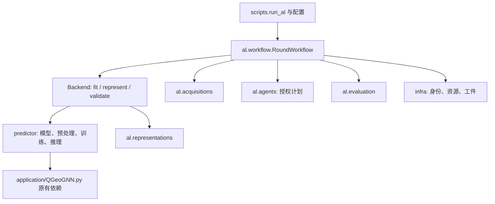

# 单一主动学习候选架构

状态：`CURRENT`。更新：2026-11-10。本页是系统设计主入口，吸收二期架构核心；完整历史验收记录见 [0e33a86d 的 NEW_ARCHITECTURE.md](https://github.com/guoscfish/column_chromatography_prediction/blob/0e33a86d3dea3945acb0a638ca78a8f5065980a5/docs/repository/phase2/NEW_ARCHITECTURE.md)。科学状态见 [NEXT_STAGE_DECISION.md](NEXT_STAGE_DECISION.md)，导航见 [README.md](README.md)。

## 一套稳定 API



| 包 | 负责什么 |
| --- | --- |
| [predictor](../src/qgeognn_al/predictor/) | 原六输出模型、图与条件输入、预处理、训练和原始推理。迁移实际实现，保持模型、loss 和训练数学定义。 |
| [al/representations](../src/qgeognn_al/al/representations/) | 授权 L/U 的 latent128、q50 全网络 CountSketch512、CW 梯度变换、fused640；绑定有序 ID、checkpoint、参数与图身份。 |
| [al/acquisitions](../src/qgeognn_al/al/acquisitions/) | Random、LCMD、MaxDet、IVR、Hybrid 纯数值核心，只接授权向量和信号，不读候选标签。 |
| [al/agents](../src/qgeognn_al/al/agents/) | 白名单、预算、唯一 ID、已提供计划与记录包；不拥有训练或 provider。 |
| [al/workflow](../src/qgeognn_al/al/workflow/) | 唯一 round 状态机、持久 freeze、有限标签揭示和恢复。 |
| [al/evaluation](../src/qgeognn_al/al/evaluation/) | 原分目标指标、Combined NRMSE、标签转换与 AULC。 |
| [infra](../src/qgeognn_al/infra/) | schema、有序/集合身份、哈希、分区、只读快照和工件。 |

[application/QGeoGNN.py](../application/QGeoGNN.py) 及其原工具仍是图/编码器实际依赖，保持原字节，没有宣称原论文工程已完全解耦。旧 v2/v3/v3_2、transfer 和专用 runner 已退出候选稳定源码，通过历史来源恢复，没有复制成 `src/legacy/`。

## 回合和恢复

`RoundWorkflow` 从当前 L 拟合，生成 validation 和 feedback，计算表示并选样，排他持久化 batch freeze，经 `LabelBroker` 揭示该批 ID 标签，提交 L/U 转移后进入下一轮拟合；达到预算后完成最终验证。schema v2 哈希信封绑定 outer seed、有效 acquisition seed、数据/划分、初始化、协议、当前拟合及有序身份。

恢复从 L0 和逐轮 freeze/reveal receipt 重建 L/U 与标签，拒绝重复 ID、越权候选、跨 seed 复用、配置/标签漂移及重算状态哈希后的标签注入。拟合与揭示各有 started/receipt：receipt 已落盘可恢复；started 存在而 receipt 缺失时阻断自动重试。工件采用独占创建、fsync、原子状态替换；哈希是完整性绑定，不是抵抗任意改写全部日志的签名认证。

`agent_plan` 只验证显式提供的 ID，不自动调用 packet builder、bound-plan adapter 或 provider。Free/CW/NoCW/V3/V3.2 在 [registry](../configs/method_registry.json) 中均为 `HISTORICAL_FROZEN`，`new_runner_adapter=false`。共用输入合同通过不证明旧 Prompt、重试、传输或随机 LLM 输出等价。

## 当前运行入口

唯一候选 CLI [scripts/run_al.py](../scripts/run_al.py) 只开放 `offline_synthetic`：

```sh
python -m scripts.run_al --config configs/offline_synthetic.json --output /private/tmp/column_al_demo
```

首次运行使用新目录；同代码身份/配置可恢复。预算2→4→6，执行完整合成生命周期。`SyntheticBackend.fit` 生成 fixture receipt，不优化权重；表示使用 latent-kind 合成向量。CLI 不加载真实数据或标签、不训练科学模型、不接受 provider。从 Git worktree 登记识别 main 并拒绝向其写输出；输出路径不能经过符号链接，macOS 使用 `/private/tmp/...`。

`QGeoGNNBackend` 有调用原训练/推理、初始化/seed 校验、checkpoint 回执、当前模型表示和验证的实际实现，但默认 `allow_training=False`，CLI 不开放。完整生产重训练及 checkpoint 选择尚未验证。`frozen_replay` 还需调用者提供 replay 后端，不是一键历史重放能力。

## 科学语义

| 组件 | 保持的合同 |
| --- | --- |
| 模型/预处理 | 历史 sequential 每轮按当前 checkpoint 重算特征。covariate normalization 来自冻结 outer-train X；目标 sigma/CW 使用 L0 标签，sketch 映射固定。中心及 fused RMS 使用当前 L。 |
| IVR | 固定原 L0+U0 reference 集合及顺序，每轮对齐当前特征，不是冻结 predictor。直接 select 省略 reference_ids 时只有当前 snapshot 顺序语义。 |
| Random | registry independent_batch / historical_sequential_fixed32 对应 per_round_choice / fixed_trajectory；逐轮 choice 与一次 U0 permutation 切片不可互换。有效 seed 显式传入，round 从0开始，末批可不足额。 |
| Hybrid | top ceil(25% U) ensemble disagreement 加 latent k-center；须提供同 seed/同 L 的真实 K3，缺失失败关闭，不自动补训。成员 checkpoint/初始化真实性由 supplier 负责。 |
| 输入/输出 | [V2 输入语义](model/INPUT_SCHEMA.md)；原始输出顺序 V1_q10/q50/q90、V2_q10/q50/q90，交叉统计前不能排序。 |

## 验证与恢复

[二期测试报告](repository/phase2/TEST_REPORT.md) 记录91项通过、五 seed 真 checkpoint/cache 对照及三个历史 LCMD 批次重放的范围，不证明整条重训练轨迹、真实 K3、LLM 输出或 AULC 改善。

[HISTORICAL_PROTOCOLS.json](repository/phase2/HISTORICAL_PROTOCOLS.json) 固定科学来源 `16eca74769f664bc378a58ccbf380a806723f587` 与一期候选 `4ee480378b0293f1985e3ee4a09df2c78f77901e`；[DELETION_PROOF.csv](repository/phase2/DELETION_PROOF.csv) 保留逐文件 blob/SHA。历史恢复使用 main 与 candidate 之外的新 detached worktree：

```sh
python tools/history_restore.py --protocol scientific_source \
  --destination /private/tmp/column_history_source \
  --output /private/tmp/column_history_verification.json
```

`phase1_candidate` 恢复一期候选，见 [工具说明](../tools/README.md)。工具只恢复源码并验证 hash/环境元数据，不加载模型或执行旧控制器。更早研究仍按自己的 BASE_COMMIT 恢复。Git 不能自动恢复忽略/未提交的原 runtime、checkpoint、请求和凭据。

工程验收从 [版本导航](repository/README.md) 进入。候选精简不授权删除或切换 main；CW-Free 完成并审计、用户授权、届时 main 消费者迁移及相应科学验证补齐后，才可正式切换。
