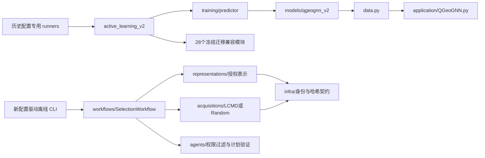

# 隔离重构候选架构

基线为 `16eca74769f664bc378a58ccbf380a806723f587`。本分支位于原仓库的受控 linked worktree，与实验运行目录共用 Git 历史，源码目录、HEAD 和 index 独立，原 main 仍承载 CW-Free；候选新增源码会改变旧 benchmark 的全目录 code hash，因此这不是旧冻结协议的可替代运行树。历史报告不重算。

## 当前调用关系与候选调用关系



| 职责 | 已落实的实现 | 边界与保留理由 |
| --- | --- | --- |
| 表示 | `representations/base.py`，`latent.py` | 预计算 latent/gradient 快照验证；冻结 predictor 的 128 维 latent 提取。严格匹配有序 L/U 身份，不接未来标签。CountSketch 生产算法暂留冻结模块。 |
| 选样 | `acquisitions/lcmd.py`，`base.py` | LCMD-TP 计算迁移为新权威实现，random 使用局部 RNG；仅接向量、身份、预算，不打开标签或 provider。 |
| 工作流 | `workflows/selection.py` | plan → durable freeze → 有限授权 reveal callback；磁盘排他写、哈希绑定、恢复、崩溃后的重复 reveal 阻断。fit/validate/feedback 暂由既有冻结工作流负责，不冒称完成全部迁移。 |
| 智能体 | `agents/plans.py` | 白名单 catalogue、合法候选 ID/预算/唯一性验证。没有新的 prompt、provider 或付费通信实现。V2/V3/V3.2 协议区别原样保留。 |
| 基础设施 | `infra/contracts.py` 与原 `artifacts.py/resources.py/partitions.py` | 新统一 provenance/序列化；原稳定功能不删、不重复制造替代实现。 |
| 评价 | 既有 `evaluation/point.py` | 保留当前 NRMSE/MAE/R²；本次没有改变评分，也没有把分位区间称为校准不确定性。 |
| 模型与数据 | 原 `models/`、`training/`、`data.py`、`schemas/`、`input_schema.py`、`application/QGeoGNN.py` | 原字节保留。未完成真实 checkpoint、缓存、初始化的完整解耦回归，不将 data.py 强改为包。 |
| 绘图 | `scripts/plot_saved_validation.py` | 从两个已结束绘图入口合并真实绘图逻辑，输入保存曲线，保留历史图语义；删除清单与合成等价证据见 retirement manifest。 |

## 迁移和兼容退出映射

`active_learning_v2/lcmd.py → acquisitions/lcmd.py`：新公共 API 自己拥有实际算法；不是旧实现的转发层。旧文件不改字节，只为冻结历史调用者保留。`active_learning_v2/coverage.py` 的 latent 提取计算迁入新表示边界；旧代码仍用于历史数值对照。退出条件均为：CW-Free 全部完成、引用协议退出、固定历史输入/检查点/选择 ID 回归与恢复演练通过、全部调用方迁移、用户在独立任务中批准 main 切换。没有永久 alias。

`benchmark_reporting.py` 仍被 benchmark/sequential 及多个报告调用，`phase1.seal_phase1()` 仍由 small-batch runner 调用并验证旧 code hash。二者未迁移或退役，inventory 已记录调用/冻结阻碍。将它们改成新工作流会改变旧封存协议，不能在此冒充等价替换。

`schemas/conditions.py` 对 `input_schema.CATEGORICAL_BOND_FEATURES` 的依赖保留。模型的图、编码器仍来自原论文 `application/QGeoGNN.py`。t1_formal/t1b1/transfer 的 28 个文件仍是原路径原字节，未另建 legacy 副本。

## 配置驱动的最小完整路径

在重构分支的工作树中运行：

```sh
OMP_NUM_THREADS=1 PYTHONDONTWRITEBYTECODE=1 python -m scripts.run_offline_selection \
  --config configs/offline_selection.synthetic.json \
  --output /tmp/column_selection_demo.json
```

输出为统一 envelope：`sha256` 绑定 `payload`，包含 code_commit、dataset_hash、split_hash、model_checkpoint_hash、protocol_hash、representation、acquisition、seed、budget、selected_ids、trace、feature_hash 和权限 provenance。当前示例的模型/数据哈希明确属于合成资源。示例保留算法基线 commit；实际执行候选 commit 另在报告和 lab lock 中绑定，避免自引用 commit hash。

本次公共 API 不依赖 lab；先前独立 lab 的完整提交已归档到原仓库 `refs/archive/column_chromatography_lab-20261109`，两个独立副本不再作为项目入口。未来需要开发新科学方法时，可按归档规程另建实验工作区登记。新 acquisition 实现纯函数，经合法候选/确定性回归验证后注册；新 representation 只生成向量和 provenance。主工作流独占后续状态变更。当前CLI不负责启动正式实验，不能通过配置打开训练或测试真值。

## 验证范围

合成固定双图、458,952 参数、5/4几何层、128维hidden、六维输出顺序、512 CountSketch 指定seed/顺序、当前loss与train-only归一化有独立测试和数值快照。LCMD/MaxDet/IVR/Hybrid 使用安全合成输入测试。真实预训练 checkpoint、全图缓存与代表性封存真实输入尚无独立授权快照，因此未执行相应新旧端到端回归；旧源码字节一致是保留边界，不是对未执行科学测试的替代声明。
