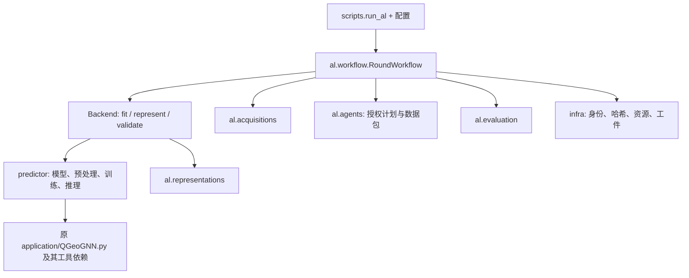

# 单一主动学习候选架构

本阶段从 `4ee480378b0293f1985e3ee4a09df2c78f77901e` 增量重构，保留科学模型的数学定义。开发目录是原仓库的独立 linked worktree：`/Users/fish/.codex/worktrees/repository-architecture-20261109/column_chromatography_prediction`。主运行目录 `/Users/fish/Documents/GitHub/column_chromatography_prediction` 继续停留 `main`，不接受本分支的自动合并、重启或路径替换。

## 维护边界



`predictor/` 迁入原六输出模型、图构造、条件归一化、训练损失和训练函数的实际实现。条件和数据模块的相对导入及仓库根定位随包层级调整，损失与训练算法未改。`application/QGeoGNN.py` 及其原有工具仍是实际依赖，保持原字节；本次没有宣称已将原论文工程完全解耦。

`al/representations/` 只生成授权 L/U 的特征：128D latent、512D q50 全网络梯度 CountSketch、CW 线性输出梯度变换、640D gradient+latent fused。提取前后核对模型与图的身份，不把候选标签带入特征图，也不向参数累积 `.grad`。快照同时绑定有序 ID、参数、checkpoint 与图来源。

`al/acquisitions/` 自己拥有 random、LCMD、MaxDet、IVR、Hybrid 的纯数值实现，只接授权向量和数值信号。没有调用旧目录的转发 wrapper。`agents/` 负责候选白名单、预算、ID 唯一性、已提供计划和记录包；不拥有训练或 provider。工作流的 `agent_plan` 只验证显式提供的 ID，没有自动调用数据包 builder 或 bound-plan adapter。方法来源和历史协议见 `configs/method_registry.json`。

`al/evaluation/` 统一原分目标/Combined NRMSE、标签转换和 AULC。AULC 显式返回原积分与归一化积分，可要求完全匹配冻结预算网格。分位数/损失诊断独立保留在 `main`，见 [SCIENCE_AUDIT.md](SCIENCE_AUDIT.md)。`infra/` 收敛工件哈希、排序集合身份与有序身份、分区、只读快照检查。快照校验拒绝目录越界、符号链接、硬链接和不匹配 SHA，不自动退回 live 数据。

## 一套回合状态机

`RoundWorkflow` 从当前 L 拟合，生成 validation 与 feedback，生成表示并选样，排他写入 batch freeze，再经 `LabelBroker` 揭示冻结 ID 的标签，提交 L/U 转移，进入下一轮拟合。达到目标预算后仍完成最终验证。输出以 schema v2 哈希信封绑定 outer seed、选样 seed、数据/划分、初始状态、协议、当前拟合和有序样本身份。

状态恢复逐轮从 L0 和 freeze/reveal receipt 重建全部 L/U 与标签，拒绝重算哈希后注入候选标签、重复 ID、跨 seed 复用、初始标签/validation/backend 配置漂移。拟合和揭示都有独立 started 与 receipt：receipt 已持久化后可安全恢复；started 存在而 receipt 缺失时拒绝自动重复有外部效果的调用。文件写入采用独占创建、fsync 和原子状态替换。哈希是完整性绑定，不是应对能任意改写所有日志的签名认证系统。

唯一 CLI 为 `python -m scripts.run_al --config ... --output ...`，当前只允许明确的合成数据配置。CLI 从 Git worktree 登记中识别 `main`，拒绝在该目录下写输出，拒绝链接输出路径。严格路径检查下应使用 `/private/tmp/...`，避免 macOS `/tmp` 的符号链接。

`SyntheticBackend` 是可重复的工程生命周期 fixture，其 fit 不训练模型，表示使用 latent-kind 合成向量。`QGeoGNNBackend` 已实现调用迁移后 `train_source`、检查初始化/种子、checkpoint 回执、当前模型表示和 validation 的真实路径，但 `allow_training=False` 为默认值；CLI 不开放此开关。本次没有执行科学训练或新增 AL 真值揭示，不能据合成生命周期宣称生产重训练数值等价。`frozen_replay` 标识仍需要调用者提供 replay 后端，未附带一键历史重放 CLI。

## 不可混淆的科学参数

| 组件 | 保持的语义 |
| --- | --- |
| 当前模型 | 历史 sequential 每轮用当前拟合 checkpoint 重算表示；三个冻结回合的 feature/cache/checkpoint 不同。没有改成冻结 L0 模型。 |
| CW / CountSketch | covariate normalization 使用冻结 outer-train X；目标 sigma、CW 变换使用 L0 标签，确定 sketch 映射固定；中心和 fused RMS 使用当前 L。 |
| IVR | 固定的是原始 L0+U0 参考 universe 的 ID 顺序；每轮按 ID 对齐当前特征。固定核选样不等于跨回合冻结 predictor。直接调用 select 而省略 reference_ids 时，仅保持当前 snapshot 的 L/U 顺序语义。 |
| Random | registry independent_batch / historical_sequential_fixed32 对应 API per_round_choice / fixed_trajectory。前者每轮对当前 U choice，后者使用一次原始 U0 permutation 与批次切片。acquisition_seed 是显式有效 seed，不自动由 outer_seed 推导；历史 sequential 映射为 outer_seed×1000003+900001，control 映射为 outer_seed×1000003+50000+c。round 从 0 开始，末批允许不足额。 |
| Hybrid | 数值核心是 top ceil(25% U) ensemble disagreement 加 latent k-center。生产后端须提供同 seed、同 L 的真实 K3 快照；缺失即阻断，没有自动训练退路。接口机器校验 seed、L hash、维度和 ID；成员初始化及 checkpoint 来源真实性仍由 supplier 负责。 |
| Free/CW/NoCW/V3/V3.2 | 全部登记 HISTORICAL_FROZEN，new_runner_adapter=false。共用输入合法性测试只证明控制契约，不证明提示词、重试、传输或随机 LLM 输出一致。 |

新假设应在临时研究工作树中验证后再晋升稳定 API。加入配置选项不能替代科学证据，离线宽度相关性不能作为 AL 效率提升的证明。

## 已退出与历史恢复

候选稳定包从 174 个 Python 文件减少到 38 个；`active_learning_v2/v3/v3_2` 从 81/11/12 个文件分别变为 0。共退出 374 个可恢复路径，其中 368 个 Python 文件、74,288 个物理源码行（含空行和注释），另有 6 个文档/配置/合成 fixture。representation/acquisition 有 9 个实际算法文件，加 2 个 base 契约共 11 个非 init 模块。非 init 纯 re-export 兼容层为 0；规范化顶层函数 AST 的精确重复组从 80 到 0，额外副本从 105 到 0。此统计不证明所有语义重复已消失。

没有将旧目录改名复制进 `src/legacy`。`t1_formal`、`t1b1`、transfer、旧 benchmark/reporting/phase1 及专用 runner 通过固定 Git 来源恢复。研究报告和 `studies/.../frozen_source` 保留为历史证据，不构成新稳定 API；其旧导入要求恢复对应历史源码，不能直接在新树执行。

| 来源 | 不可变身份 | 本次实际恢复验证 |
| --- | --- | --- |
| 科学基线 | archive/qgeognn-cw-source-20261109 → 16eca74769f664bc378a58ccbf380a806723f587 | 263 源文件、165 src/application universe、166 benchmark hashes、7 包版本 |
| 第一期完整候选 | archive/qgeognn-al-phase1-20261109 → 4ee480378b0293f1985e3ee4a09df2c78f77901e | 375 源文件、177 src/application universe、178 benchmark hashes、7 包版本 |

在候选根目录运行以下命令可恢复只含源码的独立 detached worktree（目标必须不存在且位于 main 和候选源码树之外）：

```sh
python tools/history_restore.py --protocol scientific_source \
  --destination /private/tmp/column_history_source \
  --output /private/tmp/column_history_verification.json
```

`--protocol phase1_candidate` 恢复第一期候选。工具验证完整 SHA、已存在 tag 的绑定、原始全目录 benchmark hash 与环境元数据；不加载数据/checkpoint、不导入控制器或训练入口。历史源码设为只读。更早协议须按其自己的 BASE_COMMIT 恢复，不可假定这两个来源能替代所有历史版本。逐文件恢复来源、blob 与 SHA 在 [DELETION_PROOF.csv](DELETION_PROOF.csv)；历史恢复注册表为 `HISTORICAL_PROTOCOLS.json`。

`DEPENDENCY_DAG.json` 分别记录 import、subprocess、动态字符串、hash/path 和文档引用，并提供 SCC 凝缩 DAG；原依赖存在环，不能声称原始模块图是无环图。静态扫描没有发现新稳定源码到已退役文件的剩余运行引用；任意反射和仓库外调用不在其证明范围内。

## main 切换边界

用户明确要求科学复盘留在 `main`，该分支只新增诊断目录，提交 `fcb51852c8bb6e38403fe95a302287a0a1779d47`。运行保护工具只在显式给出该完整 SHA 且证实所有变更均为诊断目录新增文件时接受它；566 个既有科学/控制源码仍逐一核对。重构分支未合并、重放或重启 CW-Free。

后续正式切换仍需 CW-Free 完成和审计、用户授权、对届时 main 新增消费者逐一迁移，以及真实生产重训练/真实 K3/LLM 协议所需的独立验证。当前候选的旧源码退出完成，不代表已授权删除或替换 main 的旧源码。
