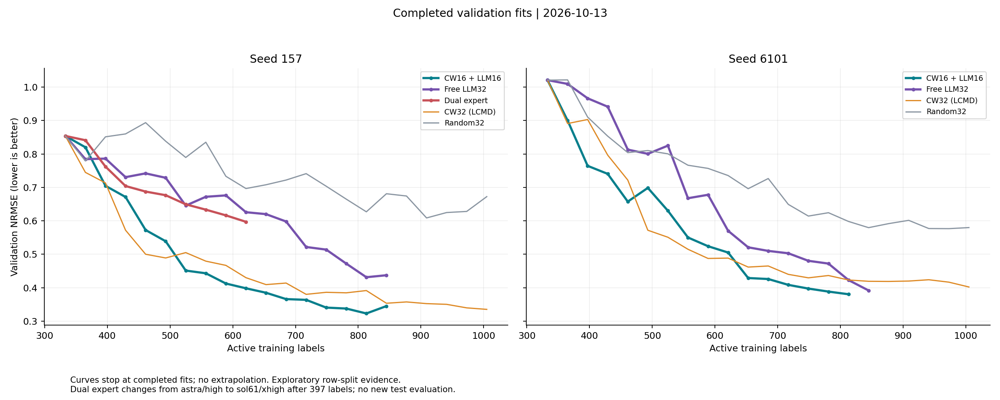
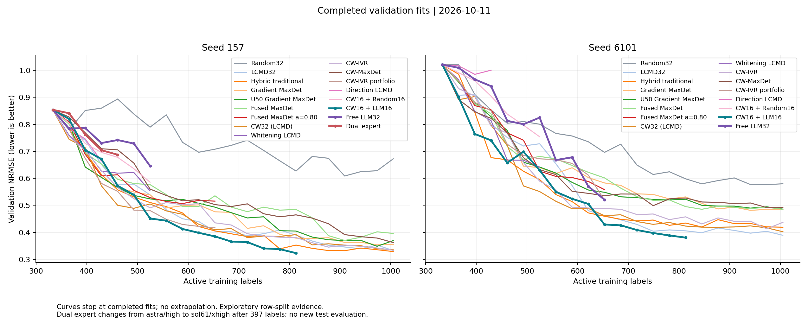

# 最新主动学习结果

快照时间：2026-10-11T23:28:59+08:00（Asia/Shanghai）。
本页统一汇总已完成的 validation 拟合；运行中的选样或未完成训练不计作结果。



## LLM 与匹配对照

| Seed | 方法 | 已完成标签数 | 端点 validation NRMSE |
| --- | --- | ---: | ---: |
| 157 | CW16 + LLM16 | 813 | 0.322792 |
| 157 | Free LLM32 | 525 | 0.645484 |
| 157 | Dual expert | 461 | 0.687444 |
| 157 | CW32 (LCMD) | 1005 | 0.335051 |
| 157 | Random32 | 1005 | 0.672336 |
| 6101 | CW16 + LLM16 | 813 | 0.380292 |
| 6101 | Free LLM32 | 653 | 0.520703 |
| 6101 | CW32 (LCMD) | 1005 | 0.401997 |
| 6101 | Random32 | 1005 | 0.579732 |

端点预算不同，不用上表直接排名。CW16+LLM16 的两个 seed 均到813；Free 的157/6101分别到525/653。双专家仅seed157，provider每日额度耗尽，493目标未完成，已停止新增调用；快照只报告已完成点；333→397使用astra/high，后续改用sol61/xhigh，并保留格式／证据修复记录。

## 相同预算比较

| Seed | 共同区间 | 方法 | 端点 NRMSE | Validation AULC |
| --- | --- | --- | ---: | ---: |
| 157 | 333–461 | CW16 + LLM16 | 0.572431 | 0.727255 |
| 157 | 333–461 | Free LLM32 | 0.741885 | 0.774777 |
| 157 | 333–461 | Dual expert | 0.687444 | 0.769474 |
| 157 | 333–461 | CW32 (LCMD) | 0.499968 | 0.676726 |
| 157 | 333–461 | Random32 | 0.893673 | 0.841025 |
| 6101 | 333–653 | CW16 + LLM16 | 0.428822 | 0.669513 |
| 6101 | 333–653 | Free LLM32 | 0.520703 | 0.804191 |
| 6101 | 333–653 | CW32 (LCMD) | 0.461569 | 0.666688 |
| 6101 | 333–653 | Random32 | 0.696075 | 0.831658 |

AULC为梯形积分除以该共同区间长度，越低越好。不同seed／区间之间不可直接排名。

## 其他传统策略



CW-MaxDet/CW-IVR两seed均完成1005；Whitening按要求停525。原333–525确认门槛与1005探索性扩展分开解释。

## 证据与复现

[snapshot.json](snapshot.json)保留完整曲线、拟合摘要与原始文件SHA-256。checkpoint、完整请求和训练缓存仍在本地忽略的runtime目录；新克隆可直接读取或重绘快照。

```bash
python scripts/report_active_learning_snapshot.py --from-snapshot reports/active_learning_latest/snapshot.json
```

报告不打开测试真值、不训练、不调用LLM。两seed及历史修复后的曲线属于探索性开发证据，不能识别化学知识或额外模型调用的独立因果贡献。
