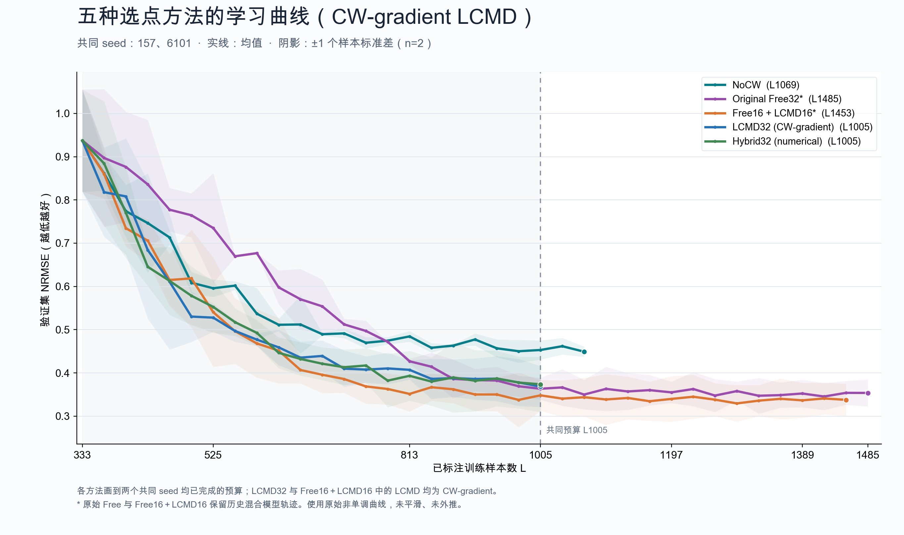

# Five-method validation comparison with CW-gradient LCMD



The figure uses the same two available seeds, 157 and 6101, for all five methods. Lines show the mean saved validation NRMSE; bands show one sample standard deviation (`ddof=1`). Lower is better. The full raw, nonmonotone curves are retained without smoothing or extrapolation.

| Method | Common completed endpoint for these two seeds |
|---|---:|
| NoCW | L1069 |
| Original Free32 | L1485 |
| Free16 + CW-gradient LCMD16 | L1453 |
| CW-gradient LCMD32 | L1005 |
| Numerical Hybrid32 | L1005 |

All five methods share L333–L1005. Endpoints with different budgets are not a matched-budget ranking. The LCMD32 curve is the center/width-gradient version, distinct from ordinary q50-gradient LCMD. Historical Free32 and Free16 + LCMD16 retain their mixed-model trajectories.

`validation_curves.csv` contains per-seed values and fit-audit provenance. `mean_curves.csv` contains the displayed mean and sample standard deviation. `snapshot.json` records source hashes, endpoints and audit checks. This figure is separate from the currently running CW-visible Free32 rerun. Only saved validation summaries and freeze metadata were read; no test truth, model calls, or new fits were used.

The superseded ordinary-gradient figure directory was removed at the user's request. Its six file hashes and sizes are retained in `cleanup_manifest.json`; all experiment runtime artifacts remain intact.

Reproduce with the original local saved fits, using a new output directory:

```sh
MPLCONFIGDIR=/tmp/cw_five_methods_matplotlib OMP_NUM_THREADS=1 OPENBLAS_NUM_THREADS=1 MKL_NUM_THREADS=1 \
  python scripts/studies/plot_five_methods_cw_gradient_20261103.py --output reports/<new-figure-directory>
```

The published CSV, PNG, SVG and PDF files can be read without the local runtime.
