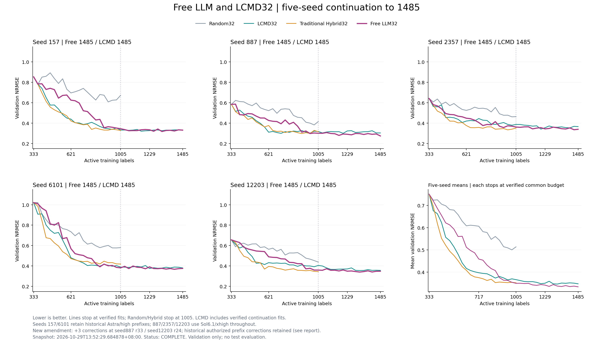

# Free LLM32 与 LCMD32：五 seed 最终结果

采集时间：2026-10-29T13:52:29.684878+08:00。状态：COMPLETE。
目标为每条1485训练标签（初始333 + 36批×32，37次拟合）；已完成10/10条，还剩0次拟合。

| Seed | Free标签 | Free validation NRMSE | LCMD标签 | LCMD validation NRMSE |
| --- | ---: | ---: | ---: | ---: |
| 157 | 1485 | 0.331755 | 1485 | 0.330408 |
| 887 | 1485 | 0.274699 | 1485 | 0.304093 |
| 2357 | 1485 | 0.339940 | 1485 | 0.366228 |
| 6101 | 1485 | 0.375767 | 1485 | 0.380761 |
| 12203 | 1485 | 0.348263 | 1485 | 0.356421 |

五seed共同预算1485：Free平均NRMSE 0.334085 ± 0.037097，LCMD 0.347582 ± 0.030467（均值 ± seed间样本标准差）。Free比LCMD低0.013497，相对LCMD低3.88%。

全程333→1485标签的平均归一化曲线面积：Free 0.439159，LCMD 0.417049（越低越好）。端点误差与整个采样过程的效率应分别比较。



## 实现与证据范围

LCMD续跑使用冻结的原梯度特征实现，512D CountSketch、q50输出梯度和corrected LCMD-TP；沿用原初始化、validation划分、batch32及训练规则。特征源码副本与原git8081e86一致，不采用当前源码后来新增的变换。见[扩展manifest](lcmd/extension_manifest.json)及[冻结源码](frozen_sources/gradient_features.py)。

Free的157/6101保留历史Astra/high前缀，887/2357/12203使用gpt-6.1-sol/xhigh。887 r33与12203 r24有显式授权的额外3次逻辑纠正；原失败回执保留，其他科学规则不变。见[amendment](free/continuation_amendment.json)。

历史前缀还保留157 r5、6101 r0/r19各一次已授权的额外纠正，以及157 r5的一次已授权ID抄写修正；这些例外均有原始回执，本次没有新增调用或修正。见[历史授权记录](../llm_eight_to1549_20261018/historical_protocol_deviations.json)。

只画完成且冻结的拟合点。Random/Hybrid五seed只到1005，不外推。这些是validation开发轨迹，没有新增test评价，validation指标不进入selector，标签在批次冻结后揭示。

## 全训练集参考与平台期

固定五seed、同初始化与416条validation下，3330标签全训练集参考平均NRMSE为0.325433；LCMD1485为0.347582，相差0.022149（相对全量约6.81%）。LCMD从1357到1485只改善0.003371；后段收益放缓，但这不等于已达到全数据性能。参考值来自既有冻结fit audit，没有重新训练或读取test真值。见[逐seed比较](analysis/full_reference_validation_comparison_20261028.json)。

## 重绘与复现

从仓库根目录运行：

```bash
python scripts/report_free_lcmd.py
python scripts/report_free_lcmd.py --from-snapshot reports/free_llm_five_seeds_to1485_20261024/figures
```

第一条读取本地runtime并核对冻结拟合、预测和批次哈希；第二条仅从Git保留的数值快照重绘。新克隆不包含检查点、逐fit预测和训练缓存，因此离线重绘不等于重新完成runtime完整审计。本轮已使用`--require-complete`完成全部十条37拟合/36批次核验；逐条最终审计与图表核验见[最终核验记录](final_audit.json)。

历史监控入口`reports/free_llm_five_seeds_to1485_20261024/plot_frozen_results.py`保留为兼容转发，绘图实现统一在`scripts/report_free_lcmd.py`。原阶段协议与失败回执保持原路径。
