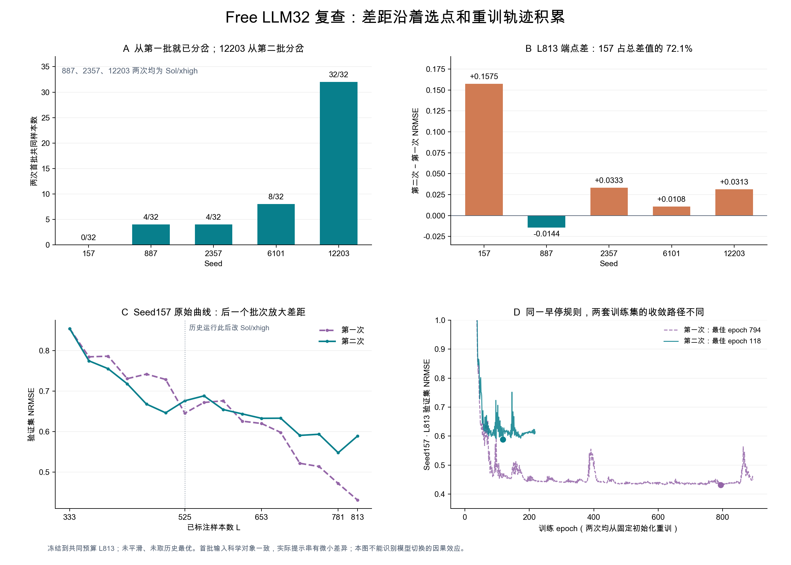

# 两次 Free LLM32 运行审计 · 2026-11-03

结论：历史中途切换那一步，确实只改了模型及推理强度；但现在比较的两条曲线，是从 L333 重新选点产生的两条轨迹，并不是共享同一个前缀的模型消融实验。现有记录支持“选择、自由文本记忆与重训路径逐轮分岔”，不能把 L813 的 10.5% 端点差归因于一次模型切换。

本报告固定比较共同预算 L333–L813，五 seed 均为 157、887、2357、6101、12203。运行绑定核验截止当前 87 个已接受且完成训练的批次（15、20、19、17、16）。报告只使用已保存的请求、回执、选中点快照、训练元数据及验证指标；未调用新 API、训练或读取未选标签及测试真值。运行文件、冻结科学源码及 NoCW 未修改。

## 1. 当时的模型切换与这次重新运行，是两个不同问题

历史 `free_sol_xhigh_continuation_20261012/transition_manifest.json` 与切换脚本证明：模型从 Astra 改为 Sol，reasoning effort 从 high 改为 xhigh；prompt 哈希相同，继承的 319 个前缀文件哈希通过。当时确实保留旧轨迹继续运行。

第二次实验则从各 seed 相同的 L333 checkpoint、相同科学输入对象与候选目录重新请求选点，科学记忆重新由自身历史积累。历史 seed157 的 Astra/high 前缀至 L525，之后首次 Sol 选点为 L525→557；6101 的 Astra/high 前缀至 L653，首次 Sol 选点为 L653→685。其余三 seed 历史和本次均为 Sol/xhigh。

| Seed | 第一批两次共同点数 / 32 | 第一次分叉 | 到 L813 新增480点的交集 | L813 第一次 NRMSE | 第二次 | 第二次−第一次 |
|---|---:|---|---:|---:|---:|---:|
| 157 | 0 | L333→365 | 222（46.3%） | 0.431253 | 0.588739 | +0.157486 |
| 887 | 4 | L333→365 | 168（35.0%） | 0.408794 | 0.394385 | −0.014409 |
| 2357 | 4 | L333→365 | 224（46.7%） | 0.384308 | 0.417583 | +0.033275 |
| 6101 | 8 | L333→365 | 205（42.7%） | 0.422698 | 0.433474 | +0.010776 |
| 12203 | 32 | L365→397 | 260（54.2%） | 0.433036 | 0.464312 | +0.031276 |

887、2357 两次模型名相同、初始科学输入相同，第一批也仅有 4/32 点重叠。因此模型切换不是轨迹分叉的必要条件。API 请求均未设置采样 seed、temperature、top_p 或其他确定性参数；外层 seed 固定数据划分和本地训练，不能使 LLM 选点可复现。供应商内部的路由和采样不能由客户端回执验证。

## 2. 同批数据、同模型文件，仍会因解释记忆分岔

seed12203 是最有解释力的自然对照：两次第一批有序 ID 完全相同，L365 重训后的 checkpoint 字节 SHA 也相同。下轮请求的候选预测、CW 分位、已测数值、候选/observed/schema/counts 均相同，差异仅在 memory 及其派生 packet 哈希。

memory 的已选 ID、反馈预测、测量值和误差相同，但上轮 LLM 自由生成的理由、假设引用及解释文本不同，旧的假设为 3 条，新的为 4 条。下一批只剩 8/32 点相同。这里没有更换记忆结构或重置记忆；自由文本本身就是后续选择器输入的一部分。

证据：[同 checkpoint 下轮 packet 差异及87对训练元数据](code_protocol_audit.json)，字段 `same_checkpoint_next_packet_seed12203_round01`；记忆构造见仓库 `src/qgeognn_al/active_learning_v2/scientist_selector.py:350`。

这支持一个反馈机制：自由生成的假设和选点不同 → 新增标签及重训预测不同 → 记忆与下一轮输入进一步不同。它不证明哪个单独因素占多少因果贡献。

## 3. 确实还存在模型以外的接口差异

两次科学对象相同，并不代表请求字节完全相同。五 seed 的历史首轮 messages/config 重建哈希均与当时回执匹配，已排除只是落盘格式造成的假差异。

| 项目 | 历史运行 | 第二次运行 | 当前记录能说明什么 |
|---|---|---|---|
| 系统 prompt | 包含 Pending-CW 句 | 删除该句47字符，7869→7822字符 | 实际文字差异；其余相同，整个本次运行 prompt 固定 |
| 首轮 user JSON | 原顶层键顺序 | 顶层键顺序不同 | 值、候选行顺序、嵌套字段顺序、packet SHA 全同，但实际 token 串不同 |
| 输出上限 | 未显式传入 | max_output_tokens=32768 | 真实参数差；共同 L813 内未观察到触顶的接受答复 |
| 字段校验 | validate_direct | 另加正向字段白名单 | 当前没有因新增白名单而拒绝的答复 |
| 格式纠错 instruction | 旧纠错文案 | 新纠错文案 | 已完成87轮内实际经历81次拒绝，纠错链参与了轨迹 |

代码：`scripts/studies/run_free_cw_sol61_five_20261101.py:96–127`（prompt/输入/白名单）；历史 `scientist_transport.py:259–277,438–476`；本次 `nocw_study.py:273–293` 与冻结 `run_qgeognn_v2_row_llm_nocw_stream.py:79–82`。

87批共168个完整逻辑答复，其中87个最终被接受，81个被校验拒绝；另有尚未冻结轮次的23个已完成纠错答复，不能算接受批次。全目录104份拒绝按错误类型为64非法候选 ID、24 packet 哈希、15未观测证据、1假设数量；白名单拒绝为0。

本次87个被接受答复最多25,483 output tokens；包含上述纠错在内168答复最多29,377，均低于32,768。历史共同L813前75个被接受答复最多24,220，也低于32,768。历史全程有一份被接受答复为35,275，发生于 L941→973，属于后续比较应保留的配置限制，不能解释目前L813差距。未触顶只能说明没有已存完整答案硬截断的证据，不能证明参数对内部生成过程绝对无影响。

## 4. 未发现训练协议、尺度或产物错绑导致差距

审计覆盖8份历史 revision 的源码 pin；每份125或160个共同源码 SHA 与本次冻结副本相同，唯一差异为 `resources.py` 的 ROOT 路径绑定，仍指向原仓库数据。另核验当前263个冻结源码与26项授权源码绑定。

已完成87对对应预算训练的完整 training_config、normalization、preprocessing、输入 schema、初始化哈希、验证集 ID、参数数量、测试真值隔离记录均匹配；checkpoint 哈希绑定通过。共同L813的160个fit点（两次×5seed×16预算）另核验了 best.pt、预测文件、最佳epoch指标；150批冻结文件哈希通过。

V1/V2 NRMSE 的分母固定为L333标签的总体标准差（ddof=0）；CW的 s_C/s_W 也固定于L333。没有逐轮重估分母造成曲线不可比。训练固定CPU、2线程、初始化及epoch shuffle种子。12203相同首批得到字节相同checkpoint是实证，但本审计不宣称任意硬件环境下绝对确定性。

87批 memory 与已保存 feedback 重建一致；每批均32个合法点，跨轮无重复。46,429个 batch_freeze 引用、522个训练完成产物引用匹配。168个完成答复均声明 gpt-6.1-sol/xhigh、相同配置哈希，实际请求packet与 input.json 逐对象相等。没有发现本地截断、成功回执被重试覆盖、旧模型错用、重复训练结果冒充新结果或记忆清零。

历史157第6批有一次经明确授权的单字符ID转录修复，源响应为Astra；保留该偏离记录，不能继续笼统标作未知模型。

## 5. 为什么图上的差距显得很大

共同L813，第一次/第二次五seed均值为0.416018/0.459699，相差+10.50%；样本标准差为0.020150/0.076485。配对差均值0.043681，样本标准差0.066466。完整原始非单调曲线的归一化梯形 AULC 为0.562556/0.581260，只差+3.32%。因此端点与整个学习过程呈现的差距并不相同。

157贡献五seed端点总差的72.1%。最后一个批次（L781→813），第二次0.547750→0.588739，第一次0.471874→0.431253，两边同时涨跌使157的差值由0.075875扩大到0.157486。157自身整段AULC差仅0.012283。

该轮两次从同一初始化重训、应用相同早停规则，但训练集已不同，记录的优化路径也不同：第一次最佳epoch794、训练894epoch；第二次最佳epoch118、训练218epoch。后者不是因运行中止而缺少训练；它按相同100epoch patience正常停止。无法从已停止的曲线断言继续训练一定会恢复，也不应为改善结果事后修改早停协议。

选点快照也显示实际策略不同。157最后这批，第一次强调固定loading下的溶剂配对、最近已测失败的局部修复；第二次更偏广结构与条件覆盖。独立SMILES20→28，纯EA条件点1→10。当轮CW top20%点14→3。用两次共同的L333冻结预测器统一参照，旧/新两批预测C均值20.37/10.61mL、W均值14.20/7.03mL、CW平均分位71.94%/47.87%，区域差异依然存在。这里统计的是冻结预测和条件，不能据此认定真实标签价值更低。

累计480个新选点，五seed第二次均选更多纯EA(0/1)、更少弱洗脱(50/1)条件；这是跨seed的一致选择分布迁移。但三个全程Sol seed也同方向，不能把迁移唯一归因Astra→Sol。证据见 [选中点分布](selected_profiles.json)、[累计分布](cumulative_selected_profiles.json)、[共同预测器参照](seed157_shared_predictor_geometry.json)。

## 6. 结果应该怎样解释

现在的比较应称“历史Free轨迹与新的Sol/xhigh Free轨迹比较”。它表明本次到共同L813暂时较差，主要由157端点波动放大；不能证明模型切换导致10.5%损失，更不能认定训练或重试程序坏了。

要估计模型切换本身的影响，需要从同一个冻结前缀分叉，保持prompt字节、序列化、输出限制、纠错校验、记忆和训练预算一致，按预先规定的独立重复比较。现有两条运行不具备这种因果隔离条件。本次审计没有启动额外收费实验，原已授权运行继续保留冻结协议。

## 复核文件

- `trajectory_audit.json`：两次共同预算的逐轮ID、模型回执、checkpoint、指标与重叠。
- `code_protocol_audit.json`：源码pin、请求语义/字节差异、87对训练元数据、12203记忆对照。
- `runtime_binding_audit.json`：当前87批请求、记忆、冻结与完成绑定。
- `output_usage_audit.json`：两代输出token及接受/纠错统计。
- `seed_summary.csv`：逐seed共同预算结果。
- `checks/`：只读核验脚本的审计版本；从仓库根运行，结果写入`/tmp`，不调用API或训练。对应科学产物已冻结，后续运行可能令活动轮次统计增加。
- `audit_evidence.png/.pdf/.svg`：静态证据图。绘图脚本 `scripts/studies/plot_free_rerun_audit_20261103.py`。
- `manifest.json`：本审计文件字节哈希；报告不是选点输入或记忆。
