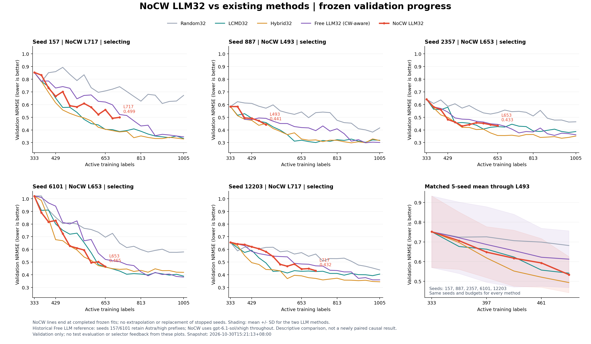
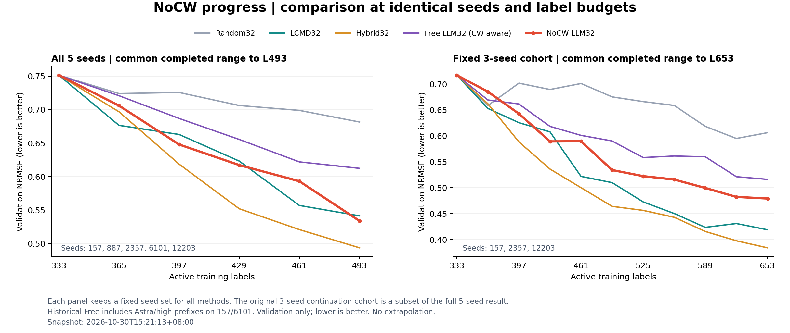

# NoCW 五种子进度与历史策略对照

结果快照：**2026-10-30T15:21:13+08:00**。这是运行中的 validation 进度记录，目标为五个 seed 各 L1005。每条曲线只到已完成并冻结的拟合；网络活动、完整答案、批次冻结和训练完成分别核对。

## 已完成结果

| Seed | 已完成训练标签 | 已冻结新增批次 | Validation NRMSE ↓ |
| --- | ---: | ---: | ---: |
| 157 | 717 | 12 | 0.499282 |
| 887 | 493 | 5 | 0.440922 |
| 2357 | 653 | 10 | 0.433178 |
| 6101 | 653 | 10 | 0.464669 |
| 12203 | 717 | 12 | 0.431980 |

快照核验时五个 worker 均存活并持有对应 seed 锁，监督器继续运行。五个 seed 都尚未到 L1005。以上预算来自 prediction freeze 与 fit audit；连接/生成状态不计为新增结果。seed12203 的 L717 拟合已完成。



## 相同 seed 与预算比较

五 seed 共同完成到 **L493**。右图固定保留首份快照中的三个连续运行 seed（157、2357、12203），共同到 **L653**；该子集不能代替五 seed 汇总，成员不按误差或当前进程状态选择。



| 方法 | 五 seed，L493 均值 ↓ | 固定三 seed 子集，L653 均值 ↓ |
| --- | ---: | ---: |
| Random32 | 0.681563 | 0.606220 |
| LCMD32 | 0.541467 | 0.418919 |
| Hybrid32 | 0.493810 | 0.384088 |
| Free LLM32（含 CW 信息） | 0.612405 | 0.516173 |
| NoCW LLM32 | 0.533961 | 0.479195 |

五 seed 在共同 L493 的 NoCW 均值为 0.533961，低于历史 Free（0.612405）和 LCMD（0.541467），高于 Hybrid（0.493810）；固定三 seed 子集在 L653 仍高于 LCMD / Hybrid。不同子集与预算分别解释，不能据此作最终优劣判断。历史 Free 的 seed157/6101 含 Astra/high 前缀，NoCW 全程 gpt-6.1-sol/xhigh，因此本图是描述性历史对照，不能单独识别移除 CW 信息的因果效果。阴影为两个 LLM 方法的 seed 间样本标准差。未外推、未填补未完成点。

## 续跑与审计边界

当前控制器为 `scripts/studies/run_qgeognn_v2_row_llm_nocw_resume_2357.py`，监督原 stream、原 resume 及新 resume_2357 worker。每 seed 独立凭据，endpoint、模型、effort、候选池和选点校验保持冻结设定。完整有效响应先落盘；持续网络重试使用原退避 30/60/120/240/300 秒后保持 5 分钟，不重置编号或删除 started/ledger。

2026-10-30 用户要求“帮我继续跑”后，先为 **seed887 round03、seed6101 round08** 各追加三个纠错答案，总上限六；同日 seed2357 round10 的三答案因非法/重复候选 ID 与数量/结构错误耗尽，用户再次明确批准“仅此轮追加 3 个答案并续跑”。最新适配器只为 **seed2357 round10** 追加三答案，并保留前两项授权；其他轮次仍为三。旧失败、答案和拟合全部保留；此授权不是全局增加纠错额度。v2 修订已取代未启动的 v1 草案，草案保留作来源记录。

全部五 seed 到 L1005 且轨迹冻结后，必须经最新 resume_2357 适配器离线 `activate(); validate(); retry.report(1005)` 生成最终 validation 报告。直接用旧三答案入口会遗漏此次授权例外。

本次图表只读既有 fit audit、checkpoint/hash、训练 history 中已保存的 validation 分数，以及 selection freeze / feedback；不新增训练、推理、LLM 调用、标签揭示或 test 评价，未将评价结果用于选点。

## 文件与复现

- [summary.json](summary.json)、[validation_curves.json](validation_curves.json)：端点与全部绘图值。
- [progress_snapshot.json](progress_snapshot.json)：对应时间的进程、锁、传输状态及请求计数；不是实时看板。
- [fit_audits.json](fit_audits.json)、[source_audit.json](source_audit.json)：本次使用的拟合元数据与原文件 SHA。
- [resume2357_receipt.json](resume2357_receipt.json)：本轮追加授权、原十轮拟合复用、新 worker 与其他四个 PID 保留的核验记录。
- [snapshot_manifest.json](snapshot_manifest.json)：本次纳入 Git 的 49 个已冻结批次、1532 个选择/尝试/失败/反馈等证据文件及哈希。
- PNG/PDF/SVG 各保留两组。完整请求、SSE原始事件日志、检查点与运行缓存继续保存在本地忽略目录，Git 快照不构成可独立重跑的完整运行包；密钥不进入仓库。

有本地运行依赖时，从仓库根目录执行：

```bash
KMP_DUPLICATE_LIB_OK=TRUE /Users/fish/miniforge3/envs/fish/bin/python scripts/studies/run_qgeognn_v2_row_llm_nocw_resume_2357.py validate
KMP_DUPLICATE_LIB_OK=TRUE /Users/fish/miniforge3/envs/fish/bin/python reports/nocw_progress_20261030/plot_comparison.py
```

重绘只更新图与数值 JSON；本文固定为本次 Git 快照。新克隆可直接读取已提交图及曲线 JSON。冻结批次上传不会搬动或中断正在运行的任务。

## 修订哈希附录

原协议 SHA-256：`fbf5bf0e7d4e304d11d0afdab2eb09bf1833ddbe1a604e3889159fdca50ea89a`。

| 修订文件 | SHA-256 |
| --- | --- |
| `persistent_retry_amendment.json` | `2b3c1b62057a6015deb7871bda21cd498dd53e2dfeaceaa086208c777939fc60` |
| `stream_transport_amendment.json` | `beb59766429506b118c125c306a006f518839628653c022455cbefc8cd16baeb` |
| `correction_resume_amendment_20261030.json` | `7fb26b9001d6a2c063f5176150ef43c5ae1d4255beb922c406049ec7e09f23e6` |
| `correction_resume_amendment_20261030_v2.json` | `2335406b512ec9bb963cc1ec4743727116fdede4f6901aed2546330243304375` |
| `correction_resume_seed2357_round10_20261030.json` | `dd66a60a7fc93b51a021bfcfad7dbdbabdf2e87b7e03ea976bb765d4f3f67fab` |

相关研究：[Free / LCMD 五种子最终报告](../free_lcmd_five_seeds_to1485_20261026/REPORT.md)、[机制诊断](../../studies/active_learning/free_lcmd_mechanism_diagnostics_20261029/README.md)、[Hybrid loading-cap 审计](../../studies/active_learning/hybrid_loading_cap_audit_20261029/README.md)。后两项仅离线分析，loading-cap 阶段B已按原证据门暂停。
