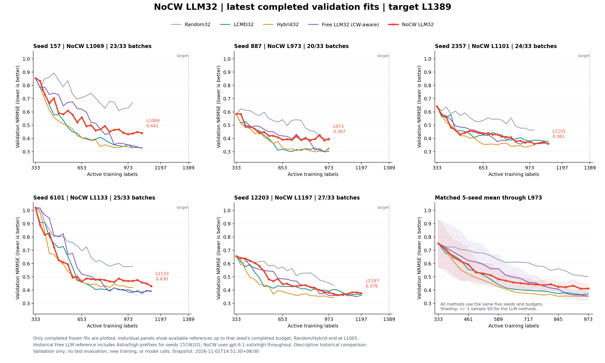
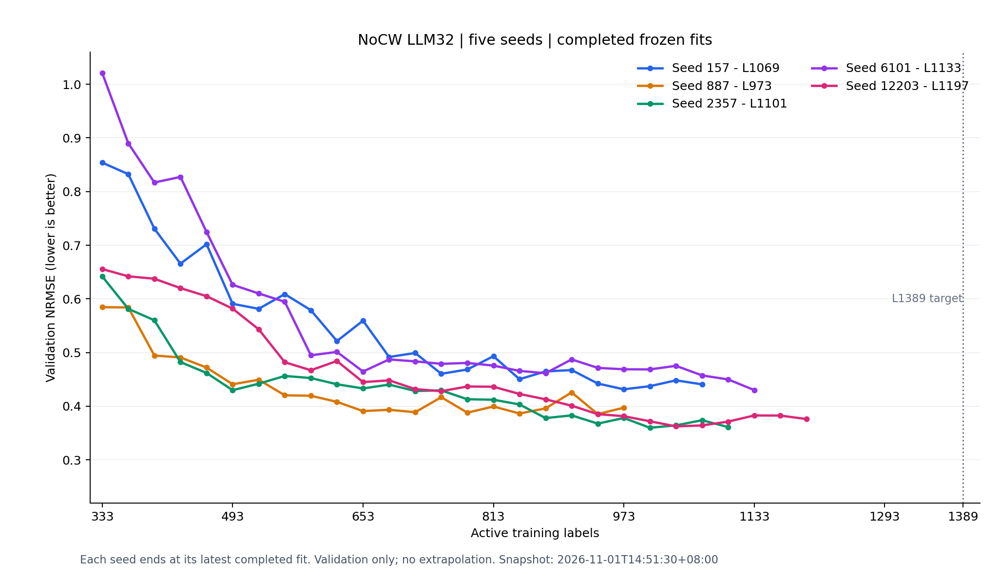

# NoCW 五 seed 最新验证结果（目标 L1389）

快照时间：2026-11-01T14:51:30+08:00（北京时间）。运行核验时间：2026-11-01T06:50:00.443557+00:00。

五个 worker 均经实际进程与持锁检查，继续运行到 L1389。该快照中五个 worker 均在接口退避重试；重试不计入有效采集进展。L1389 尚未完成，本目录为阶段结果。

| Seed | 已完成拟合到 | 已完成批次 | 最新验证 NRMSE |
|---|---:|---:|---:|
| 157 | L1069 | 23/33 | 0.440742 |
| 887 | L973 | 20/33 | 0.397353 |
| 2357 | L1101 | 24/33 | 0.361223 |
| 6101 | L1133 | 25/33 | 0.430154 |
| 12203 | L1197 | 27/33 | 0.376196 |

指标为每轮已保存最佳 checkpoint 对应的 `validation_selection_score`，越低越好。曲线只使用存在 prediction freeze 且通过 checkpoint、prediction、训练 ID、初始化及验证集 ID 哈希核对的已完成拟合；共 119 个有效采集批次、124 个预测冻结（含五个初始模型）。

所有方法的五 seed 均值只比较共同完成的 L973：NoCW 0.411480，Free LLM 0.354404，Hybrid 0.354505，LCMD 0.369898，Random 0.500483。没有对尚未完成的轮次外推，也没有将不同 seed 数目的后段均值拼接。现有 Random/Hybrid 参照最多至 L1005；LCMD/Free 参照按对应 seed 当前完成预算截取。

此处为历史对照的描述性比较：Free LLM 的 seed 157/6101 保留 Astra/high 旧前缀；NoCW 全程使用 gpt-6.1-sol/xhigh。不能据此单独作严格配对的因果结论。

## 审计与复核

- 新旧入口 validate、原阶段审计和延长段审计均通过；原协议与全部 12 项修订 SHA 保持一致。
- `fit_audits.json` 保存拟合元数据，`accepted_batch_index.json` 保存已完成批次 ID 与冻结哈希；导入的旧前缀仅计一次。
- `physical_attempt_index.json` 记录原阶段物理 attempt 和延长段 round >=21 的终结记录哈希，支持三位及以上 attempt 编号，不重复统计复制的旧请求。
- `source_audit.json` 保存曲线源文件哈希；`amendment_index.json` 保存原协议与修订索引；`progress_snapshot.json` 保存本次实际进程核验与旧 L1005 里程碑哈希。
- 本次发布不调用模型、不重新训练、不读取测试真值，不将图表反馈用于采集。
- 完整输入、原始响应和本地模型运行目录继续按仓库运行数据规则保留本机；本次提交发布聚合曲线、元数据、冻结哈希、入口代码与修订，不修改任何原始 lineage。

本机已有全部冻结运行数据时，先运行新旧入口 validate 和监控审计，再依次执行本目录 `plot_latest.py`、`export_snapshot.py` 更新阶段快照。全部五 seed 达到 L1389 后另由新入口 report 生成最终报告；本快照不替代最终报告。
