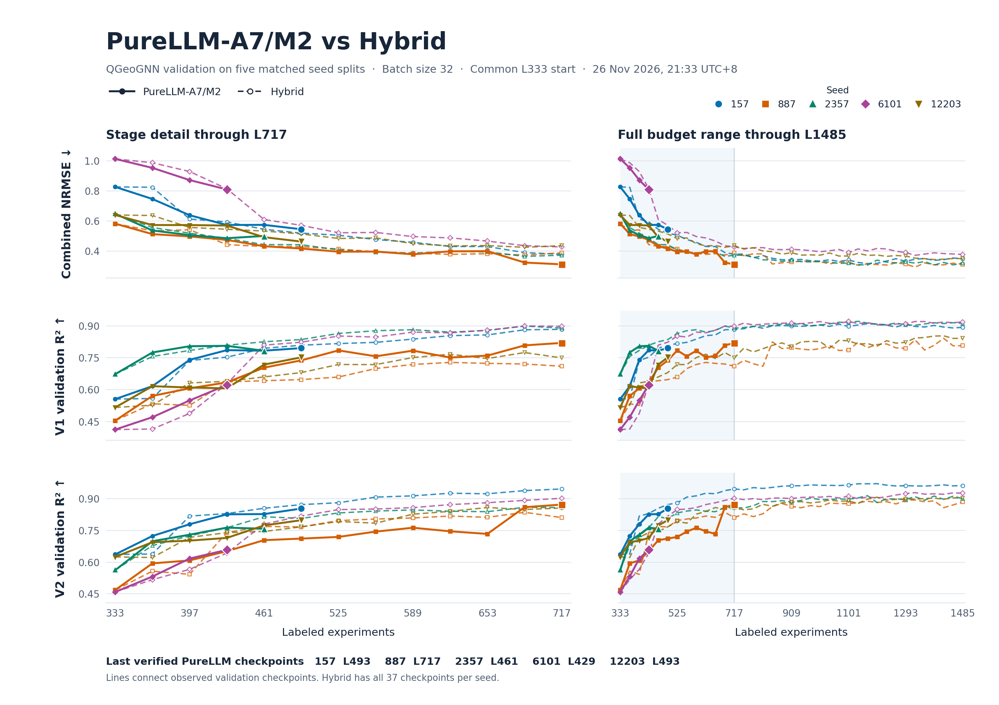

# PureLLM-A7/M2 与 Hybrid 五 seed 阶段对比

验证数据快照的核验时间为北京时间 2026 年 11 月 26 日 21:33:26。PureLLM 已完成 29 轮 CUDA 训练，记录了 928 条冻结选点及其理由。Hybrid 为正式 CUDA Uncertainty + Diversity Hybrid32，五条轨迹均已到 L1485。

两种方法在每个 seed 上共用同一份 L333 CUDA checkpoint、验证划分和 QGeoGNN 训练协议，每轮新增 32 个实验。图中数值来自各预算选定 checkpoint 的验证记录。左侧放大截至 L717 的阶段性曲线，右侧展示完整预算范围。实线止于各 seed 最后一次已完成的 PureLLM 训练。颜色和标记配对同一个 seed。 [L333 配对核验](paired_l333_anchor_receipts.json) · [Hybrid 正式归档](../eit_cuda_three_methods_20261124/README.md)



## 同预算配对

| Seed | PureLLM 已完成轮次 | 最新预算 | PureLLM 验证 NRMSE | 同预算 Hybrid NRMSE | 差值 |
|---:|---:|---:|---:|---:|---:|
| 157 | 5 | L493 | 0.5441 | 0.5183 | +0.0258 |
| 887 | 12 | L717 | 0.3106 | 0.3874 | -0.0768 |
| 2357 | 4 | L461 | 0.4995 | 0.4420 | +0.0576 |
| 6101 | 3 | L429 | 0.8089 | 0.8138 | -0.0049 |
| 12203 | 5 | L493 | 0.4620 | 0.5130 | -0.0510 |

差值为 PureLLM 减 Hybrid，NRMSE 越低越好。五个 seed 当前均覆盖到 L429，该预算处的平均验证 NRMSE 为 PureLLM **0.5816**、Hybrid **0.5752**。

## 数据和选点

- [PureLLM 验证指标](purellm_validation_curves.csv) 包含 5 个初始检查点和 29 个后续训练点。`round=0` 对应共享 L333，`acquisition_round=0` 对应首次选点和 L365 训练。 CSV 保留每个指标文件和 checkpoint 的摘要。 [PureLLM 逐文件清单](purellm_export_manifest.json)
- [Hybrid 验证指标](hybrid_validation_curves.csv) 共 185 个检查点。 [来源和校验记录](hybrid_validation_receipts.json)
- 每个 seed 的 JSONL 每行对应一个已冻结并完成训练的轮次，保留模型给出的理由、引用和选点顺序。 [157](selections/seed_157_accepted_rounds.jsonl) · [887](selections/seed_887_accepted_rounds.jsonl) · [2357](selections/seed_2357_accepted_rounds.jsonl) · [6101](selections/seed_6101_accepted_rounds.jsonl) · [12203](selections/seed_12203_accepted_rounds.jsonl)

## 复现图

使用 Python 和 Matplotlib 3.10.8，在本目录运行以下命令。

```bash
python plot_stage.py --snapshot '26 Nov 2026, 21:33 UTC+8'
```
