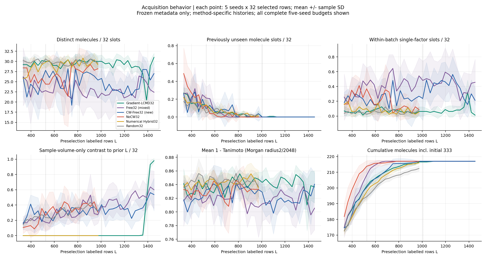
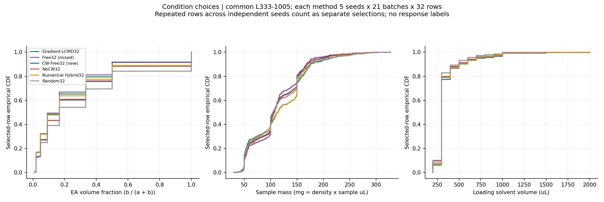
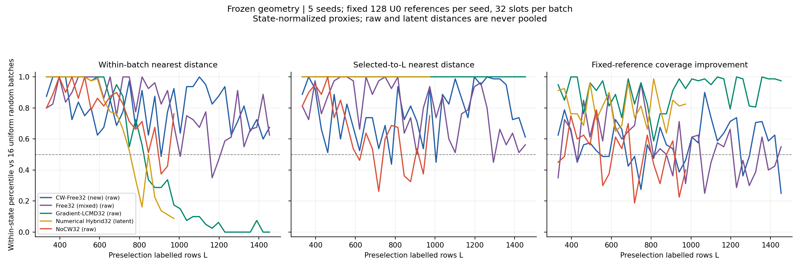

# 选点行为画像：完整 CW-Free 轨迹的再检验

本分析将最新 CW-Free 的 **180 个接受并完成训练的 batch** 加到历史行为基线上；不把旧 Free/NoCW 的诊断重新命名为新结果。新增的最重要认识是：旧报告中“中期 NoCW 相对 Free 明显损失局部对照与几何覆盖”的现象，**并未在最新 CW-Free 与 NoCW 的比较中同样出现**。CW 可见性、历史模型前缀、运行日期和状态均不同，历史对照不能隔离 CW 的因果作用。

## 输入、时间顺序与口径

- 行为总表共 **873 批、27,936 个采集名额**：新 CW-Free 180、历史混合模型 Free 180、Gradient-LCMD 180、数值 Hybrid 105、NoCW 123、Random 105。一个名额表示一个 `(method,seed,round,row ID)`；跨 seed 的相同 row 不作为全局唯一实验。
- 六法共同五 seed 完成范围为 L333–1005（每法 105 批）；CW-Free、历史 Free、Gradient-LCMD 可继续比较到 L1485（每法 180 批）。NoCW 超过 L1005 的 18 批仅保留逐轨迹数据，不与完整第四阶段做五 seed 均值比较。
- 旧 `nocw_free_selection_diagnostics_20261101` 的 584 批条件指标和 883 个空间结果直接复用，记录其文件 SHA；新算 CW 180 批、后续 NoCW 4 批与 Random 105 批的条件指标，并对全部 873 批新增结构指纹指标。新算几何 **368 行**（CW 360、NoCW 补充 8），合计 1,251 个 method/seed/round/space 结果。
- 以选前 `L_t/U_t`、当轮契约和冻结批次为依据。每批 32 个唯一 ID，属于当轮 U、与 L 不交叉；所有选择的分子/条件是选前可见信息。反馈、未采集响应、测试标签均未用于本报告的行为指标。
- PE/EA=`a/b`；乙酸乙酯体积分数是 **b/(a+b)**，不能把更大的 PE/EA 数值解释为更强 EA 洗脱条件。上样 V 为 µL，密度为 g/mL，二者乘积是 mg；加载溶剂体积为 µL。密度多随分子固定，不能一律解释为可操控实验因素。
- 先在每 seed/阶段内平均，再计算五 seed 均值及样本 SD (`ddof=1`)。名额比例分母均为 32；一个选中点可同时与不同历史点形成不同因素对照，因素比例不可相加。

数据入口：[behavior_batches.csv](tables/behavior_batches.csv)、[selected rows](tables/behavior_selected_rows.csv)、[每 seed/阶段汇总](tables/behavior_seed_phase.csv)、[配对差](tables/behavior_paired_differences.csv)。方法名与主学习曲线的 method 字段一致。

## 分子探索：更多不同分子不等于更多新分子

| 阶段 | 方法 | 不同分子/批，均值±SD | 新分子名额比例，均值±SD |
|---|---|---:|---:|
| 333–525 | CW-Free | 23.70±1.30 | 17.60±3.83% |
| 333–525 | 历史 Free | 24.00±3.78 | 23.02±3.09% |
| 333–525 | NoCW | 26.47±1.11 | 27.81±2.26% |
| 333–525 | Gradient-LCMD | 29.37±0.74 | 17.50±2.57% |
| 333–525 | 数值 Hybrid | 27.70±0.91 | 16.56±2.67% |
| 333–525 | Random | 29.97±0.38 | 13.96±1.70% |
| 525–813 | CW-Free | 25.49±1.62 | 8.06±4.03% |
| 525–813 | 历史 Free | 23.36±2.69 | 6.60±4.33% |
| 525–813 | NoCW | 25.60±2.17 | 3.61±3.55% |
| 813–1005 | CW-Free | 26.20±3.25 | 1.04±2.33% |
| 813–1005 | 历史 Free | 22.20±3.50 | 0 |
| 813–1005 | NoCW | 28.10±1.64 | 0 |
| 1005–1485 | CW-Free | 24.23±1.30 | 0 |
| 1005–1485 | 历史 Free | 22.85±2.67 | 0 |
| 1005–1485 | Gradient-LCMD | 28.69±0.20 | 仅少量尚未覆盖分子；见逐批表 |

**发现 →** 新 CW-Free 没有复现旧 Free 的快速分子补全轨迹。**证据 →** L525 累计覆盖 CW 197.6、NoCW 211.0、历史 Free 203.4、LCMD 197.6 个分子；L813 为 CW 215.6、NoCW/历史 Free 均 217.0；L1005 CW/NoCW/历史 Free 均 217.0，LCMD 216.6、Hybrid 216.0、Random 212.4。**解释 →** 晚期主要是对已见分子重新分配条件名额，不能把“不同分子/批高”写成持续发现新化学区域。**限制 →** 分子集合是当前 4g 数据范围，覆盖饱和不代表掌握全部化学机制；小类别分子被覆盖一次也不等于其响应已学好。**启发 →** 阶段自适应若只监测新分子比例，L1005 后几乎失去区分力。

结构指标使用 RDKit Morgan 半径 2、2048 bit，逐 row 配对的平均 `1−Tanimoto`；另存去除批内重复分子后的值。CW 前/中/后前三阶段为 0.8151/0.8326/0.8329，NoCW 为 0.8285/0.8307/0.8346；前期 CW 较低在五 seed 一致，中后期方向混合。当前结构库简单，Murcko scaffold 将很多取代芳环归并；共同 L1005 平均批内 scaffold 数 CW 8.51、NoCW 8.49、历史 Free 8.17、LCMD 10.28、Hybrid 10.63、Random 9.20。Scaffold 数量和 Morgan 距离均不应解释成模型信息量。

选中分子到已标注分子的最近化学距离，在同分子任一历史条件已存在时就是 0。这正确反映“分子新颖性”，却忽略条件新颖性；L1005 后不能继续将该量当作有效探索评分。



图中每条实线每点均包含五 seed；阴影是样本 SD。横轴为该 batch 选前 L；右下累计量指加入当前 batch 后的分子覆盖。每轮数据未做平滑。

## 条件对照：局部实验结构存在，但不能把所有匹配都归因于科学推理

复用旧诊断的精确规则：同规范化分子、五个已记录条件逐项比较；数值用 Decimal，配比用精确 Fraction，不取整上样体积。仅一个条件不同称单因素匹配，两个以上不同称多因素，全部相同称 recorded-exact。跨集合只与**选前** L 比较，不把同批尚未揭示的点算作历史。此规则只能控制已记录变量。

| 阶段 | CW-Free 批内单因素名额 | 历史 Free | NoCW | CW−NoCW 五 seed 配对差 |
|---|---:|---:|---:|---:|
| 333–525 | 24.27±3.12% | 29.58±14.81% | 26.88±5.90% | −2.60±8.61 个百分点；2/5 正 |
| 525–813 | 21.94±7.97% | 43.40±17.02% | 22.08±8.90% | −0.14±14.45 个百分点；1/5 正 |
| 813–1005 | 25.42±21.18% | 44.38±19.34% | 10.10±5.12% | +15.31±23.00 个百分点；5/5 正 |
| 1005–1485 | 37.08±10.32% | 43.83±16.81% | 不可作完整五 seed 比较 | 不计算 |

**发现 →** 晚期 CW 与 NoCW 的局部对照差仍存在，但中期差消失，且晚期差值大小高度异质。**证据 →** L813–1005 seed157 为 CW 62.50% 对 NoCW 6.25%，差 56.25 个百分点；其余四 seed 差仅 2.60、8.33、3.13、6.25 个百分点。三个历史从头 Sol 的 seed（887、2357、12203）中，均值为 18.40% 对 12.67%。**解释 →** 五 seed 同方向值得保留，均值大小不能脱离 seed157 解读。**限制 →** CW 与 NoCW 的模型状态已分叉；这不是移除 CW 的受控试验。**启发 →** 后续需针对相同 checkpoint/L/U 的配对设计，而非把旧差异设成必然存在的机制。

共同 L333–1005，批内严格单因素名额总计 CW 793/3360（23.60%）、历史 Free 1335/3360（39.73%）、NoCW 673/3360（20.03%）、LCMD 214/3360（6.37%）、Hybrid 269/3360（8.01%）、Random 186/3360（5.54%）。这支持 LLM 批次更常具有**批内**局部对照结构；不能证明 LLM 的理由是真实因果决策机制，也不能证明这种结构改善 NRMSE。

一个必要反例来自 Random：对历史 L 的“仅样品体积 V 不同”名额，在前三阶段为 **21.98%、29.10%、37.29%**，而 CW 为 **26.67%、30.49%、32.19%**。因此“选中实验可与历史形成 V 单因素匹配”本身并非 LLM 独有能力；它部分来自数据中现成的条件网格。严格证明有目的的实验设计还需结合假设提出时间、预期可区分机制和实际后续修订。

Gradient-LCMD/Hybrid 前 L1005 的这类仅 V 对照为 0，不能据此说它们不探索上样量：它们常同时改变 PE/EA 等条件，被正确归入多因素。完整 Gradient 末段又出现突变：L_before≥1357 后仅 V 对照比例迅速上升，到最后两批约九成以上。这与“数值法始终不做局部对照”的叙述相反；是否由表示等价、空间耗尽或 selector 次级选择造成，应结合模型输入代码和同状态缓存解释，不能由行为曲线单独确定。

固定其余四字段、同分子在同一 batch 选择至少三个不同 PE/EA 值的**结构性响应序列**（只判断结构，不声称意图），共同范围累计 CW 15、历史 Free 22、NoCW 10、LCMD 2、Hybrid 9、Random 1 组。这个更强的对照结构仍不是 LLM 独有。

同分子、五记录条件全相同但 row ID 不同的历史匹配名额：CW **48/3360=1.43%**，NoCW 66/3360=1.96%，历史 Free 33/3360=0.98%，Random 63/3360=1.88%，LCMD/Hybrid 均 0。这里只标记 recorded-exact；没有用未采集标签判断复测价值，不将其自动定性为无效重复。



图为共同 L333–1005 的 3360 名额/方法经验分布，各点仅使用选前可见条件。CW 的 EA 分数均值 0.2841，与 NoCW 0.2822 接近，历史 Free 0.2402、Random 0.3292；差异不能被简化为“LLM 总挑极端条件”。上样质量均值 CW 112.28 mg、NoCW 113.20 mg、Random 113.71 mg，提示总体均值也不能替代同分子控制结构。

## 冻结表示：最新 CW 中期覆盖不足，但比 NoCW 更好的证据较弱

对 CW 每轮使用其冻结 raw/CW 梯度 bank，核对 checkpoint SHA、完整 canonical 索引映射、选前 L/U 成员与银行顺序；r0 没有自身 bank，只复用与该 seed **完全相同 checkpoint 和 L/U** 的历史初始 bank，十个空间行显式标记 `shared_initial_bank`。r1–35 不借用其他轮次状态。

同每 seed 的初始 U0 以固定 SHA 规则抽 128 个参考 ID，跨方法、轮次不更换；与旧诊断保持相同规则。已在 L 或 batch 的参考点保持在集合中，按 ID 强制距离 0。每批抽 16 个来自**同 U_t、同 L_t、同参考集**的均匀随机 32 点 batch，用中秩分位比较。几何量是：新点到 L 最近距离、批内最近距离、加入批次后参考集平均最近距离相对下降。不同 checkpoint/空间绝对距离不混合，随机分位也不是共同信息效用。

下面仅列 raw 梯度参考覆盖增量的随机分位，均值±seed SD：

| 阶段 | 新 CW-Free | 历史 Free | NoCW | Gradient-LCMD |
|---|---:|---:|---:|---:|
| 333–525 | 0.6083±0.0300 | 0.6083±0.1347 | 0.5792±0.2141 | 0.9208±0.0789 |
| 525–813 | 0.5153±0.1304 | 0.7306±0.0729 | 0.5028±0.1526 | 0.8806±0.0559 |
| 813–1005 | 0.5167±0.1867 | 0.4854±0.1589 | 0.4104±0.1302 | 0.8229±0.0765 |
| 1005–1485 | 0.6154±0.0815 | 0.4767±0.0588 | 不可比较 | 0.9492±0.0524 |

**发现 →** 旧 NoCW 中期覆盖不足的比较依赖于“相对哪个 Free”。**证据 →** 新 CW−NoCW 中期差仅 +0.0125±0.1866，3/5 seed 为正；CW 空间差 +0.0069±0.1696，也是 3/5。新 CW 对历史 Free 中期 raw 差 −0.2153±0.1702（4/5 低、1/5 相同），CW 空间 5/5 更低。**解释 →** 新的独立重跑改变了行为轨迹，不能沿用旧 Free 的特性作为新 CW 的机制。**限制 →** 固定参考集仅 128 点，随机分位分辨率 1/16；不同状态的分位不是纯 CW 效应。**启发 →** Numerical Critic 的合理起点是指出特定批次覆盖相对随机不足，而不是预先把 NoCW 整体定性为失败机制。

**发现 →** 后期新 CW 相对历史 Free 的覆盖优势在五 seed 一致，但仍不足以解释性能排序。**证据 →** L1005–1485 raw 差 +0.1388±0.1024，CW 差 +0.1350±0.1176，均 5/5 正；同段 LCMD raw 分位仍高达 0.9492，对 CW 的差在每个阶段均 5/5 为正。**解释 →** 新 CW 后期覆盖确有改善，但覆盖更高并不保证终点 NRMSE 更低，应与 [收益关联报告](ACQUISITION_VS_LEARNING_GAIN.md) 联合判断。**限制 →** 参考到 L 的平均距离在后期可能很小，相对下降更受少量未覆盖参考点影响；表内保存 `reference_positive_before_n` 供审计，不能仅用百分比宣称后期真实信息量更大。

另一个反例：LCMD 末段“到 L 距离”随机分位为 1.000，覆盖分位 0.949，但“批内 NN”分位仅 **0.0425±0.0238**。因此批内 NN 低并不自动代表整批无效冗余；同一表征空间中，批次点可互近而补充远离 L 的区域。对局部对照作硬性距离惩罚可能删掉有价值实验，应先验证。

数值 Hybrid 使用其实际 **latent** bank，覆盖分位前三阶段 0.8354/0.7722/0.8188。与 raw/CW 分开保存；不比较其绝对距离，亦不解释成 latent 优于或劣于梯度的同状态实验。



原始每轮每空间数据：[behavior_geometry.csv](tables/behavior_geometry.csv)。每 seed 阶段结果及所有 CW 对照配对差：[geometry seed phase](tables/behavior_geometry_seed_phase.csv)、[geometry paired](tables/behavior_geometry_paired.csv)。图中五 seed 均值只画完整预算；没有对 NoCW 外推。

## 可见数值信号：选点偏好及独立性随阶段变化

仅对最新 CW 的 180 个真实选前 catalog 计算；每个 catalog 与归档 contract 的 SHA 一致，候选 ID 序列等于当轮 U。分位按完整 U 的平均秩计算；Top32 按信号降序、row ID 打破并列，不能把它等同于实际 LCMD 的迭代整批 acquisition。使用显示的 q90−q10 宽度，不重新解释为 epistemic uncertainty。

| 阶段 | 被选 CW 距离分位均值 | 被选 V1 宽度分位 | 被选 V2 宽度分位 | 被选点∩CW Top32，个/批 |
|---|---:|---:|---:|---:|
| 333–525 | 0.5983±0.0584 | 0.7556±0.0333 | 0.7649±0.0187 | 2.07±0.51 |
| 525–813 | 0.5313±0.0495 | 0.6221±0.0490 | 0.6202±0.0567 | 1.60±0.69 |
| 813–1005 | 0.5783±0.0850 | 0.6654±0.1071 | 0.6401±0.0664 | 2.73±2.51 |
| 1005–1485 | 0.6328±0.0464 | 0.6853±0.0438 | 0.6867±0.0283 | 4.68±0.88 |

被选点常处于宽度偏高区域，前期更明显；但这只是选择后的关联，不能证明 LLM 仅根据宽度选点。已知分子/条件、q50 尾部与宽度共同变化，化学知识是否改变选择需要屏蔽/置换同状态对照。

全 U 中 CW 距离与 V2 宽度 Spearman 从前期 **0.3921±0.0939** 到末期 **−0.0846±0.0517**；二者 Top32 Jaccard 从 0.1415 降到 0.0196。同时 V2 宽度与 V2 q50 的 Spearman 为 0.7258、0.7874、0.7417、0.6413。说明宽度部分反映响应尺度/尾部，CW 与宽度的相关关系会随状态改变；不能从一个 L333 状态推出全程互补性，也不能把低相关直接当作有用的增量信息。

信号表：[behavior_candidate_signals.csv](tables/behavior_candidate_signals.csv)。与真实已选残差的关系由 [模型/数值信号审计](NUMERICAL_SIGNAL_AUDIT.md) 单独分析；本模块不读取任何响应标签。完整 raw/latent acquisition 排名的跨方法 top-k 交集未计算，因为不同轨迹不是同一 L/U/checkpoint；已有几何不能充当这种证据。

## 行为画像与证据限制

| 方法 | 可支持的行为画像 | 不能据此宣称 |
|---|---|---|
| 新 CW-Free32 | 前期较集中；中期严格批内对照与 NoCW 接近；后期局部对照增加、相对自身随机的覆盖改善 | 后期收益必由化学对照或 CW 信息造成 |
| 历史混合 Free32 | 比新 CW 更早补齐分子；中后期批内单因素更多；中期几何覆盖好、末期相对随机优势弱 | 它代表固定 Sol/xhigh 的统一基线 |
| NoCW32 | 前期分子补全快；L813–1005批内单因素少；末期覆盖代理较低但有反向 seed | 完全没有科学知识、完全不使用数值或总是不如 CW |
| Gradient-LCMD32 | 每批多分子、到 L 距离及固定参考覆盖分位高；后期批内近邻多，晚末段开始大量补 V 对照 | 高覆盖保证更好的终点；低批内 NN 一定浪费预算 |
| 数值 Hybrid32 | latent 空间覆盖强、每批多分子；前三阶段很少严格批内对照，历史仅 V 对照为零 | 不探索上样量或所有局部对照都缺失 |
| Random32 | 分子分散但罕见分子补全慢；历史条件网格自然产生大量 V 单因素匹配 | 出现条件匹配即具有科学设计能力 |

Free16+CW-LCMD16 与 CW-gradient-LCMD32 的学习曲线已经进入总研究比较；本模块未把其独立历史选点源逐轮纳入统一行为表，属于明确的行为证据缺口。Random 无当轮几何 bank，这里不凭其他方法同预算 bank 冒充 Random 状态。CW 的 latent bank 也未补建。全量行为与几何属于观察性描述，五 seed 内连续 batch 有自相关；不能把 873 批当作 873 个独立方法重复。

## 核验与复现

[behavior_inputs.json](verification/behavior_inputs.json) 记录新读文件 SHA、归档内原始条目 SHA、来源及缺项；最新 CW 540 个 contract/freeze/selection 条目先验证原始 UTF-8 SHA。旧科学结果只复用已审计表，不宣称本次重新验证了所有旧 bank。新 368 个几何行逐文件验证 NPZ SHA、checkpoint 与完整 L/U，5 个共享初始 bank 明确标注。

固定 seed2357、round 3/10/17/28（存在者）对六法独立逐对循环核对单因素/多因素/exact 数量；分子新增数累计等于覆盖净增。另对 seed2357、round 0/3/10/17/28 两空间，用独立 `scipy.spatial.distance.cdist` 重算实际距离及 16 个随机 batch 的分位；避免只用生产函数自证。小型边界测试复用原几何模块的解析例、重复 ID 拒绝与自覆盖零距离检查。状态见 [behavior_checks.json](verification/behavior_checks.json)。图已人工查看，未发现裁切和单位混淆。

```sh
PYTHONDONTWRITEBYTECODE=1 /Users/fish/miniforge3/envs/chromatography/bin/python \
  studies/active_learning/comprehensive_history_diagnostics_20261112/scripts/analyze_behavior.py
```

脚本只生成当前新研究目录的派生表、图与核验记录；不打开模型权重，不调用 API，不训练，不读未采集真值或测试真值。已有源 SHA 不符会失败；源码自身更新会记录新的 SHA。本地缓存缺失会记录缺项而非重建模型。
