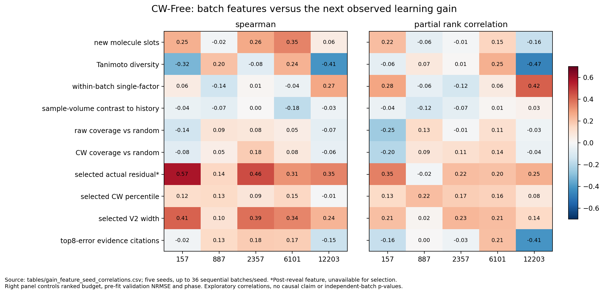
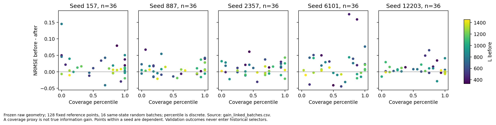

# 批次行为是否转化为模型学习收益

## 联结与分析单位

本次新增873个真实执行batch的联合表 `gain_linked_batches.csv`，包括新CW180、旧Free180、raw LCMD180、数值Hybrid105、NoCW123、Random105。新CW每个batch绑定自身选前状态、最终ID、揭示后残差和紧接的训练后validation，不使用其他seed或其他轮模型代替。已有行为表gain与独立拟合表重算gain全量差<1e−10。额外两seed混合/CW-gradient方法有性能曲线，但未用不完整行为作伪全量回归。

每seed分别报告Spearman；再对rank(feature)、rank(gain)各自回归预算rank、选前NRMSE rank和阶段指示，取残差Pearson，即partial rank correlation。排序前指标按12位小数消除机器舍入的近似并列，原值以17位有效数字保存；这不改变条件精确匹配规则。控制项只用于离线诊断，不是可交给在线selector的validation信息。分析控制可观测状态，无法控制完整训练集、拟合动力学或prompt。

gain=e_before−e_after和控制项e_before共享分量，且checkpoint用同一validation选取，存在数学耦合与回归均值。附partial_rank_without_before敏感性：只控制预算和阶段。批内raw距离和selected-to-L仍五seed同正；CW显示分位降为4/5正、完整响应数降为4/5负。这些反例说明“控制后”不能解释为已排除训练波动。

不把36连续batch当36独立重复；均值与方向按seed计，bootstrap抽整个seed的相关系数（固定seed20261112、10000次），另列leave-one-seed-out范围。仅五个且验证划分可能重叠，bootstrap区间只是敏感性描述，不是稳健人口推断。许多相关特征同时探索，不给未经多重性处理的p值，不以区间不跨零宣称新策略已成功。阶段只有6/9/6/15批，单阶段rho尤其不稳定。

## 新CW完整轨迹的状态调整关联

| feature | n_seeds | mean_seed_correlation | positive_seeds | negative_seeds | seed_bootstrap_p025 | seed_bootstrap_p975 |
| --- | --- | --- | --- | --- | --- | --- |
| complete_response_n | 5 | -0.180600 | 0 | 5 | -0.245187 | -0.121774 |
| cross_only_sample_volume_selected_fraction | 5 | -0.035985 | 2 | 3 | -0.082058 | 0.010088 |
| cw_gradient_batch_nn_distance_mean_random_percentile | 5 | 0.211350 | 5 | 0 | 0.104862 | 0.328937 |
| cw_gradient_reference_coverage_relative_drop_random_percentile | 5 | 0.019483 | 3 | 2 | -0.100118 | 0.118712 |
| memory_top8_evidence_fraction | 5 | -0.078286 | 2 | 3 | -0.261876 | 0.088754 |
| new_molecule_slot_fraction | 5 | 0.026386 | 2 | 3 | -0.090934 | 0.143706 |
| raw_gradient_batch_nn_distance_mean_random_percentile | 5 | 0.241751 | 5 | 0 | 0.149199 | 0.341590 |
| raw_gradient_reference_coverage_relative_drop_random_percentile | 5 | -0.009768 | 2 | 3 | -0.133566 | 0.094554 |
| raw_gradient_selected_to_l_distance_mean_random_percentile | 5 | 0.207446 | 5 | 0 | 0.157393 | 0.281389 |
| selected_cw_percentile_mean | 5 | 0.150925 | 5 | 0 | 0.109500 | 0.189177 |
| selected_error_combined_nrmse | 5 | 0.201208 | 4 | 1 | 0.078926 | 0.299801 |
| selected_residual_asymmetry_v2_minus_v1 | 5 | -0.129838 | 1 | 4 | -0.210055 | -0.010461 |
| selected_v2_signed_width_mean_ml | 5 | 0.162724 | 5 | 0 | 0.084836 | 0.220501 |
| within_any_single_selected_fraction | 5 | 0.114937 | 3 | 2 | -0.060964 | 0.295256 |
| within_tanimoto_distance_mean | 5 | -0.039316 | 3 | 2 | -0.275606 | 0.143577 |

**较一致的候选行为**是批内最近邻距离、selected-to-L距离相对同状态随机批的分位，以及已提供的CW分位。它们更接近“避免完全近邻聚集/获得当前模型较不同的点”，但不能证明LCMD就是LLM的最佳约束，也不能把极低梯度距离的上样对照一律剔除。后者存在真实响应变化而模型预测近乎不变的反证，详见模型审计。

**不稳定的行为**包括新分子比例、Tanimoto多样性、单因素对照和历史上样邻居；raw/CW固定参考覆盖增量的随机分位均接近零、符号混合。覆盖在策略层面能明显区分LCMD与LLM，却不能稳定解释同一LLM轨迹中哪批学得更多。跨方法均值与方法内相关是不同问题，不能偷换。

**选后实际残差**与gain有一定正关联但不是五seed统一；V2−V1标准化误差不对称多数为负。残差属于揭示后，不能直接用于选前acquisition或当hindsight oracle。其关系也可能包含起点误差与难度选择，不能说高误差样本必有高学习价值。

**宽度的微弱正关联与不确定性失准并不矛盾。** 选中V2宽度的partial rank在五seed同正，但这没有控制所有q50/尾部/几何共线信号，也不是误差增量预测检验。它可能在选择偏倚子集中代理响应尺度。原80%区间欠覆盖、V1宽度弱于q50基线等反例保留，因此不提升其“epistemic uncertainty”资格。

**较多完整响应/纠错与较差gain呈同向关联**，但LLM面对的困难状态、原提案问题和工程异常都可能是共同原因。不能由−0.18左右的状态调整相关推断“减少纠错必然提高AULC”；格式修复的首要收益是成本与方案保真，性能价值需独立对照。

## 特征组合与时间敏感性

`gain_exploratory_joint_profiles.csv`将新CW每seed按raw覆盖分位和局部对照比例的各自中位数分成四格，同时保留预算、起点NRMSE和格内batch数。分组阈值是事后描述，部分格样本很少、阶段组成不同；未证明“广覆盖＋适量局部对照”稳定优于其余组合。没有从这张表导出配额或权重。

逐seed逐阶段原始相关保存在 `gain_feature_seed_correlations.csv`（phase非空行）。全程五seed同向也不要求各短阶段同向；报告保留负方向，不把一个显著窗口作为普遍规律。旧Free与NoCW和数值方法均在同一表中，geometry缺项保留NA，无填补或跨状态转借。

## 必须经same-state验证的因果命题

1. 给Free反馈批内距离诊断，是否在保留合法化学对照的情况下提高未来3批AULC？需要Free、Free＋诊断、同等重答次数的placebo诊断对照。
2. 针对模型低灵敏度的loading轴安排额外局部对照，是否仅增加误差样本而不能被当前模型学会？需要固定标签下的模型条件表达对照，避免把模型瓶颈归咎selector。
3. 修复分子身份并保留合法选择/证据，是否只降低token和重提案，还是也改善预测？先在已授权历史包做确定性schema回放，再做统一LLM版本的科学记忆消融。

这三类命题分别对应选择几何、模型可学习性、证据完整性。现有相关系数不足以将它们合成一个复杂Agent并宣布有效。
