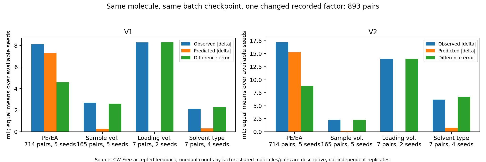
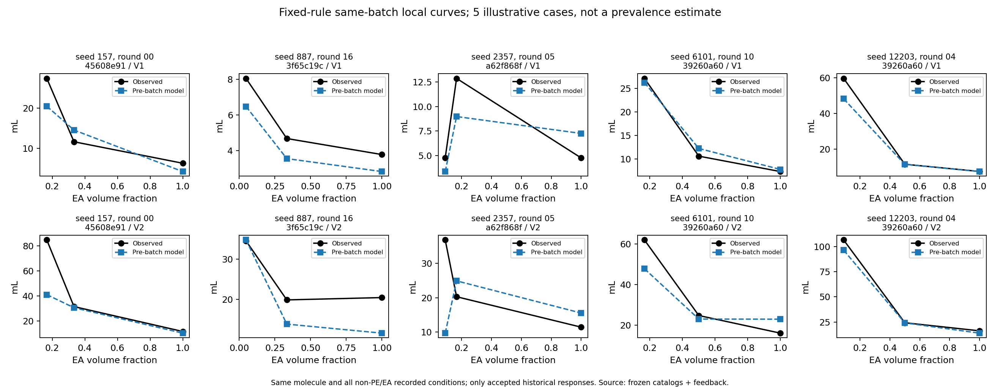
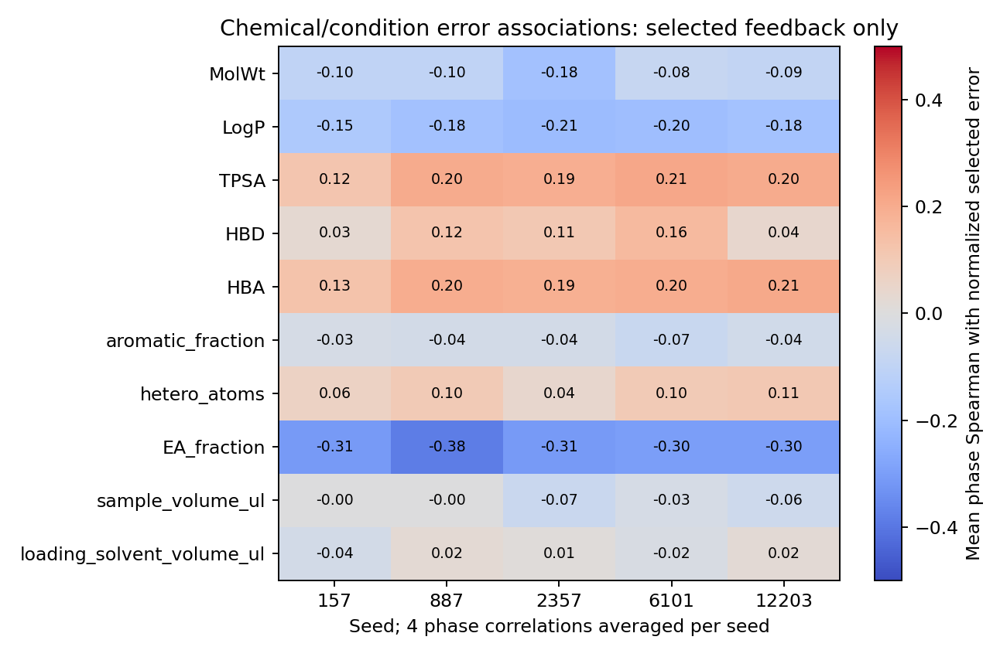

# QGeoGNN 化学误差、条件响应与数据审计

本次新增证据表明：最新 CW-Free 的上样条件实验并非全部没有化学信息，但模型对其中若干条件方向的预测响应很弱。这个结果比“LLM 做了太多同分子重复采样”更具体，也不意味着改模型或改 loss 已被证明有效。

## 1. 数据范围、证据等级与单位

**新计算 N1**：五 seed（157、887、2357、6101、12203）×36 批，共 180 个接受批次、5,760 次选中事件、2,915 个不同 row ID、217 个分子。每个选中事件仅连接自己的选前 `catalog.json` 和该批接受后的 `feedback.json`；180 个 catalog 原字节 SHA 与 archived contract 一致，540 个归档 contract/feedback/batch_freeze 原字节 SHA 均一致。每轮预测、batch freeze 和反馈的中心预测逐个 ID 完全相同。其后出现的实验值只用于事后分析，没有回填选前信号。

**这是选中分布上的 prequential 误差，不是 validation 或全部候选池误差。** 同一 row 会在不同 seed 被重复采集，分子与连续批次相关；5,760 不是统计独立重复数。每个 seed 的模型状态随轮次变化。总体表仅描述历史选择结果，机制比较尽量限制到同批同 checkpoint 的对照。

历史基础证据 H1 来自 [2026-11-04 表示审计](../representation_gp_benchmark_20261104/REPRESENTATION_REPORT.md)；H2 来自 [2026-11-09 loss/quantile 审计](../../diagnostics/quantile_loss_audit_20261109/SCIENCE_AUDIT.md)。本报告明确区分这些已完成研究和最新 CW 轨迹的新计算。

单位沿用冻结协议：`scripts/run_e0_4g_baseline.py` 将 `V_ml = t_raw × Flow_mL_min / 1200` 写入 canonical 数据；本次不重新转换原始时间，不假定原始 t 是普通秒数。选前预测和反馈的 `*_ml` 均按 mL 分析，误差定义为 **预测减观测**。样品体积 `V/ul` 与加载溶剂体积 `Volume of loading solvent/ul` 分开；模型的上样量输入是 `Density g/ml × V/ul`，不能把两个体积当成同一个变量。

本次确认的是源码和冻结产物的单位一致性，没有独立核实原始仪器时间刻度或物理标定；不能由 `/1200` 反推原始 t 的采样单位，再和外部 API 的时间直接比较。

PE/EA=`a/b` 的乙酸乙酯体积分数按 `b/(a+b)` 计算。因此 0/1 对应 EA 分数 1，50/1 对应约 0.0196。PE/EA 数字增大与 EA 分数增大方向相反；本报告的局部 PE/EA 对按 **EA 分数由小到大** 定向。

输入与代码 SHA 在 [model_input_manifest.json](verification/model_input_manifest.json)。须同时披露一次研究过程范围偏差：[label_access_incident.json](verification/label_access_incident.json) 记录单位检索误命中带标签 manifest 的三条记录；其角色未判定，值未用于分析、建议或交付。不能声称整个会话完全没有触碰标签文件。可复现分析脚本本身只从匹配接受反馈和已观测目录取得响应，未打开 canonical 标签表或 test truth。

## 2. 最新轨迹的误差变化

下表对每阶段先在 seed 内计算，再等权平均五 seed；每阶段各 seed 选中数量相同。RMSE 的均值是“每 seed RMSE 的均值”，不是把五 seed 行混合后开方。完整每 seed 数据见 [model_seed_phase_errors.csv](tables/model_seed_phase_errors.csv)。

| 预算窗口 | 每端点事件数 | V1 MAE / RMSE，mL | V2 MAE / RMSE，mL | V1 / V2 平均偏差，mL |
|---|---:|---:|---:|---:|
| L333–525 | 960 | 5.895 / 9.411 | 11.015 / 17.787 | -1.393 / -2.863 |
| L525–813 | 1,440 | 3.584 / 6.337 | 6.287 / 11.819 | -0.279 / -0.737 |
| L813–1005 | 960 | 3.315 / 5.902 | 5.888 / 11.023 | -0.229 / -0.317 |
| L1005–1485 | 2,400 | 2.390 / 4.075 | 3.869 / 6.588 | +0.109 / +0.132 |

**发现 → 证据 → 解释。** 选中样本的残差随预算下降，早期明显低估转为后期近零平均偏差。这与模型逐步学到响应有关，但同时也可能来自候选耗竭、选点分布改变以及困难区域被提前采走。没有固定独立预测集合，不能把这一趋势全部归为模型能力改善。

**反例与限制。** V2 的原单位误差高于 V1，也可能仅由响应尺度更大导致；AL 主指标必须仍用各 seed 固定 L333 标准差。早期选择尾部样本较多，直接比较 17.787 与 6.588 mL 不能当成固定测试分布的学习收益。后续应把“相同固定化学区域的误差改善”和“所选批次变简单”拆开。

## 3. 同分子单因素响应：模型对上样变化存在明显压缩

配对规则在看到响应前由元数据确定：同一个 canonical SMILES、同一个 seed/round/checkpoint，五个记录条件中**恰好一个不同**。排除多因素变化。共 893 个 pair-event，其中有些 row 对跨 seed 重复；每个响应端点使用相同对。计数见 [model_single_factor_unique_counts.csv](tables/model_single_factor_unique_counts.csv)。

| 改变因素 | pair-event | 不同 row 对 | 不同分子 | 覆盖 seed |
|---|---:|---:|---:|---:|
| PE/EA | 714 | 666 | 194 | 5 |
| 样品上样体积 | 165 | 158 | 93 | 5 |
| 加载溶剂体积 | 7 | 5 | 1 | 2 |
| 加载溶剂类型 | 7 | 4 | 2 | 4 |

下表先在 seed 内按有效 pair 求均值，再等权平均可评价 seed。差分误差为 `|(yB-yA) - (predB-predA)|`；方向不同会增大差分误差，不能用两个绝对差的差来代替。

| 因素 | 端点 | 观测 \|Δ\|，mL | 预测 \|Δ\|，mL | 差分误差，mL | 预测 \|Δ\|<0.1 mL 比例 |
|---|---|---:|---:|---:|---:|
| PE/EA | V1 | 8.110 | 7.295 | 4.593 | 2.1% |
| PE/EA | V2 | 17.201 | 15.307 | 8.827 | 0.5% |
| 样品体积 | V1 | 2.696 | 0.263 | 2.605 | 65.1% |
| 样品体积 | V2 | 2.287 | 0.153 | 2.294 | 77.4% |
| 加载溶剂体积 | V1 | 8.291 | 0.003 | 8.293 | 100.0% |
| 加载溶剂体积 | V2 | 14.028 | 0.006 | 14.022 | 100.0% |
| 加载溶剂类型 | V1 | 2.140 | 0.298 | 2.286 | 25.0% |
| 加载溶剂类型 | V2 | 6.154 | 0.782 | 6.738 | 0.0% |

0.1 mL 是本次用于可读描述的固定近零阈值，不是实际仪器分辨率、预注册科学阈值或未来选择阈值。连续绝对差同时报告，结论不依赖二分阈值。

**新发现。** 最新 CW 完整轨迹把旧表示审计中的“上样条件方向被压缩”扩展到 165 个同批对和 93 个分子：模型预测变化只有观测变化的一小部分。历史报告在固定 validation 对上得到样品体积真实变化约 1.50 mL、GNN 差分误差约 1.49 mL；本次不复算那个结果，而是使用新轨迹的已揭示实验。

**不能省略的反例。** 压缩并非所有因素通用：PE/EA 的预测变化量明显存在。随 EA 分数增加，真实 V1/V2 反而增加的对占约 8.7%/9.4%，预测的对应比例约 18.2%/15.9%（均为 seed 内比例再平均）；这说明不能给所有观测加无例外的单调约束。上样体积预测也不是恒为零：L1005–1485 的 92 对按 pair 加权平均预测变化为 V1 0.545、V2 0.309 mL，已高于早期的 0.036/0.023 mL，但同阶段观测变化仍为 2.305/2.261 mL。

**机制解释。** LLM 设计条件对照可能具有实验解释价值，但若当前模型几乎不能表达该方向，增加这类标签未必立刻转化为 row validation 收益。这是有实际响应支持的候选瓶颈，不能仅凭梯度距离小就下此结论。

**限制。** 单因素只针对已记录变量；实验人员、批次、床层状态、流量等未记录或未入目录的信息仍可能改变响应。加载溶剂体积只来自一个分子，类型只来自两个分子，不能把它们表中较大的差异推广到全域。成对差异不是随机化干预，也没有证明网络容量、loss 权重或输入编码哪一个是唯一原因。

**最小后续区分。** 在固定标签集、相同数据顺序和初始化上比较现有模型与一个仅修正条件学习能力的预定义模型/目标控制，先看 held-out 单因素差分误差，再看 combined validation NRMSE。若差分拟合提高而主指标无改善，不能继续声称该机制解释了全局 AL 效率。此报告没有实施该实验。

为检查响应形状，还按固定规则绘制每个 seed 的第一个“同批、同分子、其他全部记录条件相同且至少三个 EA 水平”曲线；先按 round，再按分子 SHA 排序，不按残差挑选。实测与选前预测在相同 mL 单位比较。它们是完整配对统计的说明图，不用五个案例代替总体，也不从少数点宣称确定的阈值机理。所选 ID 与规则见 [model_fixed_local_curve_metadata.csv](tables/model_fixed_local_curve_metadata.csv)。

22 个三水平条件组满足规则，五个图例中包含正反情况：seed6101 round10 的 V1 形状较贴近观测；seed2357 round05 的 `a62f868f` 分子在较低两个 EA 水平间，V2 观测下降而预测上升，暴露局部响应方向错误；seed887 round16 的后两个 EA 水平 V2 观测近平台，而模型继续下降。它们支持检查局部响应形状，不能证明确定的化学阈值或排除未记录条件影响。

跨模块还有一个重要限制：[行为模块](ACQUISITION_BEHAVIOR.md) 发现 Gradient-LCMD 后段才大量转向仅上样体积不同的近邻，且几何覆盖与批内间距给出不同印象。这与条件轴被压缩的诊断相容，但尚未证明两者因果相连。Random 也常出现对历史 L 的单因素邻居，因此“存在这样的邻居”本身不能作为 LLM 独特化学设计能力的证明；还须核实其明确假设、选择理由和可辨别性。

## 4. 分子结构与条件误差：绝对困难度主要混合了响应尺度

用 RDKit 计算 MW、LogP、TPSA、HBD/HBA、芳香原子比例、杂原子数与 Murcko scaffold。每个 seed×阶段内相关后再等权汇总；没有把多行视为独立显著性样本。误差为 `sqrt(0.5*((e1/s1)^2+(e2/s2)^2))`，其中 s 固定于该 seed 的 L333。

| 元数据 | 与标准化误差的平均 Spearman | 五 seed 平均方向/范围 | 控制选前 q50、CW 距离与 round 后 |
|---|---:|---|---|
| EA 分数 | -0.321 | 五 seed 均负，-0.384 至 -0.299 | 约 -0.002 至 +0.038，基本消失 |
| TPSA | +0.185 | 五 seed 均正，+0.121 至 +0.212 | -0.036 至 +0.076，方向不稳 |
| HBA | +0.184 | 五 seed 均正，+0.129 至 +0.209 | -0.003 至 +0.104 |
| LogP | -0.185 | 五 seed 均负，-0.206 至 -0.155 | -0.056 至 -0.042，幅度很小 |
| MW | -0.112 | 五 seed 均负，-0.185 至 -0.078 | -0.068 至 +0.014 |
| 样品体积 | -0.033 | 五 seed 均负，-0.069 至 -0.003 | -0.070 至 -0.006 |

控制后量是对变量秩做线性残差化后的 Pearson 相关，不是独立预测模型性能或因果效应。跨轮 checkpoint 没有被这些少数协变量完全表示。

**发现。** TPSA/HBA 与大误差的正相关不能直接升格为“极性分子需要优先采集”：控制预测保留尺度后，大部分结构关联明显减弱。结构特征可能首先在标识长保留区域，而非提供独立困难度。

条件分层也支持该解释。全程按选中事件加权，0/1 的 V1/V2 MAE 为 1.477/3.493 mL（665 事件），50/1 为 6.445/10.406 mL（790 事件）。100/1 为 6.498/13.078 mL，但仅 20 事件；其强负偏差不应主导策略开发。不同条件包含不同分子、轮次、模型与预算，这些不是随机处理组。

完整分子表在 [model_molecule_error_strata.csv](tables/model_molecule_error_strata.csv)，条件表在 [model_condition_error_strata.csv](tables/model_condition_error_strata.csv)。例如在至少 30 事件且五 seed 均出现的分子中，高 V2 MAE 同时出现在无环 scaffold、含磷 scaffold、二芳基羰基/亚砜及含氮芳环区域，不能归结为单一 scaffold。分子键是 canonical SMILES 的 SHA 前缀，避免用不同目录的 m 编号误配身份。按误差筛出的“高误差族”只属于事后描述，不是可部署的新候选规则。

本模块未新增 Tanimoto 距离：该项由 [选点行为分析](ACQUISITION_BEHAVIOR.md) 的同源结构元数据与到 L 的距离计算承担。结构距离覆盖好与残差低不是同义词。

## 5. 相同记录条件的数据质量

只在各 seed 最终已观测 L1485 内，以 SMILES 和五个完整记录条件分组。得到 111 个 seed 内组事件、跨 seed 去重后 87 个条件组；多个 seed 可以含同一组，不能称作 111 个独立复测。

| seed | 组数 | V1 组内范围中位 / 最大，mL | V2 组内范围中位 / 最大，mL |
|---|---:|---:|---:|
| 157 | 12 | 1.048 / 14.500 | 3.319 / 30.829 |
| 887 | 27 | 0.963 / 6.288 | 1.592 / 11.033 |
| 2357 | 35 | 0.775 / 17.092 | 2.017 / 18.023 |
| 6101 | 18 | 1.065 / 13.563 | 2.892 / 16.133 |
| 12203 | 19 | 1.238 / 21.550 | 3.358 / 30.829 |

所有 V1 组均非完全相等，V2 只有 seed887 的一组完全相等。这证明不同 row ID 的相同可见条件不保证相同响应；不能据此认定实验噪声方差，更不能直接认定是重复录入错误。缺实验批次、原始记录、仪器与流量核对，三种解释——真实复测、记录缺项、重复数据——不能可靠区分。若让 Agent 认为“已测过同条件必然冗余”，可能遗漏这类数据质量问题；但采更多此类点是否值得仍取决于主任务与真实复测成本。

## 6. 模型机制、loss 与训练瓶颈

源码复核支持以下明确事实：

1. QGeoGNN-V2 为六输出；q10/q90 用 pinball，q50 用 MSE，另有两项 soft crossing 惩罚，V1/V2 raw loss 等权。q50 不应解释为已校准条件中位数。
2. 训练目标采用原 mL 尺度，checkpoint 目标则用固定 L333 标准差归一的 combined NRMSE。二者优化权重并不等价。旧 L333 实测共享 backbone 的 V2/V1 梯度范数比为 2.143–4.142，condition 分支 2/5 seed 有负余弦；这是 H2 已有测量，不是本次新梯度计算，也不是整个 Adam 更新轨迹的因果解释。
3. 每轮从 `outer_seed+2000003` 的相同 scratch 初始化重训，训练 RNG 配置固定为 `outer_seed+3000017`；Adam lr=0.001、weight decay=0、最大 1000 epoch、patience=100、batch size=2048，按 validation 最优 combined NRMSE 选 checkpoint。当前 L≤1485，单 epoch 是一整个训练批。
4. 因此不同轮次的非单调验证曲线不能只称作“每轮换随机初始化造成的噪声”。数据组成、优化轨迹、BatchNorm/条件分支学习、early stopping 和 checkpoint 选择均可改变；数值执行的不可重复部分是否存在还需重复拟合控制。五 outer seed 同时改变划分与初始化，无法从五条轨迹唯一分解这两项方差。
5. 已有 `predictions.csv.gz` 是 `test_X_without_test_truth` 上的预测冻结，并非每轮独立 validation 逐行预测。本次不利用 test 标签，也不把该文件冒充 validation 化学误差快照。

最新选中事件中中心预测负值为 0；V2 中心小于 V1 的事件为 38/5,760（0.66%）。跨端点物理次序没有被两个独立目标的 soft quantile crossing 直接约束。频率不高，不能把全部 AL 性能差归因于此；所有原始输出保留，不进行修正后再覆盖原误差。

## 7. 对后续研究的明确判断与缺口

| 现象 | 当前证据支持到哪里 | 优先处理层次 | 尚不能宣布 |
|---|---|---|---|
| 上样体积响应被压缩 | 165 同状态 pair、93 分子；新旧人群均有迹象 | 条件学习能力与数据噪声的区分实验 | 换 loss/加复杂网络一定提升 AULC |
| 高保留/弱 EA 区绝对误差大 | 选中轨迹分层与响应尺度关联 | 按固定主指标检查尾部贡献，保留普通区 | 只采尾部就是最优 AL |
| 极性结构与误差相关 | 原相关稳定、控制后显著减弱 | 把结构规则作为可检验假设 | 化学知识具有独立新增信息已证实 |
| 相同记录条件响应不同 | 87 个不同可见条件组 | 原始记录审计、明确复测身份 | 这些差异全是实验噪声/全是坏数据 |
| 后期区间仍不可靠 | 见数值信号报告 | 校准/排序资格验证 | quantile width 等于 epistemic |

缺少逐轮固定 validation 行预测、同状态多初始化 ensemble、重复拟合控制和完整实验原始记录。故本次不能可靠分解“学习改善发生在哪个固定化学验证区域”、训练随机性占比或实验噪声下限；没有用别的轮次模型补齐，也没有重新训练。

复现：在仓库根目录运行 `PYTHONDONTWRITEBYTECODE=1 python studies/active_learning/comprehensive_history_diagnostics_20261112/scripts/analyze_model_signals.py`。需要原本地 catalog；若缺失应报缺失，不生成新请求或读取其他标签补齐。表格与图的核验记录见 [model_analysis_verification.json](verification/model_analysis_verification.json)。
