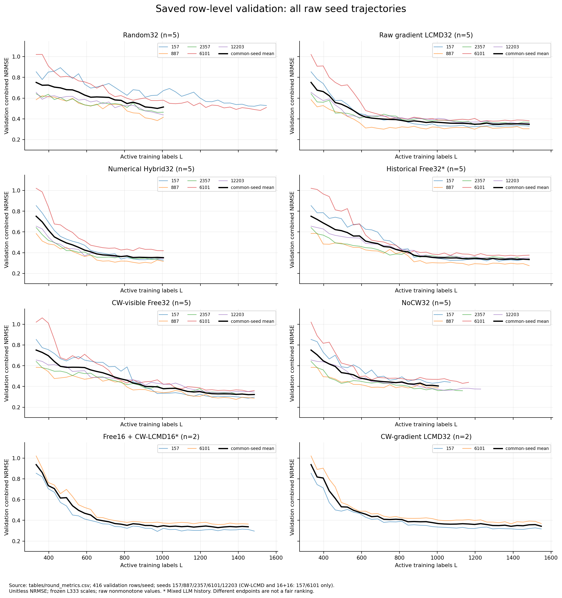
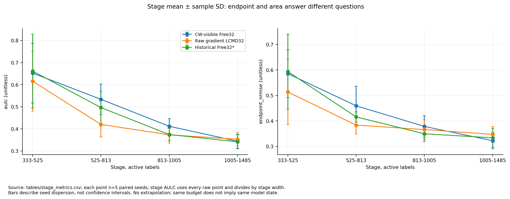
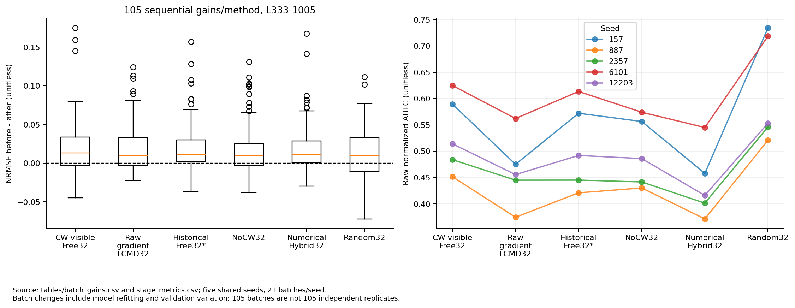

# 学习曲线、阶段收益与收敛诊断

## 定义与比较窗口

按固定L333分母计算row-level combined validation NRMSE。所有原始非单调点参与归一化梯形AULC，见协议审计。主八方法34条run、1088点、1054次实际已完成加样本→拟合变化；不同长度的总AULC不能直接排序。每seed值在run_registry/stage_metrics/paired_effects。以下均值±样本SD（ddof=1）衡量seed分散，不是置信区间。

## 五seed共同L333–1005

| method | seeds | aulc_mean | aulc_sd | endpoint_mean | endpoint_sd |
| --- | --- | --- | --- | --- | --- |
| gradient_lcmd32 | 5 | 0.462549 | 0.067389 | 0.366328 | 0.038413 |
| historical_free_mixed_model | 5 | 0.508802 | 0.082160 | 0.349855 | 0.030140 |
| new_free_cw_sol61_xhigh | 5 | 0.532876 | 0.072537 | 0.378752 | 0.042341 |
| nocw | 5 | 0.497741 | 0.065443 | 0.405025 | 0.046221 |
| numerical_hybrid32 | 5 | 0.438420 | 0.067272 | 0.351918 | 0.039880 |
| random32 | 5 | 0.614742 | 0.102912 | 0.513940 | 0.108788 |

新CW全程0.532876，明显差于数值Hybrid0.438420和raw LCMD0.462549，也高于NoCW0.497741、历史Free0.508802。新CW−NoCW AULC差+0.035136，五seed方向一致；新CW−历史Free+0.024075同样五seed一致。它优于Random（配对差−0.081866），但“LLM优于随机”不足以支持协同策略优于强数值baseline。旧Free不是纯Sol统一配置；不过五seed均同向意味着不能只用两个混模型seed解释新CW早中期损失。

## L1485终点更好，全程仍更差

| method | aulc_mean | aulc_sd | endpoint_mean | endpoint_sd |
| --- | --- | --- | --- | --- |
| gradient_lcmd32 | 0.417049 | 0.049452 | 0.347582 | 0.030467 |
| historical_free_mixed_model | 0.439159 | 0.057253 | 0.334085 | 0.037097 |
| new_free_cw_sol61_xhigh | 0.454195 | 0.048511 | 0.322703 | 0.031694 |

新CW−raw LCMD终点−0.024879（SD0.013563），相对均值约改善7.16%；全程AULC+0.037145（SD0.015703），相对恶化8.91%。两者五seed方向都一致。以下配对差均为新CW减对照，total_gain方向相反：

| seed | aulc | endpoint_nrmse | total_gain |
| --- | --- | --- | --- |
| 157 | 0.059016 | -0.033023 | 0.033023 |
| 887 | 0.043356 | -0.017944 | 0.017944 |
| 2357 | 0.016077 | -0.043952 | 0.043952 |
| 6101 | 0.032926 | -0.019836 | 0.019836 |
| 12203 | 0.034352 | -0.009641 | 0.009641 |

## 哪个阶段造成差额

| start | end | mean_delta | sample_sd | negative_deltas | contribution_to_full_delta |
| --- | --- | --- | --- | --- | --- |
| 333 | 525 | 0.036840 | 0.012365 | 0 | 0.006140 |
| 525 | 813 | 0.113630 | 0.054014 | 0 | 0.028407 |
| 813 | 1005 | 0.038861 | 0.016483 | 0 | 0.006477 |
| 1005 | 1485 | -0.009309 | 0.008055 | 4 | -0.003879 |

L525–813贡献+0.028408，约占全程净AULC差的76.5%；L1005–1485贡献−0.003879，只抵消较小部分。后期阶段AULC新CW0.344040、raw LCMD0.353349，4/5seed新CW较好；seed2357是该阶段面积反例（尽管其最后一个点更好）。因此不是从某个预算开始新CW在所有seed、每一轮都占优。

L813–1005新CW误差下降0.080947，raw LCMD仅0.017629；但该段AULC仍差+0.038861、五seed均不占优。这是**从较差起点追赶**，不能以更大gain宣称该阶段已获得更高标签效率。L1005–1485额外下降差+0.037303（五seed一致）从追赶延伸到终点超过；仍无法由观察轨迹识别“先前局部实验延迟生效”这一具体因果机制。

## 阈值、突变与稳定性

阈值表保留首达和连续三个检查点达标。NRMSE≤.4的首达预算，新CW五seed分别909/813/909/1069/1133；raw LCMD为717/557/813/845/845，新CW逐seed都更晚。尤其2357新CW首达909，但连续三点达标要到1005，单次穿越并不等于稳定收敛。未达标NoCW/Random保留右删失，不能以截止预算替代。

共同1005窗口，新CW105批中30批gain<−.001，6批|gain|≤.001；raw LCMD也有30批恶化、2批近零。新CW晚期75批中仍有27批恶化。eps=.001仅作描述门槛，表中附0/.005敏感性。不能以“LLM更多非单调”作无数据支持的笼统结论。最大/最小gain逐seed保留；没有挑出好看的单轮代表全策略。

两因素描述性平方和分解：六方法L1005 AULC的55.0%与seed主效应、39.8%与方法主效应对应；三方法L1485 AULC中seed为87.0%。该分解依赖选定方法集合，且交互剩余同时含训练集/模型状态等因素，**不是估计训练随机方差**。配对差比不配对误差条更适合当前问题。

## 两seed方法必须重配同两seed

| method | n | aulc_mean | aulc_sd | endpoint_mean |
| --- | --- | --- | --- | --- |
| cw_gradient_lcmd32 | 2 | 0.500029 | 0.059870 | 0.368524 |
| free16_lcmd16 | 2 | 0.484421 | 0.056191 | 0.348215 |
| gradient_lcmd32 | 2 | 0.518672 | 0.061549 | 0.360565 |
| historical_free_mixed_model | 2 | 0.592843 | 0.029216 | 0.363474 |
| new_free_cw_sol61_xhigh | 2 | 0.607300 | 0.024953 | 0.377972 |
| nocw | 2 | 0.565351 | 0.012433 | 0.453041 |
| numerical_hybrid32 | 2 | 0.501517 | 0.061651 | 0.373684 |
| random32 | 2 | 0.726538 | 0.011098 | 0.626034 |

这是157/6101专门配对表，不与前面的五seed平均直接比。Free16＋CW16在共同1005的AULC为0.484421，新CW在同两seed为0.607301，历史混合16＋16是有竞争力的开发基线；不能因只有两seed而忽略，也不能据此认定固定16＋16最优。其共同终点1453，完整配对值见表。CW-gradient和Random已保存至1549；本次补入其完成状态，未机械沿用旧报告的1005截断。

## 次级数值方法

`additional_round_metrics.csv`与`additional_paired_effects.csv`补充5种数值方法。Gradient-MaxDet实际五seed共同909；其余为两seed653/1005。只使用已核实初始化/验证身份、连续32增量的fit摘要，未读取其测试报告。它们支持比较已有数值设计，不能把不同预算均值排成统一榜单。

## 研究含义与负面审查

阶段自适应值得作为可证伪假设，但不能从本图确定在线切换时点；L813或1005是本次事后解释边界，按这些验证曲线挑最优切点会重复使用开发集。下一步必须在同一冻结状态、固定短窗、相同QGeoGNN拟合与LLM输入下比较选择方案；先验固定窗口，包含数值Hybrid和原始Free。训练重复对照用于区分拟合路径波动，不以重新运行历史seed修饰曲线。
