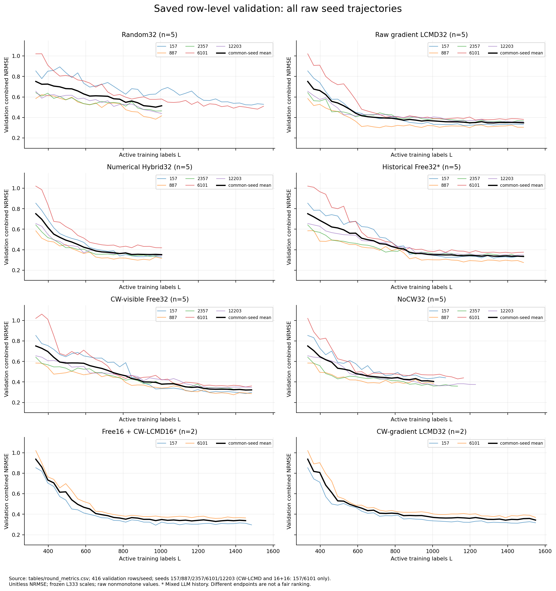
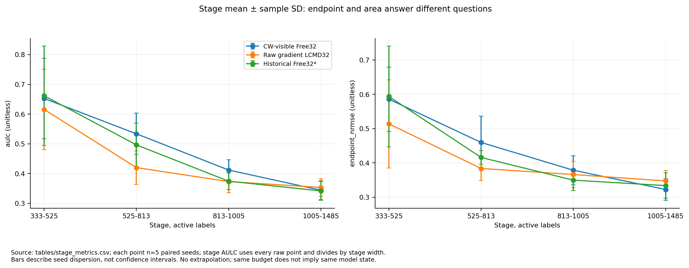
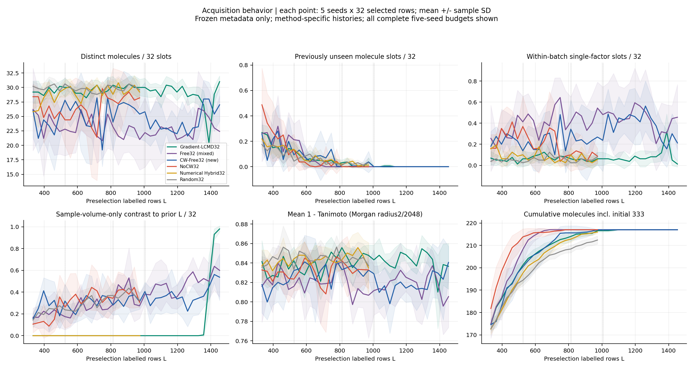
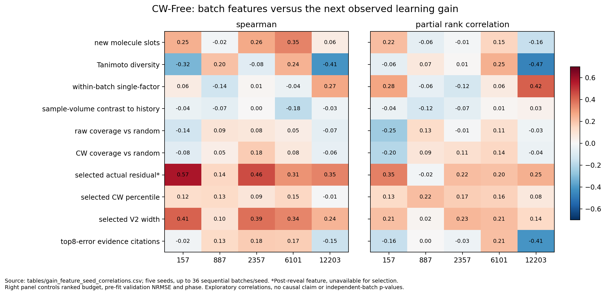
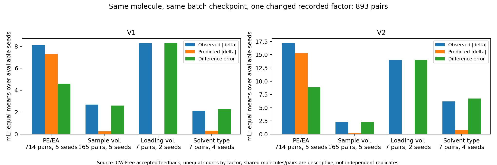

# 柱色谱主动学习历史实验的综合诊断与研究裁决

2026-11-12，Asia/Shanghai。研究代码与远端main均为 `44be2c0070219d71b2560604f8234a390cc14304`。本报告以最新CW-visible Free32五seed完整轨迹为核心，联合历史数值/LLM方法、真实科学解释、冻结表示、已选反馈与训练元数据。报告结论属于历史开发证据，不能当作新的随机化因果试验。

**最重要的判断是：Free LLM已经表现出可核验的条件实验设计、反例识别和自我修订，但这些能力尚未被证明具有稳定的额外主动学习效用。当前障碍至少分为选择几何、科学证据保真、模型条件可学习性和执行系统四层；不是一个“需要更强Agent”的单一问题。**

最新CW-Free的后期优势真实存在于保存结果中，但早中期代价同样真实。数值辅助最值得先检验的是**提案后的少量状态绑定批次诊断，附条件语义保护**；不应直接采用未通过资格检验的GP风险/IVR专家，也不应把不校准的分位宽度称为epistemic uncertainty。

直接阅读最终实验选择：[NEXT_STAGE_DECISION.md](NEXT_STAGE_DECISION.md)。完整六路线评估：[RESEARCH_DIRECTIONS.md](RESEARCH_DIRECTIONS.md)。

## 1. 研究范围、数据边界与证据等级

本次主比较八种方法、34条run、1088个原始验证点、1054个加样本后的拟合变化；另补五种数值方法、13条run、238个验证点。行为联合873批、27936个采集名额；新CW完整180批、5760个选中事件、2915个不同row、217个分子。新增CW raw/CW几何360个状态空间记录，结合既有结果共1251行；假设审计871条命题、5455次结构化引用、430个完整响应。名额/事件数不是独立实验重复数。

所有选后残差仅连接其原seed、轮次和选前冻结预测；没有从未选候选真实标签计算oracle效用。验证集只使用既有汇总/历史训练曲线，没有打开test预测行或test真值做新分析。没有训练QGeoGNN/GP、调用付费LLM、启动新主动学习、改历史冻结文件或向运行中的实验注入信息。

**须披露执行偏差：** 单位核查时，一个子任务的文本搜索范围误含带标签manifest，输出了3条带响应值记录，角色未判定。已停止该搜索，未将值用于分析、建议或交付；因此不能声称全会话没有任何标签文件接触。详情和后续范围限制见[审计事件](verification/label_access_incident.json)与[协议审计](PROTOCOL_AND_FAIRNESS_AUDIT.md)。这是执行偏差，而不是获得扩大标签使用权限。

本报告区分：①直接可验证的文件/数值事实；②同状态或时间合法的观察关联；③具体科学病例；④待受控验证的机制。没有把③升格为④已经成立。原终点/AULC数字、旧NoCW/Free行为、L333分位诊断、GP/GOLLuM No-Go均属于复用；**新增内容是完整新CW的联合轨迹、阶段贡献、全量纠错保真、后期分位及真实条件响应检查。** 复用清单见[实验盘点](EXPERIMENT_INVENTORY.md)。

## 2. 统一比较基础

主目标保持Row-level，combined validation NRMSE用每seed初始L333固定尺度：`sqrt(((RMSE_V1/s1)^2+(RMSE_V2/s2)^2)/2)`。AULC是全部原始非单调点的梯形积分除以标签跨度。V1/V2指标以mL计；PE/EA=`a/b`的EA分数是`b/(a+b)`。没有改成best-so-far曲线或换指标取得更好结论。

| 比较族 | 方法 | 公平范围及限制 |
|---|---|---|
| 五seed主比较 | Random32、raw Gradient-LCMD32、数值Hybrid32、历史Free32、新CW-Free32、NoCW32 | 全部共同L333–1005 |
| 五seed长期比较 | raw LCMD、历史Free、新CW-Free | 共同L333–1485 |
| 二seed补充 | Free16＋CW-LCMD16、CW-gradient LCMD32 | 只能与157/6101配对；前者共同1453，后者已到1549 |
| 数值补充 | MaxDet、U50-MaxDet、gradient/latent fusion、a080 screen、CW/IVR portfolio | 各自共同909/1005/653，单列，不跨预算排名 |

历史Free的157/6101含Astra/high前缀，后续Sol/xhigh；新CW是独立Sol/xhigh重跑。NoCW仅删显式CW，仍有预测、宽度、结构/条件和反馈。数值Hybrid用三模型分歧筛25%＋latent覆盖，不是16＋16。原始q50-gradient LCMD和CW-gradient LCMD必须分开。

逐点核验了初始化/validation hash与best_epoch，但同seed后续L/U/checkpoint已分叉，不能据此宣称严格CW消融。固定scratch/RNG、全批训练、validation选checkpoint仍可能因训练集变化而出现非单调；没有重复拟合控制来量化纯训练噪声。协议与实际served/model混用细节见专题审计。

## 3. 主要性能结果

| 五seed方法 | L333–1005 AULC，均值±样本SD | L1005 NRMSE，均值±样本SD |
|---|---:|---:|
| Numerical Hybrid32 | 0.438420±0.067272 | 0.351918±0.039880 |
| raw Gradient-LCMD32 | 0.462549±0.067389 | 0.366328±0.038413 |
| NoCW32 | 0.497741±0.065443 | 0.405025±0.046221 |
| 历史Free32（混合模型） | 0.508802±0.082160 | 0.349855±0.030140 |
| 新CW-Free32 | 0.532876±0.072537 | 0.378752±0.042341 |
| Random32 | 0.614742±0.102912 | 0.513940±0.108788 |

新CW比Random好，但在该共同窗口比数值Hybrid、raw LCMD、NoCW及旧Free的AULC都差，四种配对均五seed同向。这对“显式CW一定提高Free效率”构成直接反例；版本/日期/轨迹混杂意味着不能进一步认定CW字段本身有害。

L1485新CW NRMSE=0.322703±0.031694，raw LCMD=0.347582±0.030467；配对差−0.024879±0.013563、五seed均更好。全程AULC新CW=0.454195±0.048511，raw LCMD=0.417049±0.049452；配对差+0.037145±0.015703、五seed均更差。性能结果不是“到底哪个指标是真的”：二者衡量预算过程中不同目标。

## 4. 九项关键发现与反面证据

### 发现1：最大的效率损失在L525–813，而非只有起步慢

**发现 →** 后期终点优势不足以补偿中期预算代价。**定量证据 →** 新CW−raw LCMD分阶段AULC差为+0.036840、+0.113630、+0.038861、−0.009309；按阶段长度加权，L525–813贡献+0.028408，占全程净差76.5%。**解释 →** 单纯“前几批数值、之后交给LLM”的想法尚未被数据支持；中期也是关键。**反例/限制 →** 晚期面积仅4/5seed有利，2357反向；相同预算不是同状态。**启发 →** 先比较预定早/晚同状态短窗，不能从旧曲线直接挑最优切换预算。

L813–1005新CW下降0.080947而raw LCMD下降0.017629，但该段面积仍五seed更差，主要是追赶。NRMSE≤.4首达预算新CW在五seed均晚于raw LCMD。因此不能以“下降更大”代替标签效率。

### 发现2：旧NoCW行为解释不能直接移植到新CW重跑

**发现 →** 中期新CW与NoCW的局部对照/覆盖接近。**证据 →** L525–813批内严格单因素名额21.94% vs22.08%，旧Free为43.40%；raw覆盖随机分位0.5153 vs0.5028，旧Free0.7306。新CW−NoCW中期覆盖差仅3/5seed正。**解释 →** 历史Free的特性不等同于“显式CW信息”的普遍效应。**反例 →** L813–1005新CW局部对照仍五seed高于NoCW，但差值很大程度由157驱动；后期新CW覆盖又五seed超过旧Free。**启发 →** 后续必须绑定相同L/U/checkpoint与统一LLM，旧报告只能提供待复验机制。

### 发现3：LLM更常组织批内对照，但“历史上有单因素邻居”不是独有科学能力

**发现 →** 要把主动设计和数据网格自然重合分开。**证据 →** 共同1005批内严格单因素名额新CW23.60%、NoCW20.03%、raw LCMD6.37%、Random5.54%；但对历史L的仅上样V匹配，Random三个阶段为21.98/29.10/37.29%，与新CW26.67/30.49/32.19%接近。**解释 →** 批内受控结构更能区分LLM，单个历史匹配不足。**反例 →** 数值法也有PE/EA多点曲线；LCMD末轮大量补上样对照，不能说数值法始终忽略该轴。**启发 →** 用事前命题、明确对照操作数与实际反馈链评估科学设计，而不是只计同分子重复数。

### 发现4：距离信号比覆盖增量更一致，但没有指标可直接升级为最优采集规则

**发现 →** 策略之间的覆盖优势，不等于同策略每批的学习收益。**证据 →** 控制预算、阶段、起点NRMSE后，新CW raw/CW批内NN随机分位与gain平均partial rank约0.24/0.21、五seed同正；raw/CW覆盖提升分位近零且方向混合。新分子、Tanimoto、局部对照关联不稳定。**解释 →** 距离可作候选诊断；覆盖可能只是很粗的代理。**反例 →** LCMD晚期NN分位0.0425却覆盖0.9492；它可能在远离L的一个区域内选择互近点。数学上gain也与before误差共享分量；移除before控制后CW显示分位仅4/5正。**启发 →** Critic展示多个有语义的量，不设硬性近邻惩罚，并必须加等重答placebo。

### 发现5：科学反馈确实引起修订，但最终合法回答仍有身份错误

**发现 →** LLM具有具体可追踪的科学修订实例，也会把合法ID绑定到错误分子。**证据 →** 5455结构化引用全在选前L；人工核查却确认25条所选分子误写（检出下界）。887r9把m116写成m125并称加载体积对照，r10明确纠正并补真正同分子对照；m117案例区分预测异常与化学响应，r11根据观测继续设计。**解释 →** 这比关键词“化学先验”更能证明科学行为。**反例 →** r9–11 gain为−0.014372、+0.042152、−0.014625，不能把正收益归于某一个被纠正的命题。**启发 →** 可验证身份/条件差异先于更复杂推理；要通过信息消融才识别化学知识的额外学习价值。

### 发现6：整批纠错会丢失科学证据；记忆并非普遍越来越困在异常分子

**发现 →** 可靠性问题涉及方案保真，不能只统计最终通过率。**证据 →** 首答合法95/180；85个纠错批中首提案2517个合法ID仅1004保留，13轮证据从有变零，10轮清空假设。175次跨轮记忆拷贝完全忠实，但忠实传递可能保留旧错误。**解释 →** 局部身份修复比整批重答更值得先验证。**反例 →** 高误差top8记忆引用从20.04%下降到5.97%，HHI下降；51/65逐字重复集中单seed，并非所有LLM轨迹异常锁定。**启发 →** 不以“记忆越来越偏”作为造新Agent的既定理由；分别测证据正确率、保留率与学习效用。

### 发现7：局部实验有真实条件响应，当前模型可能吸收不足

**发现 →** 同分子采样不能一律视为冗余；模型预测对上样变化明显压缩。**证据 →** 893个同批同checkpoint严格单因素对中，165个上样体积对覆盖93分子，真实V1/V2绝对变化2.696/2.287mL，预测0.263/0.153mL；65.1%/77.4%预测变化低于0.1mL。PE/EA对的预测变化却明显存在。**解释 →** 科学上有信息的标签未必被当前表示/loss/优化有效学到。**反例/限制 →** 87个相同记录条件组也有响应差，缺实验批次/复测身份；上样预测晚期已增强，不是永远零响应；加载溶剂体积对只一个分子，不可推广。**启发 →** 固定标签比较一个条件学习控制模型，是比直接增加采样复杂度更有辨别力的第一实验。

### 发现8：宽度不是完全无用，但校准和增量价值都不能由正相关代替

**发现 →** 选中样本上的宽度有困难度信号，同时区间承诺持续失准。**证据 →** 完整5760事件raw80覆盖V1/V2=63.21%/57.29%，末期仍62.08%/55.54%；V1误差rho宽度0.303、q50简单基线0.448，V2为0.263 vs0.310。排序后覆盖只升至63.68%/57.48%。**解释 →** 宽度部分标记响应大小/尾部，不能默认epistemic。**反例 →** 有seed阶段覆盖到0.819或0.913；宽度与gain的正相关、控制后的弱残差相关都保留，不把它判成全无信息。**启发 →** 先做同状态、时间合法、含q50基线的增量资格检验；不能凭校准图或GP自身IG进入昂贵AL。

### 发现9：执行成本、科学决策和模型波动应分别解决

**发现 →** 173511物理尝试不是173511付费成功LLM请求。**证据 →** 完整响应430、接受batch180；input/output token记录约2.037亿/583.5万；失败包含139669次429、21911 ConnectError、9282次403。完整回答的250次非法首因集中packet/候选ID/未观测证据。共同1005新CW、raw LCMD、NoCW都各有30/105批恶化。**解释 →** 网络重试、schema/实体、科学证据、选择机制、训练过程是不同误差源。**反例/限制 →** 没有供应商发票/价格；失败服务端费用不能断言为零；member0计时不等于Hybrid全部ensemble成本。**启发 →** 先做确定性身份和局部修复；数值critic检验另立主指标，不用更强模型或大Agent掩盖根因。

## 5. 对研究主问题的回答

| 问题 | 当前最严格的回答 |
|---|---|
| Free的真实优势 | 相对Random有学习收益；比纯数值更常组织批内条件对照；有反例识别、机制区分和身份纠正实例；新CW长期终点胜raw LCMD |
| 真实不足 | 早中期AULC损失；语义实体误写；整批纠错丢失科学证据；科学设计与预测目标不一定匹配 |
| LLM是否用了化学知识 | 使用化学语言与条件设计有可核验实例；不能从自述区分预训练化学知识与数值/表格启发式的因果贡献 |
| 反馈是否使用 | 真实引用、修订和后续实验链存在；全体反馈理解正确率、是否提升泛化仍未知 |
| 哪些行为有稳定收益 | 当前只有若干距离指标较一致的观察关联；没有被因果确认的最佳batch特征组合 |
| 数值方法应介入哪里 | 提案后的状态绑定批次诊断＋精确条件差异；证据ID/schema由确定性程序处理，不由risk模型猜 |
| QGeoGNN瓶颈 | 选中条件对中上样响应压缩；V2/loss尺度历史不平衡；宽度失准；固定validation逐行快照和重复拟合证据不足 |
| 是否应立即融合GP/IVR | 不应；多个历史No-Go未解除，边际校准不保证joint acquisition有效 |
| 是否已经证明阶段自适应 | 没有；阶段现象强，最优开关/比例和相同状态交互未验证 |

## 6. 三个优先实验与停止标准

1. **固定已获标签的模型条件学习控制**：60fits、0LLM、0新标签；对比原模型与一个预定义条件学习改动，检验可学习的条件信号，主row指标不能被局部指标替代。噪声分解仍需真复测元数据/重复测量；检查组整体隔离后实际训练预算另记。
2. **same-state数值critic＋等重答placebo＋数值baseline**：早/晚各五seed、四臂一批40fits，至少30完整响应；只提高coverage不提高真实误差则停止升级。
3. **化学可见性×后续反馈2×2消融**：L813五seed、四臂20fits/至少20响应；匿名保留稳定分子身份和实验条件，No-feedback堵住后续真值/误差/记忆旁路。只改解释、不改选择与学习则不宣传科学知识效用。

详见[明确实验裁决](NEXT_STAGE_DECISION.md)的目标、baseline、未来阈值、成本和失败备选；[六路线评估](RESEARCH_DIRECTIONS.md)保留所有待验证命题。阶段融合暂依赖实验2的交互结果，不单独启动长轨迹。复杂不确定性专家暂缓，避免重复已有负面研究。

## 7. 核验、缺口与可复现性

独立复算222个阶段AULC、1054个gain望远镜和、504个配对差，最大误差约3.2e−14；873批预算/前后误差/checkpoint及5004个几何联结数值吻合。独立线性代数复算1955个Spearman及两组各425个partial，最大误差约1.47e−15。行为模块另用scipy距离与独立条件枚举核查；模型模块250标量检查、893pair重建通过。所有图已检查，修复两处色条遮挡和一处单位语义标签。

这些核验确认**记录和计算的完整性，不确认因果机制**。主要缺口：八方法并非全部有统一行为/残差；无全预算固定validation逐行预测；无新CW同状态ensemble；没有同L重复训练；实验复测/缺失变量身份未知；871假设只做全量机器审计和固定样本语义检查；历史开发集已反复暴露。具体范围见[MISSING_EVIDENCE.md](MISSING_EVIDENCE.md)。

源码、输入、派生表和图由[README](README.md)导航，`INPUT_MANIFEST.json`与verification保留哈希、事件和批判式审核。工作在新目录完成，未提交或推送Git，既有实验与监控保持原状。
