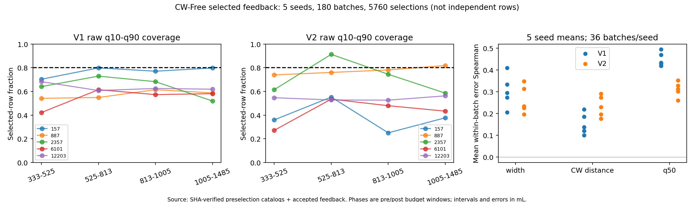
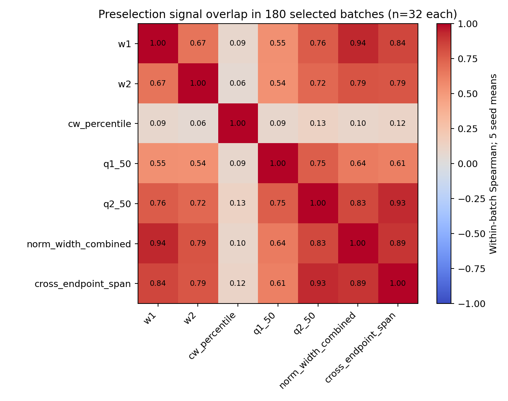

# 数值信号：可靠性、互补性与学习价值

当前最适合给 LLM 的数值辅助是**绑定当前模型状态的几何与批次诊断，并保留条件对照的明确语义**。已有证据不支持把 quantile width、GP variance 或 IVR 直接包装成可靠的“科学信息增益”。宽度在选中样本上的正相关应保留，但这与“宽度提供独立 epistemic uncertainty”是不同命题。

## 1. 三层证据不能互相替代

| 层次 | 本次或历史能够回答的问题 | 不能推出 |
|---|---|---|
| 误差信号 | 选前数值是否排序出之后已测的困难行；区间是否覆盖 | 该行对训练最有帮助 |
| 独立性 | 同状态信号间相关、增量困难度关联、Top-k 重合 | 独立信号必然提升下游模型 |
| 学习价值 | 历史批次信号与下一轮实际 gain 是否关联；已有真实 AL 对照 | 新 critic 或新融合规则已有因果收益 |

本次新增测量为最新 CW-Free 180 批、五 seed，每批 32 个已接受点。信号来自相同批次的选前 frozen catalog，真值只来自选后 matched feedback；不读取未采集候选标签。固定 L333 标准差直接取 `protocol.json.initial_states[].preprocessing.target_scales`，不以当前批次或后期响应重新估计。

Raw/CW/latent 覆盖由 [行为模块](ACQUISITION_BEHAVIOR.md) 分空间统计；本模块不混用其未标准化绝对距离。GP/IVR/GOLLuM 使用下述已有报告的冻结汇总，未重新拟合，也没有把它们接到最新 CW 的不同 checkpoint 上伪装同状态比较。许可与一次误检索的排除记录见 [化学审计](CHEMICAL_ERROR_AND_DATA_AUDIT.md) 和 [label_access_incident.json](verification/label_access_incident.json)。

## 2. 后期预算并未自动修复 q10–q90 可靠性

旧 [L333 quantile/loss 审计](../../diagnostics/quantile_loss_audit_20261109/SCIENCE_AUDIT.md) 在五 seed validation 上已报告：V1 80% 区间覆盖 0.337–0.817，V2 0.185–0.885；加入宽度的固定、分子分组 OOF ridge 困难度模型，RMSE 平均变化分别为 +0.00312/+0.00447，没有观察到增量改进。该诊断的 validation 已用于 GNN checkpoint 选择，不是盲确认。

**新增的是完整 CW 轨迹选中分布上的检查，而不是重做上述 L333 validation 分析。** 下表每阶段按五 seed 等权，括号为 seed 最小–最大；单阶段每 seed 为 192、288、192、480 个选中点。

| 预算阶段 | V1 raw80 覆盖 | V2 raw80 覆盖 |
|---|---:|---:|
| L333–525 | 0.598（0.422–0.703） | 0.506（0.271–0.740） |
| L525–813 | 0.660（0.549–0.799） | 0.658（0.528–0.913） |
| L813–1005 | 0.653（0.573–0.771） | 0.556（0.250–0.781） |
| L1005–1485 | 0.621（0.519–0.798） | 0.555（0.377–0.819） |

发现 → 后期已选样本上的 nominal80 覆盖没有随 point MAE 下降而接近 0.8。证据 → 末阶段 V1/V2 覆盖 0.621/0.555，同时 selected MAE 已降到 2.390/3.869 mL。解释 → 点预测改善和区间校准是不同目标，不能通过继续训练预算自然推定校准。反例 → seed887 末段 V2 为 0.819，seed2357 的中段 V2 一度 0.913；不是所有 seed 都欠覆盖。启发 → 边际校准与适用人群必须明确到 seed、端点、阶段和选择分布。

选择本身使用了预测宽度等特征，所以这些覆盖率不等于全部 U、未见 validation 或新实验总体覆盖率。即使一个模型在完整人群边际校准，选择后的覆盖也可能不同。本数据支持“实际被选样本上的区间承诺不可靠”，不能仅凭它确定失配来自训练还是选择。

### 原始交叉与排序后处理

| 全 5,760 选择事件 | V1 | V2 |
|---|---:|---:|
| q10>q50 | 1.267% | 1.701% |
| q50>q90 | 4.271% | 1.042% |
| q90−q10<0 | 0.365% | 0.469% |
| raw80 coverage | 63.212% | 57.292% |
| sort(q10,q50,q90) 后 coverage | 63.681% | 57.483% |
| 排序改变 q50 的比例 | 5.434% | 2.361% |
| raw q50 RMSE，mL | 6.219 | 11.400 |
| 排序 q50 RMSE，mL | 6.195 | 11.401 |

排序仅作离线反事实后处理计算，未覆盖任何历史冻结预测或训练目标。它略改覆盖和中心预测，远不足以弥补本人口上的欠覆盖；V2 RMSE 还略增。Pinball q10/q90、带符号宽度及每 seed 数字均保存在 [model_seed_phase_errors.csv](tables/model_seed_phase_errors.csv) 与 [model_batch_metrics.csv](tables/model_batch_metrics.csv)。

## 3. 困难样本排序：宽度有正信号，但简单 q50 基线更强

每个 batch 内先计算信号与本端点绝对残差的 Spearman、Top20% error lift、hard-Top20 AUROC 和 AUSE，再在 seed 内平均 36 轮，最后等权平均五 seed。Top20 固定为 `ceil(0.2×32)=7`；error lift 为该信号最高七行的 MAE / 全批 MAE；hard label 为真实绝对残差最高七行。平局稳定使用 frozen batch 顺序。AUSE 在剔除比例 0,0.1,…,0.9 上计算 retained-MAE 与 oracle retained-MAE 之差，除以全批 MAE 后梯形积分，越小越好。这里只对已测 32 行排序，不做未采集候选 oracle。

| 端点 | 信号 | 平均ρ ± seed SD | seed ρ范围 | Top20 error lift | hard-Top20 AUROC | AUSE |
|---|---|---:|---:|---:|---:|---:|
| V1 | 同端点 q90−q10 | 0.303 ± 0.075 | 0.205–0.409 | 1.673 | 0.683 | 0.340 |
| V1 | CW 到 L 距离分位 | 0.152 ± 0.049 | 0.099–0.219 | 1.485 | 0.589 | 0.458 |
| V1 | q50 预测保留体积 | 0.448 ± 0.032 | 0.418–0.494 | 1.831 | 0.767 | 0.263 |
| V2 | 同端点 q90−q10 | 0.263 ± 0.065 | 0.196–0.348 | 1.538 | 0.661 | 0.359 |
| V2 | CW 到 L 距离分位 | 0.233 ± 0.049 | 0.176–0.291 | 1.583 | 0.635 | 0.404 |
| V2 | q50 预测保留体积 | 0.310 ± 0.034 | 0.260–0.351 | 1.591 | 0.693 | 0.332 |

**新认识不是“宽度完全没用”。** 180 批内部宽度与困难度的平均方向五 seed 都为正；这必须与旧 OOF 增量负结果同时保留。另一方面，仅 q50 的简单响应尺度基线在两端点的平均 Spearman/AUROC/AUSE 都更好。若不加入 q50 baseline，就很容易把“长保留点具有较大绝对误差”误称为有效 epistemic uncertainty。

这个比较针对绝对响应误差，不是相对误差；项目 combined NRMSE 也是每端点用固定尺度归一而非逐行除以真实响应。目标不同会改变困难样本定义，但本次不事后更换主指标。

## 4. 互补性：CW 与宽度不等价，宽度与响应大小高度相关

以下相关全部在相同模型、同批已选 32 行内部计算，再对五 seed 均值汇总：

| 信号对 | 平均 Spearman |
|---|---:|
| V1 width – V2 width | 0.668 |
| V1 width – V2 q50 | 0.763 |
| V2 width – V2 q50 | 0.715 |
| CW percentile – V1 width | 0.087 |
| CW percentile – V2 width | 0.059 |
| 标准化两端点组合 width – V2 q50 | 0.832 |
| `V2_q90 − V1_q10` – V2 q50 | 0.928 |

全候选 pool 内的排名与 Top32 重合另见 [behavior_candidate_signals.csv](tables/behavior_candidate_signals.csv)，它们不需要候选真值。不要将 selected32 的相关和完整 U 的相关互换，两者受不同选择条件限制。

组合宽度定义为 `sqrt(0.5*((max(w1,0)/s1)^2+(max(w2,0)/s2)^2))`，仅用于描述且与原始有符号宽度并列。`V2_q90−V1_q10` 同时含中心洗脱跨度及端点边际，不是 V2−V1 的有效分位数，更不是纯 epistemic uncertainty。

在 seed×阶段内控制两端点 q50、当前 round 和 CW 距离后，组合宽度与标准化误差的部分秩相关五 seed 均为正，平均 0.084（0.040–0.136）；CW 距离控制两端点 q50 与 round 后平均 0.250（0.193–0.303）。这保留了“某些互补排序信息可能存在”的候选机制，**不是 OOF 增量预测改善**。没有独立训练/核验，也没有控制所有模型状态和选择机制；不能推翻旧 L333 固定 ridge 的负结果。

不把不同 outer seed 模型组成 ensemble：它们对应不同 L、划分及模型状态。当前缺少同 seed、同预算、同 L 的合格 K-member ensemble 缓存，ensemble disagreement 本次为未测，而非“无效”。

## 5. 从误差信号到下一轮学习收益：必要的联合反例

本次 [选点与收益联合分析](ACQUISITION_VS_LEARNING_GAIN.md) 将上述批特征接到下一次实际 validation gain，按 seed 分析并控制预算、阶段和选前 validation NRMSE。主要结果见 [gain_feature_summary.csv](tables/gain_feature_summary.csv)：

| 批次特征 | 控制后的平均 seed 部分秩相关 | 正方向 seed |
|---|---:|---:|
| selected CW 距离分位均值 | 0.151 | 5/5 |
| selected V2 width 均值 | 0.163 | 5/5 |
| selected V1 width 均值 | 0.191 | 4/5 |
| 实际选后 combined 残差 | 0.201 | 4/5 |
| V2−V1 标准化绝对残差不对称 | -0.130 | 1/5 |

这不是事后把宽度“判死刑”：宽度可能标记高响应、困难度或值得补充的区域，并与后续改善有关。该模型没有同时控制全部 q50/几何/选择动机，存在连续轮次相关与五 seed 样本限制；而选后残差在线不可得，不能直接用作 acquisition 输入。对各个相关特征的扫描也不是预注册显著性检验。

同一联合分析中，Raw/CW **覆盖提升相对随机的分位**与 gain 的关系很弱且 seed 方向混合，而批内最近邻距离的随机分位有更稳定正向关联。几何目标好不自动等于学习收益好，因此 numerical critic 应保留多个可解释量、明确其证据等级，不能给一个“综合分数”然后假定优化它会改善 NRMSE。

来自历史的直接反例：旧 [GP-guided Phase0](../gp_guided_llm_stability_20261103/OFFLINE_REPORT.md) 中首批 Free32 在两 seed×Raw/CW×两端点共八个组合的 GP 联合 IG 均高于 64 个同状态随机 batch 的最大值。即使该 surrogate 尚未校准，这也足以反对预设“Free 必定低信息、Critic 必须纠正它”。

## 6. 复用的 GP、IVR 与表示证据：明确保留 No-Go

| 历史分析 | 合法冻结范围与量化结果 | 对本次的意义 | 本次未新增什么 |
|---|---|---|---|
| [L333 quantile/loss](../../diagnostics/quantile_loss_audit_20261109/SCIENCE_AUDIT.md) | 五 seed，L0/validation；宽度 OOF RMSE Δ +0.00312/+0.00447；backbone V2/V1 梯度比 2.143–4.142 | 宽度与 loss/尺度需分开审查 | 未重新前向/反向或改变 loss |
| [GP-guided Phase0](../gp_guided_llm_stability_20261103/OFFLINE_REPORT.md) | seed157/6101、固定 r00；response GP nominal90 实际61.5%–74.5%；risk GPρ0.461–0.556，但训练到前96点后当前GNN已改变 | 风险排序存在有限线索，状态迁移未验证 | 未把旧 GP 分数并到最新各轮 |
| [表示GP benchmark](../representation_gp_benchmark_20261104/NEXT_STAGE_DECISION.md) | 五 seed×四 LCMD预算，720 endpoint GP fits；Qwen projection改均值但90%覆盖22.8%；360 fits预算内未收敛；模板MaxVar32重合约9.4%/9.7% | 语言表示不同于可靠概率专家 | 未重跑、未下载模型、未推广所有语言模型 |
| [GOLLuM adaptation/fusion](../gollum_adaptation_fusion_20261106/NEXT_STAGE_DECISION.md) | 208分组fit+8全L复跑+32加性核fit；增加优化预算不能修概率；learned additive mean误差Δ约−0.000625、NLPD+0.214；模板MaxVar/IVR重合53.13%/39.45% | 温度修边际覆盖不保证joint covariance/IVR校准；本轮全部No-Go | 未把toy梯度预飞说成T5/LoRA性能 |
| [IVR机制审计](../qgeognn_v2_ivr_mechanism_audit/FINAL_REPORT.md) | 25 frozen states；512维高ρ但Top32重合未过门槛；forward/backward正收益7/25、中位0；block IVR自身surrogate胜LCMD 25/25 | 排名高相关与batch稳定性不同；优化自身目标不是AL证据 | 未继续Gate C训练 |

GP benchmark 的“主误差”是两个端点 NRMSE 的算术均值，不是本任务的 `sqrt(mean(NRMSE²))`。这些值只在该研究内部配对使用，不放进本次 AL 主表。所有历史报告的 hash 在本模块 manifest 中列为复用证据。

## 7. 数值辅助的适用性排序

这里排序的是“下一阶段小型验证值得优先提供给 LLM 的信息”，不是已证明的 acquisition 赢家。所有候选策略均尚未在本任务实施。

| 优先级/信号 | 当前证据与可用性 | 互补性与成本 | 合适介入点 | 限制/正式验证门槛 |
|---|---|---|---|---|
| 1：Raw/CW 到 L 距离、批内近邻、覆盖及随机参照 | 大量冻结缓存可计算；已有数值AL基线，最新CW平均距离与gain关联 | Raw/CW共用导数基础，不能假定相互独立；缓存离线低成本，在线需梯度提取 | LLM提案后的整批诊断，显示具体近邻/被忽略区域 | 覆盖提升本身与gain不稳；保留真实条件对照豁免，用same-state提案修订实验验证 |
| 2：精确条件差异、局部响应支持与模型响应压缩标记 | 最新165样品体积对出现真实/预测差分失配；可直接审计身份和条件 | 化学控制变量语义能补几何盲点；已有观测解析成本低 | 提案前/后解释“看似近邻但可检验”的对照 | 新标签未到前不能声称真实Δ；有观测也不能预知下一模型收益 |
| 3：latent距离，配合q50大小作基线 | 冻结latent可用状态有限；历史GNN hidden强预测基线 | 一次前向成本低，和梯度不是同一概念；增量AL收益未证实 | Critic的辅助视角与错误尺度对照 | 独立于现有信号的增量价值需同状态评价 |
| 4：q10–q90宽度/交叉标志 | 最新180批有正误差关联，但欠覆盖、与q50高度相关 | 已有输出几乎零边际计算成本 | 标记模型疑点与待校准范围；保留为假设 | 不称epistemic，不以其为唯一阈值；加入q50/CW后做前向独立增量核验 |
| 暂缓：GP variance/IVR/BatchIG | 多个历史No-Go；方差、联合后验和排序稳定性未同时过关 | GP优化/矩阵分解与表示提取增加成本；大部分梯度几何可能重复 | 离线专家资格检验 | 先验证真实训练外概率或排序价值，再做昂贵AL；温度校准不能替代joint验证 |
| 未排名：同状态ensemble disagreement | 缺合格缓存 | 未来需多个QGeoGNN拟合，成本明显高 | 可作为不确定性对照 | 未测不等于无效；不能拿不同outerseed充数 |

## 8. 可证伪的下一步与停止条件

先固定模型状态、L/U、候选元数据和批预算，比较 Free 原提案、仅工程/证据修正、几何诊断后修订三者；数值法本身必须作为独立 baseline。记录每个被换点、保留的单因素对照及数值变化，随后才比较相同训练协议下的实际 gain。若 Critic 提高覆盖/距离却不改善 gain，应停止把该 surrogate 升格为主目标，而不是事后换阈值。

不确定性路线采用时间合法的 fit/calibration/check 三段并明确固定 checkpoint：优先比较 q50/CW 简单基线与加宽度的增量困难度模型，按 molecule/trajectory 分组核验，同时看区间宽度、覆盖及合适评分。只有已授权且已揭示的历史标签可使用；当前完整历史都已成为开发证据，新独立确认数据需要另行规划。本次没有执行该模型拟合或新AL。

若宽度仅提高边际覆盖却没有排序增量，或只有固定旧 checkpoint 有效而当前状态无效，停止将其作为在线风险专家。若条件响应控制改善局部拟合但主 row 指标无收益，保留其科学解释价值并降低它在 AL 预算中的研究优先级。

完整每 seed/每批统计：[signals_selected_batch_reliability.csv](tables/signals_selected_batch_reliability.csv)、[signals_seed_phase_reliability.csv](tables/signals_seed_phase_reliability.csv)、[signals_selected_batch_correlations.csv](tables/signals_selected_batch_correlations.csv)。分析代码为 [analyze_model_signals.py](scripts/analyze_model_signals.py)，固定输入 SHA、边界检查与独立标量核验记录见 `verification/`。
