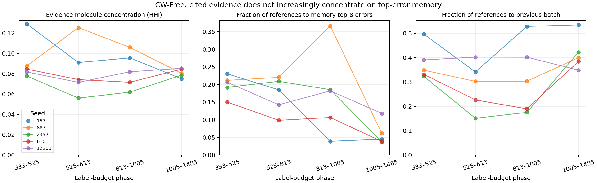
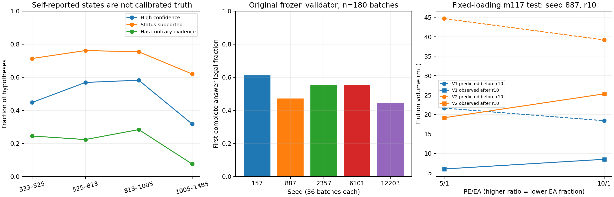

# LLM 科学推理、证据归属与跨轮记忆审计

## 结论与范围

最新 CW-visible Free32 确实出现了可核验的科学行为：识别模型预测与化学先验的冲突、选择固定其他记录条件的对照、发现分子归属错误后补选正确对照、承认反例及记录变异。然而，**科学表达、最终方案合法、以及下一轮模型性能改善是三个不同的结果**。本次发现的身份误写和纠错后证据链丢失，限制了把其自由文本直接当成可靠知识库的做法；现有证据也不支持“记忆越来越集中于极端异常分子”的总体说法。

本报告新增分析完整五 seed × 36 批，即 L333→1485 的 180 个已接受批次、5,760 个选择、871 条假设。seed 为 157、887、2357、6101、12203，round 全部从 0 起。输入来自 `reports/free_cw_final_20261112/scientific_artifacts/` 的五个归档，以及各轮 `batch_freeze.json` 哈希约束的本地 input/catalog/完整响应。没有调用模型、训练、读取测试真值或未采集候选真值；没有导出完整私有 packet。

归档中 1,645 个记录全部逐字节核 SHA；180 轮候选/已观测集合与冻结合约完全一致，选中集合与 feedback 完全一致。175 个连续轮次的 `previous_hypotheses`、`recent_outcomes` 分别与前一轮最终假设、前一轮选中反馈一致。这证明**传递链条忠实**，不证明前一轮解释正确。输入 `validation_test_records=0`，候选表无真实 V1/V2 列。

复用的旧结果是 `verifiable_scientific_agent_20261030` 的历史 Free/Hybrid/NoCW 合法性审计和 `free_lcmd_mechanism_diagnostics_20261029` 的局部条件设计病例。本报告的 180 批均来自独立 CW-Free 重跑，不把旧结果与新结果合并分母。

## 方法与证据等级

采用三层检查，分母分别保留：

1. **全量机器检查**：全部假设、结构化证据引用、完整响应、连续记忆、按固定规则发现的文本身份/ID异常。
2. **固定分层文本抽样**：每 seed 的 r0、r5、r14、r20、r35，共 25 批，阅读第一条假设、feedback interpretation 与 rationale；无假设的批次也保留。另加用户预先指定的 seed 887 r9–11。抽样规则不是按收益或显著性挑选。全部 75 个自动文本异常出现位置均人工逐条复核。
3. **详细证据链**：对上述固定样本对应的前一轮及用户指定病例，核验具体条件、冻结预测、选中后观测与下一轮选点。不是对 871 条科学命题逐条进行完整语义判真。

| 等级 | 本报告含义 | 能支持什么 |
|---|---|---|
| E0 | 与身份/条件记录冲突，或引用无法追溯 | 该具体解释存在错误/缺口 |
| E1 | ID 属于选前 L，记录存在 | 证据来源合法；尚不等于支持命题 |
| E2 | 命题中的具体条件/方向/数值与记录一致 | 记录中的关联或反例，不是实验因果律 |
| E3 | 选前问题→实际可区分的选择→反馈→后续修订可追踪 | 有可验证科学设计与反馈使用实例；仍不识别学习收益因果 |
| E4 | 同状态受控实验验证选择/知识机制改善学习 | 本次没有该级证据 |

主题分类是 `content` 的公开正则多标签描述，未调用另一个 LLM 判卷；类别可重叠且存在漏检。近似命题追踪用 token Jaccard≥0.55，只称“候选连接”，不把相同 H1/H2 编号当作同一科学命题。参考表为 [reasoning_hypotheses.csv](tables/reasoning_hypotheses.csv)、[reasoning_candidate_lineages.csv](tables/reasoning_candidate_lineages.csv)。

## 全量假设画像：既有化学内容，也缺少严格反证状态

| 内容类别（可重叠） | 假设数 / 871 | 比例 |
|---|---:|---:|
| PE/EA 与保留响应 | 417 | 47.9% |
| 上样/加载溶剂影响 | 357 | 41.0% |
| 结构相似性与迁移 | 196 | 22.5% |
| 普通区域与极端尾部 | 186 | 21.4% |
| V1/V2 不对称或分别变化 | 178 | 20.4% |
| 非线性、阈值、局部异常 | 157 | 18.0% |
| 模型误差/分位宽度/不确定性 | 128 | 14.7% |
| 明示结构—条件交互 | 115 | 13.2% |

模型自行标注 `mixed` 707、`observed_data` 116、`model_behavior` 40、`chemical_prior` 8 条。这不是外部评判的真实知识来源分解；给了数值描述符、预测和化学结构后，仅凭文字无法区分它依赖化学知识还是数值启发式。

`high/medium/low` 为 380/410/81 条；`supported/unresolved/proposed/weakened/rejected` 为 599/169/81/20/2 条。5,455 次结构化证据引用全部属于当轮选前 L，其中反例引用只有 293 次，涉及 147/871（16.9%）条假设。314 条 high 假设没有结构化反例；57 条假设没有任何结构化证据，但其中没有 high。所有假设都有非空待检验问题，23 条假设没有被当批任何 choice 关联。

这些结果支持“结构化反证较少、支持态多”的描述，**不能直接推断确认偏误发生率**：命题常以“有些、依赖结构、可能非线性”表达，反例未必能否定这种弱命题；另一方面，反例可能出现在 prose 而未进入列表。置信度也没有外部校准分母。

| seed | 假设数 | high | 有反例列表 | 与前轮内容逐字相同 |
|---|---:|---:|---:|---:|
| 157 | 168 | 28.6% | 14.9% | 3 |
| 887 | 173 | 56.6% | 13.9% | 3 |
| 2357 | 195 | 51.8% | 24.1% | 51 |
| 6101 | 170 | 42.4% | 13.5% | 4 |
| 12203 | 165 | 37.0% | 17.0% | 4 |

逐字重复 65 条，其中 42 个连接连支持/反例集合也不变；51/65 集中于 seed 2357。重复可以表示未解决问题的持续追踪，不能自动算无信息实验。但该集中度说明“所有 seed 都越来越积累精确知识”没有依据，也不能把一个 seed 的重复模式推广到全部轨迹。123 个高文本相似候选连接中没有 confidence 降低、8 次升高；**这个自动指标漏掉了 r9→r10 的真实语义降级**，因此不能据此说 LLM 从不降低置信度。问题在于命题会重写、ID 会复用或更名。

## 合法 ID 不保证科学归属：身份错误仍进入最终批次

180 个最终 selection 全部通过原冻结 validator，5,455 次 typed 引用也全在 L。然而，“第一个 m编号与所选候选实际分子不一致”的规则找到 38 条；逐条阅读后：

- 25 条明确把所选候选写成另一个分子；这是 5,760 条 choice 中的**已确认下界**，不是完整语义错误率。
- 12 条其实是合法的跨分子参照，不判错。
- 1 条将不同分子及多个条件变化称为 matched loading contrast：seed12203/r21 中 m88 的 150 μL、DCM 200 μL 与 m104 的 50 μL、DCM 300 μL，不构成同分子单因素对照，密度也不同。

另有 5 次未知 20位 ID 的 prose 引用，以及 32 次长度为 18–22 但不是 20位的近似 ID。它们未进入结构化列表，因此原规则不必拒绝。完整表保留原文与人工判断，不自动猜测正确 ID：[reasoning_flag_adjudications.csv](tables/reasoning_flag_adjudications.csv)。检出器只覆盖显式 m编号和接近 ID 的字符串，化合物名称、数值、条件、机制解释仍可能有未检出的错误。

**解释**：主要缺陷不只是格式，而是合法实体之间的语义绑定。用更严格 JSON 不能阻止把真实 m116 的合法 ID 当作 m125；单独检查 evidence∈L 也不能证明 evidence 支持命题。最小可靠改进应要求对照操作数绑定 row ID、分子身份和变化轴，由确定性程序展示实际差异，再由科学决策者解释，避免仅凭 prose 的“matched”标签。

## 预先指定病例：seed 887 r9–11 的错误、纠正与学习结果

### r9：一个被接受但不成立的对照（E0）

`59752d0b8c96b9efb90c` 实际为 **m116**，PE/EA=2/1、样品 50 μL、DCM 300 μL；LLM 将它称为 m125。`cc2a23d8eb9de61d2ab3` 才是 **m125**，同为 2/1、50 μL，但 DCM 500 μL。后者理由声称与前者“直接测试加载溶剂体积”，实际分子及密度也变了。选后 V1/V2 分别为 6.875/10.425 与 36.233/63.992 mL，不能归因于 DCM 体积。

同一批中又存在正确的对照：m72，20/1、PE 300 μL，50 与 100 μL 样品的预测 V1 几乎相同（35.379 vs 35.378 mL），实测 V1 为 47.000 vs 39.133 mL；V2 则为 119.367 vs 119.425 mL。这支持**所记录条件下 onset 与 finish 关联不同**，没有支持普遍的单调上样机理。

### r10：纠正身份并补真实可区分实验（E3）

下一轮明确指出 m116/m125 混淆，并把 m107、m120、m66、m106 等真实归属逐条纠正。m125 体积效应命题改为 `low/unresolved`。随后实际选中：

| row ID | 样品 / DCM（μL），均 m125、2/1 | 选前 V1/V2 预测（mL） | 选后 V1/V2（mL） |
|---|---|---|---|
| `5c2bc1d92128a17d996d` | 50 / 300 | 27.715 / 56.287 | 16.942 / 29.492 |
| 已观测 `cc2a23d8eb9de61d2ab3` | 50 / 500 | r9 的冻结预测为15.502 / 34.535 | 36.233 / 63.992 |
| `69b09343d0b9995c3ae4` | 100 / 500 | 27.713 / 56.285 | 6.975 / 56.858 |

第一组隔离记录的 loading-solvent-volume 轴，第二组隔离 sample amount 轴。模型对两条新点的预测近乎相同，揭示响应却不同。旧观测的预测是 r9 预测，**不能与 r10 新点预测当作同状态预测曲面**；表特意标记时间。

同轮另一个清晰案例是 m117：样品 150 μL、DCM 600 μL 固定，PE/EA 从 5/1 到 10/1，预测 V1/V2 从 21.652/44.691 降至 18.414/39.210 mL，而观测从 5.992/19.175 升至 8.483/25.325 mL。LLM 事前明确区分化学先验和未测事实，选择能区分模型插值错误与真实非单调性的两点；r11 承认其观测削弱原预测反转并继续选 20/1、50/1。这是“提出可反驳问题→选点→反馈→修订”的实例。

### r11：继续设计，但证据列表丢失

r11 继续补 m125 在 1/1、2/1、5/1 的样品量/溶剂体积条件，并延伸 m117 比例曲线。不过最终 5 条假设的支持和反例列表全部为空；它经过整批纠错，首答有 38 次结构化证据引用。这一轮保留了科学 prose，却失去了 typed 证据关系。不能将所有引用为空解释为该命题从未有观测，也不能因此直接判定修订错误。

对应 r9、r10、r11 的整批 validation gain 分别为 **−0.014372、+0.042152、−0.014625**。该正反序列来自 [batch_gains.csv](tables/batch_gains.csv)，说明叙事纠正与下一轮改善不是一一对应。每轮是全32点加重新训练；不存在只改变该 m125 设计的反事实，不能将 +0.042152 归功于修正，也不能将其他两次下降归咎于某一个点。

## 固定抽样中的其他正反例

**seed2357/r20（E3，读取其前一轮r19）**：LLM 正确引用同 m72、样品150 μL、DCM200 μL 的 2/1 与5/1对照，实测从8.183/25.800升至13.075/35.592 mL，并明确纠正“高PE/EA就是更强洗脱剂”的旧措辞：PE/EA 增加意味着 EA 分数减少；loading solvent 是加载液，不能混为流动相。可是 r19 的整批 gain 为 −0.022506，正确对照并未保证即时整体改善。此前 r14 中“low/high strength”与比例方向的对应有混乱，因此不能将后来正确的解释倒写为始终正确。

**seed6101/r35（E2，局部过度解释）**：前一轮以相同样品100 μL、DCM300 μL，测试 m179 的纯EA与1/1。预测V2为14.555与10.247 mL，实测11.358与9.417 mL。预测的上翘幅度从4.308缩小到1.942 mL，**符号仍然为正**；不能据此说所有反转消失或已证明不可重复。最终H6将“pronounced upturn 是模型 artifact”的新命题标为 `rejected`，其 status 究竟指旧预测命题还是改写后的否定命题并不清楚。这解释了为什么简单统计 `rejected=2` 不能当作两个被严密否证的机制。

**seed12203/r14（E0，物理方向语言）**：第一条假设称更强洗脱剂下形成很晚保留，反馈依据却是更高PE/EA的行；其 ratio 数值趋势与“stronger eluent”措辞不一致。这不是需要新训练才能发现的问题。报告不据此判定整批选择均无效，只要求把条件数值、EA分数、加载溶剂和自然语言方向绑定。

**seed6101/r5、r14（可追踪性缺口）**：固定抽样发现最终 hypothesis 列表为空，feedback 仍详细讨论上样、复测和局部曲线。不能因文字丰富而把它计作结构化假设链完整，也不能因列表为空就说没有用反馈。

25个固定样本及3个指定轮次的阅读范围与负面记录完整保留于 [reasoning_fixed_sample_review.csv](tables/reasoning_fixed_sample_review.csv)。上述病例体现可能的科学贡献，但既不是无偏科学错误率，也不是因果学习效益评估。

## 记忆随预算的变化：不支持简单的异常分子锁定故事

引用的分子集中度按引用出现次数计算 HHI，而非按唯一 ID；上一批和 top-8 的占比同样按引用出现次数计算。先逐批计算，再在 seed/阶段求均值，空证据批不进入这些均值。

| 阶段 | 全部批 / 有结构化证据批 | 引用分子HHI均值 | 引用 memory top-8 高历史误差样本比例 | 引用上一批比例 |
|---|---:|---:|---:|---:|
| L333–525 | 30 / 27 | 0.0913 | 20.04% | 37.72% |
| L525–813 | 45 / 39 | 0.0830 | 17.35% | 28.13% |
| L813–1005 | 30 / 29 | 0.0826 | 16.92% | 32.03% |
| L1005–1485 | 75 / 72 | 0.0807 | 5.97% | 41.78% |

初轮没有上一批和top-8反馈，若存在假设证据，相关比例为0，保留在早期均值中。总计153/180批有引用上一批的结构化证据；只有52批在 feedback prose 中直接写了上一批完整ID。不能把后者作为反馈使用率：它遗漏没有写ID的正确自然语言总结。155批出现“修订、反例、非统一”等关键词，同样不能把关键词计数当作真实修订次数。

HHI 与 top-8 引用占比的总体下降反驳了简单的“越来越追踪少数异常分子”的叙事，但**引用行为不等于模型注意力或实际选点分布**。后者应联合 [ACQUISITION_BEHAVIOR.md](ACQUISITION_BEHAVIOR.md) 的分子/条件指标评估。后期 high 比例从中期约58%降至32%，有结构化反例的假设比例也从中期28%降至7.6%；不能将较低置信度单独解释为知识更成熟。



图：五 seed 分别绘制，来自167个有结构化证据的批次，单位均为无量纲；阶段有效n为27、39、29、72。显示的是引用集中与来源，不是科学正确性。完整定义在 [reasoning_figure_captions.json](verification/reasoning_figure_captions.json)。

## 整批纠错的科学代价与系统问题分离

原冻结 validator 的纯函数通过 AST 提取，未导入 runner/model/label store。430个已保存完整响应中，95/180批首答合法（52.78%）；首答合法数按上述seed依次22、17、20、20、16。最终180/180通过，不能把最终通过率当作首答可靠性。

| 非法完整响应的原规则首因 | 数量 |
|---|---:|
| packet绑定不符 | 115 |
| 不属本轮候选集合的ID | 107 |
| hypothesis引用未观测证据 | 25 |
| choice引用未定义hypothesis | 1 |
| 其他schema/必需字段 | 2 |
| 合计 | 250 |

这是 fail-fast 首因分类，同一答案可能还含其他问题。packet绑定的115次主要集中于seed157/r15（82个完整答案）和seed12203/r16（33个完整答案），不能把重复失败当作115个独立科学决策病例。它也不同于物理传输尝试；费用/重试统计参见 [STABILITY_AND_COST_AUDIT.md](STABILITY_AND_COST_AUDIT.md)。成本档案的96,808个 later-turn transport attempts 不是96,808次逻辑纠错答案。

85个纠错批中，71批最终ID集合改变；首提案的2,517个合法ID最终保留1,004（39.89%），12批原合法ID全被替换。这里只检查集合，不能推出被替换实验更好或更差。54轮最终结构化证据数少于首答，14轮更多，17轮相同；13轮从有证据降为零，其中10轮整个hypothesis列表清空。原schema允许0–8假设，这些批次仍可合法。这是**纠错与科学可追踪性一起改变的描述证据**，不是纠错损害学习效率的因果估计。



图：左图各阶段假设n=143、197、134、397，是自报告状态；中图每seed36批，按原校验器；右图m117两条选中记录，预测为r10选前冻结、观测在冻结后揭示，单位mL，样品及DCM体积固定。连续轮次不视作独立重复。

## 对“知识→选点→学习”的最终判断

| 链条 | 历史可以支持 | 历史不能支持 |
|---|---|---|
| 观测→文本 | 精确传递前轮假设及反馈；存在身份纠正、反例识别 | 全部科学命题逐渐变真；所有反馈均被理解 |
| 文本→设计 | m125、m117 等可区分条件设计确实被选中 | 文本就是实际内部决策机制；化学先验贡献已被隔离 |
| 设计→新增观测 | 正确对照揭示条件响应与模型不敏感；也有错误归属/多轴混淆 | 每个对照都是物理因果实验；差异全来自已记录变量 |
| 观测→模型学习 | 可以连接下一次实际gain，正负都保留 | 某个化学命题或局部设计造成全部batch gain |

最有依据的下一步不是增加更多自由文本记忆，而是**小规模、同状态的可验证证据绑定对照**：保持模型、候选、已有L、原始提案与训练规则固定，只改变是否提供准确的身份/条件差异和反例检索结果，检查假设保留、科学对照有效性、合法率及后续学习。要区分化学知识与数值启发式，还需No-chemistry/No-feedback等受控消融；当前历史prompt、状态、路径和版本差异不能替代它。实际执行须属于下一阶段，本次未实施。

科学记忆建议的最小内容是：稳定命题ID及版本、不能悄然换主语的命题、比较的行ID和固定/变化轴、支持和反例、来自预测还是观测、未解决问题、检验后结果。不要让`status=rejected`附在已改写成相反意义的句子上。先证明这种结构降低错误归属且保留有效设计，再检验是否改善整体 Row AULC；不能只以解释更丰富作为成功标准。

## 复现与缺口

```bash
/Users/fish/miniforge3/envs/chromatography/bin/python -B studies/active_learning/comprehensive_history_diagnostics_20261112/scripts/analyze_reasoning.py
/Users/fish/miniforge3/envs/chromatography/bin/python -B studies/active_learning/comprehensive_history_diagnostics_20261112/scripts/review_reasoning_cases.py
MPLCONFIGDIR=/tmp/codex_reasoning_mpl /Users/fish/miniforge3/envs/chromatography/bin/python -B studies/active_learning/comprehensive_history_diagnostics_20261112/scripts/plot_reasoning.py
```

输入SHA：[reasoning_input_manifest.json](verification/reasoning_input_manifest.json)；全量检查：[reasoning_checks.json](verification/reasoning_checks.json)；人工复核范围：[reasoning_manual_review.json](verification/reasoning_manual_review.json)。脚本会拒绝本地packet/响应与freeze不符，不用其他轮次替代。新克隆只含公开归档时，本地packet/原始响应可能不可用；应阅读派生表与已固定SHA，不自动补跑模型。

仍缺：全部871命题逐条盲法语义审阅及评阅者一致性；稳定命题主语/操作性定义；机制假设的实验复测；同状态化学、反馈和数值提示的随机化消融；科学修订对后续学习的因果对照。严格界限是：本次提供全量来源/格式审计、明确范围的语义下界和正反证据链，不宣称全量科学判真。
