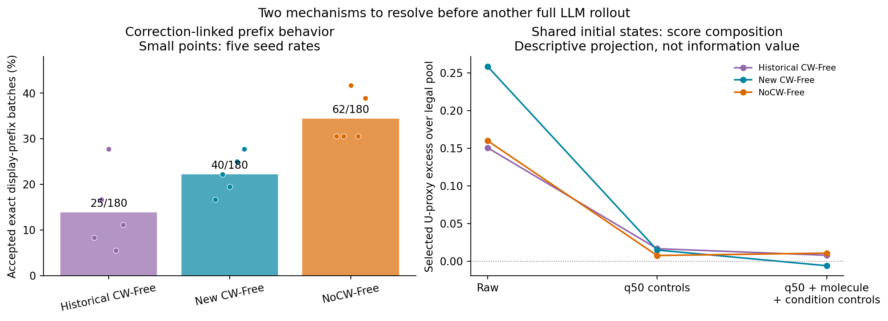

# 三种 LLM 轨迹的差异：先区分科学选择、响应尺度与纠错路径

本节新增检查实际首批输入、候选顺序、原始提议和纠错过程，并对选中 G/U 分位作组成调整。复用上轮结论，不重做整体 V/U 或 Novelty 图。全部计算来自已冻结输入、候选预测与元数据；没有新 LLM、QGeoGNN 训练、test truth 或未揭示标签。

## 1. 最值得先解决的新机制：纠错后转为候选表前32行

**观察 →** 540 个纯 LLM 已接受 batch 中，**127 个（23.52%）**恰好选择实际 packet 候选表前32行，而且顺序也完全相同。候选表按每轮 salted ID hash 展示，前32行没有被预先按科学价值或 CW 排名。

| 运行 | 全部批数 | 最终有序前32 | 有保存的拒绝记录的批数 | 纠错批中的前32比例 |
|---|---:|---:|---:|---:|
| Historical CW-Free | 180 | 25（13.89%） | 68 | 36.76% |
| New CW-Free | 180 | 40（22.22%） | 85 | 47.06% |
| NoCW-Free | 180 | 62（34.44%） | 110 | 56.36% |

这不是只发生在某个 seed：按157/887/2357/6101/12203排列，前32批数分别为 Historical **3/6/10/2/4**、New **6/8/7/9/10**、NoCW **11/11/15/11/14**。各阶段也均有出现，NoCW在L813–1005为19/30批。

**时序证据 →** 127例全部有保存的拒绝记录；无拒绝记录的277批中没有一例。127条轨迹中，第一份可解析出字符串 ID choices 的提议都不是前32；其与最终集合的重合中位数为Historical 2、New 2、NoCW 3个。38例首份可解析提议已经包含31个唯一合法候选；合法性问题之后，最终仍可能整批转到展示前缀。这里比较的是已保存的完整提议，未从不可解析文本补造候选。

**可审查实例 →** seed2357 的 Historical/NoCW 首批、seed12203 的三种 LLM 首批，都落到同一候选顺序的前32。它们的 request SHA、response-ID SHA、原始理由 SHA 均不同；各自最终原始回答与冻结 selection 完全匹配。因此，集合一致不能被解释成一次文件复制，也不能被当成独立科学重复提供更多样本量。

New seed157 r5 的最终 `batch_strategy` 明确写有“using the first 32 legal catalog rows”；New seed2357 r10及NoCW seed157 r20也明确提到first32。透明规则共找到3个与真实前缀一致的最终文本；另NoCW seed887 r20声称first32，实际只重合31个，说明理由不能代替ID核验。其余124例没有匹配到该措辞，不能由此宣称恢复了内部动机。

**可能原因与边界 →** 保存的纠错消息只要求从 **SAME complete pool/catalog** 返回合法、不同的ID，没有要求选前32。审阅的直接选择/恢复代码也没有为这些案例指定前32；证据是原始 LLM 回答自身改变了集合。当前可说“拒绝与转入前缀按此顺序共同出现”，不能说系统自动 fallback、缓存复制、LLM有意逃避思考，或纠错已被随机化地证明导致退化。前缀集合不等于没有科学信息，更不等于已证明下一轮学习收益为零。

数据：`llm_display_prefix_batches.csv`（540批）、`llm_prefix_cases.csv`（127例；首/前一提议、合法数、完整ID顺序、纠错消息、最终理由）、`llm_prefix_proposal_trajectories.csv`（原始turn路径、SHA与request/response摘要）、`llm_prefix_seed_phase.csv`。127例均唯一匹配最终 accepted receipt。这个机制表明，现有长轨迹同时测量了科学选点、ID合法性和纠错上下文的共同作用。

## 2. 首批科学输入相同到什么程度？

五个 seed 的三方法在 L333 都共享同一个 checkpoint、相同有序 L/U，合法候选2997行，初始科学记忆为空且相同。更强的核验是：**Historical 与 New 的实际 `input.json` 解析对象逐seed完全相等，`packet_sha256`也相同。** NoCW 的 packet 去除绑定hash后，精确等于从CW packet删除 `cw_distance_percentile` 一列的结果；其他预测、化学信息、观察记录及顺序不变。

但完整请求不是相同的：Historical 冻结系统提示为7869字符；New删除47字符的遗留句子 `Pending-CW outcomes are identified separately.\n` 后为7822字符，其 stable-JSON SHA 与New `protocol.lock.json`完全一致。再移除CW两行说明得到NoCW提示SHA。虽然Free没有pending，该句影响有多大仍未知，不能把它自动忽略。

Historical seed157/6101首批served为Astra，另三seed为Sol；New/NoCW首批均served Sol。Historical6101首批有4份冻结turn、New12203有3份，其他若干有2份；最终输入还可能包括不同的纠错回答/消息。因此相同科学packet不等于相同模型、系统说明、完整对话或服务实现。

首批ID重合数如下。完整候选、条件、预测及逐选点分位在 `initial_selected_candidates.csv`；请求与理由摘要在 `initial_pairwise_provenance.csv`。

| seed | Historical∩New | Historical∩NoCW | New∩NoCW |
|---|---:|---:|---:|
|157|0|12|0|
|887|4|3|4|
|2357|4|32|4|
|6101|8|2|1|
|12203|32|32|32|

2357/12203的全重合由上节的真实展示前缀核验解释，不能仅从“响应不同”推断模型科学偏好随机；0–8个重合的其他配对也同时混杂模型/系统说明/纠错路径，不是纯CW因果效应。首批后各自历史与模型分叉，不再进行同状态配对。

## 3. G/U差别有多少伴随预测响应尺度和分子/条件组成？

这里的U仍是两端点原始q90−q10池内排名组合，G是当轮CW最近历史距离池内分位。分析目标是解释**选中分数的组成**，不是估计候选实验学习价值。

每个真实候选池内，以分位分数为被解释变量，作四种透明投影：原始中心化分位；q50V1/q50V2的秩、平方及交叉项；分子固定效应加四个连续条件秩/平方与加载溶剂类别；上述全部。固定效应用分子内demean实现，没有模型训练标签。表中数字是选中候选的平均残差，单位仍为池内分位；不是行为Logit系数、不是因果效应，也不是训练外预测检验。

**共同首批五seed等权：**

|方法|原始G超额|q50调整后G|全部组成调整后G|原始U超额|q50调整后U|全部组成调整后U|
|---|---:|---:|---:|---:|---:|---:|
|Historical|0.10499|0.00462|0.00504|0.15063|0.01663|0.00784|
|New|0.18016|0.00107|−0.00942|0.25852|0.01485|−0.00602|
|NoCW|0.17191|0.05505|0.01293|0.15990|0.00753|0.01072|

New首批预测q50V2均值39.740mL，对Historical27.738、NoCW26.294；V2宽度分别19.456、15.036、15.559mL。New的高G/U选择同时更偏向长预测保留体积。New相对Historical的原始U/G差为+0.10789/+0.07517，q50调整后为−0.00178/−0.00355；只看从头Sol的887/2357/12203，U差也从+0.16681变为−0.00379。这支持“响应尺度组成可解释较多表面差异”，不足以证明q50是唯一机制或任何输入无效。

**保留反例与敏感性：** 同q50双端点五分位格中匹配未选候选，排除整个已选batch、每个点至少5个对照，覆盖99.4%–100%的首批选点。Historical/New/NoCW的U超额仍为0.0362/0.0611/0.0249；粗分箱仍保留正差。进一步同分子＋q50分箱仅覆盖约61%–64%，不拿这个不完整子集代表全部。初始NoCW的q50调整后G仍有0.05505，也反对“所有差别都只是保留体积大小”的强解释。全组成投影较灵活，残差变小本身不能证明没有独立有用信息。

**后续描述性范围：** U在540批都完整。先各seed平均36批，再等权五seed，Historical/New/NoCW的原始U超额0.21426/0.18723/0.16985，经q50调整后0.02475/0.01173/0.01193，全部组成调整后0.00374/0.00220/0.00224。各方法使用各自冻结状态，不是相同checkpoint反事实。G在Historical/New全部360批完整；NoCW只有共同早期两seed42批及其他三seed首批，共45批可用。没有把405个可用G状态冒充540批完整比较。

数据：`llm_score_adjustment.csv`、`llm_score_matching.csv`、`score_adjustment_seed_phase.csv`。控制变量中含被选择的化学/条件组成，因此这里刻画的是组成内的分数差，而非去掉选择机制后的政策效应。

## 4. 后期条件投入：有差异，但没有单一“LLM都选错因素”的证据

逐因素记录同分子、恰好一个记录条件不同的历史对照名额，以及同批对照对数。此实现与研究A的正式分配表在540批×5因素的2700行上独立核验一致，历史比例和批内pair数最大差均为0。主机制解释应合并阅读研究A已揭示反馈的真实响应压缩结果，不能仅凭分配比例归因学习效率。

|方法|L333–525批内PE/EA对/批|同阶段样品体积对/批|L1005–1485 PE/EA对/批|同阶段样品体积对/批|
|---|---:|---:|---:|---:|
|Historical|5.000|0.333|5.933|1.547|
|New|3.733|0.633|4.853|1.227|
|NoCW|3.867|0.433|4.027|1.307|

New早期体积对更多，但末段Historical更多，并不存在New全程都投入最多体积对照的排序。历史单因素体积对照名额末段为Historical47.79%、New37.67%、NoCW48.75%；历史PE/EA对照名额分别80.33%、84.12%、84.71%。同一候选可以同时匹配不同因素的历史对照，比例不可相加当预算。历史随轮次变密集也会提高这些比例，不能将其全部当成自主偏好。

末段packet记忆字符串平均约Historical52,614、New52,320、NoCW49,802字符，内容不同；它们不是API完整有效上下文长度，尚不包括全部纠错对话。`llm_context_audit.csv`另保存输入字节数与首批实际usage。参数同名不能消除不同记忆、日期、缓存/服务路由及纠错路径的混杂。

## 5. 再完整跑NoCW能回答什么？

**结论：暂缓完整重跑。** 在现有协议下重跑相同seed，可以测量“模型生成＋ID合法性＋纠错＋展示顺序＋后续历史路径”的联合运行变异；它不能单独解释CW信息效应，也不能消除Astra/Sol、47字符系统差异、历史记忆与服务时间变化。换seed主要增加划分/初始模型的覆盖，也不是随机性重复。

更小的下一步应先固定同seed checkpoint、完整packet、模型/effort、系统提示、重试和验收规则，分开保留原提议、错误与最终接受：若目标是定位新发现的工程机制，在预先指定的五个L333状态中比较两种候选行顺序、每种两次生成，共20次提案；若目标是估计CW的选择效应，则另作同状态CW可见/不可见配对，不能把它当成前一种实验。两者都不需要先跑36批反馈链；本轮均未执行，也未估计费用。

若前缀转入频率随行顺序改变，且相同科学内容的候选分布随之移动，展示/纠错机制值得优先修复并重新定义公平比较；若控制后前缀现象很少、科学选点高度稳定，则降低这条机制优先级，转向研究A的固定标签条件可学习性对照。任何提案分布改善都还需真实配对单步训练才能证明Row收益，本轮不启动该验证。



## 6. 复现与可审查性

```sh
/Users/fish/miniforge3/envs/chromatography/bin/python -B studies/active_learning/decision_mechanism_followup_20261117/llm_reproducibility.py
/Users/fish/miniforge3/envs/chromatography/bin/python -B studies/active_learning/decision_mechanism_followup_20261117/llm_prefix_diagnostic.py
/Users/fish/miniforge3/envs/chromatography/bin/python -B -m unittest discover -s studies/active_learning/decision_mechanism_followup_20261117/tests -p 'test_llm*.py' -v
```

原始输入和SHA分列在 `llm_reproducibility_inputs.json`、`llm_prefix_inputs.json`；首批ID、元数据、预测、调整值均可定位回冻结catalog/packet。测试覆盖只删除CW列、分子内投影与残差正交性、已知尺度控制、匹配排除整个batch、无匹配支持、单因素类型、前缀集合/顺序区分、拒绝从不可解析文本补造choices与措辞规则。本节没有把剩余分数差、前缀事件或条件投入当成独立学习价值。
