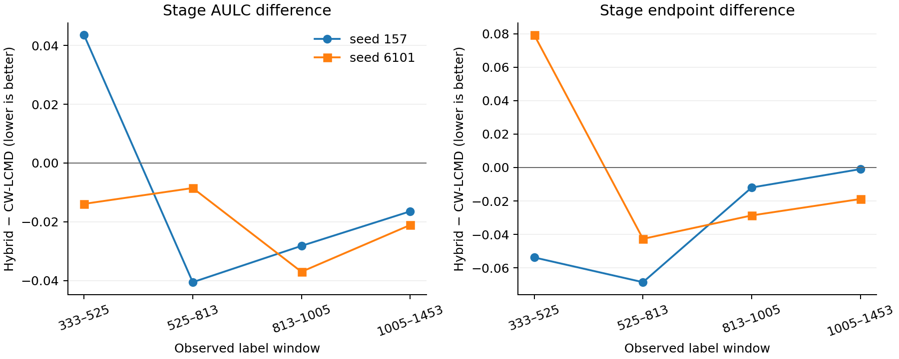

# 长期Hybrid的优势何时出现、是否被单次波动主导

**新计算显示：优势不是从一开始就在两个seed同步出现，也不是一个异常检查点单独撑起的。** 157在L333–525的AULC更差，但两个seed在后3个指定阶段都更好；任意排除一个检查点的相邻两个真实梯形后，全程方向仍保留。

本轮预先按任务指定窗口333–525、525–813、813–1005、1005–1453统计；每seed独立积分原始非单调validation NRMSE，不取best-so-far，不平滑，不跨缺口插值。数据是11月16日已核验曲线的四条campaign、144个保存评价点，逐点以旧fit_audit验证训练行数、checkpoint与validation数值。源码和输入SHA见 [phase_protocol.py](phase_protocol.py)、[phase_source_manifest.json](phase_source_manifest.json)。

## 1. 固定阶段的实测结果

下表的差均为Hybrid−CW，负值代表Hybrid更好。AULC已除以阶段标签长度。

| seed | 阶段 | Hybrid AULC | CW AULC | AULC差 | 阶段终点差 |
|---|---|---:|---:|---:|---:|
| 157 | 333–525 | 0.659929 | 0.616361 | **+0.043569** | −0.053778 |
| 157 | 525–813 | 0.381377 | 0.421957 | −0.040581 | −0.068559 |
| 157 | 813–1005 | 0.324414 | 0.352633 | −0.028219 | −0.011959 |
| 157 | 1005–1453 | 0.307907 | 0.324372 | −0.016465 | −0.000964 |
| 6101 | 333–525 | 0.764431 | 0.778342 | −0.013912 | **+0.079186** |
| 6101 | 525–813 | 0.459198 | 0.467721 | −0.008523 | −0.042657 |
| 6101 | 813–1005 | 0.381312 | 0.418348 | −0.037037 | −0.028659 |
| 6101 | 1005–1453 | 0.370560 | 0.391681 | −0.021120 | −0.018829 |

两seed全程L333–1453的Hybrid/CW AULC为157：0.389976/0.404365，差−0.014390；6101：0.462717/0.482090，差−0.019374。等权均值差−0.016882，约为CW均值的−3.81%。最终端点差分别−0.000964和−0.018829；157端点几乎追平，因此不能把积分优势写成普遍较低的最终误差。

观察点层面，去掉共同L333后，Hybrid损失较低的点数为157的30/35、6101的29/35。这是当前轨迹覆盖范围，不是70个独立实验的胜率检验。

## 2. 阶段反例与模型前缀

157早期AULC更差+0.043569，但L525端点更好−0.053778；6101早期AULC更好−0.013912，但同一端点更差+0.079186。只看某个阶段末端会得到与积分相反的印象。

单次更新也有明显反例：6101的L461→493，Hybrid loss增加0.041054，CW下降0.150120；157的L813→845，Hybrid增加0.022087，CW下降0.037998。它们反驳“Hybrid每批都更有效”，但没有消除全程积分优势。

长期Hybrid在L813前为Astra/high前缀，L813起Sol/xhigh。两seed的优势已在**525–813**出现，故不能完全归给换Sol。反过来，两个配置阶段接续同一训练历史，不能将813之后视为从头纯Sol的独立验证，更不能根据这两个seed推出应在L525或L813切换算法的通用规则。

## 3. 优势是否集中于一个点或一个阶段

将AULC差精确分解为各阶段对全程积分的贡献（均除以总宽度1120）后，两seed等权贡献分别为：早期 **+0.002542**、525–813 **−0.006313**、813–1005 **−0.005593**、1005–1453 **−0.007517**，合计−0.016882。后期区间占40%标签宽度，贡献较大部分优势并不意外；它不是唯一有利阶段。

为检查局部大波动，不改主曲线，而对每个内部检查点排除其左右两个**真实已观测梯形**，其余梯形按剩余标签宽度重新归一化；不跨被排除区间插值。这是一种离线敏感性诊断，不是新的主AULC或实际可实现的训练轨迹。

| seed | 原始全程差 | 34种局部区间排除后的最小差 | 最大差（最接近失去优势） |
|---|---:|---:|---:|
| 157 | −0.014390 | −0.019719 | **−0.012104** |
| 6101 | −0.019374 | −0.025401 | **−0.015641** |

全部仍为负。即使轮流排除四个指定阶段之一，157剩余差范围为−0.026381至−0.005324，6101为−0.023130至−0.015719，也没有翻转。因此“只是一处尖峰或唯一一段撑起全部优势”的解释不符合当前曲线。

这仍不能区分训练噪声与选点学习贡献：没有相同标签集独立重复fit，没有相同冻结状态配对标签/重训，历史模型前缀与选择状态也混杂。敏感性稳健只说明已观察积分优势分布较广，不能提供强因果证据或新增seed必然获益的保证。

## 4. 能支持的决策信息

这是比“整体AULC低3.81%”更具体的新证据：长期信号跨两个seed、后3阶段和大多数观察点存在，值得对机制进行受控检验；同时早期异质性、157末端接近持平和模型前缀使直接长跑存在风险。是否补3seed应看是否要检验“现代统一配置的Hybrid总体有效”，而不能声称补完后自动得到原历史协议的同质五seed确认。

详细表包括 [phase_performance.csv](phase_performance.csv)、[phase_interval_influence.csv](phase_interval_influence.csv)、[phase_local_omission_sensitivity.csv](phase_local_omission_sensitivity.csv) 与 [phase_omission_sensitivity.csv](phase_omission_sensitivity.csv)。这些都是新计算；原整体曲线及训练不变。
