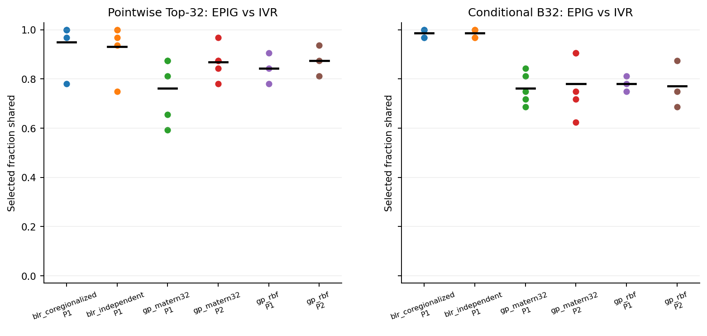
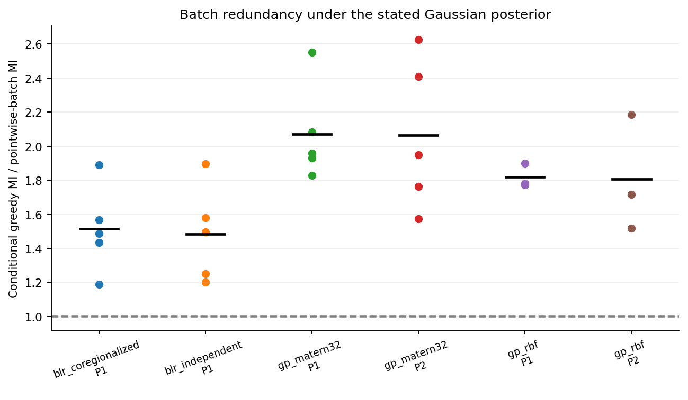
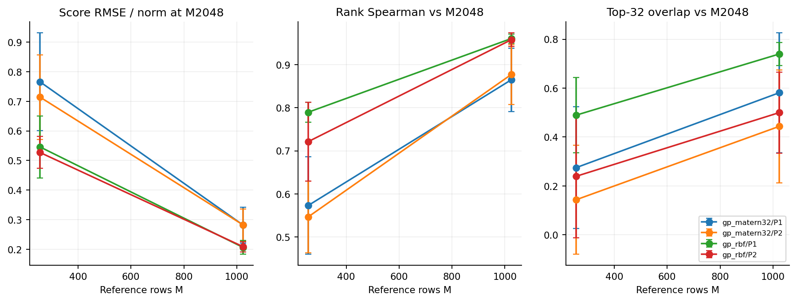
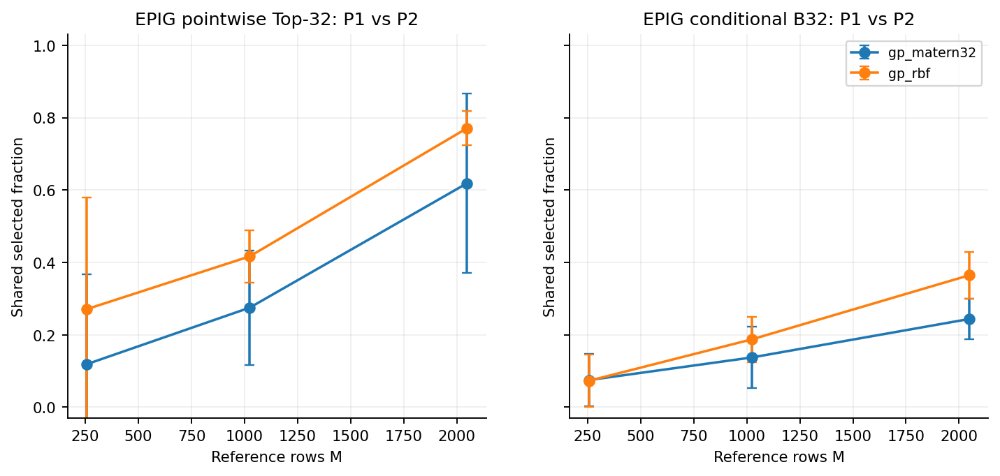
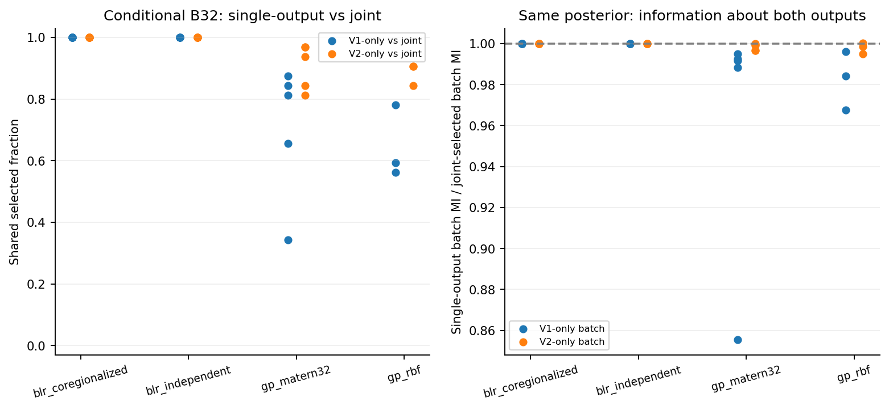

# 消融与机制证据

实际完成 58 个冻结 L333 acquisition 诊断状态；这些状态均**不揭示候选标签、不训练新的 QGeoGNN**。资格状态为 INCOMPLETE_POSTERIOR_QUALIFICATION。每个状态的 `posterior_qualified` 是相应seed本地门槛；不合格状态只作数值/机制诊断，即使有其他seed合格也不能替它认证。通过资格的代理仍须接受真实 AL 终点评价。

## 同后验 EPIG 与 IVR、批量条件化和输出

| seed | family | distribution | M | posterior_qualified | spearman_epig_ivr | top32_overlap_epig_ivr | top100_overlap_epig_ivr | greedy_batch_overlap_epig_ivr | greedy_pointwise_batch_overlap | greedy_epig_batch_information_nats | pointwise_batch_information_nats | ivr_batch_information_nats | endpoint_V1_V2_top32_overlap | V1_fraction_singleton_information | seconds |
| --- | --- | --- | --- | --- | --- | --- | --- | --- | --- | --- | --- | --- | --- | --- | --- |
| 12203 | blr_coregionalized | P1 | 1024 | False | 0.999934 | 1.000000 | 0.990000 | 1.000000 | 0.281250 | 0.006625 | 0.003502 | 0.006625 | 1.000000 | 0.500000 | 27.921545 |
| 12203 | blr_independent | P1 | 1024 | False | 0.999930 | 1.000000 | 1.000000 | 1.000000 | 0.281250 | 0.006848 | 0.003608 | 0.006848 | 1.000000 | 0.500000 | 29.808922 |
| 12203 | gp_matern32 | P1 | 1024 | True | 0.955602 | 0.656250 | 0.750000 | 0.843750 | 0.281250 | 0.065355 | 0.035748 | 0.064722 | 0.687500 | 0.438111 | 32.863538 |
| 12203 | gp_matern32 | P2 | 1024 | True | 0.966083 | 0.843750 | 0.650000 | 0.750000 | 0.187500 | 0.068081 | 0.025940 | 0.066948 | 0.875000 | 0.438441 | 32.037178 |
| 157 | blr_coregionalized | P1 | 1024 | False | 0.999923 | 0.781250 | 1.000000 | 1.000000 | 0.468750 | 0.006345 | 0.005340 | 0.006345 | 1.000000 | 0.500000 | 23.545985 |
| 157 | blr_independent | P1 | 1024 | False | 0.999924 | 0.750000 | 1.000000 | 0.968750 | 0.468750 | 0.006199 | 0.005164 | 0.006199 | 1.000000 | 0.500000 | 25.060989 |
| 157 | gp_matern32 | P1 | 1024 | True | 0.960210 | 0.593750 | 0.670000 | 0.687500 | 0.250000 | 0.044402 | 0.022674 | 0.043705 | 0.218750 | 0.190983 | 22.132310 |
| 157 | gp_matern32 | P2 | 1024 | True | 0.960016 | 0.875000 | 0.800000 | 0.718750 | 0.312500 | 0.048857 | 0.025048 | 0.048053 | 0.343750 | 0.186401 | 26.262260 |
| 2357 | blr_coregionalized | P1 | 1024 | True | 0.999853 | 0.968750 | 0.990000 | 0.968750 | 0.343750 | 0.007563 | 0.005083 | 0.007564 | 1.000000 | 0.500000 | 29.067991 |
| 2357 | blr_independent | P1 | 1024 | False | 0.999842 | 0.937500 | 0.990000 | 1.000000 | 0.343750 | 0.007845 | 0.005242 | 0.007845 | 1.000000 | 0.500000 | 28.757844 |
| 2357 | gp_matern32 | P1 | 1024 | False | 0.991654 | 0.875000 | 0.920000 | 0.750000 | 0.218750 | 0.020730 | 0.010736 | 0.020541 | 0.843750 | 0.459139 | 32.631254 |
| 2357 | gp_matern32 | P2 | 1024 | False | 0.993192 | 0.875000 | 0.820000 | 0.906250 | 0.250000 | 0.022196 | 0.014107 | 0.022068 | 0.875000 | 0.459621 | 27.596482 |
| 2357 | gp_rbf | P1 | 1024 | False | 0.994942 | 0.843750 | 0.870000 | 0.812500 | 0.218750 | 0.020211 | 0.011400 | 0.020018 | 0.781250 | 0.452271 | 24.825025 |
| 2357 | gp_rbf | P2 | 1024 | False | 0.995209 | 0.937500 | 0.890000 | 0.687500 | 0.218750 | 0.021599 | 0.014232 | 0.021302 | 0.937500 | 0.452597 | 31.807239 |
| 6101 | blr_coregionalized | P1 | 1024 | False | 0.999914 | 1.000000 | 1.000000 | 0.968750 | 0.375000 | 0.007062 | 0.004925 | 0.007056 | 1.000000 | 0.500000 | 27.697732 |
| 6101 | blr_independent | P1 | 1024 | False | 0.999917 | 0.968750 | 1.000000 | 0.968750 | 0.468750 | 0.006752 | 0.005393 | 0.006745 | 1.000000 | 0.500000 | 26.622105 |
| 6101 | gp_matern32 | P1 | 1024 | False | 0.991135 | 0.875000 | 0.800000 | 0.812500 | 0.187500 | 0.025678 | 0.012332 | 0.025510 | 0.937500 | 0.316586 | 30.630630 |
| 6101 | gp_matern32 | P2 | 1024 | False | 0.990728 | 0.781250 | 0.910000 | 0.906250 | 0.250000 | 0.030432 | 0.017264 | 0.030347 | 0.781250 | 0.311831 | 31.358526 |
| 6101 | gp_rbf | P1 | 1024 | False | 0.996924 | 0.906250 | 0.830000 | 0.781250 | 0.187500 | 0.020481 | 0.010774 | 0.020400 | 0.656250 | 0.332789 | 27.681527 |
| 6101 | gp_rbf | P2 | 1024 | False | 0.997019 | 0.812500 | 0.900000 | 0.875000 | 0.218750 | 0.024404 | 0.014217 | 0.024394 | 0.656250 | 0.326787 | 29.154194 |
| 887 | blr_coregionalized | P1 | 1024 | False | 0.999888 | 1.000000 | 0.990000 | 1.000000 | 0.281250 | 0.006669 | 0.004258 | 0.006669 | 1.000000 | 0.500000 | 24.465521 |
| 887 | blr_independent | P1 | 1024 | False | 0.999885 | 1.000000 | 0.990000 | 1.000000 | 0.281250 | 0.006828 | 0.004325 | 0.006828 | 1.000000 | 0.500000 | 24.807994 |
| 887 | gp_matern32 | P1 | 1024 | False | 0.982598 | 0.812500 | 0.840000 | 0.718750 | 0.156250 | 0.033307 | 0.013047 | 0.033093 | 0.968750 | 0.353584 | 31.329424 |
| 887 | gp_matern32 | P2 | 1024 | False | 0.981222 | 0.968750 | 0.850000 | 0.625000 | 0.187500 | 0.031424 | 0.013042 | 0.030842 | 0.968750 | 0.351519 | 27.913405 |
| 887 | gp_rbf | P1 | 1024 | False | 0.990735 | 0.781250 | 0.880000 | 0.750000 | 0.218750 | 0.024469 | 0.013742 | 0.024413 | 0.687500 | 0.345570 | 23.989172 |
| 887 | gp_rbf | P2 | 1024 | False | 0.988861 | 0.875000 | 0.820000 | 0.750000 | 0.156250 | 0.022281 | 0.010201 | 0.021924 | 1.000000 | 0.343794 | 28.982658 |

EPIG/IVR 使用相同 fitted posterior、相同参考集合和固定 L333 单位尺度，只改变 acquisition objective。Top-32 是初始单点排名重合，conditional B32 是条件化所选 batch 重合，两者不混用。MI 以 nats 记录；IVR 批次的 MI 也在同后验下独立条件化复核。贪心的代理 MI 优势不意味着 QGeoGNN 性能优势。

`epig_V1` / `epig_V2` 是边缘单任务诊断。独立输出 GP 的联合 MI 确实等于两边缘之和，但不能宣称有跨输出依赖；coupled BLR 另名单列。上表 V1 fraction 衡量初始候选总单点信息比例，不是唯一可加的 coupled 多输出归因，也不代表真实误差贡献。

### 资格揭示后的独立封存单输出批次补充分析

`supplementary_output_ablation.py` 属于**事后声明的analysis appendix**，独立seal绑定主科学freeze与代码hash，不修改stage1协议，也不借此选择主方法。状态：COMPLETE_FOR_CURRENTLY_AVAILABLE_STATES，已完成18个实际P1/M1024状态。它从已校验hash的model.pkl构造相同posterior与相同refs，分别执行V1-only/V2-only conditional greedy B32，并对每个批次用直接64×64 noisy batch协方差/Schur重算完整双输出MI。新模型拟合数与新标签读取数均为0；原selected IDs与逐step trace保留在该appendix目录。

| seed | family | posterior_qualified | V1_only_joint32_overlap | V2_only_joint32_overlap | V1_V2_greedy32_overlap | joint_batch_information_nats_direct | V1_only_batch_joint_information_nats | V2_only_batch_joint_information_nats | joint_vs_independent_sum_max_abs_score_error | joint_score_recomputation_max_abs_error | seconds |
| --- | --- | --- | --- | --- | --- | --- | --- | --- | --- | --- | --- |
| 12203 | blr_coregionalized | False | 1.000000 | 1.000000 | 1.000000 | 0.006625 | 0.006625 | 0.006625 | 0.000000 | 0.000000 | 2.598752 |
| 12203 | blr_independent | False | 1.000000 | 1.000000 | 1.000000 | 0.006848 | 0.006848 | 0.006848 | 0.000000 | 0.000000 | 2.435854 |
| 12203 | gp_matern32 | True | 0.812500 | 0.968750 | 0.781250 | 0.065355 | 0.064800 | 0.065346 | 0.000000 | 0.000000 | 5.068683 |
| 157 | blr_coregionalized | False | 1.000000 | 1.000000 | 1.000000 | 0.006345 | 0.006345 | 0.006345 | 0.000000 | 0.000000 | 3.126658 |
| 157 | blr_independent | False | 1.000000 | 1.000000 | 1.000000 | 0.006199 | 0.006199 | 0.006199 | 0.000000 | 0.000000 | 3.681772 |
| 157 | gp_matern32 | True | 0.343750 | 0.843750 | 0.281250 | 0.044402 | 0.037978 | 0.044255 | 0.000000 | 0.000000 | 4.488938 |
| 2357 | blr_coregionalized | True | 1.000000 | 1.000000 | 1.000000 | 0.007563 | 0.007563 | 0.007563 | 0.000000 | 0.000000 | 4.236633 |
| 2357 | blr_independent | False | 1.000000 | 1.000000 | 1.000000 | 0.007845 | 0.007845 | 0.007845 | 0.000000 | 0.000000 | 4.559333 |
| 2357 | gp_matern32 | False | 0.843750 | 0.812500 | 0.656250 | 0.020730 | 0.020624 | 0.020658 | 0.000000 | 0.000000 | 5.400003 |
| 2357 | gp_rbf | False | 0.781250 | 0.843750 | 0.625000 | 0.020211 | 0.020132 | 0.020109 | 0.000000 | 0.000000 | 5.592750 |
| 6101 | blr_coregionalized | False | 1.000000 | 1.000000 | 1.000000 | 0.007062 | 0.007062 | 0.007062 | 0.000000 | 0.000000 | 4.888708 |
| 6101 | blr_independent | False | 1.000000 | 1.000000 | 1.000000 | 0.006752 | 0.006752 | 0.006752 | 0.000000 | 0.000000 | 5.188009 |
| 6101 | gp_matern32 | False | 0.656250 | 0.968750 | 0.625000 | 0.025678 | 0.025376 | 0.025654 | 0.000000 | 0.000000 | 6.264849 |
| 6101 | gp_rbf | False | 0.562500 | 0.906250 | 0.531250 | 0.020481 | 0.019818 | 0.020451 | 0.000000 | 0.000000 | 6.010097 |
| 887 | blr_coregionalized | False | 1.000000 | 1.000000 | 1.000000 | 0.006669 | 0.006669 | 0.006669 | 0.000000 | 0.000000 | 4.325485 |
| 887 | blr_independent | False | 1.000000 | 1.000000 | 1.000000 | 0.006828 | 0.006828 | 0.006828 | 0.000000 | 0.000000 | 4.378462 |
| 887 | gp_matern32 | False | 0.875000 | 0.937500 | 0.812500 | 0.033307 | 0.033059 | 0.033291 | 0.000000 | 0.000000 | 5.681097 |
| 887 | gp_rbf | False | 0.593750 | 0.906250 | 0.562500 | 0.024469 | 0.024083 | 0.024476 | 0.000000 | 0.000000 | 4.592515 |

对独立输出GP，`joint_vs_independent_sum_max_abs_score_error`是完整联合初始score与V1/V2独立score求和的独立复算误差；在该GP中等式来自输出独立假设。对coupled BLR，同先验/噪声共享B，使完整双输出MI在可逆whitening后与B无关，该特别可分离结构也可产生相同求和数值；真实非零cross-output covariance仍然存在。原始字段`independent_sum_is_exact_model_identity`仅标记是否执行GP独立恒等式断言，False不代表BLR数值不相等。独立BLR的共享空间结构也可使两输出排名相同。不能用这种排名不变否定更一般非可分离联合模型。贪心不是全局最优，某单输出批次完整联合MI偶尔高于joint-greedy也不矛盾。单输出批次的双输出MI差只是代理下的信息差，不是Row-level效果。

## P1/P2 与 M 敏感性

P1 从固定 outer-training row 输入抽样，P2 从合法当前 U 输入均匀抽样；均不使用 target 真值。M=256/1024/2048 采用预定义 nested hash ordering。`acquisition/reference_sensitivity.csv` 比较相同候选上的 M2048 score RMSE、Spearman 与 Top-32/100 重合。若尚无该表，不能把缺失画成稳定。reference error 是有限 M 相对 M2048 的经验差，不是相对未知真实积分的绝对误差。

| seed | family | distribution | M | reference_M | objective | relative_score_rmse | spearman | top32_overlap | top100_overlap |
| --- | --- | --- | --- | --- | --- | --- | --- | --- | --- |
| 157 | gp_matern32 | P1 | 256 | 2048 | epig | 0.932703 | 0.505078 | 0.031250 | 0.220000 |
| 157 | gp_matern32 | P1 | 256 | 2048 | ivr | 0.877808 | 0.548819 | 0.406250 | 0.410000 |
| 157 | gp_matern32 | P1 | 1024 | 2048 | epig | 0.332587 | 0.788558 | 0.406250 | 0.480000 |
| 157 | gp_matern32 | P1 | 1024 | 2048 | ivr | 0.312967 | 0.857313 | 0.375000 | 0.540000 |
| 157 | gp_matern32 | P2 | 256 | 2048 | epig | 0.854276 | 0.455277 | 0.062500 | 0.150000 |
| 157 | gp_matern32 | P2 | 256 | 2048 | ivr | 0.799330 | 0.518641 | 0.156250 | 0.150000 |
| 157 | gp_matern32 | P2 | 1024 | 2048 | epig | 0.359076 | 0.771158 | 0.125000 | 0.340000 |
| 157 | gp_matern32 | P2 | 1024 | 2048 | ivr | 0.343174 | 0.845615 | 0.312500 | 0.430000 |
| 887 | gp_rbf | P1 | 256 | 2048 | epig | 0.554019 | 0.766117 | 0.312500 | 0.440000 |
| 887 | gp_rbf | P1 | 256 | 2048 | ivr | 0.608485 | 0.806021 | 0.437500 | 0.530000 |
| 887 | gp_rbf | P1 | 1024 | 2048 | epig | 0.230496 | 0.954306 | 0.750000 | 0.800000 |
| 887 | gp_rbf | P1 | 1024 | 2048 | ivr | 0.274935 | 0.965015 | 0.718750 | 0.740000 |
| 887 | gp_rbf | P2 | 256 | 2048 | epig | 0.588546 | 0.629003 | 0.000000 | 0.240000 |
| 887 | gp_rbf | P2 | 256 | 2048 | ivr | 0.684890 | 0.654015 | 0.031250 | 0.230000 |
| 887 | gp_rbf | P2 | 1024 | 2048 | epig | 0.193675 | 0.942101 | 0.562500 | 0.500000 |
| 887 | gp_rbf | P2 | 1024 | 2048 | ivr | 0.196549 | 0.956016 | 0.687500 | 0.500000 |
| 887 | gp_matern32 | P1 | 256 | 2048 | epig | 0.668452 | 0.627427 | 0.218750 | 0.420000 |
| 887 | gp_matern32 | P1 | 256 | 2048 | ivr | 0.699912 | 0.684757 | 0.312500 | 0.470000 |
| 887 | gp_matern32 | P1 | 1024 | 2048 | epig | 0.271682 | 0.903983 | 0.906250 | 0.710000 |
| 887 | gp_matern32 | P1 | 1024 | 2048 | ivr | 0.307919 | 0.927654 | 0.718750 | 0.780000 |
| 887 | gp_matern32 | P2 | 256 | 2048 | epig | 0.692073 | 0.537975 | 0.000000 | 0.240000 |
| 887 | gp_matern32 | P2 | 256 | 2048 | ivr | 0.757450 | 0.556147 | 0.000000 | 0.230000 |
| 887 | gp_matern32 | P2 | 1024 | 2048 | epig | 0.242052 | 0.898329 | 0.531250 | 0.510000 |
| 887 | gp_matern32 | P2 | 1024 | 2048 | ivr | 0.240570 | 0.921599 | 0.593750 | 0.490000 |
| 2357 | gp_rbf | P1 | 256 | 2048 | epig | 0.645670 | 0.790403 | 0.593750 | 0.530000 |
| 2357 | gp_rbf | P1 | 256 | 2048 | ivr | 0.768346 | 0.811652 | 0.593750 | 0.580000 |
| 2357 | gp_rbf | P1 | 1024 | 2048 | epig | 0.184891 | 0.954450 | 0.781250 | 0.640000 |
| 2357 | gp_rbf | P1 | 1024 | 2048 | ivr | 0.210806 | 0.963947 | 0.781250 | 0.690000 |
| 2357 | gp_rbf | P2 | 256 | 2048 | epig | 0.489868 | 0.722364 | 0.218750 | 0.460000 |
| 2357 | gp_rbf | P2 | 256 | 2048 | ivr | 0.572705 | 0.734667 | 0.156250 | 0.460000 |
| 2357 | gp_rbf | P2 | 1024 | 2048 | epig | 0.227766 | 0.957521 | 0.312500 | 0.660000 |
| 2357 | gp_rbf | P2 | 1024 | 2048 | ivr | 0.289306 | 0.963228 | 0.343750 | 0.690000 |
| 2357 | gp_matern32 | P1 | 256 | 2048 | epig | 0.712593 | 0.694105 | 0.593750 | 0.450000 |
| 2357 | gp_matern32 | P1 | 256 | 2048 | ivr | 0.823149 | 0.730721 | 0.593750 | 0.530000 |
| 2357 | gp_matern32 | P1 | 1024 | 2048 | epig | 0.209374 | 0.916237 | 0.687500 | 0.640000 |
| 2357 | gp_matern32 | P1 | 1024 | 2048 | ivr | 0.227602 | 0.934981 | 0.687500 | 0.690000 |
| 2357 | gp_matern32 | P2 | 256 | 2048 | epig | 0.553398 | 0.630597 | 0.125000 | 0.390000 |
| 2357 | gp_matern32 | P2 | 256 | 2048 | ivr | 0.621410 | 0.652813 | 0.093750 | 0.420000 |
| 2357 | gp_matern32 | P2 | 1024 | 2048 | epig | 0.247116 | 0.931132 | 0.281250 | 0.560000 |
| 2357 | gp_matern32 | P2 | 1024 | 2048 | ivr | 0.300628 | 0.941328 | 0.312500 | 0.670000 |
| 6101 | gp_rbf | P1 | 256 | 2048 | epig | 0.437636 | 0.812128 | 0.562500 | 0.340000 |
| 6101 | gp_rbf | P1 | 256 | 2048 | ivr | 0.480306 | 0.836078 | 0.531250 | 0.380000 |
| 6101 | gp_rbf | P1 | 1024 | 2048 | epig | 0.204491 | 0.973342 | 0.687500 | 0.580000 |
| 6101 | gp_rbf | P1 | 1024 | 2048 | ivr | 0.270318 | 0.976938 | 0.750000 | 0.740000 |
| 6101 | gp_rbf | P2 | 256 | 2048 | epig | 0.502607 | 0.812135 | 0.500000 | 0.540000 |
| 6101 | gp_rbf | P2 | 256 | 2048 | ivr | 0.573179 | 0.838101 | 0.500000 | 0.600000 |
| 6101 | gp_rbf | P2 | 1024 | 2048 | epig | 0.205909 | 0.974205 | 0.625000 | 0.840000 |
| 6101 | gp_rbf | P2 | 1024 | 2048 | ivr | 0.245256 | 0.979695 | 0.781250 | 0.810000 |
| 6101 | gp_matern32 | P1 | 256 | 2048 | epig | 0.571611 | 0.625591 | 0.468750 | 0.230000 |
| 6101 | gp_matern32 | P1 | 256 | 2048 | ivr | 0.581194 | 0.696471 | 0.500000 | 0.270000 |
| 6101 | gp_matern32 | P1 | 1024 | 2048 | epig | 0.242442 | 0.933899 | 0.625000 | 0.430000 |
| 6101 | gp_matern32 | P1 | 1024 | 2048 | ivr | 0.286930 | 0.950570 | 0.656250 | 0.600000 |
| 6101 | gp_matern32 | P2 | 256 | 2048 | epig | 0.603188 | 0.631207 | 0.531250 | 0.480000 |
| 6101 | gp_matern32 | P2 | 256 | 2048 | ivr | 0.640398 | 0.692324 | 0.531250 | 0.500000 |
| 6101 | gp_matern32 | P2 | 1024 | 2048 | epig | 0.243113 | 0.937767 | 0.625000 | 0.710000 |
| 6101 | gp_matern32 | P2 | 1024 | 2048 | ivr | 0.272294 | 0.954542 | 0.718750 | 0.760000 |
| 12203 | gp_matern32 | P1 | 256 | 2048 | epig | 0.942487 | 0.411567 | 0.062500 | 0.210000 |
| 12203 | gp_matern32 | P1 | 256 | 2048 | ivr | 0.934518 | 0.490613 | 0.000000 | 0.220000 |
| 12203 | gp_matern32 | P1 | 1024 | 2048 | epig | 0.354344 | 0.781741 | 0.281250 | 0.330000 |
| 12203 | gp_matern32 | P1 | 1024 | 2048 | ivr | 0.345995 | 0.854279 | 0.468750 | 0.500000 |
| 12203 | gp_matern32 | P2 | 256 | 2048 | epig | 0.866971 | 0.476348 | 0.000000 | 0.080000 |
| 12203 | gp_matern32 | P2 | 256 | 2048 | ivr | 0.834956 | 0.562281 | 0.031250 | 0.130000 |
| 12203 | gp_matern32 | P2 | 1024 | 2048 | epig | 0.320980 | 0.847403 | 0.656250 | 0.490000 |
| 12203 | gp_matern32 | P2 | 1024 | 2048 | ivr | 0.308835 | 0.896296 | 0.593750 | 0.540000 |

P1与P2在同seed/family/M上的实际比较（只有两边都完成才入表）：

| seed | family | M | objective | spearman_P1_P2 | relative_score_rmse_P2_vs_P1 | top32_overlap_P1_P2 | greedy32_overlap_P1_P2 |
| --- | --- | --- | --- | --- | --- | --- | --- |
| 157 | gp_matern32 | 256 | epig | 0.183766 | 0.982704 | 0.000000 | 0.000000 |
| 157 | gp_matern32 | 256 | ivr | 0.247088 | 0.960267 | 0.000000 | 0.031250 |
| 157 | gp_matern32 | 1024 | epig | 0.523612 | 0.534386 | 0.125000 | 0.062500 |
| 157 | gp_matern32 | 1024 | ivr | 0.663844 | 0.500960 | 0.218750 | 0.062500 |
| 157 | gp_matern32 | 2048 | epig | 0.800001 | 0.327408 | 0.250000 | 0.250000 |
| 157 | gp_matern32 | 2048 | ivr | 0.880299 | 0.315257 | 0.187500 | 0.343750 |
| 887 | gp_matern32 | 256 | epig | 0.261594 | 0.847344 | 0.000000 | 0.187500 |
| 887 | gp_matern32 | 256 | ivr | 0.305946 | 0.875341 | 0.062500 | 0.156250 |
| 887 | gp_matern32 | 1024 | epig | 0.767976 | 0.384238 | 0.500000 | 0.218750 |
| 887 | gp_matern32 | 1024 | ivr | 0.821450 | 0.373273 | 0.531250 | 0.312500 |
| 887 | gp_matern32 | 2048 | epig | 0.913280 | 0.222064 | 0.781250 | 0.312500 |
| 887 | gp_matern32 | 2048 | ivr | 0.937224 | 0.235767 | 0.718750 | 0.250000 |
| 887 | gp_rbf | 256 | epig | 0.415306 | 0.729800 | 0.062500 | 0.156250 |
| 887 | gp_rbf | 256 | ivr | 0.462040 | 0.783453 | 0.062500 | 0.125000 |
| 887 | gp_rbf | 1024 | epig | 0.877646 | 0.303884 | 0.500000 | 0.187500 |
| 887 | gp_rbf | 1024 | ivr | 0.905864 | 0.307253 | 0.562500 | 0.343750 |
| 887 | gp_rbf | 2048 | epig | 0.957531 | 0.185697 | 0.781250 | 0.343750 |
| 887 | gp_rbf | 2048 | ivr | 0.969637 | 0.205109 | 0.625000 | 0.187500 |
| 2357 | gp_matern32 | 256 | epig | 0.493901 | 0.760701 | 0.031250 | 0.031250 |
| 2357 | gp_matern32 | 256 | ivr | 0.528387 | 0.834679 | 0.000000 | 0.031250 |
| 2357 | gp_matern32 | 1024 | epig | 0.800209 | 0.371695 | 0.281250 | 0.187500 |
| 2357 | gp_matern32 | 1024 | ivr | 0.839510 | 0.398854 | 0.281250 | 0.125000 |
| 2357 | gp_matern32 | 2048 | epig | 0.936223 | 0.184610 | 0.875000 | 0.250000 |
| 2357 | gp_matern32 | 2048 | ivr | 0.953289 | 0.191990 | 0.843750 | 0.437500 |
| 2357 | gp_rbf | 256 | epig | 0.609570 | 0.716262 | 0.125000 | 0.031250 |
| 2357 | gp_rbf | 256 | ivr | 0.629862 | 0.807295 | 0.000000 | 0.062500 |
| 2357 | gp_rbf | 1024 | epig | 0.880600 | 0.334095 | 0.375000 | 0.125000 |
| 2357 | gp_rbf | 1024 | ivr | 0.902089 | 0.371350 | 0.312500 | 0.125000 |
| 2357 | gp_rbf | 2048 | epig | 0.966665 | 0.161570 | 0.812500 | 0.312500 |
| 2357 | gp_rbf | 2048 | ivr | 0.975257 | 0.175175 | 0.843750 | 0.312500 |
| 6101 | gp_matern32 | 256 | epig | 0.460292 | 0.722525 | 0.562500 | 0.093750 |
| 6101 | gp_matern32 | 256 | ivr | 0.536254 | 0.671683 | 0.625000 | 0.093750 |
| 6101 | gp_matern32 | 1024 | epig | 0.834635 | 0.402850 | 0.343750 | 0.187500 |
| 6101 | gp_matern32 | 1024 | ivr | 0.877742 | 0.447082 | 0.562500 | 0.250000 |
| 6101 | gp_matern32 | 2048 | epig | 0.953779 | 0.195897 | 0.687500 | 0.250000 |
| 6101 | gp_matern32 | 2048 | ivr | 0.966927 | 0.190124 | 0.718750 | 0.343750 |
| 6101 | gp_rbf | 256 | epig | 0.708315 | 0.595496 | 0.625000 | 0.031250 |
| 6101 | gp_rbf | 256 | ivr | 0.741675 | 0.576650 | 0.625000 | 0.062500 |
| 6101 | gp_rbf | 1024 | epig | 0.931053 | 0.343467 | 0.375000 | 0.250000 |
| 6101 | gp_rbf | 1024 | ivr | 0.943901 | 0.399294 | 0.656250 | 0.187500 |
| 6101 | gp_rbf | 2048 | epig | 0.983513 | 0.155551 | 0.718750 | 0.437500 |
| 6101 | gp_rbf | 2048 | ivr | 0.987125 | 0.154516 | 0.781250 | 0.406250 |
| 12203 | gp_matern32 | 256 | epig | 0.279343 | 0.943232 | 0.000000 | 0.062500 |
| 12203 | gp_matern32 | 256 | ivr | 0.359554 | 0.929962 | 0.000000 | 0.062500 |
| 12203 | gp_matern32 | 1024 | epig | 0.541928 | 0.577476 | 0.125000 | 0.031250 |
| 12203 | gp_matern32 | 1024 | ivr | 0.687380 | 0.556235 | 0.031250 | 0.062500 |
| 12203 | gp_matern32 | 2048 | epig | 0.825511 | 0.297435 | 0.500000 | 0.156250 |
| 12203 | gp_matern32 | 2048 | ivr | 0.896366 | 0.292528 | 0.531250 | 0.218750 |

## QGeoGNN 条件学习能力

现有冻结审计显示上样体积响应幅度压缩；这里只能将其作为候选预测器瓶颈，不是新 EPIG 失败的既定原因。未用未揭示 U 真值计算 oracle information。当前 acquisition 诊断不能识别数据在真实重训中是否被吸收。若改变预测器，必须预注册为第二研究因素，同时给 EPIG/IVR/LCMD 同一个新预测器。当前未完成这一独立预测器控制。

## 哪些消融有性能证据

以上为同状态决策与代理信息量消融，尚无五 seed 完整 L1005 EPIG/IVR 性能配对。P1/P2、Top32/greedy、单输出/多输出的完整五 seed AL 性能消融，只有确实存在相应冻结真实重训轨迹时才成立；本报告不把冻结状态的排名差异称为 AL 效果消融。
