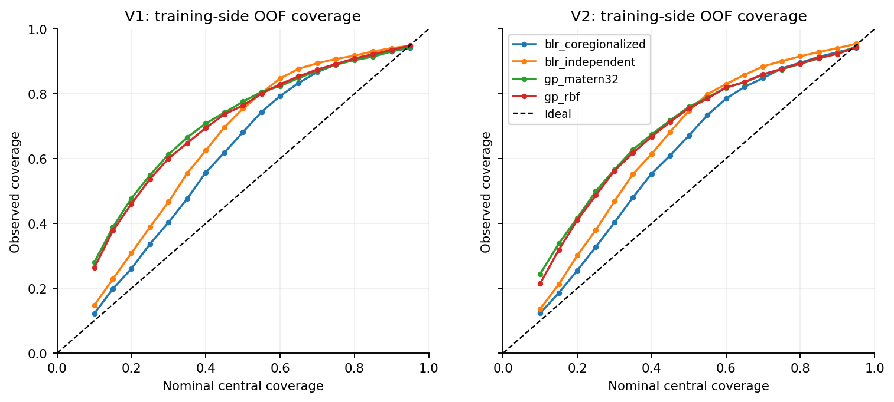
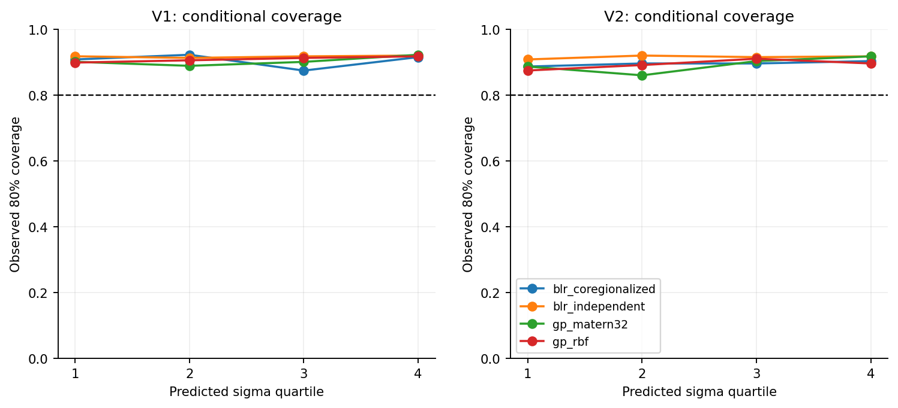
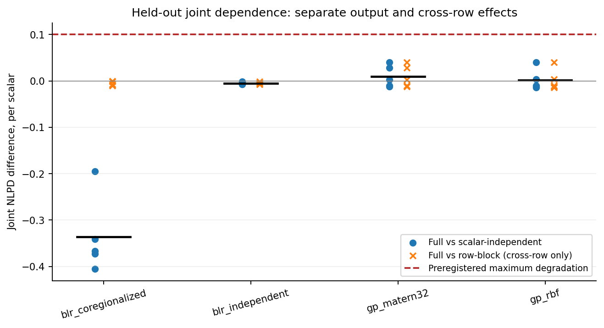

# 概率模型资格验证

实际资格状态：**INCOMPLETE_POSTERIOR_QUALIFICATION**。已完成 20/20 个 seed×family 状态；每个完成状态进行 3 折合法 L333 OOF。逐 seed 最终选择：`{"157": "gp_matern32", "887": null, "2357": "blr_coregionalized", "6101": null, "12203": "gp_matern32"}`。

本节为stage1原始资格。第二阶段已按独立freeze实际执行，当前资格状态：INCOMPLETE_POSTERIOR_QUALIFICATION。实际结果与新formal状态以[stage2结果](stage2_nested_calibration/STAGE2_RESULTS.md)及[stage2决策](stage2_nested_calibration/STAGE2_NEXT_STAGE_DECISION.md)为准；下面保留stage1原资格结论，不把stage2结果倒写成stage1通过。

完整计算是否结束：是，20个状态/60次fold拟合均已完成；status的INCOMPLETE指五seed后验资格未齐，不是仍有漏跑模型。无合格本地后验的seed：887, 6101。

全部结果均为重复暴露历史 Row 开发队列上的 development evidence；不是独立确认。统计单位为 outer seed，五个 seed 的划分仍重叠，不能把 batch/OOF 行数当独立实验重复。

## 数据边界与模型族

仅使用每个 seed 当前合法 L333 真值和预定义 response-independent 输入特征。每折的标准化、PCA、常数均值、核尺度与噪声由该折训练子集拟合；无全 L 监督 encoder 造成的 OOF 标签绕行。真实 OOF 预测与 mL² covariance 保存在 `qualification/seed_*/oof.npz` 和 `oof_predictions.csv`。不同 outer seed 的标签权限不交叉使用。

候选族为 RBF GP、Matérn-3/2 GP、独立 BLR 与 coupled matrix-normal BLR。GP 分别学习两个输出的幅度/长度尺度/噪声，是 empirical Bayes 的独立输出联合分布；BLR coupled 有明确跨输出 B，但先验/噪声共享 B，完整双输出 MI 对其 whitening 不敏感。不是 Deep Ensemble 的严格后验，也未从三个边缘分位数推断 joint covariance。

预注册门槛：每个 seed 分别仅用自己333个OOF行，要求每端点80% coverage ∈ [0.7, 0.9]，95% coverage ∈ [0.88, 0.99]，标准化残差 RMS ∈ [0.7, 1.5]；held-out fold 全联合 NLPD 相对独立对角预测的平均差每 scalar ≤0.10，且 predictive covariance 正定。该seed合格GP按最低OOF NLPD选择；若无合格GP，才在该seed合格的预注册BLR中选择最低NLPD。**跨seed pooled只描述，不能影响该seed资格/选择**。任一seed无合格后验时，整个正式五seed比较不开始，不删除该seed。阈值冻结于资格结果揭示之前，不根据 AL 效果调整。

## 实际模型门槛

| seed | family | qualified | mean_marginal_nlpd | joint_nlpd_degradation_per_scalar | reasons |
| --- | --- | --- | --- | --- | --- |
| 157 | gp_rbf | False | 3.514121 | 0.003370 | V1 coverage80=0.918919 outside [0.7, 0.9]; V2 coverage80=0.924925 outside [0.7, 0.9] |
| 157 | gp_matern32 | True | 3.537421 | 0.028537 |  |
| 157 | blr_independent | False | 3.549338 | -0.000957 | V1 coverage80=0.933934 outside [0.7, 0.9]; V2 coverage80=0.942943 outside [0.7, 0.9] |
| 157 | blr_coregionalized | False | 3.579164 | -0.373040 | V1 coverage80=0.915916 outside [0.7, 0.9]; V2 coverage80=0.924925 outside [0.7, 0.9] |
| 887 | gp_rbf | False | 3.776454 | -0.014662 | V1 coverage80=0.909910 outside [0.7, 0.9] |
| 887 | gp_matern32 | False | 3.784402 | 0.002886 | V1 coverage80=0.909910 outside [0.7, 0.9] |
| 887 | blr_independent | False | 3.823761 | -0.007529 | V1 coverage80=0.918919 outside [0.7, 0.9]; V2 coverage80=0.915916 outside [0.7, 0.9] |
| 887 | blr_coregionalized | False | 3.869701 | -0.405104 | V1 coverage80=0.906907 outside [0.7, 0.9] |
| 2357 | gp_rbf | False | 3.610893 | -0.010326 | V1 coverage80=0.909910 outside [0.7, 0.9]; V2 coverage80=0.909910 outside [0.7, 0.9] |
| 2357 | gp_matern32 | False | 3.613287 | -0.010243 | V1 coverage80=0.909910 outside [0.7, 0.9]; V2 coverage80=0.915916 outside [0.7, 0.9] |
| 2357 | blr_independent | False | 3.692314 | -0.006956 | V1 coverage80=0.915916 outside [0.7, 0.9]; V2 coverage80=0.912913 outside [0.7, 0.9] |
| 2357 | blr_coregionalized | True | 3.722259 | -0.366847 |  |
| 6101 | gp_rbf | False | 3.377902 | -0.012433 | V1 coverage80=0.906907 outside [0.7, 0.9] |
| 6101 | gp_matern32 | False | 3.373350 | -0.012201 | V1 coverage80=0.912913 outside [0.7, 0.9] |
| 6101 | blr_independent | False | 3.428131 | -0.004670 | V1 coverage80=0.915916 outside [0.7, 0.9] |
| 6101 | blr_coregionalized | False | 3.443650 | -0.194483 | V1 coverage80=0.906907 outside [0.7, 0.9] |
| 12203 | gp_rbf | False | 3.720449 | 0.039720 | V1 coverage80=0.900901 outside [0.7, 0.9] |
| 12203 | gp_matern32 | True | 3.668176 | 0.040310 |  |
| 12203 | blr_independent | False | 3.785855 | -0.004728 | V1 coverage80=0.903904 outside [0.7, 0.9]; V2 coverage80=0.924925 outside [0.7, 0.9] |
| 12203 | blr_coregionalized | False | 3.807504 | -0.340634 | V1 coverage80=0.900901 outside [0.7, 0.9]; V2 coverage80=0.906907 outside [0.7, 0.9] |

所有失格条件均为80%区间过覆盖上界（大于0.90）；不是负方差、矩阵非正定或联合NLPD退化越界。部分值仅比门槛高1–6个样本比例；333行OOF的分辨率为1/333，折与行也并非完全独立。该预注册门槛必须原样执行，但这种轻微过覆盖不能表述为已证明联合相关失真或概率模型全面失效。

## 五 seed 端点描述性汇总（不作选择）

| family | endpoint | outer_seeds | marginal_nlpd | coverage80 | coverage95 | standardized_residual_rms | rmse_ml | mae_ml |
| --- | --- | --- | --- | --- | --- | --- | --- | --- |
| blr_coregionalized | V1 | 5 | 3.339000 | 0.905706 | 0.941742 | 1.195758 | 6.570005 | 3.919192 |
| blr_coregionalized | V2 | 5 | 4.029911 | 0.896096 | 0.942342 | 1.163265 | 13.220507 | 8.075501 |
| blr_independent | V1 | 5 | 3.307209 | 0.917718 | 0.948348 | 1.041934 | 6.572037 | 3.921839 |
| blr_independent | V2 | 5 | 4.004551 | 0.915916 | 0.954354 | 1.010860 | 13.220472 | 8.080117 |
| gp_matern32 | V1 | 5 | 3.249799 | 0.903904 | 0.945345 | 1.022650 | 6.186371 | 3.369843 |
| gp_matern32 | V2 | 5 | 3.940856 | 0.892492 | 0.945345 | 1.071495 | 12.399427 | 6.872245 |
| gp_rbf | V1 | 5 | 3.256084 | 0.909309 | 0.948949 | 1.017859 | 6.203390 | 3.432037 |
| gp_rbf | V2 | 5 | 3.943844 | 0.893694 | 0.943544 | 1.058247 | 12.412911 | 7.004537 |

逐 seed 原始数值见 `qualification/seed_metrics.csv`；每 fold 的跨样本联合评分见 `reported_joint_fold_metrics.csv`。80%/95% pooled coverage 与联合 NLPD 是互补诊断：边缘校准好不能保证跨样本相关正确。联合分布可直接给出有效 log-likelihood，但单一开发数据集的一组相关残差仍不足以证明真实 joint covariance 已识别。

资格已完成但至少一个seed没有合格本地后验，整个五seed正式门槛未满足；这支持概率模型问题类别 A 和证据不足 F，不支持 EPIG 目标无效。全部预注册候选族均应完整检验，不因某个模型先失败就取消其他族。

## 概率校准与联合依赖图

以上图的每个点/曲线来自真实 OOF 残差，不是模型自己采样出的校准效果；不同 seed pooled 图的行不是独立重复。若某族失格，原因限定于当前特征、均值、核、噪声和调参预算，不代表冻结 GNN 表征 GP、异方差代理或其他联合模型均无效。
