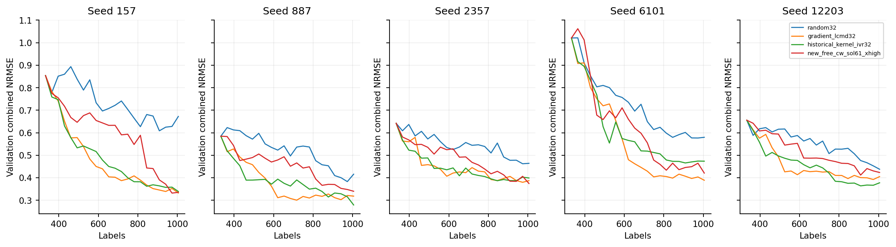

# 真实 Row-level 结果

**尚未完成五 seed L333→L1005 主 EPIG/同后验 IVR 配对，当前不能判定 EPIG 改善或不改善真实学习性能。** 当前本研究完成新的 QGeoGNN 拟合数为 0；资格状态 INCOMPLETE_POSTERIOR_QUALIFICATION。未执行的正式结果不以数学测试、单状态 MI 或历史曲线代替。

第二阶段已按独立freeze实际执行，当前资格状态：INCOMPLETE_POSTERIOR_QUALIFICATION。实际结果与新formal状态以[stage2结果](stage2_nested_calibration/STAGE2_RESULTS.md)及[stage2决策](stage2_nested_calibration/STAGE2_NEXT_STAGE_DECISION.md)为准；下面保留stage1原资格结论，不把stage2结果倒写成stage1通过。

全部结果均为重复暴露历史 Row 开发队列上的 development evidence；不是独立确认。统计单位为 outer seed，五个 seed 的划分仍重叠，不能把 batch/OOF 行数当独立实验重复。

## 新方法：真实已完成点与阶段

未执行 / 尚无完成的结果。

逐点原始非单调曲线：`formal_validation_curves.csv`。窗口缺任一32-label预算点时不计算该完整窗口 AULC，不插补、不沿用别的方法checkpoint、不把best-so-far作为原始曲线。标准化 AULC 为 trapezoid(raw NRMSE,budget)/(end−start)，低者更优。V1/V2 MAE/RMSE 单位 mL。固定 L333 sigma 不随轮次改变。

## EPIG 减去同后验 IVR：逐 seed 配对

未执行 / 尚无完成的结果。

未执行 / 尚无完成的结果。

负差代表 EPIG 更优。early=333–525，mid=525–813，late=813–1005，primary_full=333–1005，extension_full=333–1485。若五 seed 主窗口未完整，任何已有阶段都只是进度快照，不构成提前否定或停止理由。区间为 outer-seed 配对 t 区间；五 seed 离散符号翻转双侧检验的分辨率有限，且划分重叠，不能将其解释为独立化学任务的总体因果保证。

## 已完成历史 validation 基线：仅作历史对照

这些是本次恢复审计的真实历史 validation 指标，**不是新 posterior-EPIG/posterior-IVR 的结果**。训练协议、split、初始化、L333尺度与checkpoint需逐项匹配后才可复用。正式辅助后验如有BLR备选，将逐seed注明真实family，不统一冒称GP。CW-gradient LCMD 仅两 seed；混合版本 historical Free 与最新 CW-Free 单列，不能包装成随机化因果消融。历史 Kernel-IVR 原 published final report 的 test 指标没有作为本表主结果。

| method | end_budget | seeds | aulc_mean | aulc_sample_sd | terminal_mean | terminal_sample_sd |
| --- | --- | --- | --- | --- | --- | --- |
| cw_gradient_lcmd32 | 1005 | 2 | 0.500029 | 0.059870 | 0.368524 | 0.047338 |
| gradient_lcmd32 | 1005 | 5 | 0.462549 | 0.067389 | 0.366328 | 0.038413 |
| historical_free_mixed_model | 1005 | 5 | 0.508802 | 0.082160 | 0.349855 | 0.030140 |
| historical_kernel_ivr32 | 1005 | 5 | 0.472446 | 0.079777 | 0.373631 | 0.072092 |
| new_free_cw_sol61_xhigh | 1005 | 5 | 0.532876 | 0.072537 | 0.378752 | 0.042341 |
| nocw | 1005 | 5 | 0.497741 | 0.065443 | 0.405025 | 0.046221 |
| numerical_hybrid32 | 1005 | 5 | 0.438420 | 0.067272 | 0.351918 | 0.039880 |
| random32 | 1005 | 5 | 0.614742 | 0.102912 | 0.513940 | 0.108788 |

| method | seed | end_budget | raw_aulc | terminal_nrmse | terminal_v1_mae | terminal_v2_mae | terminal_v1_rmse | terminal_v2_rmse |
| --- | --- | --- | --- | --- | --- | --- | --- | --- |
| cw_gradient_lcmd32 | 157 | 1005 | 0.457694 | 0.335051 | 1.467790 | 1.865124 | 2.556299 | 3.481239 |
| cw_gradient_lcmd32 | 6101 | 1005 | 0.542363 | 0.401997 | 1.450343 | 2.370912 | 2.311397 | 4.657159 |
| gradient_lcmd32 | 157 | 1005 | 0.475150 | 0.332293 | 1.477509 | 1.917203 | 2.565705 | 3.359219 |
| gradient_lcmd32 | 887 | 1005 | 0.374656 | 0.318329 | 1.543335 | 2.575074 | 2.878510 | 4.912656 |
| gradient_lcmd32 | 2357 | 1005 | 0.445092 | 0.387107 | 1.480697 | 2.773593 | 2.580141 | 6.626150 |
| gradient_lcmd32 | 6101 | 1005 | 0.562194 | 0.388837 | 1.315090 | 2.181384 | 2.238847 | 4.496872 |
| gradient_lcmd32 | 12203 | 1005 | 0.455655 | 0.405076 | 1.908973 | 2.793847 | 3.713484 | 5.430558 |
| historical_free_mixed_model | 157 | 1005 | 0.572184 | 0.345461 | 1.480451 | 2.030527 | 2.658014 | 3.521433 |
| historical_free_mixed_model | 887 | 1005 | 0.421070 | 0.301079 | 1.462076 | 2.489108 | 2.719979 | 4.652878 |
| historical_free_mixed_model | 2357 | 1005 | 0.445213 | 0.361812 | 1.505551 | 3.000623 | 2.544571 | 5.979503 |
| historical_free_mixed_model | 6101 | 1005 | 0.613502 | 0.381487 | 1.276569 | 2.252406 | 2.157093 | 4.508938 |
| historical_free_mixed_model | 12203 | 1005 | 0.492040 | 0.359436 | 1.659798 | 2.639312 | 3.116729 | 5.301916 |
| historical_kernel_ivr32 | 157 | 1005 | 0.485866 | 0.338977 | 1.513505 | 2.236560 | 2.508061 | 3.746423 |
| historical_kernel_ivr32 | 887 | 1005 | 0.383378 | 0.279080 | 1.491520 | 2.740078 | 2.444419 | 4.499408 |
| historical_kernel_ivr32 | 2357 | 1005 | 0.442959 | 0.398980 | 1.552241 | 2.930082 | 2.787305 | 6.624917 |
| historical_kernel_ivr32 | 6101 | 1005 | 0.599001 | 0.473583 | 1.477248 | 2.738266 | 2.638144 | 5.691737 |
| historical_kernel_ivr32 | 12203 | 1005 | 0.451028 | 0.377537 | 1.647485 | 2.613221 | 3.338918 | 5.400731 |
| new_free_cw_sol61_xhigh | 157 | 1005 | 0.589655 | 0.335245 | 1.469150 | 2.093402 | 2.545828 | 3.518900 |
| new_free_cw_sol61_xhigh | 887 | 1005 | 0.451581 | 0.339942 | 1.652816 | 3.097451 | 3.026146 | 5.364602 |
| new_free_cw_sol61_xhigh | 2357 | 1005 | 0.484011 | 0.374469 | 1.472280 | 2.869594 | 2.529301 | 6.357967 |
| new_free_cw_sol61_xhigh | 6101 | 1005 | 0.624945 | 0.420699 | 1.391824 | 2.350767 | 2.450114 | 4.794600 |
| new_free_cw_sol61_xhigh | 12203 | 1005 | 0.514190 | 0.423406 | 1.916617 | 3.228755 | 3.686931 | 6.206314 |
| nocw | 157 | 1005 | 0.556560 | 0.437426 | 1.844053 | 2.737335 | 3.267999 | 4.746858 |
| nocw | 887 | 1005 | 0.430235 | 0.387152 | 1.749660 | 3.196384 | 3.207291 | 6.646982 |
| nocw | 2357 | 1005 | 0.441695 | 0.359906 | 1.461315 | 2.903652 | 2.433618 | 6.106511 |
| nocw | 6101 | 1005 | 0.574143 | 0.468655 | 1.575393 | 2.880877 | 2.632149 | 5.581929 |
| nocw | 12203 | 1005 | 0.486071 | 0.371985 | 1.735552 | 2.819437 | 3.205573 | 5.536838 |
| numerical_hybrid32 | 157 | 1005 | 0.457923 | 0.328558 | 1.395651 | 1.857708 | 2.503575 | 3.423338 |
| numerical_hybrid32 | 887 | 1005 | 0.371556 | 0.316101 | 1.538808 | 2.367132 | 2.925406 | 4.703944 |
| numerical_hybrid32 | 2357 | 1005 | 0.401420 | 0.351859 | 1.433432 | 2.656091 | 2.422280 | 5.901248 |
| numerical_hybrid32 | 6101 | 1005 | 0.545111 | 0.418810 | 1.364882 | 2.389129 | 2.250013 | 5.220589 |
| numerical_hybrid32 | 12203 | 1005 | 0.416087 | 0.344262 | 1.581481 | 2.791913 | 2.952343 | 5.159459 |
| random32 | 157 | 1005 | 0.734385 | 0.672336 | 2.314125 | 4.105493 | 4.517051 | 8.543744 |
| random32 | 887 | 1005 | 0.520988 | 0.415809 | 1.630651 | 3.168120 | 3.462656 | 7.101426 |
| random32 | 2357 | 1005 | 0.546295 | 0.464073 | 1.962072 | 3.995660 | 3.302308 | 7.604129 |
| random32 | 6101 | 1005 | 0.718690 | 0.579732 | 1.679197 | 3.007613 | 3.339640 | 6.700396 |
| random32 | 12203 | 1005 | 0.553353 | 0.437752 | 1.963630 | 3.388732 | 3.789463 | 6.473064 |

全部525/813/1005/1485实际完整窗口见 `baseline_seed_metrics.csv`，所有原始预算点与hash见 `baseline_validation_curves.csv`。历史曲线末期的优势不能取代全程AULC；早期成本也不能掩盖长期终点收益。

`figures/historical_*_raw_curves.png` 为各历史方法的逐 seed 原始非单调曲线。没有正式 EPIG 结果时，不生成伪造的 EPIG 学习曲线/配对效果图。

## 实际计算成本

| qualification_completed_seed_family_states | qualification_auxiliary_model_fits | acquisition_completed_states | new_completed_QGeoGNN_fits | acquisition_seconds_sum | acquisition_peak_rss_bytes | formal_training_seconds_sum | supplementary_output_ablation_completed_states | supplementary_output_ablation_seconds_sum | stage1_acquisition_surrogate_fits_completed | stage2_nested_auxiliary_fit_attempts | qualification_auxiliary_fit_seconds_sum | acquisition_auxiliary_model_fits | acquisition_auxiliary_fit_seconds_sum | qualification_fit_attempts_including_interruptions |
| --- | --- | --- | --- | --- | --- | --- | --- | --- | --- | --- | --- | --- | --- | --- |
| 20 | 60 | 58 | 0 | 1841.525816 | 1584857088 | 0 | 18 | 82.518598 | 18 | 240 | 1.476571 | 18 | 1.110761 | 60 |

资格为 cheap auxiliary model fits，不计作 QGeoGNN fits。acquisition时间为完成状态的测量值之和，包含重复评分与条件化；不是神经训练时间。RSS 为进程生命周期峰值，不能把不同状态峰值相加。完整日志、complete receipts 与 `reported_compute_cost.json` 保留计数；未完成/失败attempt应结合原budget ledger单列，而非隐去。
