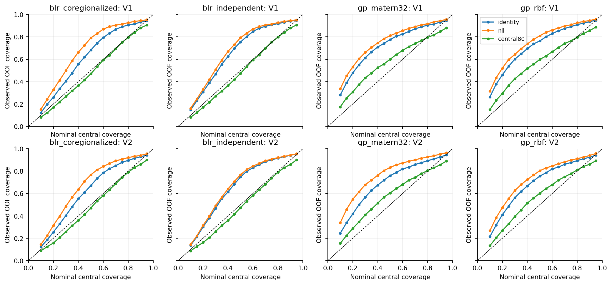
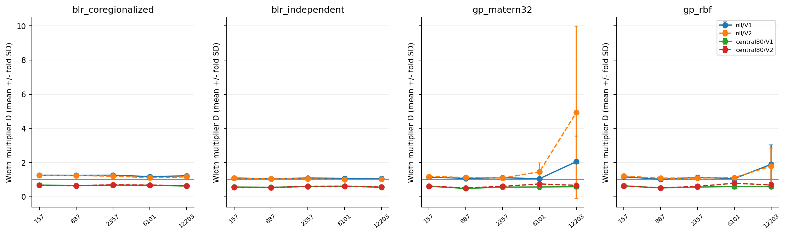
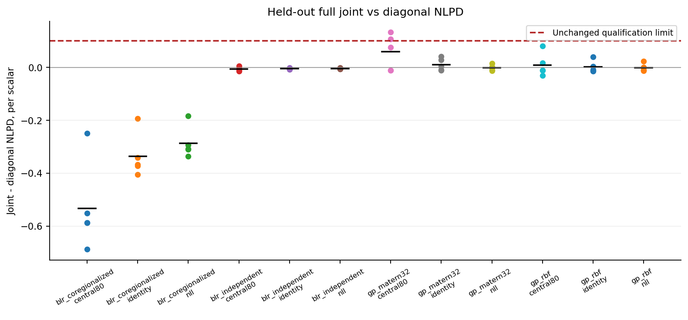

# Nested covariance calibration：实际执行结果

资格状态：**INCOMPLETE_POSTERIOR_QUALIFICATION**。实际完成60/60个seed×family×calibration候选；这些共享最多240次base辅助拟合，不是60个独立数据划分。完整五seed正式后验资格尚未齐全，不删除seed、不放宽原门槛。新完成QGeoGNN拟合0次；五seedL1005配对未完整，真实效能仍未判定。

本阶段由stage1已知结果触发，虽在新结果前另行冻结，仍属结果后的development研究；五个Row划分重叠，不是独立确认。

## 方法与不变量

参见冻结的[STAGE2_PROTOCOL.md](STAGE2_PROTOCOL.md)与config。四族、三outer×(三inner+一outer)；temperature仅由outer训练侧inner-OOF产生，outer-held-out只评分。标准化、PCA、中心与base参数都在该fit训练子集学习。无候选U/validation/test监督，三个scheme共享同一outer base mean/covariance。

identity的D_width=1；nll的D_width=sqrt(mean(z²))，是每端点**marginal** Gaussian NLL最优尺度，并非full-joint NLL最优；central80的D_width=Q80(|z|)/Φ⁻¹(.9)。D_width是sigma/区间宽度倍率，其平方才是variance temperature；无任意bounds，非法/非正/非有限D明确失败。全部latent/noise/cross covariance同步DΣD，mean不变。同一已拟合family的正对角DΣD变换不改变Gaussian单点/条件化EPIG；它可改变trace-IVR的端点风险权重。校准改变选模资格或family时才可间接改变EPIG决策，不能把幅度校准直接说成EPIG获得新信息。

此代理称为nested校准Gaussian联合代理，不能声称仍是原GP似然/先验未经修改的精确后验。温度不改变Gaussian形状或相关系数，不能修复尖峰重尾、错均值、条件异方差或错误跨row依赖；80%中心覆盖改善不保证95%尾部、NLL、joint NLL或AL收益。

## 本地选择与完整门槛

| seed | family | calibration | status |
| --- | --- | --- | --- |
| 157 | gp_matern32 | identity | QUALIFIED_LOCAL |
| 887 | — | — | NO_LOCAL_QUALIFIED_POSTERIOR |
| 2357 | blr_coregionalized | identity | QUALIFIED_LOCAL |
| 6101 | — | — | NO_LOCAL_QUALIFIED_POSTERIOR |
| 12203 | gp_matern32 | identity | QUALIFIED_LOCAL |

原门槛每seed/endpoint仍为80%coverage[.70,.90]、95%coverage[.88,.99]、标准化残差RMS[.70,1.50]；full-joint相对diagonal NLPD每scalar退化≤.10且covariance正定。只用本seed OOF，在合格GP family×calibration中优先最低marginal NLPD；无GP才选本seed合格BLR。跨seed pooled表只描述，不用于选择。

| seed | family | calibration | qualified | mean_marginal_nlpd | joint_nlpd_degradation_per_scalar | reasons |
| --- | --- | --- | --- | --- | --- | --- |
| 157 | gp_rbf | identity | False | 3.514121 | 0.003370 | V1 coverage80=0.918919 outside [0.7, 0.9]; V2 coverage80=0.924925 outside [0.7, 0.9] |
| 157 | gp_rbf | nll | False | 3.538365 | -0.000194 | V1 coverage80=0.939940 outside [0.7, 0.9]; V2 coverage80=0.936937 outside [0.7, 0.9] |
| 157 | gp_rbf | central80 | False | 3.801073 | 0.015646 | V1 standardized_residual_rms=1.591829 outside [0.7, 1.5]; V2 standardized_residual_rms=1.572736 outside [0.7, 1.5] |
| 157 | gp_matern32 | identity | True | 3.537421 | 0.028537 |  |
| 157 | gp_matern32 | nll | False | 3.543767 | 0.014459 | V1 coverage80=0.903904 outside [0.7, 0.9]; V2 coverage80=0.909910 outside [0.7, 0.9] |
| 157 | gp_matern32 | central80 | False | 3.982208 | 0.132136 | V1 coverage95=0.879880 outside [0.88, 0.99]; V1 standardized_residual_rms=1.759227 outside [0.7, 1.5]; V2 standardized_residual_rms=1.699550 outside [0.7, 1.5]; joint NLPD degradation 0.132136 > .10 nat/scalar |
| 157 | blr_independent | identity | False | 3.549338 | -0.000957 | V1 coverage80=0.933934 outside [0.7, 0.9]; V2 coverage80=0.942943 outside [0.7, 0.9] |
| 157 | blr_independent | nll | False | 3.571119 | -0.001048 | V1 coverage80=0.948949 outside [0.7, 0.9]; V2 coverage80=0.948949 outside [0.7, 0.9] |
| 157 | blr_independent | central80 | False | 4.062245 | 0.004058 | V1 standardized_residual_rms=1.802086 outside [0.7, 1.5]; V2 standardized_residual_rms=1.762418 outside [0.7, 1.5] |
| 157 | blr_coregionalized | identity | False | 3.579164 | -0.373040 | V1 coverage80=0.915916 outside [0.7, 0.9]; V2 coverage80=0.924925 outside [0.7, 0.9] |
| 157 | blr_coregionalized | nll | False | 3.562992 | -0.308512 | V1 coverage80=0.945946 outside [0.7, 0.9]; V2 coverage80=0.948949 outside [0.7, 0.9] |
| 157 | blr_coregionalized | central80 | False | 4.024325 | -0.588344 | V1 standardized_residual_rms=1.772189 outside [0.7, 1.5]; V2 standardized_residual_rms=1.731141 outside [0.7, 1.5] |
| 887 | gp_rbf | identity | False | 3.776454 | -0.014662 | V1 coverage80=0.909910 outside [0.7, 0.9] |
| 887 | gp_rbf | nll | False | 3.778476 | -0.014030 | V1 coverage80=0.909910 outside [0.7, 0.9]; V2 coverage80=0.903904 outside [0.7, 0.9] |
| 887 | gp_rbf | central80 | False | 4.671654 | -0.031097 | V1 coverage95=0.867868 outside [0.88, 0.99]; V1 standardized_residual_rms=2.004802 outside [0.7, 1.5]; V2 coverage95=0.858859 outside [0.88, 0.99]; V2 standardized_residual_rms=2.097750 outside [0.7, 1.5] |
| 887 | gp_matern32 | identity | False | 3.784402 | 0.002886 | V1 coverage80=0.909910 outside [0.7, 0.9] |
| 887 | gp_matern32 | nll | False | 3.771274 | -0.001674 | V1 coverage80=0.915916 outside [0.7, 0.9]; V2 coverage80=0.912913 outside [0.7, 0.9] |
| 887 | gp_matern32 | central80 | False | 4.879627 | 0.075786 | V1 coverage95=0.843844 outside [0.88, 0.99]; V1 standardized_residual_rms=2.157651 outside [0.7, 1.5]; V2 coverage95=0.858859 outside [0.88, 0.99]; V2 standardized_residual_rms=2.191033 outside [0.7, 1.5] |
| 887 | blr_independent | identity | False | 3.823761 | -0.007529 | V1 coverage80=0.918919 outside [0.7, 0.9]; V2 coverage80=0.915916 outside [0.7, 0.9] |
| 887 | blr_independent | nll | False | 3.831451 | -0.006894 | V1 coverage80=0.924925 outside [0.7, 0.9]; V2 coverage80=0.915916 outside [0.7, 0.9] |
| 887 | blr_independent | central80 | False | 4.526241 | -0.014762 | V1 standardized_residual_rms=1.904382 outside [0.7, 1.5]; V2 standardized_residual_rms=1.941458 outside [0.7, 1.5] |
| 887 | blr_coregionalized | identity | False | 3.869701 | -0.405104 | V1 coverage80=0.906907 outside [0.7, 0.9] |
| 887 | blr_coregionalized | nll | False | 3.831489 | -0.336266 | V1 coverage80=0.924925 outside [0.7, 0.9]; V2 coverage80=0.918919 outside [0.7, 0.9] |
| 887 | blr_coregionalized | central80 | False | 4.501542 | -0.687931 | V1 standardized_residual_rms=1.892411 outside [0.7, 1.5]; V2 standardized_residual_rms=1.920818 outside [0.7, 1.5] |
| 2357 | gp_rbf | identity | False | 3.610893 | -0.010326 | V1 coverage80=0.909910 outside [0.7, 0.9]; V2 coverage80=0.909910 outside [0.7, 0.9] |
| 2357 | gp_rbf | nll | False | 3.622052 | -0.009740 | V1 coverage80=0.921922 outside [0.7, 0.9]; V2 coverage80=0.924925 outside [0.7, 0.9] |
| 2357 | gp_rbf | central80 | False | 4.042175 | -0.011840 | V1 standardized_residual_rms=1.766071 outside [0.7, 1.5]; V2 standardized_residual_rms=1.646488 outside [0.7, 1.5] |
| 2357 | gp_matern32 | identity | False | 3.613287 | -0.010243 | V1 coverage80=0.909910 outside [0.7, 0.9]; V2 coverage80=0.915916 outside [0.7, 0.9] |
| 2357 | gp_matern32 | nll | False | 3.623526 | -0.009858 | V1 coverage80=0.918919 outside [0.7, 0.9]; V2 coverage80=0.927928 outside [0.7, 0.9] |
| 2357 | gp_matern32 | central80 | False | 4.039165 | -0.011330 | V1 standardized_residual_rms=1.774945 outside [0.7, 1.5]; V2 standardized_residual_rms=1.630073 outside [0.7, 1.5] |
| 2357 | blr_independent | identity | False | 3.692314 | -0.006956 | V1 coverage80=0.915916 outside [0.7, 0.9]; V2 coverage80=0.912913 outside [0.7, 0.9] |
| 2357 | blr_independent | nll | False | 3.697904 | -0.006199 | V1 coverage80=0.927928 outside [0.7, 0.9]; V2 coverage80=0.927928 outside [0.7, 0.9] |
| 2357 | blr_independent | central80 | False | 4.089520 | -0.012172 | V1 standardized_residual_rms=1.725020 outside [0.7, 1.5]; V2 standardized_residual_rms=1.638893 outside [0.7, 1.5] |
| 2357 | blr_coregionalized | identity | True | 3.722259 | -0.366847 |  |
| 2357 | blr_coregionalized | nll | False | 3.696223 | -0.310121 | V1 coverage80=0.927928 outside [0.7, 0.9]; V2 coverage80=0.927928 outside [0.7, 0.9] |
| 2357 | blr_coregionalized | central80 | False | 4.116492 | -0.551494 | V1 standardized_residual_rms=1.762595 outside [0.7, 1.5]; V2 standardized_residual_rms=1.649010 outside [0.7, 1.5] |
| 6101 | gp_rbf | identity | False | 3.377902 | -0.012433 | V1 coverage80=0.906907 outside [0.7, 0.9] |
| 6101 | gp_rbf | nll | False | 3.366400 | -0.011557 | V1 coverage80=0.912913 outside [0.7, 0.9] |
| 6101 | gp_rbf | central80 | False | 3.636805 | -0.012293 | V1 standardized_residual_rms=1.701573 outside [0.7, 1.5] |
| 6101 | gp_matern32 | identity | False | 3.373350 | -0.012201 | V1 coverage80=0.912913 outside [0.7, 0.9] |
| 6101 | gp_matern32 | nll | False | 3.399806 | -0.012590 | V1 coverage80=0.912913 outside [0.7, 0.9]; V2 coverage80=0.912913 outside [0.7, 0.9] |
| 6101 | gp_matern32 | central80 | False | 3.706678 | -0.010969 | V1 standardized_residual_rms=1.767088 outside [0.7, 1.5] |
| 6101 | blr_independent | identity | False | 3.428131 | -0.004670 | V1 coverage80=0.915916 outside [0.7, 0.9] |
| 6101 | blr_independent | nll | False | 3.438298 | -0.004679 | V1 coverage80=0.918919 outside [0.7, 0.9] |
| 6101 | blr_independent | central80 | False | 3.845818 | -0.005605 | V1 standardized_residual_rms=1.723613 outside [0.7, 1.5]; V2 coverage95=0.870871 outside [0.88, 0.99]; V2 standardized_residual_rms=1.691281 outside [0.7, 1.5] |
| 6101 | blr_coregionalized | identity | False | 3.443650 | -0.194483 | V1 coverage80=0.906907 outside [0.7, 0.9] |
| 6101 | blr_coregionalized | nll | False | 3.441182 | -0.184286 | V1 coverage80=0.918919 outside [0.7, 0.9] |
| 6101 | blr_coregionalized | central80 | False | 3.855723 | -0.249837 | V1 standardized_residual_rms=1.740176 outside [0.7, 1.5]; V2 coverage95=0.870871 outside [0.88, 0.99]; V2 standardized_residual_rms=1.680942 outside [0.7, 1.5] |
| 12203 | gp_rbf | identity | False | 3.720449 | 0.039720 | V1 coverage80=0.900901 outside [0.7, 0.9] |
| 12203 | gp_rbf | nll | False | 3.969115 | 0.023297 | V1 coverage80=0.948949 outside [0.7, 0.9]; V2 coverage80=0.909910 outside [0.7, 0.9] |
| 12203 | gp_rbf | central80 | False | 4.064748 | 0.081091 | V1 standardized_residual_rms=1.745437 outside [0.7, 1.5]; V2 standardized_residual_rms=1.563160 outside [0.7, 1.5] |
| 12203 | gp_matern32 | identity | True | 3.668176 | 0.040310 |  |
| 12203 | gp_matern32 | nll | False | 4.206276 | 0.002092 | V1 coverage80=0.933934 outside [0.7, 0.9]; V2 coverage80=0.966967 outside [0.7, 0.9]; V2 coverage95=0.990991 outside [0.88, 0.99]; V2 standardized_residual_rms=0.463852 outside [0.7, 1.5] |
| 12203 | gp_matern32 | central80 | False | 3.986821 | 0.106732 | V1 standardized_residual_rms=1.694166 outside [0.7, 1.5]; V2 standardized_residual_rms=1.556061 outside [0.7, 1.5]; joint NLPD degradation 0.106732 > .10 nat/scalar |
| 12203 | blr_independent | identity | False | 3.785855 | -0.004728 | V1 coverage80=0.903904 outside [0.7, 0.9]; V2 coverage80=0.924925 outside [0.7, 0.9] |
| 12203 | blr_independent | nll | False | 3.796471 | -0.004057 | V1 coverage80=0.918919 outside [0.7, 0.9]; V2 coverage80=0.924925 outside [0.7, 0.9] |
| 12203 | blr_independent | central80 | False | 4.369043 | -0.007192 | V1 standardized_residual_rms=1.905851 outside [0.7, 1.5]; V2 standardized_residual_rms=1.758698 outside [0.7, 1.5] |
| 12203 | blr_coregionalized | identity | False | 3.807504 | -0.340634 | V1 coverage80=0.900901 outside [0.7, 0.9]; V2 coverage80=0.906907 outside [0.7, 0.9] |
| 12203 | blr_coregionalized | nll | False | 3.793772 | -0.293500 | V1 coverage80=0.918919 outside [0.7, 0.9]; V2 coverage80=0.924925 outside [0.7, 0.9] |
| 12203 | blr_coregionalized | central80 | False | 4.394077 | -0.587421 | V1 standardized_residual_rms=1.920774 outside [0.7, 1.5]; V2 standardized_residual_rms=1.788361 outside [0.7, 1.5] |

## 独立失败维度复核：中央覆盖与尾部不能互相替代

| calibration | candidate_states | qualified_candidates | endpoint_coverage80_above_090 | endpoint_coverage80_below_070 | endpoint_coverage95_outside_bounds | endpoint_residual_RMS_above_150 | endpoint_residual_RMS_below_070 | candidate_joint_NLPD_degradation_above_010 |
| --- | --- | --- | --- | --- | --- | --- | --- | --- |
| identity | 20 | 3 | 26 | 0 | 0 | 0 | 0 | 0 |
| nll | 20 | 0 | 37 | 0 | 1 | 0 | 1 | 0 |
| central80 | 20 | 0 | 0 | 0 | 7 | 38 | 0 | 2 |

上表candidate计数以seed×family×calibration为单位，endpoint计数每候选有两端点；同一候选可因多个门槛失败，不能将各列相加当独立失败次数。identity与stage1同seed/family/endpoint的RMSE、MAE、marginal NLPD、coverage80/95、标准化残差RMS最大绝对差：0.0，详细见`reported_identity_vs_stage1.csv`。这是复现控制，不是新数据确认。

实际identity只有3/20候选合格，NLL温度0/20、central80为0/20。NLL尺度主要仍未消除中央80%过覆盖；central80缩窄后中央门槛可改善，但20/20候选的V1标准化残差RMS仍超过1.5（部分同时95%覆盖不足或joint NLPD退化）。这支持“单一Gaussian幅度不能同时协调中央质量与尾部误差”的有限代理/校准失配解释，不能据此断言真实残差必属于某个特定重尾分布，也不是EPIG objective失败。

## 描述性OOF结果与实际温度

| family | calibration | endpoint | outer_seeds | coverage80 | coverage95 | marginal_nlpd | standardized_residual_rms |
| --- | --- | --- | --- | --- | --- | --- | --- |
| blr_coregionalized | central80 | V1 | 5 | 0.795195 | 0.905706 | 3.866098 | 1.819132 |
| blr_coregionalized | central80 | V2 | 5 | 0.789790 | 0.899700 | 4.490766 | 1.756669 |
| blr_coregionalized | identity | V1 | 5 | 0.905706 | 0.941742 | 3.339000 | 1.195758 |
| blr_coregionalized | identity | V2 | 5 | 0.896096 | 0.942342 | 4.029911 | 1.163265 |
| blr_coregionalized | nll | V1 | 5 | 0.927327 | 0.952553 | 3.315408 | 0.981591 |
| blr_coregionalized | nll | V2 | 5 | 0.921321 | 0.955556 | 4.014855 | 0.983147 |
| blr_independent | central80 | V1 | 5 | 0.797598 | 0.906907 | 3.860083 | 1.814001 |
| blr_independent | central80 | V2 | 5 | 0.790390 | 0.900901 | 4.497064 | 1.761522 |
| blr_independent | identity | V1 | 5 | 0.917718 | 0.948348 | 3.307209 | 1.041934 |
| blr_independent | identity | V2 | 5 | 0.915916 | 0.954354 | 4.004551 | 1.010860 |
| blr_independent | nll | V1 | 5 | 0.927928 | 0.951952 | 3.318088 | 0.978003 |
| blr_independent | nll | V2 | 5 | 0.920721 | 0.955556 | 4.016009 | 0.980288 |
| gp_matern32 | central80 | V1 | 5 | 0.794595 | 0.879279 | 3.839183 | 1.838128 |
| gp_matern32 | central80 | V2 | 5 | 0.805405 | 0.889489 | 4.398616 | 1.732328 |
| gp_matern32 | identity | V1 | 5 | 0.903904 | 0.945345 | 3.249799 | 1.022650 |
| gp_matern32 | identity | V2 | 5 | 0.892492 | 0.945345 | 3.940856 | 1.071495 |
| gp_matern32 | nll | V1 | 5 | 0.917117 | 0.954955 | 3.318221 | 0.900773 |
| gp_matern32 | nll | V2 | 5 | 0.926126 | 0.963964 | 4.099638 | 0.834632 |
| gp_rbf | central80 | V1 | 5 | 0.796997 | 0.888288 | 3.751556 | 1.767148 |
| gp_rbf | central80 | V2 | 5 | 0.810811 | 0.893093 | 4.335026 | 1.674035 |
| gp_rbf | identity | V1 | 5 | 0.909309 | 0.948949 | 3.256084 | 1.017859 |
| gp_rbf | identity | V2 | 5 | 0.893694 | 0.943544 | 3.943844 | 1.058247 |
| gp_rbf | nll | V1 | 5 | 0.926727 | 0.957958 | 3.317345 | 0.895374 |
| gp_rbf | nll | V2 | 5 | 0.911712 | 0.957357 | 3.992418 | 0.914378 |

每seed原始表见`qualification/seed_metrics.csv`，每fold宽度和方差倍率见`reported_width_temperatures.csv`，full-joint评分见`reported_joint_fold_metrics.csv`。所有未完成候选保持缺失，不用其他seed或identity替代。

## 计算、缓存与边界

新增辅助拟合attempt账本实际记录数：240（精确阶段计数以`compute_budget.json`为准）；finalization状态：`{}`。资格240次加最终最多20次、总cap260次及1800秒预算不因效果好坏修改；中断attempt须按账本披露。阶段1没有保存full outer covariance，阶段2outer refit是明确记账的新联合评分计算，不冒充resume重复。

不调用付费LLM；真实神经训练仍是原模型、scratch、原训练配置/初始化/validation checkpoint selection和固定L333尺度。概率资格通过不等于主任务已完成。

## 真实Row-level轨迹

正式状态：`{"status": "SCIENTIFIC_QUALIFICATION_HELD", "reason": "Both finite registered qualification stages completed; not every outer seed has a locally qualified posterior. Original five-seed gate rejected the real formal entry before context, label store or neural fitting.", "missing_qualified_seeds": [887, 6101], "stage2_auxiliary_completed_fits": 240, "new_neural_fits": 0, "new_neural_fit_attempts": 0, "formal_runtime_created": false, "new_target_reads_during_formal_gate_check": 0, "main_L333_to_L1005_learning_curves_completed": false, "not_a_resource_failure": true, "not_an_EPIG_efficacy_rejection": true, "effectiveness": "UNDETERMINED; no EPIG-versus-IVR QGeoGNN outcome comparison was run", "finite_fallbacks_exhausted": true, "automatic_extra_model_search": false, "gate_command": ["/Users/fish/miniforge3/envs/fish/bin/python", "/Users/fish/Documents/GitHub/column_chromatography_prediction/studies/active_learning/epig_prediction_oriented_20261117/stage2_nested_calibration/run_stage2.py", "formal"], "gate_exit_code": 1, "gate_check_seconds": 10.573232173919678, "log_sha256": "5f77ad2ec3e658bf2477d54d1e1789b5bd487f2263b16f64aed07e7e8937b332", "before": {"runtime_exists": false, "gnn_checkpoints": 0, "qualification_sha256": "7d2c14d4c46b0044ad9e91bb1b4e41b811afd66fa90679b556206cf8266641fa", "freeze_sha256": "bbee7fd3f5bfe9ae3ab37a8eb21ecf44a376a2e6cc71a0c263fdd8b78843f3be", "qualification_attempts": 240}, "after": {"runtime_exists": false, "gnn_checkpoints": 0, "qualification_sha256": "7d2c14d4c46b0044ad9e91bb1b4e41b811afd66fa90679b556206cf8266641fa", "freeze_sha256": "bbee7fd3f5bfe9ae3ab37a8eb21ecf44a376a2e6cc71a0c263fdd8b78843f3be", "qualification_attempts": 240}}`。

尚无完成结果 / 未执行。

尚无完成结果 / 未执行。

尚无完成结果 / 未执行。

原始非单调曲线见`formal_validation_curves.csv`。完整窗口缺任何预算点不计算该窗口AULC；不插值、不best-so-far。未完成五seed21轮主配对时不作效能Go/No-Go。L1485未运行时不宣称长期无效。配对负差代表EPIG更优；样本SD、t4区间与精确符号翻转检验仅描述五个重叠开发split，统计单位outer seed，batch/行/innerfold不增加n。历史Random/LCMD/Kernel-IVR与Free的审计曲线保留在[父研究RESULTS.md](../RESULTS.md)，不以异质历史轨迹补齐新方法。
