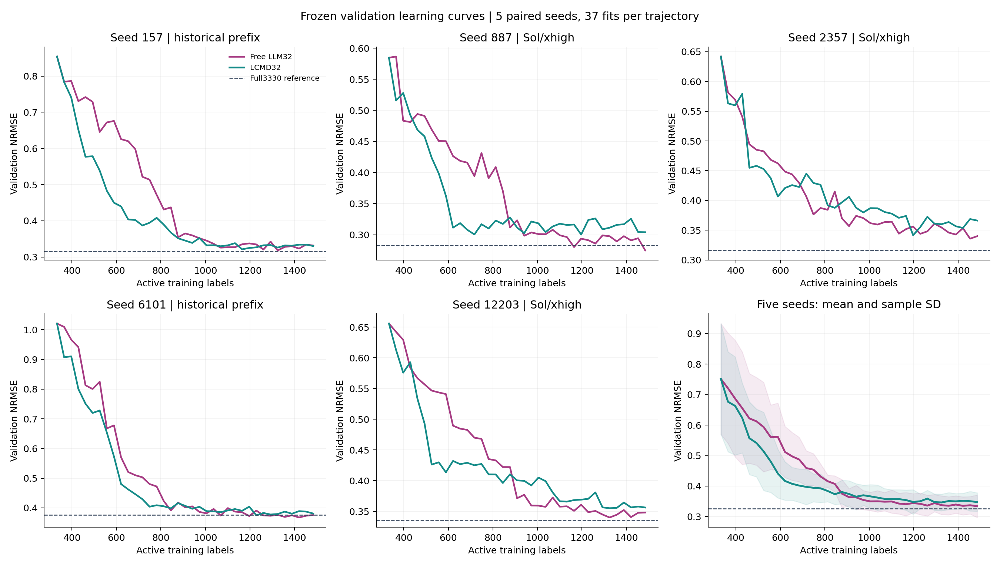
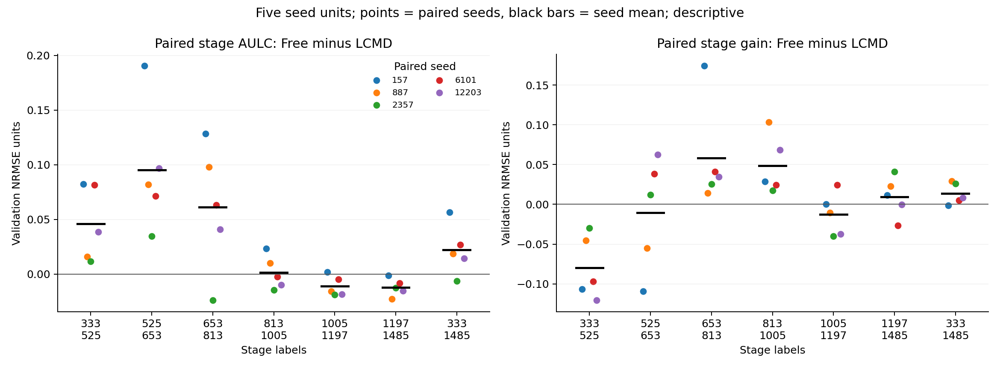
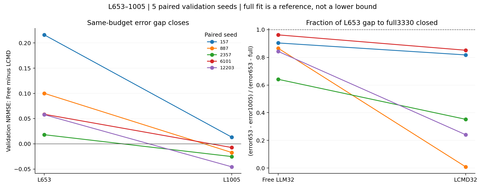
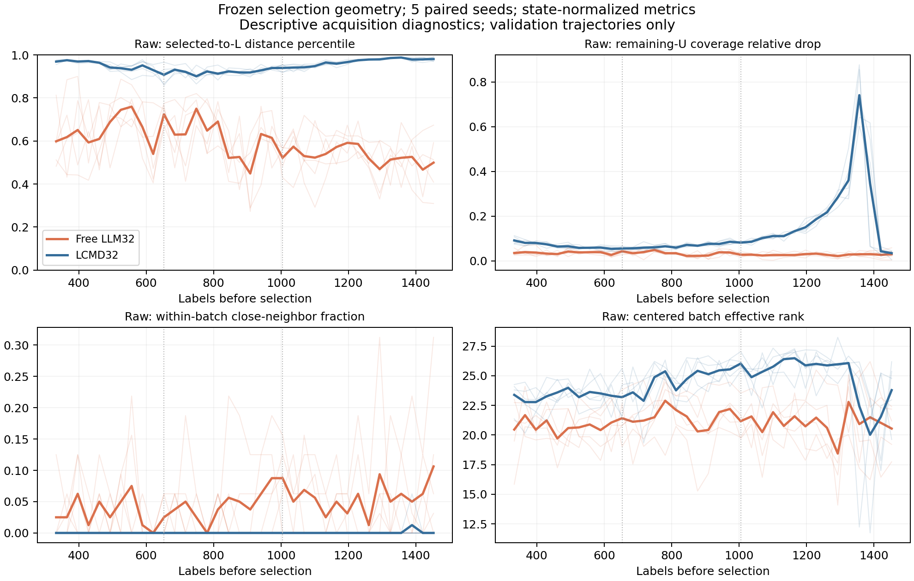
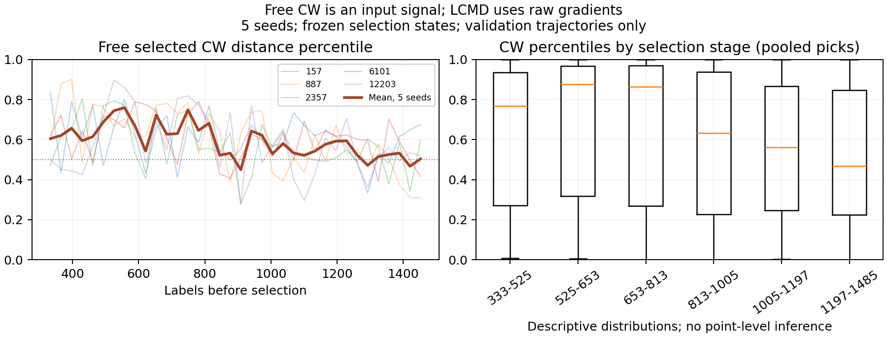
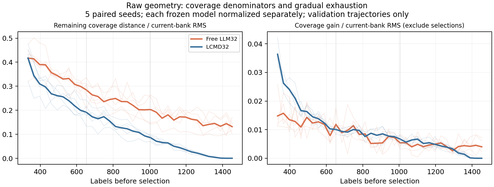
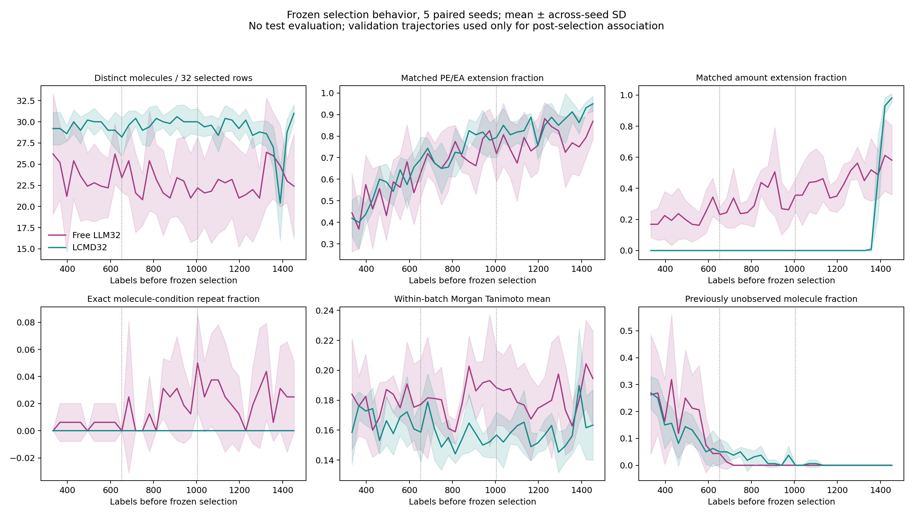
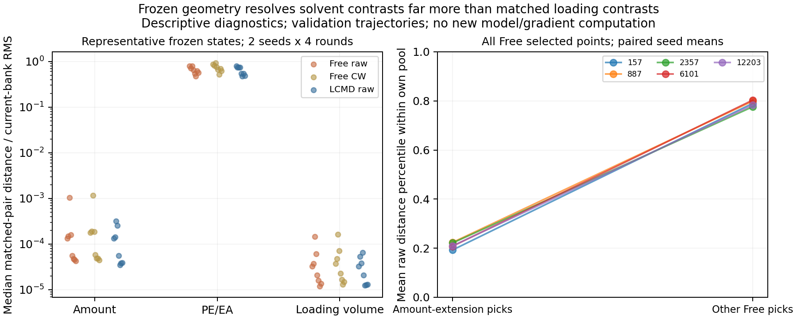
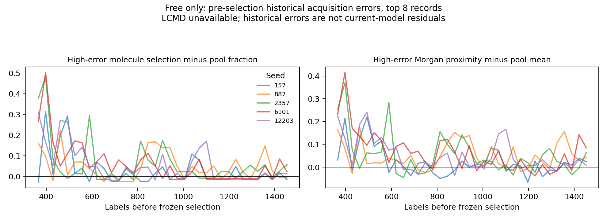

# Free LLM32 vs LCMD32：五 seed 主动学习机制诊断

2026-10-29，4g QGeoGNN-V2、Row split、validation开发轨迹。**诊断已完成；没有启动新实验。** 原始NRMSE归一化保持不变，统计单位为五个配对seed。

最可靠的结论是：**LCMD更快覆盖当前梯度表示；Free在较少分子上组合更多局部条件，尤其是上样量对照。** 但Free中期下降较大主要发生在早期落后的背景下；目前不能把较晚的性能优势归因于局部补线、历史反馈或CW信息。冻结几何中上样量/加载体积方向很弱，值得作为下一步可检验的机制问题，不能直接视为已经证明的解释。

## 1. 完整性、来源和实现复核

本地main、缓存origin/main及本次只读远端查询一致：`fbf4efa9efe251a22c3865d15718e149a38eeb7d`。读取了任务指定的最新决策页、最终报告/审计、冻结曲线、scientist_study/selector、lcmd及相关历史提交；原始gradient源`8081e865`与延长实验保留副本逐字节一致。当前gradient模块的五个共同函数AST仍一致，新增linear-output功能没有被误当作本次LCMD特征。

| 证据 | 预期 | 本次独立复核 | 边界 |
|---|---:|---:|---|
| Free/LCMD冻结validation拟合 | 370 | 370 | 每条37点，初始化/validation划分/预算和模型预测哈希一致 |
| 冻结采集批次 | 360 | 360 | 每批32个合法唯一ID，逐轨迹1152个新增ID |
| 逐次选点记录 | 11,520 | 11,520 | 保留原顺序、来源路径和SHA256，不从曲线反推 |
| raw q50 CountSketch bank | 360 | 360 | bank索引、checkpoint及选择状态核验 |
| Free CW bank | 180 | 180 | 全候选分位与冻结bank重算在展示舍入容差内一致 |
| LCMD CW bank | 180 | 0 | 明确NA，没有重提梯度 |
| Free事前历史残差 | 175批可有历史 | 175 | r0的5批无历史，NA；每轮历史数=32×round |
| LCMD历史残差 | 180 | 未从已审计来源取得 | receipt是值哈希，没有可用于该分析的响应载荷，不以外轨迹/全量真值补齐 |
| 3330标签全量validation参考 | 5 | 5 | 仅复核既有fit_audit；不是不可突破的下界 |

完整证据见[data_availability_audit.json](data_availability_audit.json)、[runtime_integrity_audit.json](runtime_integrity_audit.json)及逐文件哈希清单。检查点和预测文件按字节哈希；没有解析预测CSV内的候选/test真值。所有实测值仅来自该轨迹已揭示的catalog/feedback。本次无训练、推理、LLM调用、梯度重算、新标签请求或test评价。

Free不是没有数值输入的化学LLM：候选含QGeoGNN预测、q10/q90宽度、CW分位、结构/条件新颖性和相似性，观测记录含实测响应及历史采集误差。五seed LCMD使用**原始q50全网络512D CountSketch与corrected LCMD-TP**，并非CW-LCMD。raw/CW是各自冻结模型的空间，不能跨轮直接比较原始距离。

157/6101保留历史Astra/high前缀；其他三个seed主要是Sol/xhigh。已接受turn可直接核到164批Sol、15批Astra，157 r5因历史授权抄写修正不能直接对应served-model，保留unknown；不据配置猜填。原报告中历史授权纠正和887 r33/12203 r24 amendment仍存在，不作新的纠正。以历史前缀两seed和Sol三seed分层后，早期LCMD全程AULC更低、Free中期下降更多的方向均保留，但不能分离模型版本、seed及路径历史。

## 2. 曲线结论可靠，必须区分四种指标

NRMSE使用各seed原L333的V1/V2 population std，固定为整条轨迹的分母。AULC是NRMSE对标签数的梯形积分除以阶段跨度，没有以初始误差或full参考再次定标。

| 验证指标 | Free | LCMD | 解释 |
|---|---:|---:|---|
| NRMSE@1485，均值±seed样本SD | 0.334085±0.037097 | 0.347582±0.030467 | Free低0.013497，4/5 seed较低 |
| AULC333–1485 | 0.439159 | 0.417049 | LCMD更低，4/5 seed较低 |
| AULC653–1005 | 0.412270 | 0.383662 | 中期整段累计效率仍是LCMD更好 |
| 首尾下降653–1005 | 0.147736 | 0.041176 | Free五seed均下降更多，不等同于整段误差更低 |
| AULC1005–1485 | 0.341659 | 0.353349 | Free五seed均更低 |
| 首尾下降1005–1485 | 0.015770 | 0.018746 | 两法后段收益都小；Free后段下降并未更多 |

六个主阶段的完整比较如下。AULC差为Free−LCMD，负为Free更优；改善量正为该段误差降低。

| 标签段 | Free/LCMD AULC | 配对AULC差均值±样本SD | Free/LCMD首尾改善 |
|---|---:|---:|---:|
| 333–525 | 0.661703 / 0.615647 | +0.046056±0.034345 | 0.157664 / 0.237476 |
| 525–653 | 0.544912 / 0.449844 | +0.095068±0.058100 | 0.096142 / 0.106417 |
| 653–813 | 0.457695 / 0.396386 | +0.061309±0.058075 | 0.081573 / 0.023548 |
| 813–1005 | 0.374416 / 0.373058 | +0.001359±0.015426 | 0.066163 / 0.017629 |
| 1005–1197 | 0.346480 / 0.357681 | −0.011201±0.009207 | 0.005688 / 0.018299 |
| 1197–1485 | 0.338446 / 0.350462 | −0.012016±0.007980 | 0.010082 / 0.000447 |

**653–1005并非简单的整段效率反转。** L653均值Free 0.497591、LCMD 0.407505；L1005为0.349855、0.366328。多下降0.106560 = 起点落后0.090086 + 终点领先0.016473。约84.5%的额外下降在算术上用于抹平起点劣势，不能称为某机制的因果份额。五seed Free在653都更差，该段却都下降更多；相对各自起点改善均值28.69%对9.58%，相对全量参考余量关闭均值84.32%对45.42%，方向仍在，但未控制模型状态、训练集、版本与优化差异。

曲线有明显非单调性。各seed交叉次数为8、5、7、11、3；持续Free误差更低的首个预算分别为无、941、1229、1261、909，不能选一个普适的653或1005切换点。逐轮NRMSE/相邻改善、阶段速度/波动、0.50/0.45/0.40/0.35/0.30首达与持续阈值及右删失、各seed最佳点/预算、配对方差全部输出到CSV/JSON。最佳点是反复查看validation后得到的事后最小值，不替代固定预算结果。[CURVE_FINDINGS.md](CURVE_FINDINGS.md)提供逐seed完整表。

## 3. 几何覆盖：LCMD更强，但没有653突然饱和

所有距离特征由该方法当轮冻结状态计算。LCMD选点raw距离平均分位0.94921，Free raw为0.59000；排除本批32个自归零点后，候选池覆盖距离的相对改善为12.26%对3.23%。两项在全部30个seed×阶段配对均为LCMD较大，独立统计单位仍只有五seed。

Free的raw批次有效秩21.09，LCMD24.33，29/30个seed×阶段LCMD更高。Free有4.65%选点的批内最近邻距离小于其到L距离的一半，LCMD为0.0347%。这支持Free更集中，不能由此宣称其局部设计无用。

Free所选CW分位均值0.59254，最高十分位占30.35%；525–653和653–813阶段约45%选点位于最高十分位，后期约19%。它有高距离偏好，但并非固定高CW贪心。raw/CW选点级rank相关0.987–0.991，因此CW和raw/结构/条件等共线，无法据观察数据单独归因。

“LCMD在653突然覆盖饱和”没有得到支持。其排除本批后的覆盖相对改善从525–653的5.78%到653–813的5.96%、813–1005的7.30%，后期还上升。以各自当前bank centered RMS定标的覆盖增量则逐渐减小：LCMD六阶段为0.02343、0.01272、0.00967、0.00804、0.00601、0.00219。剩余可覆盖距离也逐渐变小，极后期接近零；这解释了为何相对下降可以很大而绝对定标增量很小，但没有定位到653的断点。两种尺度均受当前模型表示影响，不能当作固定空间因果证据。

覆盖与下一拟合误差改善没有跨seed稳定的强联系。按六阶段中心化后，raw相对覆盖改善与下一轮validation改善的seed内Spearman均值约Free +0.072、LCMD −0.077；LCMD仅2/5为正。未调整的时间趋势会改变结果。这些相关有自相关、小样本、状态混杂，未报告p值或独立轮次显著性。完整逐seed结果见[next_fit_associations_by_seed.csv](next_fit_associations_by_seed.csv)。

## 4. 真实化学/条件行为：更少分子，更多loading对照

所有行为来自冻结ID及对应条件，没有按LLM文字推断。matched contrast要求同分子、除目标变量外四条件完全一致且目标值不同；真正curve extension额外排除已观测的完整条件tuple。完全相同条件的新ID重复测量另计。

| 每批/选点指标，五seed等权 | Free | LCMD |
|---|---:|---:|
| 不同分子数/32行 | 23.06 | 29.22 |
| 批内同分子对数 | 10.32 | 3.36 |
| 新上样量条件点补全 | 34.65% | 6.65% |
| 新PE/EA条件点补全 | 68.58% | 73.13% |
| 已见完整分子+五条件tuple的重复行 | 1.65% | 0.00% |
| 批内Morgan平均相似度 | 0.1807 | 0.1602 |
| 仅批内不同分子的Morgan平均相似度 | 0.1636 | 0.1550 |

同分子集中和上样量补全均为五seed同向。Free新上样量补全从早期19.90%升至末段50.00%；LCMD在333–1197全部为零，末段26.60%。这不表示LCMD早期没选不同上样量，而是它们没有与过去已观察的同分子/PE/EA/其他条件组成严格对照。Free在813以后新选分子都已观测，但早期新分子行比例反而更高，不能说Free始终只做局部开发。

**Free更爱补PE/EA曲线的宽泛说法被数据否定。** 真正差别是上样量及多维loading局部对照。Murcko同骨架配对比例Free也未更高（0.3432对0.3601）；“同家族密集”依赖家族定义，不能由分子重复推及所有化学家族。

新增有限几何探针进一步连接了行为与表示：在seed157/887、L333/653/973/1293的既有bank中，比较同分子且只改一个条件的真实行对。Free raw/CW和LCMD raw共72个轴汇总中，PE/EA对比距离中位数是上样量对比的767–14,189倍（跨状态中位7814倍）；loading-solvent volume对比同样很小。这里比较的是候选中实际存在的条件对比，**没有将变量单位或扰动幅度等同，倍数不是单位导数/物理因果效应**。特征不是完全相同，上样量方向只是远弱于PE/EA方向。

全五seed选点与几何联结后，Free真正上样量补全的1996行raw/CW平均分位约0.212，其余3764行约0.791/0.795；各seed方向一致。Free因此混合了**高距离选点与低距离loading补全**。这也是不能把CW偏好均值当作单一采集机制的原因。该探针只覆盖代表状态，不扩大为全五seed全程的一般灵敏度结论。

源码确认预测器确有density×V、loading solvent和loading-solvent volume输入，不能称作缺失输入。值得检验的是当前梯度表示/模型是否低估某些条件对比，以及这类额外标签是否带来误差收益；不是先判定LCMD错误或LLM化学推理正确。

## 5. 历史误差和科学反馈：行为成立，收益未识别

Free选择前全史top8残差分子的选中比例6.70%，当轮U池基线1.59%，富集+5.11pp；到这些样本的Morgan近邻相似性比池基线高0.0494。只看前一批top8时，五seed同分子富集约+13.5至+19.0pp，近期反馈附近继续探索有真实ID证据。全史top8富集在653–813仅+0.81pp，说明不是始终追逐固定最坏点。

阶段中心化后，全史top8富集和下一轮改善的seed内相关均值约−0.037（2正3负）；控制预算和起始NRMSE后约 `[+0.070,+0.299,−0.009,−0.023,−0.359]`，仍不稳定。新上样量补全与下一轮收益也没有稳定正相关。可以说行为会响应反馈，不能说反馈修复已解释中期收益。LCMD历史残差缺项使跨方法该机制比较不能完成。

具体科学假设有证据链，而非只有漂亮理由。例如seed2357在L653选择m125的两个缺失2×2条件角，冻结V2预测23.652/23.644ml，揭示为20.225/36.142ml；先前两个角已观察，下一轮解释确实引用结果，但没有持续重采这个分子。另一个m207补齐150µl点后显示非单调响应，不能支持通用单调loading先验。病例完整ID、事前记录、hypothesis、冻结预测、揭示值及下一轮文字/真实选择见[hypothesis_feedback_cases.json](hypothesis_feedback_cases.json)与[BEHAVIOR_FINDINGS.md](BEHAVIOR_FINDINGS.md)。这些是已揭示观测，不是随机化的物理因果实验。

## 6. 信息依赖诊断

文本只匹配LLM叙述字符串值，排除schema键、ID、hash；失败修复只匹配模型误差语义，避免把非法ID逻辑纠正当作模型修复。按批及五字段独立统计都已输出。

| 叙述类别 | 180批出现比例 | 行为证据/缺口 |
|---|---:|---|
| CW/距离分位 | 66.11% | 实际CW偏好与mention相关；NoCW因果贡献未知 |
| 分位宽度 | 75.56% | 与所选V2宽度的池内rank相关；宽度未被证明校准 |
| 分子相似性 | 73.89% | Morgan结构选择有差别，可能与同分子设计共线 |
| 化学先验 | 100.00% | 关键词饱和，无法由提及率识别价值；需No-chemistry |
| 实测/历史误差 | 99.44% | 近期失败邻近有证据；收益需No-feedback |
| 局部条件曲线 | 100.00% | 上样量行为支持，PE补线优势不成立 |
| 多样性/冗余/覆盖 | 97.78% | Free真实批次更集中，不能由自述称其更分散 |
| 明确模型失败修复 | 88.89% | 行为富集与收益应分别解释 |

CW mention与所选CW分位的每seed相关0.359–0.544，控制预算/起始验证误差后0.508–0.563。与实际选择有联系，强于只有文字引用；仍可能由阶段、模型、其他数值和化学代理共同驱动。否定句也计mention，化学/局部曲线的100%提及是饱和代理，不是100%依赖或因果证明。[text_field_mentions.csv](text_field_mentions.csv)和相关敏感性CSV保留可复查结果。

NoCW需要回答显式CW在其他输入仍存在时是否有增量价值；No-feedback要真正移除后续已测响应/历史误差/解释记忆的输入渠道；No-chemistry需移除SMILES/化学描述符，同时保留稳定的匿名分子同一性与条件，避免把条件设计能力也一起删除。现有观察数据不能替代任何一项。

## 7. 对653–1005现象的解释顺序

1. **已确定的算术因素：** Free在653起点更差，有更大的下降空间，额外下降的大部分是追赶；中期AULC尚未反转。
2. **强行为差异、合理机制候选：** LCMD持续覆盖当前raw几何，Free将部分预算投向低几何距离的loading局部对照；冻结表示对这些条件对比很弱。它有可能修复梯度覆盖无法区分的响应方向，但尚无因果收益证据。
3. **有行为、收益证据不足：** Free用近期失败反馈引导局部探索，text与实际CW/宽度偏好一致；去趋势后的收益相关不稳定，不能宣称这些渠道已造成反转。
4. **仍不能排除：** L_t组成、模型状态、seed/划分、Astra/Sol历史、优化非单调、验证噪声和已暴露开发集的选择效应。单纯“LCMD在653饱和”不足以解释观察结果。

H1–H6逐项支持/反证、替代解释、最小实验及投入价值见[mechanism_hypotheses.md](mechanism_hypotheses.md)。没有得出LLM/LCMD互补或应当混合的结论。

## 8. 下一步三个实验，按优先级

**1. Free vs NoCW的信息消融。** 五seed、固定一个LLM版本/effort，保留预测/宽度/结构/条件/反馈，只去显式CW字段与相应说明/记忆。用相同初始L333、训练规则、候选交付/排序及纠正预算，固定333–1005窗口；主指标为AULC与1005端点，阶段改善/选点变化为机制指标。旧Free的Astra/Sol混合轨迹不能直接充当干净同版本对照。回答的是显式CW的条件增量，不是去除一切几何代理。

**2. Free vs No-feedback。** 同五seed、同模型版本/信息条件。selector保留L333初始观测和后续已标注ID/条件，隐藏后续实测响应、采集误差、top-error记忆和对应解释；模型训练照常使用合法已获得标签。预定相同333–1005窗口，比较中期AULC、端点、近期失败邻近及loading设计改变。只去feedback_interpretation文字仍保留误差列的版本不够回答H4。

**3. 同状态的loading条件对照与数值约束实验。** 五seed，在事先固定L653/L813、来自Free和LCMD两种历史的冻结状态分支；固定LLM与输入，比较自由选32点、仅增加预定高CW配额、仅保留预定数量新matched-loading对照三臂。配额事先固定且不按已有验证结果调参；所有ID先冻再揭示，按相同初始化拟合一个预定短窗。主问题是高距离约束是否挤走低距离条件对照，以及这种改变是否影响验证改善/AULC；这同时检验H3、几何薄弱方向和H6，而非直接开发混合算法。先只比较冻结选择可控制成本，但不能替代性能实验。

No-chemistry是随后定位化学先验的必要消融，优先级暂后于上述三项：当前最鲜明的差异是可直接量化的loading对照，而非已识别的化学先验收益。任何未来试验均需独立授权；本任务已在报告分析处停止。

## 9. 复现、自检和文件入口

[PROTOCOL.md](PROTOCOL.md)给出公式、时间边界和NA规则；[README.md](README.md)列出分析命令、依赖与全部产物。`selection_profiles.csv`合并360批几何、结构/条件、文本、反馈特征及紧接该批的validation改善；`selection_records.csv`为11,520真实选点；`stage_comparison.csv`为100行逐seed/方法/阶段指标。导出的列保留各自来源和定义。

本次独立核验370拟合/360批哈希、370点数值和5个full参考；轻量测试覆盖数值定义、删失/交叉、阶段积分、geometry rank/coverage、真实ID顺序、条件补全、历史时间边界、文本键误命中和合并对齐。图表已逐幅查看。最终测试及输出哈希见[verification.json](verification.json)。历史目录未覆盖；原工作区两条既有状态修改保留。
