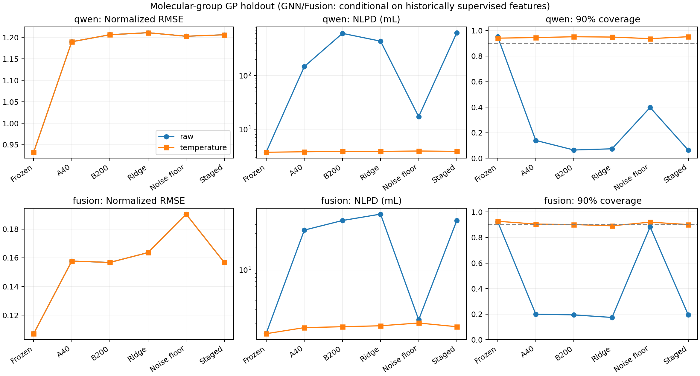

# Phase 1 受控训练消融结果

本报告来自已执行的真实缓存与训练，不含模拟效果。首轮固定2开发seed×L333/L813、2端点、Projection init17/29；全部失败和未收敛结果保留。主矩阵200次拟合，另补8次同拆分Frozen Fusion；8次全L_t数值复跑单列。

## 合法拆分与解释范围

| Seed | 预算状态 | GP fit行 | calibration行 | check行 |
| --- | --- | --- | --- | --- |
| 157 | 333 | 205 | 65 | 63 |
| 157 | 813 | 525 | 145 | 143 |
| 887 | 333 | 196 | 53 | 84 |
| 887 | 813 | 475 | 142 | 196 |

按分子hash固定分组，不是旧Row validation任务的同分布复现。Qwen-only的check分子完全未进入GP拟合/校准；Qwen预训练未使用本任务标签。Fusion/GNN/Raw/CW的历史GNN见过整个L_t，因此内部check仅为冻结监督表示后的GP核验；不能当成端到端无泄漏外样本证据。416行validation参与过GNN checkpoint选型，仅作开发评价。PCA/GP缩放仅fit子集，calibration只拟合观测方差temperature，check从不反馈调参。

## 分组核验：原始概率输出与校准分开

表中先平均初始化/端点/预算，再等权平均seed。nRMSE=RMSE/历史L0端点std；NLPD为原mL单位密度评分。Coverage和标准化RMS不能取代区间宽度与NLPD。temperature只改变观测预测区间，不改均值/原始GP选点。

### qwen

| 方法 | 概率输出 | nRMSE | NLPD | 90%覆盖 | 95%覆盖 | 标准化RMS |
| --- | --- | --- | --- | --- | --- | --- |
| Frozen | raw | 0.9325 | 3.7640 | 95.3% | 96.0% | 0.79 |
| Frozen | temperature | 0.9325 | 3.7345 | 94.0% | 96.0% | 0.81 |
| A40 | raw | 1.1897 | 147.6264 | 14.0% | 16.4% | 17.00 |
| A40 | temperature | 1.1897 | 3.8154 | 94.5% | 95.7% | 0.77 |
| B200 | raw | 1.2060 | 613.0814 | 6.4% | 7.3% | 33.81 |
| B200 | temperature | 1.2060 | 3.8821 | 95.1% | 96.6% | 0.74 |
| C Ridge | raw | 1.2108 | 438.7431 | 7.4% | 8.7% | 28.97 |
| C Ridge | temperature | 1.2108 | 3.8792 | 94.9% | 96.5% | 0.72 |
| D Noise floor | raw | 1.2025 | 17.1683 | 39.8% | 45.3% | 5.40 |
| D Noise floor | temperature | 1.2025 | 3.9410 | 93.7% | 95.5% | 0.77 |
| E Staged | raw | 1.2059 | 631.1494 | 6.4% | 7.1% | 34.24 |
| E Staged | temperature | 1.2059 | 3.8842 | 95.2% | 96.6% | 0.74 |

### fusion

| 方法 | 概率输出 | nRMSE | NLPD | 90%覆盖 | 95%覆盖 | 标准化RMS |
| --- | --- | --- | --- | --- | --- | --- |
| Frozen | raw | 0.1071 | 1.4674 | 92.4% | 95.8% | 0.96 |
| Frozen | temperature | 0.1071 | 1.4528 | 92.7% | 95.5% | 0.93 |
| A40 | raw | 0.1577 | 33.5166 | 20.0% | 23.4% | 7.90 |
| A40 | temperature | 0.1577 | 1.7462 | 90.5% | 94.4% | 1.01 |
| B200 | raw | 0.1568 | 44.8172 | 19.4% | 22.8% | 9.06 |
| B200 | temperature | 0.1568 | 1.7949 | 90.1% | 93.9% | 1.02 |
| C Ridge | raw | 0.1636 | 54.3871 | 17.4% | 21.3% | 9.92 |
| C Ridge | temperature | 0.1636 | 1.8466 | 89.2% | 92.7% | 1.06 |
| D Noise floor | raw | 0.1904 | 2.2174 | 88.3% | 91.7% | 1.07 |
| D Noise floor | temperature | 0.1904 | 2.0083 | 92.0% | 94.6% | 0.94 |
| E Staged | raw | 0.1568 | 44.8458 | 19.4% | 22.8% | 9.06 |
| E Staged | temperature | 0.1568 | 1.7950 | 90.1% | 93.9% | 1.02 |

## 区间宽度按端点保留

所有方法的90/95区间宽度分别见 [逐端点宽度](summary/phase1_interval_width_by_endpoint.csv)，不把V1/V2的mL宽度混成单一量。校准前后保持同均值，宽度乘sqrt(alpha)；巨大alpha是方差尺度失配的证据，不能证明信息排序正确或GP假设成立。

## 优化行为

| 表示 | 方法 | 有限fit | optimizer success | noise/signal中位 | 条件数中位 | alpha中位 | 训练秒数合计 |
| --- | --- | --- | --- | --- | --- | --- | --- |
| fusion | B200 | 16 | 0.0% | 2.662e-06 | 134529717.4 | 65.13 | 77.9 |
| fusion | Frozen | 8 | 100.0% | 1.661e-04 | 2055100.8 | 1.12 | 5.9 |
| fusion | D Noise floor | 16 | 0.0% | 1.416e-04 | 2342089.5 | 1.16 | 68.6 |
| fusion | A40 | 16 | 0.0% | 3.377e-06 | 101449756.9 | 57.36 | 23.7 |
| fusion | C Ridge | 16 | 0.0% | 9.246e-07 | 306532301.5 | 72.10 | 72.5 |
| fusion | E Staged | 16 | 100.0% | 2.666e-06 | 135045308.3 | 65.18 | 76.0 |
| qwen | B200 | 16 | 0.0% | 8.337e-07 | 408781569.6 | 2620.97 | 112.2 |
| qwen | Frozen | 8 | 100.0% | 4.779e-02 | 6474.8 | 0.93 | 4.2 |
| qwen | D Noise floor | 16 | 0.0% | 2.104e-04 | 2362008.4 | 50.23 | 108.2 |
| qwen | A40 | 16 | 0.0% | 8.263e-06 | 44277259.0 | 484.84 | 33.0 |
| qwen | C Ridge | 16 | 0.0% | 1.849e-05 | 13499563.5 | 1759.22 | 120.4 |
| qwen | E Staged | 16 | 100.0% | 7.697e-07 | 467865850.4 | 2734.23 | 114.0 |

loss_history和objective_evaluations是函数求值记录，包含未接受的线搜索点，不应称作每次接受迭代的单调学习曲线。B200只是增加预算的候选，不能凭名称宣称收敛。E的success是表示冻结后核超参数阶段的状态，第一阶段停止状态另存，不能冒称整个联合目标已收敛。gradient-qualified门槛同时检查有界投影梯度<1e-3；完整梯度、MLL、边界和迭代在 [fit明细](summary/phase1_fits.csv)。全部数值求解float64，jitter与noise分开记录。

## 种子、预算与最差情形

逐seed×预算×初始化×端点评分见 [完整metrics](summary/phase1_metrics.csv)；[seed配对差](summary/phase1_paired_seed_differences.csv) 保留B–E相对A40的差，不挑最优初始化。下表为每个seed平均两预算、端点、初始化后的原始check结果。

| Seed | 表示 | 方法 | nRMSE | NLPD | 90%覆盖 |
| --- | --- | --- | --- | --- | --- |
| 157 | fusion | B200 | 0.1213 | 35.2314 | 25.3% |
| 157 | fusion | Frozen | 0.0897 | 1.1192 | 89.8% |
| 157 | fusion | D Noise floor | 0.1504 | 1.9792 | 88.5% |
| 157 | fusion | A40 | 0.1216 | 30.0803 | 24.5% |
| 157 | fusion | C Ridge | 0.1266 | 41.8283 | 21.6% |
| 157 | fusion | E Staged | 0.1213 | 35.2131 | 25.3% |
| 157 | qwen | B200 | 1.2746 | 627.7892 | 4.4% |
| 157 | qwen | Frozen | 1.0450 | 3.6967 | 94.6% |
| 157 | qwen | D Noise floor | 1.3150 | 18.4537 | 35.4% |
| 157 | qwen | A40 | 1.2334 | 156.9744 | 12.4% |
| 157 | qwen | C Ridge | 1.3288 | 513.9181 | 6.0% |
| 157 | qwen | E Staged | 1.2747 | 646.8107 | 4.4% |
| 887 | fusion | B200 | 0.1922 | 54.4030 | 13.5% |
| 887 | fusion | Frozen | 0.1244 | 1.8155 | 95.1% |
| 887 | fusion | D Noise floor | 0.2305 | 2.4556 | 88.1% |
| 887 | fusion | A40 | 0.1938 | 36.9529 | 15.4% |
| 887 | fusion | C Ridge | 0.2006 | 66.9459 | 13.2% |
| 887 | fusion | E Staged | 0.1922 | 54.4785 | 13.5% |
| 887 | qwen | B200 | 1.1375 | 598.3736 | 8.5% |
| 887 | qwen | Frozen | 0.8199 | 3.8313 | 95.9% |
| 887 | qwen | D Noise floor | 1.0900 | 15.8830 | 44.1% |
| 887 | qwen | A40 | 1.1460 | 138.2785 | 15.5% |
| 887 | qwen | C Ridge | 1.0928 | 363.5681 | 8.8% |
| 887 | qwen | E Staged | 1.1372 | 615.4880 | 8.4% |

只有两个开发seed，不能称最终跨seed性能，也不将4状态当4独立统计重复。最差seed和预算必须与整体均值一起读；未进行显著性检验。

## 采集排序与文本鲁棒性

| 表示 | 方法 | init方差秩ρ | MaxVar重叠 | IVR重叠 | BatchIG重叠 |
| --- | --- | --- | --- | --- | --- |
| fusion | B200 | 0.802 | 0.707 | 0.594 | 0.703 |
| fusion | D Noise floor | 0.817 | 0.688 | 0.672 | 0.691 |
| fusion | A40 | 0.878 | 0.758 | 0.633 | 0.727 |
| fusion | C Ridge | 0.822 | 0.707 | 0.609 | 0.688 |
| fusion | E Staged | 0.802 | 0.707 | 0.594 | 0.703 |
| qwen | B200 | 0.831 | 0.684 | 0.559 | 0.691 |
| qwen | D Noise floor | 0.826 | 0.664 | 0.547 | 0.637 |
| qwen | A40 | 0.855 | 0.703 | 0.625 | 0.711 |
| qwen | C Ridge | 0.843 | 0.691 | 0.602 | 0.672 |
| qwen | E Staged | 0.830 | 0.680 | 0.566 | 0.680 |

重叠为同状态同池32点交集/32，不是Jaccard。全部候选是原冻结U_t中同一256点子池。跨seed的L_t、checkpoint、候选池不同，不能把跨seed差异当作仅训练随机性效应；本表init17/29隔离GP初始化。

模板A→B同一模型前向，未用B调参；均值变化、方差秩ρ与三种采集重叠在 [模板稳定性](summary/phase1_template_stability.csv)。[采集覆盖](summary/phase1_acquisition_coverage.csv) 保留分子数、全部五条件取值覆盖、批内相关、信息量及成本。方差绝对失准与相对排序分别报告；排序稳定本身不证明对未来误差/下游AULC有价值。

## 开发validation与基线

| 表示 | 方法 | nRMSE | NLPD | 90%覆盖 |
| --- | --- | --- | --- | --- |
| cw | Frozen | 0.6124 | 4.2575 | 73.6% |
| fusion | B200 | 0.5553 | 634.2114 | 10.7% |
| fusion | Frozen | 0.5514 | 21.6558 | 56.7% |
| fusion | D Noise floor | 0.5669 | 8.2872 | 74.3% |
| fusion | A40 | 0.5569 | 582.0134 | 12.1% |
| fusion | C Ridge | 0.5567 | 755.1895 | 10.9% |
| fusion | E Staged | 0.5553 | 634.1885 | 10.7% |
| gnn | Frozen | 0.5556 | 24.5225 | 55.2% |
| qwen | B200 | 1.0148 | 607.0632 | 7.0% |
| qwen | Frozen | 0.9459 | 3.7797 | 94.8% |
| qwen | D Noise floor | 1.0167 | 14.5013 | 48.4% |
| qwen | A40 | 0.9693 | 220.3102 | 16.0% |
| qwen | C Ridge | 0.9882 | 472.4001 | 10.1% |
| qwen | E Staged | 1.0149 | 620.7536 | 7.0% |
| raw | Frozen | 0.6163 | 4.2108 | 73.4% |
| structured | Frozen | 0.8587 | 3.7234 | 94.8% |

这张表只评价GP未拟合的416行，但历史GNN用过该集选checkpoint。仅展示冻结设置下的开发结果，不按它重新选正则/噪声强度。Structured/Raw/CW/Frozen GNN与语言模型使用相同GP fit子集；与旧全L_t报告不能直接做因果方法对比。

## 成本与门槛

实际保存有限fit 208，失败fit 0。训练累计 831.1 秒；含逐fit数值与采集诊断 871.0 秒。墙钟与补充复跑成本各自见completion JSON；测试工程fit不计入科学矩阵。

| 表示 | 方法 | success率 | 梯度资格率 | 覆盖门槛 | RMS门槛 | NLPD门槛 | 通过 |
| --- | --- | --- | --- | --- | --- | --- | --- |
| fusion | B200 | 0.000 | 0.000 | False | False | False | False |
| fusion | D Noise floor | 0.000 | 0.000 | True | True | True | False |
| fusion | A40 | 0.000 | 0.000 | False | False | False | False |
| fusion | C Ridge | 0.000 | 0.000 | False | False | False | False |
| fusion | E Staged | 1.000 | 1.000 | False | False | False | False |
| qwen | B200 | 0.000 | 0.000 | False | False | False | False |
| qwen | D Noise floor | 0.000 | 0.000 | False | False | False | False |
| qwen | A40 | 0.000 | 0.000 | False | False | False | False |
| qwen | C Ridge | 0.000 | 0.000 | False | False | False | False |
| qwen | E Staged | 1.000 | 1.000 | False | False | False | False |

Fusion Noise-floor在条件性GP check上的原始覆盖/NLPD明显改善，但16/16仍未报告优化收敛，且GNN已见过这些check标签，不能据此宣布可信外样本概率专家。扩展门槛在训练前冻结，完整判据见 [PROTOCOL.md](PROTOCOL.md)。未通过时停止5seed×4budget扩展，不靠temperature、挑预算或删失败来取得资格。此次没有正式QGeoGNN AL轨迹、没有新模型权重下载、没有测试真值访问。

最终工程测试：整目录44项全部通过（8.03秒），见 `test_results.txt` 与 `test_receipt.json`。这不替代科学概率门槛。