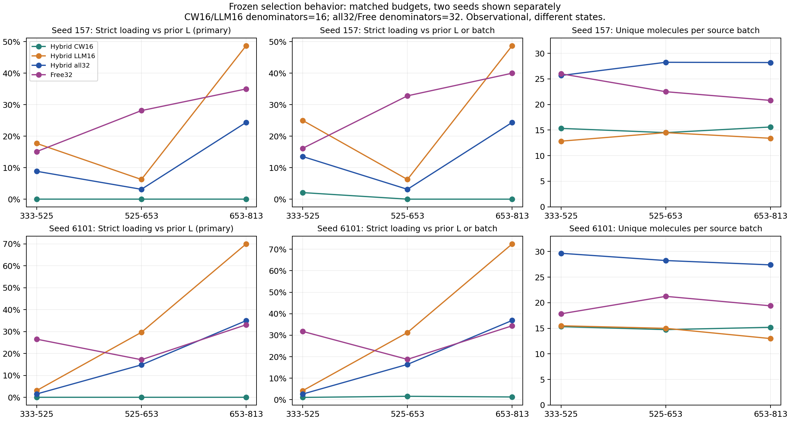
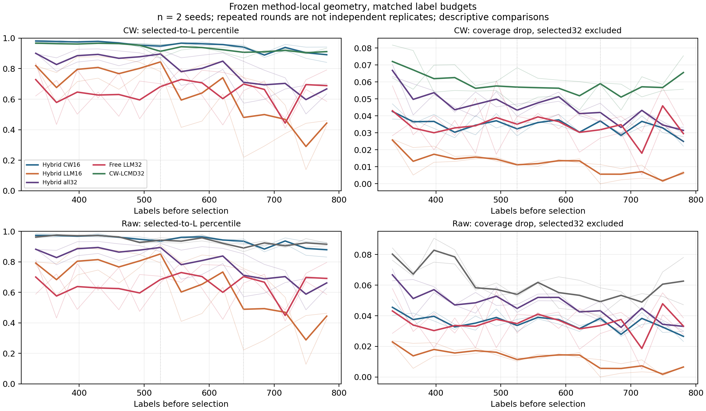
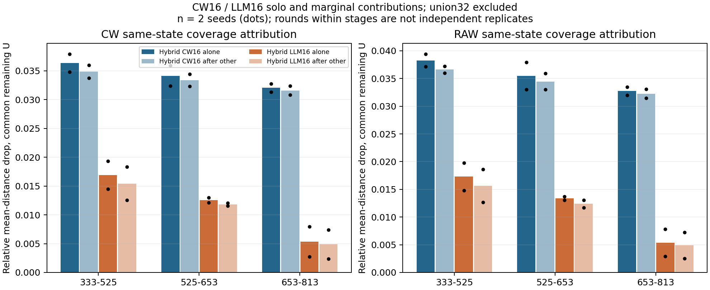
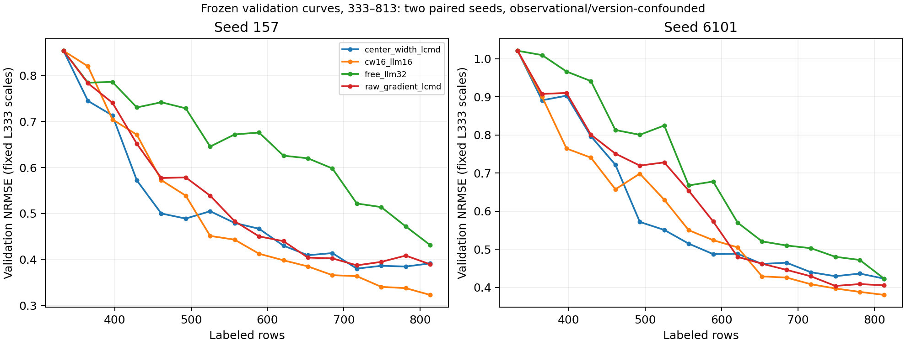

# CW16+LLM16 选点机制复核与 Loading-only 决策

2026-10-29，4g QGeoGNN-V2 Row split。**阶段A完成；按任务的反证决策门暂停阶段B，不启动新实验，也不实现未获证据支持的cap策略。**

## 五个直接回答

1. **不能认定最大差别就是loading。** Free全批确实有更多严格loading单轴补全，但它也更集中于少数分子的多条件组合，Hybrid具有更强的梯度覆盖。seed6101的PE/EA补全差达到25.63个百分点，超过严格loading差11.46个百分点；宽口径loading关系反而是Hybrid略高。因此“全局覆盖与局部多条件设计的组合方式不同”比“只差loading”更符合数据。不同量纲指标不能据差值排名为唯一机制。
2. **CW16提供基础几何覆盖；LLM16提供其余条件/化学及历史误差邻域实验，并仍有额外覆盖。** CW16在各自冻结CW空间的距离分位均值0.9408/0.9573，LLM16为0.6804/0.6087；LLM与CW同分子点仅9.58%/7.92%。LLM不是简单重复CW，也不是始终更少loading。这里的“贡献”是可审计行为和几何分解，不是性能的因果份额。
3. **目前不足以按原假设启动完整loading-only闭环。** 合并32比例下降主要由CW16组成；内部LLM16没有稳定下降，且后段存在反向证据。值得先做同版本、同冻结状态的单轮配对选择诊断，检验减少loading是否实际增加覆盖。单轮不能替代长期AULC。
4. **现在不冻结一个主K。** K=8与12仅作为25%/37.5%强度的待验证行为候选，不是主实验预注册，也未比较历史validation来择优。两seed受到它们影响的轮次与阶段不同，无法从Hybrid平均数推出一个统一最优上限。
5. **若以后正式做两Arm至1005，复用共同L333，2seed需84次新训练和84个基础LLM请求；5seed为210/210。** 首次加最多2次纠正时逻辑请求上限252/630；传输重试另计。本次实际新增训练、真实LLM调用、新标签请求均为0。

## 1. 数据、版本和完整性

两seed157/6101、每条方法15批333→813，主对象是Scientist V2，不拼接Dialog Feedback V1。审计通过128个方法×预算拟合点（122个唯一fit_audit路径；各seed四法共享L333，不能称128次独立训练）、120个冻结批次，其中Scientist有60批。行为表180行（每seed×15round×6来源），点来源表4800行，其中Hybrid子来源与all32是同一批的不同视图，不能当额外独立实验。

Hybrid权威前缀位于`qgeognn_v2_row_llm_scientist_v2/revisions/astra_high_full_pool_20261001`。Free逐轮归属及继承副本由freeze与原目录逐字节确认。旧`reports/llm_hybrid_complete_20261010`的Free当时只到157@525、6101@653，不能单独充当完整两seedFree333→813证据；本报告采用后续实际冻结fit。CW-LCMD32、raw-gradient LCMD32是两个不同控制，分别使用CW与raw bank。

Hybrid的30批均可核到Astra/high；Free157为5批Astra、9批Sol及1批授权抄写修正unknown，6101为10批Astra、5批Sol。主要历史系统Prompt字节相同，不能虚构一个已发现的Prompt版本差；pending16、selection_count16/32、L_t、模型、历史记忆和纠错路径仍不同。原历史protocol明确属于曾曝光test的开发证据，本次不读取test不能恢复为未曝光test的独立验证。

每次input/catalog/selection/batch_freeze/feedback/receipt/fit/checkpoint/预测文件哈希与freeze-before-reveal链见[source_audit.json](source_audit.json)、[source_hashes.json](source_hashes.json)、[PROVENANCE_FINDINGS.md](PROVENANCE_FINDINGS.md)。预测CSV只按字节核验，不解析未选候选/test真值；checkpoint不反序列化。训练初始化、split和原L333归一化按冻结记录核验。历史延长段可用性单列于来源审计，本报告只汇总两seed共同333→813，没有与延长段混平均。

## 2. Loading口径：旧定义、扩展轴与批内关系必须分开

主分析A要求同分子、只变一个原始条件、其他四项完全一致，且排除选前L已见完整tuple。先保留与旧五seed**逐行完全对齐**的V-only/prior口径，再列四个loading原始轴的prior-L union；第三列关系union加入同批其他点作为敏感性口径。Density×V是派生mg，不另算一个轴。匹配没有被理由文本替代。

以下比例为0–1，seed内15批平均；CW16/LLM16各除16，全批除32。旧34.65%和raw-LCMD6.65%是五seed333→1485，不能搬用到此窗口。本窗口两个独立LCMD32控制的严格loading补全均为0。

| seed | 来源 | 每批分母 | 旧V-only/prior | 四轴严格/prior | 四轴严格/L或batch | PE补全/L或batch | 宽loading/L或batch | 不同分子数 |
| --- | --- | --- | --- | --- | --- | --- | --- | --- |
| 157 | hybrid_cw16 | 16.0000 | 0.0000 | 0.0000 | 0.0083 | 0.6250 | 0.7875 | 15.2000 |
| 157 | hybrid_llm16 | 16.0000 | 0.2500 | 0.2500 | 0.2792 | 0.7208 | 0.7000 | 13.4667 |
| 157 | hybrid_all32 | 32.0000 | 0.1250 | 0.1250 | 0.1437 | 0.6729 | 0.7438 | 27.2000 |
| 157 | free32 | 32.0000 | 0.2521 | 0.2521 | 0.2854 | 0.7208 | 0.7042 | 23.3333 |
| 157 | cw_lcmd32 | 32.0000 | 0.0000 | 0.0000 | 0.0000 | 0.6229 | 0.7562 | 29.8000 |
| 157 | raw_lcmd32 | 32.0000 | 0.0000 | 0.0000 | 0.0000 | 0.5979 | 0.7312 | 29.3333 |
| 6101 | hybrid_cw16 | 16.0000 | 0.0000 | 0.0000 | 0.0125 | 0.5708 | 0.8208 | 15.1333 |
| 6101 | hybrid_llm16 | 16.0000 | 0.3042 | 0.3250 | 0.3417 | 0.6250 | 0.6792 | 14.5333 |
| 6101 | hybrid_all32 | 32.0000 | 0.1521 | 0.1625 | 0.1771 | 0.5979 | 0.7500 | 28.5333 |
| 6101 | free32 | 32.0000 | 0.2562 | 0.2625 | 0.2917 | 0.8542 | 0.7292 | 19.2667 |
| 6101 | cw_lcmd32 | 32.0000 | 0.0000 | 0.0000 | 0.0000 | 0.6146 | 0.7438 | 28.9333 |
| 6101 | raw_lcmd32 | 32.0000 | 0.0000 | 0.0000 | 0.0000 | 0.5896 | 0.7271 | 30.2667 |

Free vs Hybrid all32的四轴prior差：157为25.21%−12.50%=12.71个百分点；6101为26.25%−16.25%=10.00个百分点。加入batch后为28.54%−14.38%=14.17pp、29.17%−17.71%=11.46pp。只有两个配对seed，不能称统计“显著”。

Free vs Hybrid LLM16：prior口径157为25.21% vs25.00%，6101为26.25% vs32.50%；关系union为28.54% vs27.92%、29.17% vs34.17%。**内部LLM在157近似相同、6101更高；“pending统一降低loading”这个更强子命题没有得到支持，原H3的行为改变仍无法归因。** 这与强制CW配额稀释合并比例的解释一致。

宽口径B允许同分子同时改变多个条件；其Free/Hybrid all32为157的70.42%/74.38%、6101的72.92%/75.00%，方向与严格单轴相反。这说明严格对照多不等于所有loading相关局部设计都更多。

### 单轴明细（关系L或batch）

| seed | 来源 | V轴 | Density轴 | 加载溶剂体积轴 | 加载溶剂种类轴 |
| --- | --- | --- | --- | --- | --- |
| 157 | hybrid_cw16 | 0.0083 | 0.0000 | 0.0000 | 0.0000 |
| 157 | hybrid_llm16 | 0.2750 | 0.0000 | 0.0083 | 0.0083 |
| 157 | hybrid_all32 | 0.1417 | 0.0000 | 0.0042 | 0.0042 |
| 157 | free32 | 0.2812 | 0.0000 | 0.0187 | 0.0000 |
| 157 | cw_lcmd32 | 0.0000 | 0.0000 | 0.0000 | 0.0000 |
| 157 | raw_lcmd32 | 0.0000 | 0.0000 | 0.0000 | 0.0000 |
| 6101 | hybrid_cw16 | 0.0125 | 0.0000 | 0.0000 | 0.0000 |
| 6101 | hybrid_llm16 | 0.3250 | 0.0000 | 0.0375 | 0.0042 |
| 6101 | hybrid_all32 | 0.1688 | 0.0000 | 0.0187 | 0.0021 |
| 6101 | free32 | 0.2812 | 0.0000 | 0.0229 | 0.0063 |
| 6101 | cw_lcmd32 | 0.0000 | 0.0000 | 0.0000 | 0.0000 |
| 6101 | raw_lcmd32 | 0.0000 | 0.0000 | 0.0000 | 0.0000 |

Density单轴在此窗口为0；溶剂体积/种类少量补全真实存在。单轴行可能重叠，不能把四列直接相加当union。所有匹配peer、axis、prior/batch及元数据可从[loading_matched_contrasts.csv](loading_matched_contrasts.csv)追溯。

### 去重、时间和分母审计

下表为每批平均计数；仅L+仅batch+both=union。批内参考为整批32，包含CW↔LLM，但pending不能混进已测量L。

| seed | 来源 | 仅L/批 | 仅batch/批 | 两者皆有/批 | union/批 | 已见完整tuple重复比例 | 批内完整tuple重复对 | 新分子行比例 |
| --- | --- | --- | --- | --- | --- | --- | --- | --- |
| 157 | hybrid_cw16 | 0.0000 | 0.1333 | 0.0000 | 0.1333 | 0.0000 | 0.0000 | 0.0750 |
| 157 | hybrid_llm16 | 3.6667 | 0.4667 | 0.3333 | 4.4667 | 0.0000 | 0.0000 | 0.1417 |
| 157 | hybrid_all32 | 3.6667 | 0.6000 | 0.3333 | 4.6000 | 0.0000 | 0.0000 | 0.1083 |
| 157 | free32 | 7.4000 | 1.0667 | 0.6667 | 9.1333 | 0.0063 | 0.0000 | 0.1313 |
| 157 | cw_lcmd32 | 0.0000 | 0.0000 | 0.0000 | 0.0000 | 0.0000 | 0.0000 | 0.1083 |
| 157 | raw_lcmd32 | 0.0000 | 0.0000 | 0.0000 | 0.0000 | 0.0000 | 0.0000 | 0.1083 |
| 6101 | hybrid_cw16 | 0.0000 | 0.2000 | 0.0000 | 0.2000 | 0.0000 | 0.0000 | 0.0458 |
| 6101 | hybrid_llm16 | 4.7333 | 0.2667 | 0.4667 | 5.4667 | 0.0167 | 0.0000 | 0.1667 |
| 6101 | hybrid_all32 | 4.7333 | 0.4667 | 0.4667 | 5.6667 | 0.0083 | 0.0000 | 0.1062 |
| 6101 | free32 | 7.7333 | 0.9333 | 0.6667 | 9.3333 | 0.0021 | 0.0000 | 0.1667 |
| 6101 | cw_lcmd32 | 0.0000 | 0.0000 | 0.0000 | 0.0000 | 0.0000 | 0.0000 | 0.1167 |
| 6101 | raw_lcmd32 | 0.0000 | 0.0000 | 0.0000 | 0.0000 | 0.0000 | 0.0000 | 0.1083 |

Free每批不同分子为23.33/19.27，Hybrid为27.20/28.53；同分子pair数Free为9.47/14.93，Hybrid为5.73/3.87。这里Free更集中，但新分子行比例反而更高，不能将CW的覆盖说成新分子配额。全批内完整tuple重复对为0；与旧L重复的完整tuple少量存在并单列，不能把它们称为补全。

## 3. CW16与LLM16的具体分工

每轮都核对该方法自己的checkpoint、有序L/U、bank SHA及catalog。120个冻结状态对应90个raw和90个CW bank；CW32没有raw、raw32没有CW的格子保留NA，没有借其他方法空间或重提梯度。catalog CW分位重算与冻结显示最大差4.99833e-6，符合五位小数舍入。

覆盖指标为固定事前U减去全批32后，到L最近距离的相对下降；各16来源都用同一分母。绝对距离不跨状态比较。Free/Hybrid首轮后模型与L不同，跨方法仍只是匹配预算观察。

| seed | 来源 | CW距离分位 | raw距离分位 | CW覆盖相对改善 | raw覆盖相对改善 |
| --- | --- | --- | --- | --- | --- |
| 157 | hybrid_cw16 | 0.9408 | 0.9321 | 0.0342 | 0.0352 |
| 157 | hybrid_llm16 | 0.6804 | 0.6808 | 0.0116 | 0.0120 |
| 157 | hybrid_all32 | 0.8106 | 0.8065 | 0.0449 | 0.0462 |
| 157 | free32 | 0.6312 | 0.6295 | 0.0321 | 0.0334 |
| 157 | cw_lcmd32 | 0.9272 | NA | 0.0567 | NA |
| 157 | raw_lcmd32 | NA | 0.9319 | NA | 0.0579 |
| 6101 | hybrid_cw16 | 0.9573 | 0.9512 | 0.0344 | 0.0361 |
| 6101 | hybrid_llm16 | 0.6087 | 0.6117 | 0.0121 | 0.0126 |
| 6101 | hybrid_all32 | 0.7830 | 0.7814 | 0.0456 | 0.0475 |
| 6101 | free32 | 0.6646 | 0.6628 | 0.0364 | 0.0369 |
| 6101 | cw_lcmd32 | 0.9460 | NA | 0.0618 | NA |
| 6101 | raw_lcmd32 | NA | 0.9467 | NA | 0.0653 |

在Hybrid同一冻结空间内，CW16单独使CW覆盖距离下降3.42%/3.44%；在CW16之后加入LLM16，仍多下降1.07%/1.12%，合计4.49%/4.56%。这可描述为CW16承担约四分之三的该顺序几何改善；先加入LLM再加入CW也保留大多数CW边际收益。不是把validation改善的75%归因给CW。

LLM16的严格loading为25.00%/32.50%（prior），PE/EA关系union补全为72.08%/62.50%，另有新分子行14.17%/16.67%，类别可以重叠。每批与CW仅共享1.47/1.13个分子；LLM相对CW的独有新分子为2.00/2.60个，CW为1.20/0.73个。LLM选择与已知历史高8残差分子相同的比例在r1之后约17.86%/18.30%，但这是自己的历史采集时误差，不能当成当前模型候选高误差。

LLM理由中loading词出现率为Hybrid157的224/240、6101的198/240，但其中实际严格关系union只有66/224、72/198；词可以指宽loading、控制loading不变的PE对照或其他化学推理，不能由关键词推断真实补全。确有少量冻结catalog中不存在的20-hex引用，详见[reason_id_reference_audit.csv](reason_id_reference_audit.csv)；其中排除/声明不可用的句子与声称实测anchor的句子分开，不把所有外分子引用当错。真实选择行为始终以冻结ID为准。

## 4. 分阶段：不能把总体均值写成一致机制

| seed | 标签段 | 来源 | 严格loading/prior | 严格loading/L或batch | 不同分子数 | CW覆盖相对改善 |
| --- | --- | --- | --- | --- | --- | --- |
| 157 | 333-525 | free32 | 0.1510 | 0.1615 | 26.0000 | 0.0372 |
| 157 | 333-525 | hybrid_all32 | 0.0885 | 0.1354 | 25.6667 | 0.0504 |
| 157 | 333-525 | hybrid_llm16 | 0.1771 | 0.2500 | 12.8333 | 0.0145 |
| 157 | 525-653 | free32 | 0.2812 | 0.3281 | 22.5000 | 0.0341 |
| 157 | 525-653 | hybrid_all32 | 0.0312 | 0.0312 | 28.2500 | 0.0444 |
| 157 | 525-653 | hybrid_llm16 | 0.0625 | 0.0625 | 14.5000 | 0.0121 |
| 157 | 653-813 | free32 | 0.3500 | 0.4000 | 20.8000 | 0.0244 |
| 157 | 653-813 | hybrid_all32 | 0.2437 | 0.2437 | 28.2000 | 0.0387 |
| 157 | 653-813 | hybrid_llm16 | 0.4875 | 0.4875 | 13.4000 | 0.0079 |
| 6101 | 333-525 | free32 | 0.2656 | 0.3177 | 17.8333 | 0.0335 |
| 6101 | 333-525 | hybrid_all32 | 0.0156 | 0.0260 | 29.6667 | 0.0531 |
| 6101 | 333-525 | hybrid_llm16 | 0.0312 | 0.0417 | 15.5000 | 0.0193 |
| 6101 | 525-653 | free32 | 0.1719 | 0.1875 | 21.2500 | 0.0366 |
| 6101 | 525-653 | hybrid_all32 | 0.1484 | 0.1641 | 28.2500 | 0.0475 |
| 6101 | 525-653 | hybrid_llm16 | 0.2969 | 0.3125 | 15.0000 | 0.0130 |
| 6101 | 653-813 | free32 | 0.3312 | 0.3438 | 19.4000 | 0.0396 |
| 6101 | 653-813 | hybrid_all32 | 0.3500 | 0.3688 | 27.4000 | 0.0351 |
| 6101 | 653-813 | hybrid_llm16 | 0.7000 | 0.7250 | 13.0000 | 0.0027 |

最明确反例是6101的653–813：Hybrid all32严格关系union36.88%高于Free34.38%，CW覆盖下降3.51%低于Free3.96%，但Hybrid该段validation AULC仍较低。这直接反驳“较低loading与较高覆盖必须同时伴随更优曲线”的简单描述；期初误差/历史状态不同，也不能把反例倒过来证明loading有益。

157早期333–525的Free/Hybrid all32 loading关系union差仅2.60pp，而两者AULC差0.09365。6101早期loading差29.17pp，AULC差0.14451。两seed同向性能差背后，行为差强度不同。Hybrid内部LLM16早期157有25%loading，高于Free16.15%；6101则4.17%低于31.77%。

## 5. Validation曲线复核

原seed L333固定population std归一化保持不变；AULC为真实非单调曲线梯形积分除标签跨度。不是test评价，不据此反复选择K。

| seed | 方法 | NRMSE@813 | validation AULC333–813 |
| --- | --- | --- | --- |
| 157 | cw16_llm16_scientist_v2 | 0.322792 | 0.492798 |
| 157 | free_llm32_scientist_v2 | 0.431253 | 0.650581 |
| 157 | center_width_lcmd | 0.391350 | 0.499719 |
| 157 | raw_gradient_lcmd | 0.389443 | 0.524059 |
| 6101 | cw16_llm16_scientist_v2 | 0.380292 | 0.581291 |
| 6101 | free_llm32_scientist_v2 | 0.422698 | 0.698584 |
| 6101 | center_width_lcmd | 0.422949 | 0.591969 |
| 6101 | raw_gradient_lcmd | 0.405376 | 0.625827 |

Hybrid在共同333–813的端点和AULC均优于CW32，复现历史结论；它也优于此窗口Free。但优势不是每个阶段都成立：157的333–525 Hybrid AULC0.659929劣于CW32的0.616361；6101的525–653 Hybrid0.527136也劣于CW32的0.499207。

| seed | 方法 | 标签段 | validation AULC |
| --- | --- | --- | --- |
| 157 | cw16_llm16_scientist_v2 | 333-525 | 0.659929 |
| 157 | cw16_llm16_scientist_v2 | 525-653 | 0.417850 |
| 157 | cw16_llm16_scientist_v2 | 653-813 | 0.352198 |
| 157 | free_llm32_scientist_v2 | 333-525 | 0.753584 |
| 157 | free_llm32_scientist_v2 | 525-653 | 0.651583 |
| 157 | free_llm32_scientist_v2 | 653-813 | 0.526178 |
| 157 | center_width_lcmd | 333-525 | 0.616361 |
| 157 | center_width_lcmd | 525-653 | 0.458227 |
| 157 | center_width_lcmd | 653-813 | 0.392942 |
| 157 | raw_gradient_lcmd | 333-525 | 0.671241 |
| 157 | raw_gradient_lcmd | 525-653 | 0.461078 |
| 157 | raw_gradient_lcmd | 653-813 | 0.397824 |
| 6101 | cw16_llm16_scientist_v2 | 333-525 | 0.764431 |
| 6101 | cw16_llm16_scientist_v2 | 525-653 | 0.527136 |
| 6101 | cw16_llm16_scientist_v2 | 653-813 | 0.404847 |
| 6101 | free_llm32_scientist_v2 | 333-525 | 0.908936 |
| 6101 | free_llm32_scientist_v2 | 525-653 | 0.647074 |
| 6101 | free_llm32_scientist_v2 | 653-813 | 0.487370 |
| 6101 | center_width_lcmd | 333-525 | 0.778342 |
| 6101 | center_width_lcmd | 525-653 | 0.499207 |
| 6101 | center_width_lcmd | 653-813 | 0.442531 |
| 6101 | raw_gradient_lcmd | 333-525 | 0.827271 |
| 6101 | raw_gradient_lcmd | 525-653 | 0.575534 |
| 6101 | raw_gradient_lcmd | 653-813 | 0.424329 |

以上不能把“较少loading→性能更好”认定为因果链。指标间相关还受预算、初始误差、L/模型、版本和反馈选择影响；只用两seed不开展伪独立的轮次显著性检验。

## 6. 假设裁决与阶段B

H1（Free过度loading使早期覆盖不足）：观察到严格补全较多、分子集中、整体覆盖较弱，但“过度/浪费”和因果路径未识别；宽loading方向相反、早期差强烈异质。

H2（CW覆盖+LLM其他实验）：与同状态Hybrid几何分解、较低来源重叠相容。还不能排除训练路径及版本，不能把LLM额外覆盖等同于额外性能收益。

H3（看到pending CW可能改变LLM loading偏好）：观察到seed与阶段异质，尚不能把偏好差异归因于pending；原假设并未限定增加或降低。更强的“统一降低”子命题不获支持：6101内部LLM更多loading，后段达72.5%。首轮虽共享初始模型，但157的LLM与Free关系union同为6.25%，6101为0% vs40.63%；单次LLM选择不能分离pending信息、16/32数量效应与LLM输出波动。

H4（减少Free loading可改善效率）：尚无直接证据。合并比例被CW16稀释不意味着cap能让Free自动找到CW的覆盖。按用户明确停止条件，**暂停阶段B实现、正式训练和真实LLM调用**；不交付一个被误认为已验证的新acquisition算法。条件性最小prompt、审计、fail-closed、两臂公平性、K候选与成本方案见[LOADING_CAP_DESIGN.md](LOADING_CAP_DESIGN.md)。

优先下一步是单轮同版本、同冻结状态配对选择，先看cap是否真正改变覆盖和重复、需要多少纠错；当前不执行。K=8会触及两条Free各8/15、6/15批，K=12为2/15、5/15批；早期157两候选都只触及1/6批，6101都触及3/6批。行为强度已经异质，不据曲线优劣挑一个主K。

## 7. 复现、交付和边界

定义见[PROTOCOL.md](PROTOCOL.md)；支持与反证见[loading_mechanism_findings.md](loading_mechanism_findings.md)；全部自检与阶段B未执行项见[PREFLIGHT_REPORT.md](PREFLIGHT_REPORT.md)。复现命令、文件索引见[README.md](README.md)。

主交付为[hybrid_selection_profiles.csv](hybrid_selection_profiles.csv)、[loading_matched_contrasts.csv](loading_matched_contrasts.csv)、逐点flags、行为/几何/来源脚本与轻量可复现测试。Hybrid16来源贴附的NRMSE是整个Hybrid32轨迹结果，绝不是16点独立训练Arm的性能。新克隆若缺gitignored runtime只能使用派生证据，不能声称重现原始hash审计。
