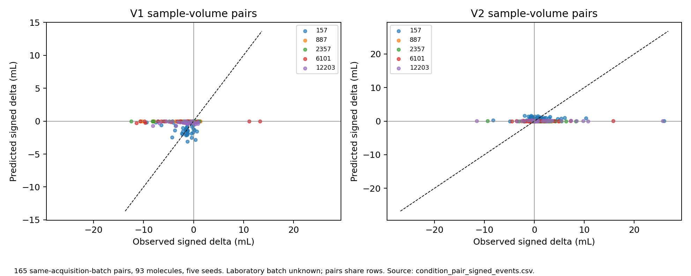
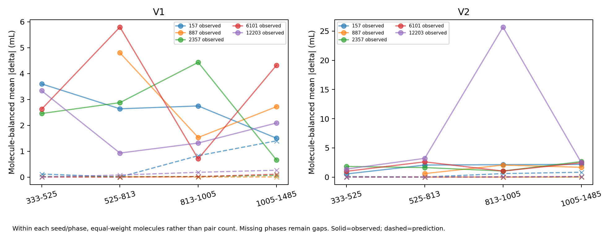

# 条件学习能力：输入正确、响应压缩与尚未解决的归因

本次把已有CW的165个上样体积对扩展为有方向、分子分层的诊断，并新增 **NoCW五seed共同L333–1005的41个上样体积对、27个分子**。另外按与响应/gain无关的规则检查NoCW seed157/887、L525/L1005四个冻结模型的真实候选条件对和局部导数。

**结论是输入确实进入模型、梯度并未断开，但上样条件经过的路径明显弱于PE/EA路径。** 这支持预定义的一种条件融合对照进入小型模型试验，尚不证明模型结构是唯一瓶颈，更不证明增加这类标签一定改善Row预测。资格记录见[C_gate.json](verification/C_gate.json)。本模块没有训练或调用LLM。

## 1. C1：五项条件从记录到预测的逐段追踪

源码检索仅限明确列出的Python文件，未打开原始canonical标签表或test truth。输入元数据来自SHA绑定的既有catalog；真实响应只来自合法已观测L和对应已接受反馈。精确源码SHA在[condition_input_manifest.json](verification/condition_input_manifest.json)。

| 记录因素 | 解析与单位 | 缩放/图构建 | 实际模型路径 |
|---|---|---|---|
| 样品体积V | `V/ul`，µL | 乘`Density g/ml`形成mg；放在连续edge position8 | completion branch，再加到pooled分子表示 |
| Density | g/mL | 仅通过Density×V；没有独立density输入 | 同上；同ΔV在不同density下不等于同Δmass |
| PE/EA | a/b，EA分数b/(a+b) | 6种混合溶剂描述符，outer_train_X minmax | 前4描述符经每层backbone RBF；HBA/LogP另经completion |
| Loading solvent | PE/EA/DCM类别 | 0/1/2仅作索引，4维embedding | completion；数字编码距离不解释为物理距离 |
| 加载溶剂体积 | `Volume of loading solvent/ul`，µL | 独立连续position9，outer_train_X minmax | completion；不是样品V |

关键源码：`src/qgeognn_al/data.py:140`解析PE/EA，`:193`构建edge_attr；`schemas/conditions.py:173`按位置提取并pool；`models/qgeognn_v2.py:38`定义backbone，`:58`定义预测头与融合；`active_learning_v2/runner.py:25`冻结AL预处理。

NoCW157/887冻结的上样mass最小/最大为30.0/327.29999mg，加载体积200/2000µL，范围均正且单位独立。样品50/100/150µL进入模型后不是与Density作两个悬殊尺度输入，而是先相乘，再minmax。四状态被探测行的编码重建全部吻合：

`typed[2] = (Density×V−mass_min)/mass_range`；`typed[3]=(loading_volume−volume_min)/volume_range`。

HBA/LogP和溶剂索引亦按冻结scaler/embedding处理。没有发现V被漏读、µL/mL在这条输入路径重复换算、或归一化分母为零。输入缩放是outer_train_X-only，不是每轮L重新拟合；目标NRMSE分母是L333标签固定尺度，这两件事应分开。

这一检查仅确认代码与冻结输入的实现一致性；没有独立标定仪器或原始时间刻度。体积输出沿用项目已有mL定义，不重新解释`t×Flow/1200`。

## 2. C2：配对定义、依赖与实验噪声边界

所有响应差分均限定同canonical分子、同获取轮、同选前checkpoint、五个记录条件中仅一个不同。数值条件用精确Fraction，PE/EA按精确EA分数定向，样品/加载体积由低到高；溶剂类型按类别排序。定义：

`Δy=y_high−y_low`，`Δp=p_high−p_low`；有符号误差=`Δp−Δy`；绝对差分误差=`|Δp−Δy|`。方向一致指sign(Δy)=sign(Δp)，零值不自动算方向正确。

“同批”指同一主动学习获取批，**不是已知同一实验室批次**。原实验日期、操作者、床层/流量等记录未齐，不能把记录单因素对当作随机控制的物理因果实验。

| 来源/轴 | 获取pair-event | 不同row对 | 分子 | outer seed |
|---|---:|---:|---:|---:|
| CW上样V | 165 | 158 | 93 | 5 |
| CW PE/EA | 714 | 666 | 194 | 5 |
| CW加载体积 | 7 | 5 | 1 | 2 |
| CW加载溶剂 | 7 | 4 | 2 | 4 |
| NoCW上样V，共同1005 | 41 | 41 | 27 | 5 |

CW总计893对；NoCW共同窗口总计377对。一个row可进入多个轴的对照、同分子可有多组条件、相同row对可能跨seed重复。CW上样V每seed各55/21/28/27/34对，单个分子最高占对应seed pair-event约5.9%–10.7%；93不是165个独立分子。`condition_pair_dependence.csv`列出row连通分量和分子数，不以配对数计算独立显著性。

### 2.1 新NoCW直接证据：方向可对，幅度仍几乎不变

先在每个seed内等权平均分子，再等权平均五seed。不是把所有41对当独立重复。

| NoCW上样V | V1 | V2 |
|---|---:|---:|
| 有符号真实Δ，mL | −3.074 | −0.528 |
| 有符号预测Δ，mL | −0.02045 | +0.01484 |
| 真实\|Δ\|，mL | 3.175 | 3.756 |
| 预测\|Δ\|，mL | 0.02045 | 0.01494 |
| 有符号误差Δp−Δy，mL | +3.054 | +0.543 |
| 绝对差分误差，mL | 3.156 | 3.749 |
| 方向一致比例 | 86.8% | 55.1% |
| 预测变化低于0.1mL | 98.6% | 98.6% |
| 预测幅度低于观测 | 98.9% | 100.0% |

**具体证据 →** 41个NoCW真实选中对的预测压缩直接成立，不再仅凭CW外推。**机制解释 →** 对多数V1对，模型学到了下降方向但幅度很弱；V2真实方向在seed之间不同，只有总体幅度压缩较一致。**竞争解释 →** 实际差分中可能混有未记录条件和测量变异；NoCW选中子集也非总体随机样本。**证据等级 →** 时间合法、同checkpoint的观察事实，不是模型结构导致AL失败的因果证明。**下一步 →** 固定标签隔离H的模型对照，检验哪些差分能在不牺牲Row指标的条件下学到。

各seed真实V1\|Δ\|为2.429/1.478/4.082/3.823/4.061mL，对应预测仅0.0382/0.0060/0.0229/0.0048/0.0303；V2真实均值0.413–7.681mL，异质性很大。NoCW去掉各seed最高10%真实差分后，分子与seed平衡的V1/V2真实变化仍2.090/2.399mL，预测仅0.0218/0.0153。逐分子删除诊断的真实V2范围明显，说明效应量不稳，但不能仅用极端分子解释全部压缩。不能把一个普遍上样单调规则加到所有分子。逐分子/阶段及稳健性表在`condition_nocw_pair_*`中；这些事后检查不用于选择H或模型。

### 2.2 165个CW上样对的新增有符号、阶段与稳健性结果

既有报告的pair加权均值2.696/2.287与0.263/0.153mL不是本次新发现。下面改为分子等权、再seed等权，并补充有方向误差和敏感性。

| CW上样V | V1 | V2 |
|---|---:|---:|
| 有符号真实Δ，mL | −2.185 | +0.938 |
| 有符号预测Δ，mL | −0.266 | +0.153 |
| 真实\|Δ\|，mL | 2.707 | 2.103 |
| 预测\|Δ\|，mL | 0.266 | 0.155 |
| 有符号误差Δp−Δy，mL | +1.919 | −0.784 |
| 绝对差分误差，mL | 2.600 | 2.111 |
| 方向一致比例 | 82.4% | 58.8% |
| 预测幅度低于观测 | 90.0% | 91.2% |

重要反例是seed157：分子等权预测V1/V2变化1.008/0.630mL，其他四seed V1仅0.008–0.198、V2 0.005–0.069。seed157并非始终完全不敏感；后期条件响应确实增强。raw pair幅度比中位数seed157为0.673/0.431，而其余seed多数远低。不能用全局均值说所有模型都压缩到相同程度。

阶段内有效分子数并不固定。图中seed12203的L813–1005真实V2峰值约26mL，仅来自1个分子/1对；seed6101早期也只有1对。它们应作为不稳定小组与极端病例保留，不能把连接的阶段均值解释成平滑的总体化学演化。缺失阶段保持空缺，逐分子/阶段表保留具体pair数。

稳健性结果：各seed先按本身真实\|Δ\|去掉最高10% pair，仅作为事后极端值诊断，剩余分子等权再seed平均，真实V1/V2变化仍1.923/1.362mL、预测0.267/0.155。逐个删除任一分子的均值范围仍保持明显幅度差。压缩不只是一个极端分子造成，但效应量受分子分布影响。

幅度比`|Δp|/|Δy|`在Δy接近零时会爆大；文件保留原比值，主判断优先用分子平衡的连续差分、绝对差分误差、ratio中位数及“预测幅度更小”的比例。去极端响应的操作从未参与模型检查组或结构选择。

### 2.3 相同记录条件与未知变量

旧CW已观测L1485中有111个seed内重复条件组事件、跨seed87个组。重新核对其响应范围，事件加权中位数V1约0.896mL、V2约2.300mL，最大21.550/30.829mL。该幅度不能作为噪声估计直接从条件效应中扣除：这些组与上样pair分子/条件人群不同，而且未知是真复测、重复录入还是遗漏实验条件。

不能由“条件全相同但响应不同”判定某条记录错误；也不能由其差异否定全部上样信号。真正噪声归因需要实验记录身份和有计划复测。本次仅保存组级统计，没有读取未采集候选响应。

## 3. C3：四个冻结NoCW模型的合法条件有限差分

outer seed按数值最小固定157/887，预算固定525/1005，不按历史gain或响应选模型。每seed从r0完整outer-train元数据生成严格单因素真实row对，按固定SHA排序取最多32个不共享端点的pair/轴；相同pair集合在两个预算复用。仅针对实际存在的3330行outer-train X，排除validation/test行；所有graph.y先验证为zero-sentinel。

共800个pair×目标记录（400个获取状态内实际X pair），及32个不同分子/seed的256个局部导数记录。Density轴只有3个真实记录对，变化很小且通常不是可控变量，只作软件输入核查。加载溶剂类别不做任意连续插值；没有发明候选域外实验。

### 3.1 输入改变，backbone对loading不变，支路产生小量变化

| seed / L | 上样V预测\|ΔV1\|，mL | 上样V预测\|ΔV2\|，mL | PE/EA预测\|ΔV1\| | PE/EA预测\|ΔV2\| |
|---|---:|---:|---:|---:|
| 157 / 525 | 0.00692 | 0.01186 | 4.620 | 8.532 |
| 157 / 1005 | 0.04491 | 0.04557 | 4.708 | 8.308 |
| 887 / 525 | 0.00289 | 0.00109 | 3.893 | 7.845 |
| 887 / 1005 | 0.00492 | 0.00169 | 3.507 | 6.736 |

上样V变化时，条件typed输入平均L2变化约0.263–0.271，不是零；condition hidden平均变化约0.090–0.213，condition residual/fused变化约0.0073–0.1327，而backbone pooled变化精确为0。PE/EA对同时改变backbone，pooled L2约33.3–44.2。不同轴扰动幅度和单位不同，不能把这些绝对L2比值解释成单位导数或真实信息比。

这一定位比“预测变化小”更具体：加载条件没有进入图主干；它们只通过16维隐层的completion residual，在pooling后加和。PE/EA的前四描述符则参与多层分子图传播。模型本身对不同条件轴采用了不同的交互路径。

### 3.2 自动微分：有梯度，但很弱且端点不平衡并不固定

对32个固定不同分子实际坐标，保持pooled分子表示不变，计算completion路径的局部导数。mass/加载体积只经过这条路径，所以其导数是完整loading偏导；HBA/LogP导数只是completion部分，不能冒充完整PE/EA导数。

`|dV1/d(sample µL)|`四状态均值约0.000047–0.000646mL/µL；V2约0.000050–0.000658mL/µL。mass导数全部非零，排除了“完全硬断梯度”的解释。157从525到1005增强，而887只小幅变化；V2/V1灵敏度比并无四状态统一方向。原始loss的V2梯度优势与这里输出对条件偏导的比值是不同对象，不能互相替代。

这些是**实际X坐标上的局部软件偏导**。即使导数对应连续数值，也不代表实验可以任意改变Density或构造所有中间体积；实际化学响应判断仍以真实候选pair有限差分和合法已测反馈为依据。

### 3.3 可检验的结构机制与替代解释

原结构为`z = p(molecule, eluent_legacy) + r(completion_conditions)`，随后`ReLU(Wz+b)`。在head保持正激活、条件ReLU区域固定时，loading偏导近似`W × dr/dc`，没有显式分子表示因子。不能泛称全域分子无关：Density×V随分子改变，ReLU边界也能产生条件依赖，PE/EA本来经过backbone。

由此支持唯一预定义无参数融合控制：`z=p+r+r*tanh(nonaffine_layer_norm(p))`。它加入有界分子调制、保持458952参数、r=0时初始函数与原模型相同，只改变一种融合结构。该控制仍同时改变优化路径/梯度conditioning；若试验有效，不能唯一归因于“容量增加”或纯表示而排除优化。若无效，也不否定所有H3机制。

该候选没有经过多个结构扫描，没有使用validation选择；具体训练/H隔离及结果由[MODEL_PILOT_PROTOCOL.md](MODEL_PILOT_PROTOCOL.md)与[MODEL_PILOT_RESULTS.md](MODEL_PILOT_RESULTS.md)另行记录。本模块只给出训练输入/机制资格，不代替root的执行许可。

## 4. 归因分层与资格判断

| 类别 | 证据 | 能支持的判断 | 竞争解释与下一步 |
|---|---|---|---|
| 输入实现 | 5条件源码追踪＋四状态typed重建全部吻合 | 未发现V丢失、重复换算或缩放分母错误 | 仪器标定和原时间刻度未独立核实 |
| 表示/优化 | loading主干不变、支路/输出弱、局部梯度非零、加法线性head机制 | H3有明确可证伪候选，值得一个模型控制 | 小支路权重、训练样本/损失/优化也可能造成压缩 |
| 已观测数据 | NoCW41对、CW165对；方向与幅度、重复条件差异 | 局部观测包含模型未表现的变化 | 未记录变量/复测身份未知，不确定其中多少可学 |
| 整体AL限制 | 尚无同状态选择反事实 | 不能把H3当NoCW失效的唯一解释 | 模型pilot不能代替E1/E2的因果选择实验 |

四状态均通过输入和元数据资格gate，允许parent在用户规定的最多16次成功拟合内执行唯一模型控制。证据不支持立即改生产runner、增大主动学习预算或追加另一种结构。本报告没有读取检查组响应来调整H、模型或训练预算。

## 5. 核验与复现

`condition_mechanism.py`完成全部表与两图；`verify_condition_independent.py`使用独立反馈减法核对seed2357 r0/3/10/17/28的144标量，复核旧94个绝对差分阶段均值；再以解析链式法则`Dhead·Whead·Wout·Dhidden·Whidden`对512个mass/volume梯度重算。最大标量差约3.6×10⁻¹⁵，autodiff对解析Jacobian最大差4.47×10⁻⁸。单因素/多因素边界和EA方向也通过。

原checkpoint参数逐tensor前后完全一致。输入hash、pair-source边界、zero-sentinel、状态选择与独立核验在`verification/condition_*`。来源缺失或hash不合格应停止，不自动生成新标签、重训历史模型或借用其他状态。
