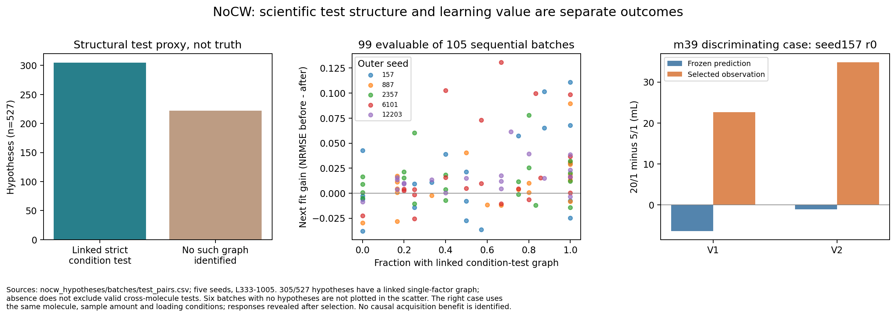

# NoCW的科学假设—真实验证—模型学习链

## 回答核心问题

**存在“解释丰富、具体科学命题未被充分区分”的现象，但不是所有NoCW假设都停留在叙述。** 实际有可识别的预测反转/平台测试、明确反例和后续修订；同时大量“scaffold-specific、不能用统一修正”的宽命题没有预先规定拒绝条件。即使真实条件对照存在，它也可能只回答一个局部响应问题，未验证假设中“能改善泛化”的学习价值主张。

主范围105批、527假设、3152次typed引用。对全部假设建立选前证据与关联choice图；对按固定规则抽出的52批首个假设/问题、所关联理由、一个按元数据排序取出的条件对及下一轮引用文字作人工审查。52批来自45个gain规则位置与r0/r5/r14/r20网格的并集，既有按收益选取也有固定网格，均为解释性样本。不是527条命题的全量科学判真。

## 六步链与可判定边界

| 链条问题 | 本次核验 | 仍不可判定 |
|---|---|---|
| 具体可测命题？ | 人工分开命名的模型形状/转折问题、宽泛家族问题、事后模型/采集价值叙述、空假设 | 无数值边界的“long/ordinary/threshold”不能补写检验阈值 |
| 范围明确？ | 保存m编号/条件原文、实际linked分子数；canonical身份稳定键 | 明确命名不证明机制成立，不能把m编号跨轮直接当身份 |
| 证据是否合法/正确？ | 3152引用均在选前L；38身份flags逐条人工判分11错/27合法参照 | 证据属于L不等于支持命题；未逐条判定所有科学语义 |
| 选择能否区分？ | 305/527假设找到其关联choices或所引证据中的严格单因素测试结构，985pair-event | 222无这种结构不自动无效；跨分子比较可有价值，未记录变量仍存在 |
| 反馈支持/削弱？ | 针对明确模型形状的病例能观察原预测被支持/反驳 | 一个局部差分不能证明宽泛家族机制或采集效用 |
| 下一轮吸收？ | 保存新观测被typed引用、候选命题连接与具体修订 | 引用不等于正确吸收，Jaccard不是严格命题持续身份 |

527假设中305（57.87%）有可识别关联单因素测试结构、222（42.13%）没有。有假设的99批中，23批每个假设都有该结构，11批均没有，65批混合；另6批假设列表为空，单列而不填成0比例。结构是本次的可验证代理，不是科学假设“被验证率”。每个pair可能共享点、同一pair可能服务多命题；985不能当985独立实验。

### 固定样本人工类别

| category | sampled_first_hypotheses |
| --- | --- |
| broad_family_or_tail_question_without_decision_rule | 17 |
| concrete_condition_question_under_broad_claim | 20 |
| empty_hypothesis_list | 2 |
| explicit_named_model_shape_or_transition_test | 9 |
| retrospective_model_description_or_acquisition_value_claim | 4 |

人工判分保留在 `nocw_fixed_sample_review.csv`。未给宽命题补上原文不存在的前向预测/阈值；52个首命题的语义判断不能转写成全体527命题错误率。命题编号H1会重用，只有文本/证据候选匹配，不声称掌握完整科学命题图谱。

三个具体子检验的操作数、条件、冻结差分、观测差分、支持/削弱/不可判定边界和下一轮信息使用单列于 `nocw_scientific_chain_adjudications.csv`。子问题被区分不等于整个宽命题被证实；其余未做语义判定的命题保留不可判定，不用模型自己的status代替。

## 病例1：m39预测反转被真实实验区分，下一轮明确修订

seed157/r0在相同m39、50µL样品和加载条件下，选5/1与20/1两点。冻结V1预测22.9875→16.5621mL（方向反转）；揭示为10.8833→33.5500mL，V2为22.8667→57.7167mL。5/1→20/1意味着EA分数下降，实际保留增加。r1明确写“previous m39 inversion was a prediction error”，并继续强调单点不建立完整曲线。

这条链有具体替代解释、元数据正确的同分子控制、选后观测及后续修订，证据强于关键词计数。该批gain仅+0.021410；它不是只改变m39两点的随机化对照，不能把整批收益归于此命题。科学验证价值和总体学习价值必须分别记账。

## 病例2：模型平台被打破，但下一轮验证误差仍恶化

seed6101/r7第一命题追问m82/m95是否真正平台化。一个同批严格PE/EA对的预测V2变化为−2.205mL，观测变化+54.363mL；V1预测+4.789、观测+13.200mL。它揭示一个真实局部模型形状失败，下一轮用前批证据继续强调carbonyl placement与endpoint-specific响应。

当批gain+0.099739，下一轮r8为−0.006306；不能将局部反例或文字修订作为每轮持续增益保证。当前＋后续两批仍可能累计为正，这又是单轮恶化不等于原实验无效的反例。本例未孤立化学结构机制、模型误差修复与其余30行的作用。

同一批另一个更接近模型可学习性的实例来自H7_I：m125、PE/EA=1/1、100µL样品，DCM加载溶剂300→500µL。冻结V1/V2差−0.000837/−0.000931mL，观测差+5.941667/+17.933334mL。r8反馈准确指出该dimethoxybenzaldehyde的1/1 finish contrast在100mg再次出现，同时5/1、150mg对照主要改变onset；它没有把现象泛化为普适体积机理。这是**科学对照被测量、反馈被解释，而当前模型事前对该轴不敏感**的具体链，支持H3候选机制；但两行不是随机复测，也没有证明下一模型学不到或改网络一定改善。

## 病例3：身份误写让“matched”论证缺乏正确操作数

NoCW中确认11条明确selected molecule误写，典型是seed6101/r1 `34aaca6f7a0768d743fe` 实际m128，理由却以“Measure m177”解释；r2又把另一个实际m82点称m177。seed12203/r10实际m122点被写成m177，称补全固定loading的10/20/50曲线。ID本身属于U，typed证据合法，并不能阻止这些语义错配。

其余27个“首m编号不同”的flags都是合法跨分子参照，不能错误判为幻觉。两个未知prose ID保留不可追溯，不猜修。下界11/3360不是完整错误率，也没有证据说NoCW的真实错误率高于新CW。错误病例可与gain联结，但错误并不随机分配，不能估计它造成多少误差损失。

## 病例4：宽命题可以反复被“支持”，而缺乏明确拒绝标准

seed887 r5–r12多次强调氮分子需要各自曲线、不能用统一氮修正；部分轮次确实选择同条件或局部响应实验，但“不同家族不共享一个offset/transition”没有定义何种新观测会推翻它。seed157 r15–r20和2357中后期的长尾/threshold命题同样经常使用“can、some、scaffold-specific”。这些命题可以产生有价值的测量，却不等于提出了可量化否证的机制。

主范围逐字重复29条；重复本身可以是未解决问题的合理持续跟踪，不能自动判零信息。无明确拒绝规则时，增加几个不同响应并继续标supported，无法证明知识状态更准确。更有辨识力的协议应预先指定操作数、变化轴、候选替代模型和方向/区间判断规则，而不是事后让文字顺应任意观测。

## 纠错与知识链丢失

68个主范围纠错批中，最终集合改变63批，15批原合法ID全部替换；首答合法ID保留583/2002。7批结构化证据从有变零，6批从有假设变零。零假设批不能通过丰富feedback prose补造一个不存在的typed命题。

这些是方案保真问题，非直接科学效用损失估计。原始最终schema允许0–8假设，最终合法率不能替代假设链完整率；同类问题已在旧Free、新CW与16＋16观察到，不能归为NoCW独有。

直接方法比较限定共同105批：NoCW首完整答合法37、完整回答229；新CW首合法50、完整回答309。NoCW首合法率更低，但CW的packet绑定异常整批重答使回答总数反而更高，不能将任一数量解释为科学质量或费用优劣。新CW95/180与430仅为完整轨迹背景，详见 `nocw_reliability_common_window.csv`。

## “被检验”与下一次gain的关联

| feature | n_seeds | raw_mean | partial_mean | partial_positive | without_before_mean |
| --- | --- | --- | --- | --- | --- |
| complete_response_n | 5 | -0.28977 | -0.19173 | 1 | -0.19244 |
| condition_test_fraction | 5 | 0.36809 | 0.24507 | 4 | 0.31910 |
| contradiction_hypothesis_n | 5 | -0.13416 | 0.12618 | 4 | 0.02608 |
| evidence_hhi | 5 | -0.14773 | -0.01471 | 3 | -0.15880 |
| exact_repeat_n | 5 | -0.06945 | 0.15106 | 2 | 0.12156 |
| first_molecule_mismatch_flag_n | 5 | -0.14114 | 0.00866 | 2 | -0.16917 |
| previous_batch_reference_fraction | 5 | 0.20739 | 0.12079 | 4 | 0.11764 |
| without_linked_test_n | 5 | -0.27261 | -0.22530 | 1 | -0.26767 |

全105批的condition_test_fraction等是可复算图结构代理；身份flags是待人工语义判分的扫描指标，不等于错误数。每seed独立计算Spearman与控制预算、阶段和before NRMSE的partial rank，另列不控制before的敏感性。无batch p值，五条轨迹不视作105独立重复；gain与before共享项、同validation选checkpoint带来数学耦合。

这里有必须保留的**正向线索**：condition_test_fraction与gain的partial均值约+0.245，4/5seed为正；仅控预算/阶段约+0.319。这支持继续检验“有可追踪局部测试的科学设计可能更有学习价值”，不支持将其判为无效。不过该指标只描述图结构，非命题语义被区分；控制不能消除完整状态、模型可学习性、验证选择和连续轮次混杂。

实际确认身份误写的batch另在 `nocw_detected_error_gain.csv` 按seed与“未检出错误”batch比较；后者不是已确认无错。仅10个被检出错误批、每seed0–4个，不足以稳健判断错误造成多少gain损失。具体反例修订有真实行为证据，却没有相同批次、只改变科学信息的反事实。固定样本中的明确模型形状测试和宽泛命题都出现正/负gain，三类结果仍须分开：科学命题有无被区分、模型是否响应条件轴、整体row预测是否改善。

## 对Hypothesis-Driven AL的研究判断

本次支持研究“Scientific Hypothesis Value与Model Learning Value可能脱节”，但尚未证明系统性因果脱节。可验证代理为：事前明确的替代命题、合法identity/condition graph、观测是否落入预定义区分区域、下一轮是否据此修订；学习价值另用同状态配对gain/AULC及训练噪声控制。一个二目标acquisition还没有资格直接实施。

H1得到的是“证据绑定/否证标准有缺口”的支持，不是NoCW所有选择无效；H2保留几何代理与强数值基线的证据，但新CW反例阻止将其解释为CW缺失的因果；H3是否被小试支持，应由本轮条件敏感性和唯一模型控制裁决。下一步E1识别的是显式反馈通道，E2识别的是数值内容，二者不能混成一个大Agent。

输入与独立核验见 `verification/nocw_inputs.json`、`nocw_checks.json`、`nocw_manual_review.json`、`nocw_independent_checks.json`。新图是结构代理、105个相关轮次与一个具体病例的并列，不把图形差异当科学判真或因果证据。
