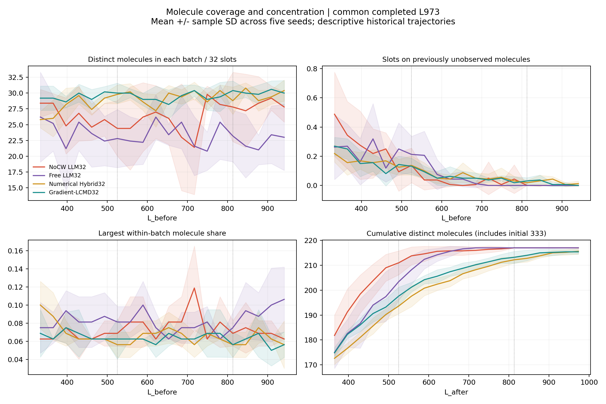
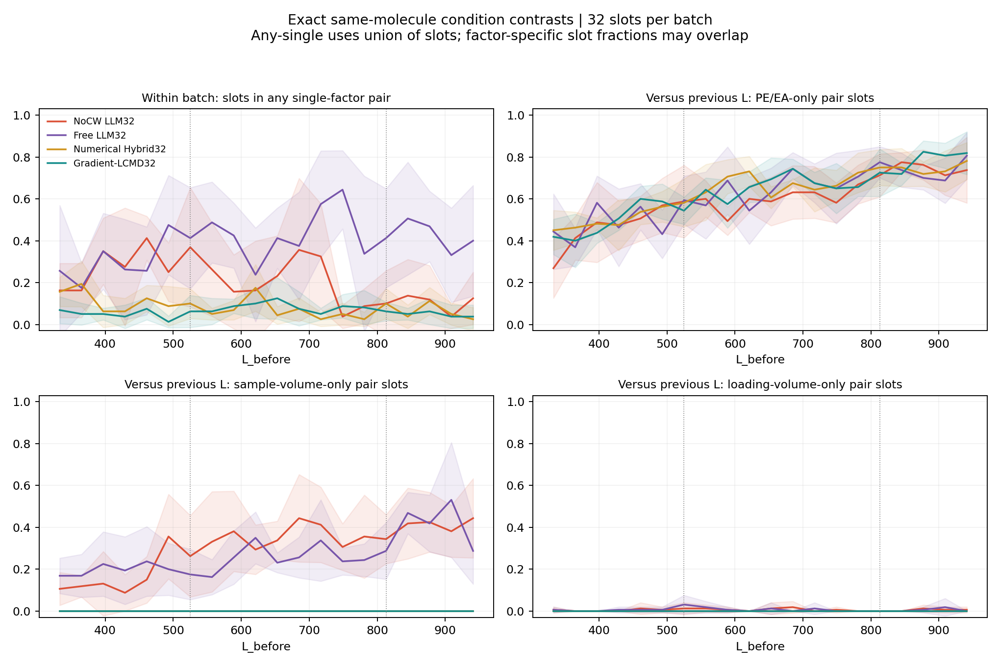
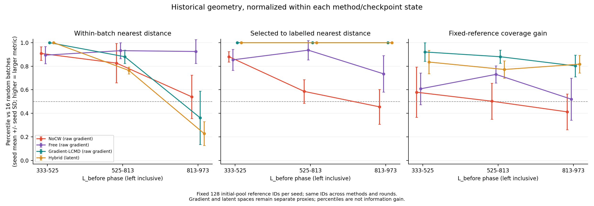

# NoCW、Free 与数值基线：已有选点行为诊断

固定快照：**2026-11-01T16:35:02.564895+08:00（北京时间）**；提交 `3e5c298e26e9e37ded2f39ab2ec322d56fe0e828`，分支 `main`。本目录是独立只读分析，不是新实验。

**去掉显式CW后，最可靠的变化是：前期把更多名额用于此前未见的分子；后期每批涉及的分子更多，但批内严格单因素条件对照更少。** 前期新分子名额比例NoCW为27.81%、Free为23.02%，五seed均增加。后期每批不同分子数28.08对22.44，五seed均增加；参与批内单因素对照的名额10.38%对42.38%，五seed均减少。配置从头一致的887、2357、12203三个seed也保留这些方向。

**与“前期较快、后期落后”相伴的线索**：前期NoCW更快扩充分子覆盖，且L525验证误差在五seed均低于Free；中期NoCW更多地把新点接到既有同分子的上样量对照上。在当轮历史表示内，相对随机批次的中期覆盖增量分位低于Free，五seed一致；后期批内最近邻与到既有标签集合距离的分位也更低。因此“批内分子更多”与“在模型表示中补充更多未覆盖区域”是不同现象。到L813两种LLM都已覆盖全部217个允许训练分子，后期落后不能简单归咎于漏掉更多分子。这些是相伴的行为差异，**没有证明CW通过这些路径导致了性能反转**。

**现有记录不能回答**：相同模型状态下加入CW究竟会改选哪些点；哪组条件对照真正提供了更高信息增益；未采集点的真实响应；数值反馈后有限修订是否有效。历史Free混有Astra/high前缀，且各法后续标签集合、checkpoint和反馈历史不同。即使三seed模型配置一致，也不能称为严格同状态的CW因果消融。

## 快照、方法与比较范围

先检查了适用AGENTS.md：本仓库及其父路径没有适用文件。没有执行pull、checkout或reset；未修改训练入口、prompt、配置、历史结果或运行进程。只新增本目录。开工前工作树已有运行产物修改/未跟踪文件，状态另存`worktree_status_before.txt`。本次没有LLM调用、新的实际选点、响应揭示、训练、模型加载或GPU计算。几何中的随机32点集合仅作为数值参照，不写入实验采集记录。

四个对象的实际实现如下；路径、行号、配置和单位证据见[实现核对附录](PROTOCOL_AUDIT.md)。

| 名称 | 实际实现与信息 |
| --- | --- |
| NoCW LLM32 | `llm32_nocw`；去掉显式CW分位与CW说明；仍有点预测、q10/q50/q90及宽度、SMILES/描述符、五条件、新颖性/相似性、已测记录和获取时反馈。不是完全没有模型预测信息。 |
| Free LLM32 | `free_llm32_scientist_v2`；历史完整候选自由选32点，含显式`cw_distance_percentile`。 |
| 纯数值 Hybrid32 | 三个当前模型q50分歧筛U_t前25%，再在当轮128维latent中以全部L_t作中心farthest-first选32点。不是CW16＋LLM16。 |
| Gradient-LCMD32 | 当前全网络q50的512维CountSketch、corrected LCMD-TP、raw梯度几何；续跑沿用冻结的原实现。作为辅助参照。 |

五seed为157、887、2357、6101、12203。每seed共4163行：L0=333、U0=2997、validation=416、test=417；批量32。初始split、L0、U0与checkpoint逐seed对齐；主脚本核对初始化哈希与验证ID哈希。训练均为QGeoGNN-V2、Adam lr0.001、weight decay0、batch2048、最大1000epoch、patience100、同一scratch初始化/训练RNG规则、validation选checkpoint。后续只核对实际轨迹，没有强行对齐标签集合。

NoCW全程`gpt-6.1-sol/xhigh`。Free的157 r0–4为Astra/high，r5最终是历史授权ID抄写修正、接受模型标记unknown，r6起Sol/xhigh；6101 r0–9为Astra/high，r10起Sol；另外三个seed从r0全为Sol/xhigh。后续纠错/重试修订也存在，原始配置的3次额度不能代表全部实际请求上限。只将最后接受并冻结的合法32点批次作为单位。

| seed | NoCW完成到L | NoCW已接受且完成批次 | Free完成到L | 数值Hybrid完成到L | LCMD完成到L |
| --- | --- | --- | --- | --- | --- |
| 157 | 1069 | 23 | 1485 | 1005 | 1485 |
| 887 | 973 | 20 | 1485 | 1005 | 1485 |
| 2357 | 1101 | 24 | 1485 | 1005 | 1485 |
| 6101 | 1133 | 25 | 1485 | 1005 | 1485 |
| 12203 | 1197 | 27 | 1485 | 1005 | 1485 |

本次从文件自动确定的主共同终点是 **L973**，不是直接抄用旧报告进度。每方法每seed20批，共400批；每方法跨seed3200个采集名额，按`(seed,row ID)`计数，不是全局去重实验数。完整快照有584个接受批次，全部已有完成拟合和验证的metadata；没有“只接受尚未完成”的批次。较长轨迹单列`completion_status.csv`和`extended_trajectory_summary.csv`：NoCW L1005–1069为4seed，L1101为3seed，L1133为2seed，L1165–1197为1seed；Hybrid到1005为5seed；Free与LCMD到1485各5seed。不得把这些不同seed数的后段拼成主均值。

读取规则：文件mtime不得晚于截止；同一文件前后stat及双次字节读取一致，JSON/CSV完整，已有freeze要求的哈希必须吻合。变化、不完整或缺失文件不使用。完成判据为已有prediction freeze（LLM轨迹）和fit audit中的训练ID、标签数、checkpoint/prediction哈希及验证分数；数值轨迹复用其fit audit和既有完整审计。本次没有重新读取全部大checkpoint和prediction文件做全量runtime审计，不能把metadata链核对冒充重新完成了大文件审计。本次5个缺项均为各NoCW seed下一轮尚不存在的`batch_freeze.json`，不外推、不补跑；没有检测到变化中或损坏文件被纳入。物理终结attempt中1041个失败、260个成功响应，均不直接算作选点；只有119个NoCW冻结接受批次进入行为表。成功响应还可被validator拒绝。`rejected_responses_in_accepted_batch_artifacts`仅数freeze列出的拒绝文件，不是跨方法完整失败率；Free freeze没有相同拒绝文件索引，字段为0不能解读为Free无失败。旧合法性审计只作为依据，不混入另一个CW16＋LLM16对象。

## 分子身份、分期与汇总口径

稳定`sample_id`只识别实验行；分子用split的`canonical_smiles`与冻结catalog的`smiles`逐行核对。没有把row ID或当轮`m0/m1`编码当compound ID。五seed允许训练元数据并集4162行、217个规范化分子；剩余1行不在任一seed的允许训练集合，不需为本分析读取其条件或响应。每seed训练池都覆盖217个分子，初始L0覆盖依次169、168、165、167、169个。

沿用已有曲线边界并合并原中间小窗：前期`333≤L_before<525`（6批/seed）、中期`525≤L_before<813`（9批）、后期`813≤L_before<973`（5批，且L_after≤973）。525归中期，813归后期，不重复计数；这些界限参考已有曲线，属于描述性分期。批次始终按选前L_before标记，累计覆盖明确按L_after标记。

先在每seed内汇总，再对5个seed均值求平均和样本SD（ddof=1）；比例分母为每批32个名额，等批量使批均值等于该seed阶段名额比例。连续轮次不当作独立重复，无轮次p值。`seed_phase_summary.csv`包含seed行、组均值/SD及三seed配置子组；累计覆盖列是阶段末值，其余行为列通常是批均值，配对原始总数另有`*_pairs_total`。`paired_seed_differences.csv`保存逐指标正/负/相同方向的seed名单。

## 分子覆盖与集中程度

以下为seed均值±seed间样本SD。新分子数按批相对选前L_t定义；新分子名额比例包括同一新分子在本批的所有名额。最大占比为单个分子的最大名额数/32；逐批完整“名额数→该名额数的分子个数”分布保存在`molecule_slot_histogram`。

| 阶段 | 方法 | 不同分子/批 | 首次出现分子/批 | 新分子名额比例 | 单分子最大占比 |
| --- | --- | --- | --- | --- | --- |
| 前期 L333–525 | NoCW LLM32 | 26.47 ± 1.11 | 7.23 ± 0.56 | 27.81 ± 2.26% | 6.56 ± 0.47% |
| 前期 L333–525 | Free LLM32（含CW） | 24.00 ± 3.78 | 5.97 ± 1.21 | 23.02 ± 3.09% | 8.23 ± 1.82% |
| 前期 L333–525 | 纯数值 Hybrid32 | 27.70 ± 0.91 | 4.33 ± 0.73 | 16.56 ± 2.67% | 7.40 ± 0.57% |
| 前期 L333–525 | Gradient-LCMD32 | 29.37 ± 0.74 | 5.00 ± 0.63 | 17.50 ± 2.57% | 6.67 ± 0.77% |
| 中期 L525–813 | NoCW LLM32 | 25.60 ± 2.17 | 0.67 ± 0.53 | 3.61 ± 3.55% | 7.99 ± 1.01% |
| 中期 L525–813 | Free LLM32（含CW） | 23.36 ± 2.69 | 1.51 ± 0.83 | 6.60 ± 4.33% | 7.71 ± 0.57% |
| 中期 L525–813 | 纯数值 Hybrid32 | 29.40 ± 0.55 | 2.07 ± 0.27 | 6.67 ± 0.90% | 6.46 ± 0.53% |
| 中期 L525–813 | Gradient-LCMD32 | 29.40 ± 0.43 | 1.73 ± 0.56 | 6.04 ± 1.75% | 6.39 ± 0.58% |
| 后期 L813–973 | NoCW LLM32 | 28.08 ± 1.92 | 0.00 ± 0.00 | 0.00 ± 0.00% | 6.88 ± 0.44% |
| 后期 L813–973 | Free LLM32（含CW） | 22.44 ± 3.41 | 0.00 ± 0.00 | 0.00 ± 0.00% | 9.25 ± 2.31% |
| 后期 L813–973 | 纯数值 Hybrid32 | 29.64 ± 0.52 | 0.68 ± 0.36 | 2.25 ± 1.22% | 6.13 ± 0.28% |
| 后期 L813–973 | Gradient-LCMD32 | 30.16 ± 0.91 | 0.44 ± 0.33 | 1.63 ± 1.30% | 5.88 ± 0.95% |



前期NoCW新分子名额比例比Free高4.79±2.81个百分点，5/5seed同向；不同分子数多2.47±3.20个/批，仅4/5同向。L525累计覆盖NoCW 211.0、Free 203.4、数值Hybrid193.6、LCMD197.6；NoCW与Free的差值7.6±7.3个，4/5同向。

中期不能概括为NoCW始终更广：其新分子名额比例3.61%低于Free6.60%，且不同分子数差异只有3/5同向。两种LLM到L813均达到217；全部seed首次全覆盖的最晚预算Free为L717、NoCW为L813，早期均值优势并不等于每seed更早完成全覆盖。按seed首次全覆盖：NoCW为621/557/749/813/557，Free为717/557/685/653/685（按157/887/2357/6101/12203顺序）。

后期NoCW比Free多5.64±4.27个分子/批，5/5seed一致；但两者新分子数与新分子名额比例均为0。变化是把名额分配给更多**已经见过的分子**。Free单分子最大占比平均9.25%，NoCW6.88%，4/5下降、2357略增；不能写成每个seed都更分散。两种数值法全程平均约29个分子/批，NoCW26.48、Free23.32；NoCW比两种数值法每批分子数都少，5/5seed一致。数值法累计覆盖L973仍为215.6/215.4，略低于两LLM，说明分散批次与尽早补全罕见分子也是不同指标。

## 同分子条件对照

只有五个含义明确字段：PE/EA为石油醚/乙酸乙酯配比，EA分数为b/(a+b)；Density单位g/mL；V为样品上样体积µL（同密度下与质量成比例，Density×V为mg）；loading solvent为PE/EA/DCM类别；Volume of loading solvent为加载溶剂体积µL。没有流速字段。密度通常随分子固定，不将少量密度变化解释成受控操作。

严格规则：先要求规范化分子键相同，再将五字段逐项比较；数值按`Decimal(str(原记录值))`精确比较、容差0；PE/EA按精确Fraction化简等比例，溶剂字符串精确相等。保留如34.01360544、68.02721088、102.0408163的V值，不任意取整。只有一个字段不同才是该因素匹配对照；两项及以上不同列为多因素；五项全同另列exact。只保证记录的五字段，不保证未记录条件相同。

批内计算无序实验对；跨集合仅计算本批×选前L_t，不让本批先选的点冒充历史已标注。每类同时报告原始对数、涉及去重的本批实验数及分子数（CSV）；any_single对所涉及名额取并集。一点可分别与历史PE和V对照配对，所以不同因素比例不可相加。

下表每格是**原始配对总数 / 涉及本批实验数（占3200个采集名额比例）**，仅主共同范围。每seed内跨批无重选；跨seed按各自轨迹计数，因此涉及实验数是`(seed,row ID)`数，不是全局唯一row ID数。不同类别间可重叠。配对总数用于描述组合，不作为独立样本量。

| 比较类别 | NoCW | Free | 数值Hybrid | LCMD |
| --- | --- | --- | --- | --- |
| 批内：任一单因素 | 370 / 659（20.59%） | 675 / 1248（39.00%） | 142 / 260（8.12%） | 105 / 204（6.38%） |
| 批内：仅PE/EA | 324 / 582（18.19%） | 587 / 1109（34.66%） | 142 / 260（8.12%） | 105 / 204（6.38%） |
| 批内：仅样品体积V | 40 / 74（2.31%） | 72 / 138（4.31%） | 0 / 0（0.00%） | 0 / 0（0.00%） |
| 批内：仅加载溶剂体积 | 5 / 10（0.31%） | 13 / 26（0.81%） | 0 / 0（0.00%） | 0 / 0（0.00%） |
| 批内：仅加载溶剂种类 | 1 / 2（0.06%） | 3 / 6（0.19%） | 0 / 0（0.00%） | 0 / 0（0.00%） |
| 批内：仅密度 | 0 / 0（0.00%） | 0 / 0（0.00%） | 0 / 0（0.00%） | 0 / 0（0.00%） |
| 批内：多因素 | 289 / 469（14.66%） | 321 / 526（16.44%） | 188 / 345（10.78%） | 151 / 284（8.88%） |
| 批内：五条件完全相同 | 0 / 0（0.00%） | 0 / 0（0.00%） | 0 / 0（0.00%） | 0 / 0（0.00%） |
| 对历史L：任一单因素 | 4121 / 2265（70.78%） | 4412 / 2310（72.19%） | 3349 / 2026（63.31%） | 3248 / 2029（63.41%） |
| 对历史L：仅PE/EA | 2989 / 1888（59.00%） | 3355 / 1977（61.78%） | 3349 / 2026（63.31%） | 3248 / 2029（63.41%） |
| 对历史L：仅样品体积V | 1110 / 974（30.44%） | 1029 / 870（27.19%） | 0 / 0（0.00%） | 0 / 0（0.00%） |
| 对历史L：仅加载溶剂体积 | 19 / 19（0.59%） | 21 / 21（0.66%） | 0 / 0（0.00%） | 0 / 0（0.00%） |
| 对历史L：仅加载溶剂种类 | 1 / 1（0.03%） | 7 / 7（0.22%） | 0 / 0（0.00%） | 0 / 0（0.00%） |
| 对历史L：仅密度 | 2 / 2（0.06%） | 0 / 0（0.00%） | 0 / 0（0.00%） | 0 / 0（0.00%） |
| 对历史L：多因素 | 6034 / 2376（74.25%） | 6157 / 2307（72.09%） | 5058 / 2388（74.62%） | 5080 / 2393（74.78%） |
| 对历史L：五条件完全相同 | 59 / 58（1.81%） | 31 / 31（0.97%） | 0 / 0（0.00%） | 0 / 0（0.00%） |

这些原始配对表明：LLM两法更常在保持PE/EA等其余条件相同的情况下补样品体积V点，数值两法相应严格配对为0；但数值法也大量选不同V。独立核对发现其同分子不同V的历史配对Hybrid有5006对、LCMD5003对，PE/EA也同时变化（其中4943/4915对只有PE与V两因素变化），所以被正确列为多因素，不能称为“不探索上样量”。

阶段名额比例（seed均值±SD）进一步区分批内共同设计与利用已有记录：

| 阶段 | 方法 | 批内任一单因素名额 | 对历史L仅V变化名额 |
| --- | --- | --- | --- |
| 前期 L333–525 | NoCW LLM32 | 26.88 ± 5.90% | 15.83 ± 5.02% |
| 前期 L333–525 | Free LLM32（含CW） | 29.58 ± 14.81% | 19.90 ± 8.62% |
| 前期 L333–525 | 纯数值 Hybrid32 | 11.46 ± 3.23% | 0.00 ± 0.00% |
| 前期 L333–525 | Gradient-LCMD32 | 4.90 ± 1.71% | 0.00 ± 0.00% |
| 中期 L525–813 | NoCW LLM32 | 22.08 ± 8.90% | 34.72 ± 7.16% |
| 中期 L525–813 | Free LLM32（含CW） | 43.40 ± 17.02% | 25.00 ± 4.45% |
| 中期 L525–813 | 纯数值 Hybrid32 | 6.81 ± 2.12% | 0.00 ± 0.00% |
| 中期 L525–813 | Gradient-LCMD32 | 8.13 ± 2.94% | 0.00 ± 0.00% |
| 后期 L813–973 | NoCW LLM32 | 10.38 ± 5.41% | 40.25 ± 7.22% |
| 后期 L813–973 | Free LLM32（含CW） | 42.38 ± 18.50% | 39.88 ± 9.98% |
| 后期 L813–973 | 纯数值 Hybrid32 | 6.50 ± 1.80% | 0.00 ± 0.00% |
| 后期 L813–973 | Gradient-LCMD32 | 5.00 ± 2.34% | 0.00 ± 0.00% |



NoCW中期仅V变化的历史对照比例比Free高9.72±6.90个百分点，5/5同向；后期两者40.25%与39.88%接近，只有3/5同向，不能称NoCW始终更偏上样量。后期NoCW批内单因素名额比例比Free低32.00±20.72个百分点，5/5同向；三seed同配置子组也下降18.13±10.06个百分点，3/3同向。

exact条件的跨历史重复为NoCW58个新实验名额（59对、1.81%）、Free31个（31对、0.97%），数值两法0；批内exact均为0。它们是不同row ID但同分子和同五条件的记录，有可能是复测，也可能是记录层面的信息重复；没有用未采集响应判断其价值。密度单因素仅NoCW对历史2对，报告为稀少记录差异，不做机制解释。**同分子不同条件不自动等于冗余**；Free较多的批内PE/EA对照可能是有目的的条件研究，是否有用需要另行实验验证。

## 历史整批几何：只解释状态内数值代理

盘点结果不是“缺历史表示”：584批可用883个method-space行（NoCW119×raw/CW、Free180×raw/CW、LCMD180×raw、数值Hybrid105×latent），0几何缺项。NoCW r0没有自己的bank，使用与其**同初始checkpoint、同完整L/U与有序canonical映射**的Free共享初始bank，共10空间行显式标`shared_initial_bank`。没有用后期模型代替历史模型，没有重建指纹或梯度。没有现成独立分子指纹缓存；本次不额外计算结构距离或人为拼接结构与条件权重，raw梯度/CW/latent都只称模型表示空间。

每seed从初始U0以固定SHA规则取128个参考ID，四方法与所有轮次保持相同参考名单；固定种子90210–90225各抽16个均匀随机32点参照批次。已在L或本批中的参考点保留，并按ID强制距离为0；随机批次用相同L和参考集，允许同样的自覆盖贡献。指标为批内最近邻距离均值、新点到L最近距离均值、以及加入整批后参考集平均最近距离相对下降。后者的分母是加入前均值，不是“未标注点比例”。128点是小参考集，选中参考点会贡献零距离，随机分位只到1/16量级，不能解释成精密测量或显著性。

所有bank核对文件哈希、当轮checkpoint与canonical indices；NoCW/Free核对前n行属于L、后段属于U，数值bank核对L/U哈希与契约。只读NPZ，在CPU单线程用128×128距离块计算。不同checkpoint/变换的原始距离没有横比，也没有把Free prompt的CW列与NoCW缺失列直接拼接。下表是**各自当轮16个随机批次中的指标分位**，再先汇总seed、后求均值±SD；分位高表示该指标数值大，不能一律称为更好。

| 阶段 | 方法与空间 | 批内NN分位 | 到选前L距离分位 | 参考覆盖增量分位 |
| --- | --- | --- | --- | --- |
| 前期 L333–525 | NoCW LLM32（raw梯度） | 0.908 ± 0.058 | 0.881 ± 0.045 | 0.579 ± 0.214 |
| 前期 L333–525 | Free LLM32（含CW）（raw梯度） | 0.894 ± 0.073 | 0.854 ± 0.089 | 0.608 ± 0.135 |
| 前期 L333–525 | 纯数值 Hybrid32（latent） | 1.000 ± 0.000 | 1.000 ± 0.000 | 0.835 ± 0.099 |
| 前期 L333–525 | Gradient-LCMD32（raw梯度） | 1.000 ± 0.000 | 1.000 ± 0.000 | 0.921 ± 0.079 |
| 中期 L525–813 | NoCW LLM32（raw梯度） | 0.826 ± 0.166 | 0.586 ± 0.101 | 0.503 ± 0.153 |
| 中期 L525–813 | Free LLM32（含CW）（raw梯度） | 0.932 ± 0.067 | 0.936 ± 0.081 | 0.731 ± 0.073 |
| 中期 L525–813 | 纯数值 Hybrid32（latent） | 0.764 ± 0.029 | 1.000 ± 0.000 | 0.772 ± 0.074 |
| 中期 L525–813 | Gradient-LCMD32（raw梯度） | 0.881 ± 0.057 | 1.000 ± 0.000 | 0.881 ± 0.056 |
| 后期 L813–973 | NoCW LLM32（raw梯度） | 0.540 ± 0.184 | 0.455 ± 0.148 | 0.413 ± 0.151 |
| 后期 L813–973 | Free LLM32（含CW）（raw梯度） | 0.925 ± 0.102 | 0.735 ± 0.155 | 0.520 ± 0.179 |
| 后期 L813–973 | 纯数值 Hybrid32（latent） | 0.228 ± 0.101 | 1.000 ± 0.000 | 0.818 ± 0.074 |
| 后期 L813–973 | Gradient-LCMD32（raw梯度） | 0.363 ± 0.227 | 1.000 ± 0.000 | 0.803 ± 0.092 |



中期NoCW raw到L距离分位0.586、Free0.936，5/5seed较低；覆盖增量分位0.503对0.731，5/5较低。仅作同口径相对下降的补充：NoCW参考距离下降4.20%、随机均值3.89%，Free7.29%、随机4.12%；这些分母各属于自己的历史状态，不能直接把两者百分点之差当同一空间的增益差。CW空间方向保留（中期覆盖分位0.497对0.725）。

后期NoCW批内NN分位0.540、Free0.925，5/5较低；到L分位0.455对0.735，也5/5较低。后期覆盖增量分位0.413对0.520只有4/5较低（887相反），前期几何方向混合；不能将整段历史概括成“去CW一直损害几何覆盖”。三seed同配置子组保留中后期上述5/5方向对应的3/3方向。数值法到L分位接近1，与按距离选择的实现相符；其原始空间与LLM不同，分位也不是跨方法共同效用分数。

这些结果支持“中后期NoCW常补充相对已有区域更近的实验”的代理描述。它与“每批涉及分子更多”并不冲突：同一分子有不同条件，不同分子也可能在模型表示中相近。覆盖和距离都不等于实际信息增益或学习效率。

## 性能背景与配置敏感性

只读取已有fit audit中的validation checkpoint分数，未做预测或读取验证/测试响应。数值越低越好，均值±seed间样本SD：

| 标签L | NoCW | Free | 数值Hybrid | LCMD |
| --- | --- | --- | --- | --- |
| 333 | 0.75140 ± 0.18172 | 0.75140 ± 0.18172 | 0.75140 ± 0.18172 | 0.75140 ± 0.18172 |
| 525 | 0.52529 ± 0.07646 | 0.59373 ± 0.14679 | 0.47510 ± 0.07755 | 0.51392 ± 0.12842 |
| 813 | 0.44341 ± 0.04022 | 0.41602 ± 0.02015 | 0.36822 ± 0.04233 | 0.38396 ± 0.03527 |
| 973 | 0.41148 ± 0.03843 | 0.35440 ± 0.03116 | 0.35450 ± 0.03722 | 0.36990 ± 0.03316 |

L525 NoCW低于Free，5/5seed同向；L813为4/5更高，L973为5/5更高。三seed同配置子组L525为0.47825对0.49945（3/3较低），L973为0.38566对0.34455（3/3较高）；换模型前缀不足以单独解释全部反转，但仍是五seed差异大小的重要混杂。相伴的中期上样量补点与几何覆盖变化不构成因果链，本次没有以轮次相关性挑选机制，也没有计算未采集标签的误差。

三个从头Sol/xhigh的seed行为敏感性：

| 阶段 | 方法 | 不同分子/批 | 新分子名额比例 | 批内单因素名额比例 |
| --- | --- | --- | --- | --- |
| 前期 L333–525 | NoCW LLM32 | 26.44 ± 0.82 | 28.47 ± 2.62% | 27.78 ± 5.24% |
| 前期 L333–525 | Free LLM32（含CW） | 25.39 ± 2.18 | 23.09 ± 4.34% | 23.78 ± 2.87% |
| 中期 L525–813 | NoCW LLM32 | 26.19 ± 2.84 | 3.13 ± 3.67% | 20.72 ± 12.29% |
| 中期 L525–813 | Free LLM32（含CW） | 25.00 ± 1.98 | 4.63 ± 3.48% | 33.91 ± 14.23% |
| 后期 L813–973 | NoCW LLM32 | 26.93 ± 1.50 | 0.00 ± 0.00% | 13.54 ± 4.52% |
| 后期 L813–973 | Free LLM32（含CW） | 24.27 ± 2.80 | 0.00 ± 0.00% | 31.67 ± 14.53% |

五seed前期不同分子数的NoCW−Free差为+2.47，三seed仅+1.06且2/3同向；前期批内单因素名额的差在五seed为−2.71个百分点，三seed却+3.99个百分点、3/3同向，故不把“前期减少批内对照”写成稳健结论。最稳健的是前期新分子名额增加、后期分子数增加及批内单因素减少、中期历史V对照增加，以及中后期所述状态内几何分位下降。

## 代表批次与人工抽查

事先固定代表规则：五个预定seed取排序中位2357，前/中/后期各取内部预算L_before=429/653/877（r3/r10/r17），同时展示四法，共12批；不按误差改善、极端指标或有利文本筛选。`representative_batches.json`保留实际32个ID、原始条件、有限匹配对及原选择理由/假设；理由只作审查线索，不作为机制证据。

| 阶段 | L_before | 方法 | 不同分子数 | 新分子数 | 批内单因素：对数/实验数 |
| --- | --- | --- | --- | --- | --- |
| 前 | 429 | NoCW LLM32 | 20 | 9 | 12 / 24 |
| 前 | 429 | Free LLM32（含CW） | 24 | 14 | 7 / 14 |
| 前 | 429 | 纯数值 Hybrid32 | 29 | 7 | 2 / 4 |
| 前 | 429 | Gradient-LCMD32 | 29 | 6 | 0 / 0 |
| 中 | 653 | NoCW LLM32 | 29 | 0 | 2 / 4 |
| 中 | 653 | Free LLM32（含CW） | 26 | 1 | 3 / 6 |
| 中 | 653 | 纯数值 Hybrid32 | 30 | 4 | 0 / 0 |
| 中 | 653 | Gradient-LCMD32 | 25 | 1 | 4 / 8 |
| 后 | 877 | NoCW LLM32 | 29 | 0 | 1 / 2 |
| 后 | 877 | Free LLM32（含CW） | 24 | 0 | 6 / 12 |
| 后 | 877 | 纯数值 Hybrid32 | 28 | 2 | 1 / 2 |
| 后 | 877 | Gradient-LCMD32 | 29 | 0 | 1 / 2 |

例如seed2357 r17：NoCW实际ID`4dd5139156c57f3467c1`与`0d2aca4be80c9833ca6a`同为`O=C(c1ccccc1)c1ccc(Cl)cc1`，密度1.0、样品50µL、DCM、加载600µL，只有PE/EA 5/1→10/1不同；Free的`2f72c334253bbe94a8ab`与`55200f8e501a16ffa0cf`同为`CSc1ccc(C(C)=O)cc1`，密度1.0、样品50µL、DCM、加载300µL，只有PE/EA 10/1→20/1不同。两种LLM都存在真实条件对照；该固定后期批次Free6对涉及12名额，NoCW1对涉及2名额，但前期固定病例NoCW反而更多（12对/24名额对Free7对/14名额），避免只展示一种方向。

独立抽查在12个代表批次之外，用固定`random.Random(20261101)`加抽3批；15批用独立全循环重算分子数、全部条件类别原始对数、参与ID/分子并集，与CSV一致。12批直接复核freeze/selection/contract/csv哈希与前序标签集合，数值缓存另核canonical索引；另复核2688个seed阶段及组均值/SD，见`manual_review.json`。全部584批32个唯一ID、无前序重选，累计新增分子数与覆盖净增一致；几何锁定输入重跑后两CSV和PNG字节SHA完全复现。

## 现有证据边界与下一步判断

不支持以下解释：NoCW完全不看模型；NoCW后期漏掉大量分子；同分子实验必然冗余；数值法不探索上样量；Free批内对照更多就一定更有用；单个极端批次或LLM自述证明了机制；本次分位等于真实信息增益；历史差异已经证明CW的同状态因果效应。

仍缺：当前NoCW每seed下一轮接受批次和后续完成拟合；共同预算以后的五seed同预算NoCW结果；同一历史checkpoint与同一L/U的NoCW/Free配对反事实；用于判断科学假设真假的新实验或真实信息增益度量；数值反馈后修订的实际记录；独立结构特征缓存。后几项属于本次禁止补跑的内容，不会自动补齐。几何自身本次所需raw/CW/latent均可读取，不能以缺失为由省略。

**值得进入一个独立、小规模的“整批数值诊断→LLM有限修订”原型研究，但收益尚未证明。首先反馈一个指标：固定训练候选参考集在加入整批后，平均到L最近距离的相对下降，以及它相对同状态随机32点批次的分位。** 它直接检查“整批究竟补了多少表示覆盖”，比仅反馈分子数或惩罚同分子重复更贴合本次中期5/5一致差异。反馈时应允许保留有明确条件对照目的的近邻；本次不能据此设硬阈值或把低分位强制视为无效。未来若试原型，应独立固定同一checkpoint、L/U、配置、修订次数与合法性规则，再观察实际选择及已有评价流程；本次未实现或执行该方法。

## 文件、输入与复现

| 文件 | 内容 |
| --- | --- |
| `REPORT.md`、`PROTOCOL_AUDIT.md` | 主报告和实现/配置/条件语义证据附录 |
| `batch_metrics.csv` | 584批，含method/seed/L_before/L_after/来源/hash/完成状态/缺失标记/分子指标/每类原始配对及参与数 |
| `seed_phase_summary.csv`、`paired_seed_differences.csv` | seed、阶段、组均值/样本SD、三seed子组及方向；主范围L973 |
| `completion_status.csv`、`extended_trajectory_summary.csv`、`validation_fits.csv` | 完成端点、较长轨迹每预算实际seed数、已有验证分数 |
| `snapshot_inputs.json.xz` | 无损压缩的固定元数据投影、允许训练ID、接受批次、已有fit metadata；不保存真实响应列 |
| `input_manifest.json`、`protocol_input_manifest.json` | 3980个行为/历史审计输入与46个静态协议/源码输入的路径、时间、SHA256 |
| `geometry_input_manifest.json.xz`、`geometry_missing_inputs.json` | 1447个历史几何源及锁定来源选择，几何缺项为0；XZ保留原JSON字节 |
| `missing_inputs.json` | 五个未完成下一轮的NoCW batch freeze缺失路径及原因 |
| `geometry_metrics.csv`、`geometry_seed_phase_summary.csv` | 每批每空间数值、随机参照和seed汇总 |
| `representative_batches.json`、`manual_review.json` | 固定病例的真实ID/条件与独立抽查记录 |
| `verification.json`、`geometry_verification.json`、`geometry_reproduction_verification.json`、`final_verification.json`、`artifact_hashes.json` | 必要检查、几何重现及最终产物校验 |
| `analyze.py`、`condition_metrics.py`、`geometry_metrics.py`、`run_geometry.py`、`write_report.py`、`verify.py` | 独立离线分析、精确条件规则、历史缓存数值计算及交付验证 |

从仓库根目录复现本快照（不需要LLM凭据、GPU或训练入口）：

```sh
PY=/Users/fish/miniforge3/envs/chromatography/bin/python
D=studies/active_learning/nocw_free_selection_diagnostics_20261101
export PYTHONDONTWRITEBYTECODE=1 OPENBLAS_NUM_THREADS=1 OMP_NUM_THREADS=1 VECLIB_MAXIMUM_THREADS=1
"$PY" "$D/analyze.py"
"$PY" "$D/run_geometry.py"
"$PY" "$D/write_report.py"
"$PY" "$D/verify.py"
```

第一条从固定压缩快照重算前两类必查分析，不读取新进度。第二条只读取manifest锁定的历史NPZ与metadata并核对SHA；本机缓存缺失则明确标缺失，不训练、不重建。新克隆可直接读取已交付几何CSV/图及其核验，不能冒充完成原缓存核对。只有需要未来新快照时，才对**新的空目录**运行`analyze.py --capture --out 新快照目录`；脚本拒绝覆盖已有快照。几何脚本用`--out 新快照目录 --capture`配套捕获（已有目录本次不重捕获）。XZ可用Python标准库`lzma`解压，无额外依赖；几何manifest中的`snapshot_path`保留捕获时的逻辑JSON名称，其解压SHA仍对应现在的`snapshot_inputs.json.xz`内容。全部本次工作至此停止，保留正在运行的NoCW实验。
