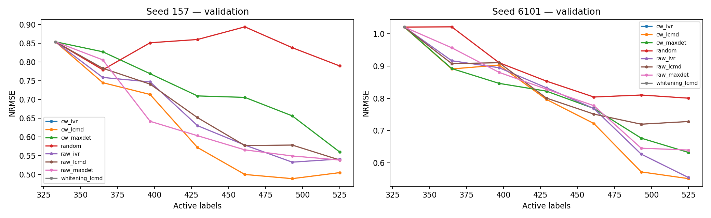

# CW geometry and LLM feedback results

Status: **running**. P0 numerical/compatibility audit and P2 offline boundary implementation completed. Formal fits completed: 13/36; reserved attempts: 13/36. Paid LLM calls: 0. New test evaluations: 0.

## Frozen primary result

Development seeds157/6101; budgets333,365,397,429,461,493,525. Normalized trapezoidal validation AULC333–525 is the primary metric. Only complete seven-point curves enter the table. No endpoint-based or test-based method selection.

| seed | arm | AULC333_525 | NRMSE525 |
| --- | --- | --- | --- |
| 157 | cw_lcmd | 0.616361 | 0.504888 |
| 157 | cw_maxdet | 0.729025 | 0.560055 |
| 157 | random | 0.840634 | 0.789499 |
| 157 | raw_ivr | 0.657404 | 0.541166 |
| 157 | raw_lcmd | 0.671241 | 0.538682 |
| 157 | raw_maxdet | 0.643651 | 0.538580 |
| 6101 | cw_lcmd | 0.778342 | 0.550836 |
| 6101 | cw_maxdet | 0.805314 | 0.631959 |
| 6101 | random | 0.884977 | 0.800353 |
| 6101 | raw_ivr | 0.804408 | 0.554113 |
| 6101 | raw_lcmd | 0.827271 | 0.727990 |
| 6101 | raw_maxdet | 0.819634 | 0.639522 |




## Paired effects and continuation gate

Negative delta means CW improves on Raw within the same selector. Mean relative improvement is computed as 1−mean(CW AULC)/mean(Raw AULC), with an additional requirement that both seed deltas are negative. The 2% threshold is an engineering resource allocation rule, not significance.

| seed | selector | delta_AULC | relative_improvement |
| --- | --- | --- | --- |
| 157 | lcmd | -0.054881 | 0.081760 |
| 6101 | lcmd | -0.048928 | 0.059144 |
| 157 | maxdet | 0.085374 | -0.132640 |
| 6101 | maxdet | -0.014320 | 0.017471 |


| selector | status | raw_mean_AULC | cw_mean_AULC | relative_mean_improvement | both_seeds_improve | eligible |
| --- | --- | --- | --- | --- | --- | --- |
| lcmd | completed | 0.749256 | 0.697352 | 0.069275 | True | True |
| maxdet | completed | 0.731642 | 0.767169 | -0.048558 | False | False |
| ivr | incomplete | nan | nan | nan | nan | False |


Development interaction contrasts (differences of paired CW effects):

| seed | contrast | difference_of_CW_effects |
| --- | --- | --- |
| 157 | maxdet minus lcmd | 0.140255 |
| 6101 | maxdet minus lcmd | 0.034608 |


Whitening minus CW AULC:

Pending whitening curves.

Decision: **pending_incomplete_matrix**. Full machine-readable gates: decision.json. Whitening interpretation: **pending whitening trajectories**.

Cross-selector comparisons remain developmental interactions with two seeds. MaxDet and IVR retain different RMS policies. A favorable CW result under one selector does not establish universality. Finite CountSketch orientation contributes to the realized representation; see MECHANISM_AUDIT.md.

## Secondary endpoint metrics

| seed | arm | combined_normalized_RMSE | V1_RMSE | V2_RMSE | V1_MAE | V2_MAE | V1_R2 | V2_R2 |
| --- | --- | --- | --- | --- | --- | --- | --- | --- |
| 157 | raw_lcmd | 0.538682 | 3.637148 | 6.806046 | 1.908649 | 3.327194 | 0.808396 | 0.847783 |
| 157 | raw_maxdet | 0.538580 | 3.615436 | 6.850468 | 2.062745 | 3.556727 | 0.810677 | 0.845790 |
| 157 | raw_ivr | 0.541166 | 3.828968 | 6.433313 | 2.239856 | 3.661978 | 0.787653 | 0.863999 |
| 157 | cw_lcmd | 0.504888 | 3.356634 | 6.491721 | 1.947568 | 3.284250 | 0.836811 | 0.861518 |
| 157 | random | 0.789499 | 5.258336 | 10.130970 | 2.742186 | 4.989901 | 0.599522 | 0.662733 |
| 157 | cw_maxdet | 0.560055 | 3.819762 | 6.991346 | 2.213231 | 3.778063 | 0.788673 | 0.839382 |
| 6101 | raw_lcmd | 0.727990 | 4.164092 | 8.487776 | 2.243283 | 4.367277 | 0.698293 | 0.718102 |
| 6101 | raw_maxdet | 0.639522 | 3.692809 | 7.369420 | 1.910821 | 3.791260 | 0.762722 | 0.787494 |
| 6101 | raw_ivr | 0.554113 | 3.173307 | 6.451122 | 1.745171 | 3.390236 | 0.824786 | 0.837155 |
| 6101 | cw_lcmd | 0.550836 | 3.274820 | 6.101310 | 1.807020 | 3.024075 | 0.813397 | 0.854336 |
| 6101 | random | 0.800353 | 4.545866 | 9.410398 | 2.424371 | 4.198967 | 0.640435 | 0.653486 |
| 6101 | cw_maxdet | 0.631959 | 3.663652 | 7.245418 | 1.906870 | 3.878474 | 0.766454 | 0.794585 |


## Evidence and limitations

70 historical control points were reused after byte hashes, numerical training configuration, normalization, preprocessing, initialization, L/U ordering and trajectory checks. Source paths and hashes are retained in REUSE_MANIFEST.json and reuse_compatibility.json. Historical test exposure is disclosed; none of these data constitute a new blind test. This report evaluates validation from saved checkpoints only.

P0: real-model uncompressed isometry, projection grid and exact historical Raw/CW first-batch replay; existing MaxDet logdet and IVR covariance oracle tests. Supplemental eight-row selection checks are not multi-round experiments. P2: synthetic adversarial fixtures plus sixteen real historical input adaptations; the live prompt adapter and positive paid budget remain future work. Historical Full prompt/source and all ongoing trajectory artifacts are untouched. LLM_HISTORY_AUDIT.json records completed budgets and P2_ABLATION_PLAN.md records quota/manual-correction limitations.

## Cost and recovery

Completed training wall-seconds (sum over fits): 2081.1. Acquisition wall-seconds: 657.3. Training uses two CPU threads per fit; this is wall time, not metered CPU/GPU cost. See resource_costs.csv. Large checkpoints remain local under ignored runtime. No dollar charge was incurred by LLM calls in this study.

```sh
# Verify/continue the exact bounded P1 trajectory only if it is incomplete:
KMP_DUPLICATE_LIB_OK=TRUE conda run --no-capture-output -n fish python scripts/studies/run_cw_geometry_feedback.py run
# Recompute validation from frozen checkpoint artifacts, then this report:
KMP_DUPLICATE_LIB_OK=TRUE conda run --no-capture-output -n fish python scripts/studies/run_cw_geometry_feedback.py report
KMP_DUPLICATE_LIB_OK=TRUE conda run --no-capture-output -n fish python scripts/studies/report_cw_geometry_feedback.py
# Offline boundary checks (no provider):
KMP_DUPLICATE_LIB_OK=TRUE conda run --no-capture-output -n fish pytest -q tests/active_learning_v2/test_cw_factorial.py tests/active_learning_v2/test_feedback_ablation_adapter.py
```

An interrupted fit reservation is not silently retried or removed: account for its attempt within the36 cap before any recovery. Selection coverage is in selection_coverage.csv; same_state_L333_overlap.csv compares only identical shared-model states. Later coverage rows belong to separate adaptive trajectories.

No automatic expansion beyond525, no test reveal command, and no live LLM command are enabled here. Future confirmation requires one frozen candidate/strong controls and five audited unused split seeds; extensions to813/1005 require a later preregistered budget. New splits are robustness checks, not external validation. The current round stops at the registered boundary.
