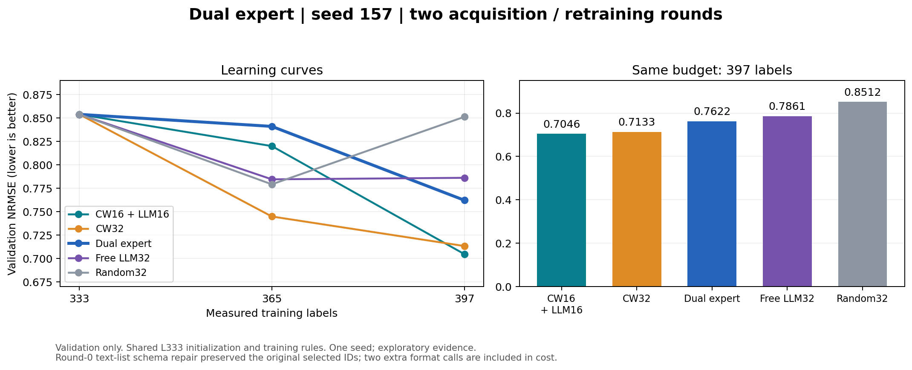

# 双专家两轮验证结果

2026-10-11：seed 157，333→365→397；完成2次新增训练、64条新标签，无新test评价。

初始验证集NRMSE为 0.853887；双专家端点为 0.762186，相对初始改善 10.74%。第二轮端点优于free和random，仍弱于CW16+LLM16与CW32；两轮validation AULC在五种方法中最差，尚不支持双专家整体收益。

| 方法 | 365标签 NRMSE | 397标签 NRMSE | validation AULC333–397 |
| --- | ---: | ---: | ---: |
| 双专家 | 0.841029 | 0.762186 | 0.824533 |
| Free LLM32 | 0.784499 | 0.786118 | 0.802251 |
| CW16 + LLM16 | 0.819989 | 0.704643 | 0.799627 |
| CW32 | 0.744804 | 0.713259 | 0.764188 |
| Random32 | 0.779164 | 0.851246 | 0.815865 |

所有指标越低越好。对照复用同seed、同分割、同初始化和同训练规则的历史fit audit，未新增对照训练。单seed两轮探索性验证结果不能确认总体优劣。

## 流程与偏差

第一轮32个样本涉及20个分子；第二轮32个样本涉及16个分子，64个ID无重复。第二轮完整收到首轮方案、4条假设、两个专家memo、32条实测反馈和8条最大历史误差记录。选样前不提供验证或测试结果。

2026-10-10的额度失败保留。此次首轮planner共识/分歧返回文字列表，旧validator只接受字符串，三次回答后停止；在揭示标签之前修复为兼容非空文字列表，用独立revision保存新代码协议。原始首个planner回答通过全部其他校验，按“最早合法回答”规则重放，内容、理由与32个ID均原样保留；没有按效果挑选回答。两个额外格式回答保留且计入成本，后两次回答的假设格式/引用仍有其他校验问题，未采纳。详见研究revision的schema_migration.json。

有效角色回答6次，额外格式回答2次，实际provider回答8次；输入3,669,927 tokens、输出34,993 tokens，共3,704,920 tokens。费用以provider账单为准。72项相关测试通过。

## 产物

- [冻结输入、响应与模型来源](results.json)
- [调用成本](call_cost_summary.json)
- [图表 PNG](comparison.png) / [SVG](comparison.svg)
