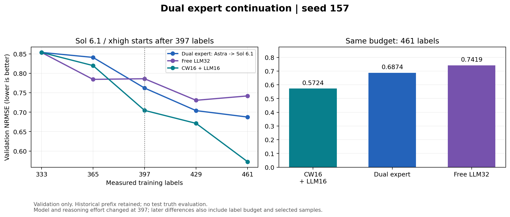

# 双专家续跑：同预算验证结果

seed 157，397标签后切换gpt-6.1-sol/xhigh；最新完成461标签。无新test评价。

| 方法 | 397标签 | 429标签 | 461标签 |
| --- | ---: | ---: | ---: |
| 双专家（397后Sol 6.1/xhigh） | 0.762186 | 0.704016 | 0.687444 |
| Free | 0.786118 | 0.730605 | 0.741885 |
| LLM+CW | 0.704643 | 0.671230 | 0.572431 |

指标越低越好；对照复用同seed、同分割和同训练规则的历史fit audit。

从397继承原有checkpoint、方案、标签和反馈。前两轮选样是Astra/high，之后是Sol 6.1/xhigh；不是同一397状态下的Astra/Sol分叉对照，不能单独归因模型更换。

所有原始回答、格式纠正和失败网络请求保留。对格式/证据问题只提供纠正反馈，不由host改写选点或证据；样本与证据全部通过校验后才冻结和揭示新标签。首个Sol轮次ML和第二个Sol轮次planner各登记一次额外格式修复，来源与原始回答在研究revision的provenance文件中。

模型切换后的已完成provider回答18次，共8,845,565 tokens；包含已完成的无效格式回答及尚未完成批次的回答。网络中断未获得完整usage，费用不估算。

[原始指标与来源hash](results.json) · [区间AULC和成本](comparison_summary.json)

模型设置参考：[OpenAI GPT-6.1 Sol文档](https://developers.openai.com/api/docs/models/gpt-6.1-sol)。实际provider回复的served_model已核对；无模型自动回退。

