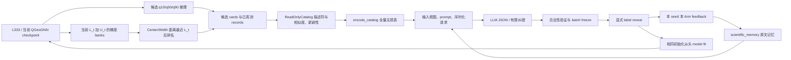

# 原实现数据流与 CW 通道审计

审计日期：2026-10-29（Asia/Shanghai）。先审阅下列路径及历史 protocol、测试，再新增隔离适配器；所有历史源码均保持原样。

| 原路径/符号 | 审计发现 | 新实验处理 |
|---|---|---|
| `scientist_study.make_catalog`，`scientist_lifecycle.make_catalog` | `banks` 返回当前 checkpoint 的 CW/raw 梯度；最近 L_t 欧氏距离经 pandas `rank(pct=True)`，进入 `_card`。Hybrid 还调用 LCMD 取 pending16 | 后续轮复用 lifecycle，但显式 `pending_count=0`；仅 CW-aware 暴露该数值。内部计算不能影响顺序/候选集合 |
| `llm_screen.banks` | round0 可复用梯度缓存；后续抽取梯度；不会读取 U/validation/test 标签 | dry-run 不调用；正式后续 stage 需显式允许计算 |
| `dialog_study._card` | `cw_distance_percentile` 原有 5 位小数；pred q50 原精度 | 只删除这一列，绝不重舍入其他数字 |
| `dialog_study._observed` | L333 实测记录；后续加入采集前预测/误差。没有 CW 字段，也没有验证分数 | 保留；仅使用本 Arm 的冻结反馈 |
| `scientist_selector.clean_card`, `SIGNALS`, `ReadOnlyCatalog` | 原白名单允许 CW；可按 CW 搜索排序；计算 Morgan、描述符、loading、新颖性、分位宽度 | 复用 card 计算；新 runner 没有查询工具。新增正向白名单拒绝未知/改名数值通道 |
| `ReadOnlyCatalog.key` | `stable_hash([salt,id])`，原 salt 含 method；`initial_cards`、overview、搜索都可能展示不同顺序 | 新 salt 固定 `version:seed:paired:round`，两个 Arm 相同；原 salt 不变 |
| `scientist_full_delivery.encode_catalog` | 按 `catalog.key` 排序；所有 row key 并集变成列，若只改 prompt，CW 列仍会送出 | 在构造 catalog 前移除 CW；同时审核 `catalog.json`、`input.json`、实际 request 文件 |
| `scientist_study.stage` | 先建初始卡/overview，再移除这些字段，以完整编码替代；Free 没有 shortlist。Hybrid 的 pending16 是隐含 CW 约束 | 新实验始终完整 U_t、pending0，不构造 overview/shortlist；IDs 沿用 opaque sample IDs |
| `scientist_selector.SYSTEM_PROMPT` | 解释 CW 距离，并列为搜索排序字段；包含 hybrid/pending-CW 说明 | 从 `DIRECT_PROMPT` 构造共同 Free32 prompt，两个 Arm 都删 hybrid 描述；仅 NoCW 再删 CW 定义 |
| `scientist_full_delivery.DIRECT_PROMPT` | 切掉查询 relay，但前半段仍解释 CW；全文输入并不等于 NoCW | 针对实际直接输入 prompt 审计；精确匹配 CW 定义，旧 prompt 漂移时拒绝 |
| `scientist_selector.scientific_memory` | 原样传播最近 hypotheses、解释、batch rationale；最近32反馈、全历史 top8 误差及所有选中 ID；reason 可能包含 CW 数字 | 从空历史分叉，验证 seed/Arm/round；typed schema；NoCW 扫描所有层级原文，污染即停止，不删除整段化学记忆 |
| `scientist_lifecycle.state/advance` | 验证 freeze、receipt、feedback hash、ID顺序和误差；freeze 后 reveal，再 fit；source CW/LLM 的 reason 也进入后续记忆 | 复用；新路径隔离；pending0 使所有 source=LLM；额外验证 typed history、当前 checkpoint 绑定 |
| `scientist_transport.run_full_selector` | 全量输入、最多3次答案；无自动补点；使用全局固定 DIRECT_PROMPT | 新的小型 selector adapter 复用编码与验证，支持两个 prompt；所有答案都有限纠错、不得修复 IDs |
| `scientist_transport._call_with_retries` | 每次重启以已有失败数继续，但再给3次额度，累计可超过3；CLI恢复逻辑与此实验无关 | 新 transport 累计最多3次/答案；未完成 started 标记 fail-closed；仅 Responses，锁定 served model |
| `feedback_ablation.packet` | 强制 selection16+pending16；GEOMETRY 仍包含 CW；其 No-chemistry 等与本研究问题不同 | 不作为 runner；借鉴 typed schema，新增独立 Free32 输入视图 |
| `ShortSequentialContext.fit`, `runner.fit_from_same_initialization`, `train_source` | 初始模型 seed 固定；Adam、相同 RNG/归一化；validation 选择 best checkpoint；test graph labels 为零；test 仅预测 | 原样复用；checkpoint selection 的 validation 不进入 LLM。新 report 使用 validation，完全不 reveal test |
| 历史 `scientist_study.report/trajectory_report` | 旧主报告是 test 后验报告，不能直接当本实验 validation AULC | 新报告单独实现；完整配对 milestone 冻结后计算 validation 曲线，不提供实时奖励 |

实际直接暴露的 CW 数值是候选 `cw_distance_percentile`。其主要二次传播通道是解释/假设/理由和由此产生的历史记忆。原 Free 全量路径不存在数值 shortlist 或 LCMD 替换；原查询路径可以显式按 CW 排序。新路径不启用查询，也不存在后置 LCMD 修复。

初始 catalog 只读历史 `astra_high_full_pool_20261001/.../round_00/{catalog,contract}.json`。其模型、split、L333、U333 与 baseline member0 逐项比对。历史模型名称与生成特征无关，旧选择/理由/反馈/LLM 输出从不加载。未读取任何 round1+ 历史状态。

保留的限制：静态检查可以禁止已知显式字段、未知结构化通道和常见 CW 文字，但不能证明任意自然语言隐写或模型内部推理不存在。NoCW 可以利用相似度、预测、结构等信息推断覆盖关系，这正是保留能力的一部分；本实验隔离的是预计算 CW 数值先验。
