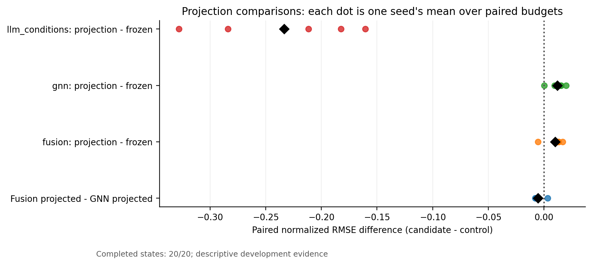
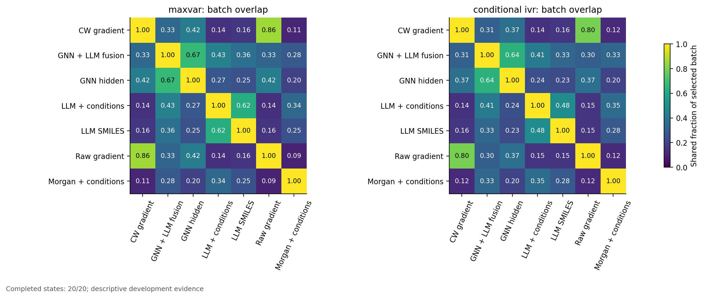

# GNN、语言表示、Projection与Fusion配对比较

日期：2026-11-04。**当前为完整预定开发矩阵**：已完成 20/20 个seed×预算状态，720 次端点GP拟合。只汇总有complete回执的真实结果，不计未完成目录，不把预检重复计算为独立状态。

本地语言对照是 **Qwen1.5-0.5B-Chat的冻结decoder hidden state**，不是T5或语义embedding专用encoder。T5缺本地权重，未下载；本次只研究Frozen/Projection思路，没有执行GOLLuM主变体PLLMφ的语言模型微调。

评价来自既有416行validation，它参与过QGeoGNN checkpoint selection，因此全部为开发证据。五seed共享数据来源、四预算嵌套，20状态不能称20次统计独立重复。主指标为两个端点RMSE/L0标准差的均值；Projection先平均17/29/43三初始化，再平均端点，总体先在seed内平均已完成预算，再等权平均seed。±为seed样本SD，非置信区间。缺项时不同seed的预算组成可能不同，必须结合下表解释；配对比较只用共同状态。

| 开发seed | 已完成预算 | 计划预算 |
| --- | --- | --- |
| 157 | 333, 525, 813, 1005 | 333, 525, 813, 1005 |
| 887 | 333, 525, 813, 1005 | 333, 525, 813, 1005 |
| 2357 | 333, 525, 813, 1005 | 333, 525, 813, 1005 |
| 6101 | 333, 525, 813, 1005 | 333, 525, 813, 1005 |
| 12203 | 333, 525, 813, 1005 | 333, 525, 813, 1005 |

数值来源：[机器汇总](summary/summary.json)，SHA256 `c6eff9e4004835036fff1b454bdf3b9f7222124fc47e05c03eb95ce0d0613b9a`。方法与权限见[PROTOCOL.md](PROTOCOL.md)、[METHOD.md](METHOD.md)、[AUDIT.md](AUDIT.md)。

## 语言表示是否提供额外预测信息

| 候选−对照 | 配对seed/状态 | Δ主误差 | 主误差下降seed | ΔNLPD | Δ90%覆盖 |
| --- | --- | --- | --- | --- | --- |
| LLM conditions - structured | 5/20 | 0.1113 | 0/5 | 0.0762 | -0.5 pp |
| LLM conditions - GNN | 5/20 | 0.3723 | 0/5 | -14.6175 | +26.9 pp |
| LLM conditions - SMILES | 5/20 | -0.1621 | 5/5 | -0.1658 | +0.1 pp |
| llm_conditions: projection - frozen | 5/20 | -0.2333 | 5/5 | 82.5195 | -72.6 pp |
| gnn: projection - frozen | 5/20 | 0.0120 | 0/5 | 30.5515 | -23.5 pp |
| fusion: projection - frozen | 5/20 | 0.0099 | 1/5 | 320.3658 | -48.3 pp |
| Fusion frozen - GNN | 5/20 | -0.0033 | 5/5 | -2.4964 | +1.6 pp |
| Fusion projected - GNN projected | 5/20 | -0.0053 | 4/5 | 287.3179 | -23.2 pp |

LLM conditions - structured：已完成共同状态的seed均值主误差上升，Δ=0.1113，0/5 seed方向为下降；NLPD差=0.0762。 当前没有主指标平均收益；不能用个别预算或初始化替代该结论。

LLM conditions - GNN：已完成共同状态的seed均值主误差上升，Δ=0.3723，0/5 seed方向为下降；NLPD差=-14.6175。 当前没有主指标平均收益；不能用个别预算或初始化替代该结论。 NLPD有所改善，需结合区间宽度判断是否主要来自更保守的方差；不把它等同均值优势。

Structured是必要的非语言化学与条件对照；若它已优于本地Qwen，应保留该负结果。Qwen自身无优势不能外推为T5或所有语言模型均无价值；同样，局部有优势也不证明语言先验具有可迁移新增信息。

## MLL训练Projection是否带来可重复的未见行收益

llm_conditions: projection - frozen：已完成共同状态的seed均值主误差下降，Δ=-0.2333，5/5 seed方向为下降；NLPD差=82.5195。 **均值误差改善与概率评分恶化同时出现，不能称为更可靠的GP。**

gnn: projection - frozen：已完成共同状态的seed均值主误差上升，Δ=0.0120，0/5 seed方向为下降；NLPD差=30.5515。 当前没有主指标平均收益；不能用个别预算或初始化替代该结论。

fusion: projection - frozen：已完成共同状态的seed均值主误差上升，Δ=0.0099，1/5 seed方向为下降；NLPD差=320.3658。 当前没有主指标平均收益；不能用个别预算或初始化替代该结论。

| Projection表示 | seed数 | 初始化间主误差SD均值 | 初始化间主误差range均值 | 初始化间NLPD SD均值 |
| --- | --- | --- | --- | --- |
| GNN+Qwen Fusion | 5 | 0.0043 | 0.0082 | 26.1889 |
| GNN Hidden | 5 | 0.0033 | 0.0061 | 1.8343 |
| Qwen Conditions | 5 | 0.0147 | 0.0281 | 10.4765 |

三初始化全部报告并先平均；未由validation选最优初始化。初始化SD与跨seed方向共同反映可重复性，一个seed/一个初始化的最低RMSE不能替代整体配对。只有开发均值收益时，仍不能声称新独立数据上的复现，更不能将MLL下降包装为概率可靠性。

## Fusion的收益是否超出容量

Fusion frozen - GNN：已完成共同状态的seed均值主误差下降，Δ=-0.0033，5/5 seed方向为下降；NLPD差=-2.4964。 概率结论还需共同检查逐端点覆盖、宽度和初始化/优化稳定性。

Fusion projected - GNN projected：已完成共同状态的seed均值主误差下降，Δ=-0.0053，4/5 seed方向为下降；NLPD差=287.3179。 **均值误差改善与概率评分恶化同时出现，不能称为更可靠的GP。**

容量匹配对照为GNN原隐藏128→64与Fusion128→64，均8,256个投影参数；Fusion先用L_t covariates将GNN与Qwen分别标准化/PCA64并作block RMS，再拼128维。Qwen直接1024→64有65,600参数，不能与GNN直接投影称为容量相同。即使Fusion胜过参数匹配对照，PCA、block scaling与输入组成也变化，不能把全部增益唯一归于语言信息；需结合Frozen Fusion及相同PCA预处理的GNN对照进一步辨别。

## 按预算与seed看方向

| 表示/核 | L333主误差 | L525主误差 | L813主误差 | L1005主误差 |
| --- | --- | --- | --- | --- |
| CW Gradient / Linear | 0.8198 ± 0.1722 (n=5) | 0.5542 ± 0.1480 (n=5) | 0.4163 ± 0.0376 (n=5) | 0.4095 ± 0.0400 (n=5) |
| CW Gradient / Matérn | 0.8150 ± 0.1787 (n=5) | 0.5565 ± 0.1396 (n=5) | 0.3992 ± 0.0402 (n=5) | 0.3946 ± 0.0359 (n=5) |
| GNN+Qwen Fusion / Matérn | 0.7645 ± 0.1743 (n=5) | 0.5095 ± 0.1286 (n=5) | 0.3766 ± 0.0323 (n=5) | 0.3575 ± 0.0405 (n=5) |
| GNN+Qwen Fusion + Projection | 0.7720 ± 0.1666 (n=5) | 0.5170 ± 0.1244 (n=5) | 0.3924 ± 0.0375 (n=5) | 0.3664 ± 0.0453 (n=5) |
| GNN Hidden / Matérn | 0.7669 ± 0.1728 (n=5) | 0.5100 ± 0.1278 (n=5) | 0.3813 ± 0.0319 (n=5) | 0.3630 ± 0.0421 (n=5) |
| GNN Hidden + Projection | 0.7751 ± 0.1660 (n=5) | 0.5199 ± 0.1281 (n=5) | 0.3960 ± 0.0356 (n=5) | 0.3781 ± 0.0441 (n=5) |
| Qwen Conditions / Matérn | 0.9656 ± 0.2056 (n=5) | 0.9223 ± 0.1647 (n=5) | 0.8273 ± 0.1216 (n=5) | 0.7951 ± 0.1297 (n=5) |
| Qwen Conditions + Projection | 0.9029 ± 0.1813 (n=5) | 0.7187 ± 0.1282 (n=5) | 0.4963 ± 0.0626 (n=5) | 0.4593 ± 0.0632 (n=5) |
| Qwen SMILES / Matérn | 1.0646 ± 0.2351 (n=5) | 1.0841 ± 0.2004 (n=5) | 1.0169 ± 0.1802 (n=5) | 0.9931 ± 0.1882 (n=5) |
| Raw Gradient / Linear | 0.8231 ± 0.1679 (n=5) | 0.5521 ± 0.1577 (n=5) | 0.4266 ± 0.0378 (n=5) | 0.4074 ± 0.0417 (n=5) |
| Raw Gradient / Matérn | 0.8219 ± 0.1720 (n=5) | 0.5550 ± 0.1496 (n=5) | 0.4079 ± 0.0410 (n=5) | 0.3954 ± 0.0384 (n=5) |
| Structured / Matérn | 0.9080 ± 0.2212 (n=5) | 0.8067 ± 0.1495 (n=5) | 0.6912 ± 0.1020 (n=5) | 0.6592 ± 0.1047 (n=5) |

| 候选−对照 | 预算 | Δ主误差均值 | 下降seed/配对seed | ΔNLPD均值 |
| --- | --- | --- | --- | --- |
| Fusion frozen - GNN | 333 | -0.0024 | 4/5 | -7.2260 |
| Fusion frozen - GNN | 525 | -0.0005 | 3/5 | -2.0347 |
| Fusion frozen - GNN | 813 | -0.0047 | 5/5 | -0.5035 |
| Fusion frozen - GNN | 1005 | -0.0055 | 5/5 | -0.2215 |
| Fusion projected - GNN projected | 333 | -0.0030 | 4/5 | 883.6754 |
| Fusion projected - GNN projected | 525 | -0.0029 | 3/5 | 149.6463 |
| Fusion projected - GNN projected | 813 | -0.0036 | 4/5 | 67.8174 |
| Fusion projected - GNN projected | 1005 | -0.0117 | 5/5 | 48.1326 |
| LLM conditions - GNN | 333 | 0.1987 | 0/5 | -35.7691 |
| LLM conditions - GNN | 525 | 0.4123 | 0/5 | -14.4471 |
| LLM conditions - GNN | 813 | 0.4460 | 0/5 | -6.3132 |
| LLM conditions - GNN | 1005 | 0.4321 | 0/5 | -1.9404 |
| LLM conditions - SMILES | 333 | -0.0990 | 5/5 | -0.1108 |
| LLM conditions - SMILES | 525 | -0.1618 | 5/5 | -0.1619 |
| LLM conditions - SMILES | 813 | -0.1895 | 5/5 | -0.1864 |
| LLM conditions - SMILES | 1005 | -0.1980 | 5/5 | -0.2042 |
| LLM conditions - structured | 333 | 0.0576 | 0/5 | 0.0197 |
| LLM conditions - structured | 525 | 0.1157 | 0/5 | 0.0696 |
| LLM conditions - structured | 813 | 0.1361 | 0/5 | 0.0989 |
| LLM conditions - structured | 1005 | 0.1359 | 0/5 | 0.1168 |
| fusion: projection - frozen | 333 | 0.0075 | 2/5 | 952.4253 |
| fusion: projection - frozen | 525 | 0.0074 | 1/5 | 182.2865 |
| fusion: projection - frozen | 813 | 0.0158 | 1/5 | 86.5407 |
| fusion: projection - frozen | 1005 | 0.0089 | 1/5 | 60.2106 |
| gnn: projection - frozen | 333 | 0.0082 | 1/5 | 61.5239 |
| gnn: projection - frozen | 525 | 0.0099 | 1/5 | 30.6055 |
| gnn: projection - frozen | 813 | 0.0146 | 0/5 | 18.2199 |
| gnn: projection - frozen | 1005 | 0.0150 | 0/5 | 11.8565 |
| llm_conditions: projection - frozen | 333 | -0.0627 | 4/5 | 211.6648 |
| llm_conditions: projection - frozen | 525 | -0.2036 | 5/5 | 55.5001 |
| llm_conditions: projection - frozen | 813 | -0.3310 | 5/5 | 32.5085 |
| llm_conditions: projection - frozen | 1005 | -0.3358 | 5/5 | 30.4045 |

| 候选−对照 | seed | 共同预算数 | Δ主误差 | ΔNLPD | Δ90%覆盖 |
| --- | --- | --- | --- | --- | --- |
| Fusion frozen - GNN | 157 | 4 | -0.0018 | -4.1510 | +2.3 pp |
| Fusion projected - GNN projected | 157 | 4 | -0.0074 | 449.8168 | -14.5 pp |
| LLM conditions - GNN | 157 | 4 | 0.4423 | -34.4419 | +52.6 pp |
| LLM conditions - SMILES | 157 | 4 | -0.2429 | -0.2157 | +1.2 pp |
| LLM conditions - structured | 157 | 4 | 0.1053 | 0.0203 | +0.5 pp |
| fusion: projection - frozen | 157 | 4 | -0.0053 | 500.3968 | -27.9 pp |
| gnn: projection - frozen | 157 | 4 | 0.0003 | 46.4289 | -11.2 pp |
| llm_conditions: projection - frozen | 157 | 4 | -0.3281 | 145.9614 | -75.3 pp |
| Fusion frozen - GNN | 887 | 4 | -0.0038 | -0.3524 | +1.5 pp |
| Fusion projected - GNN projected | 887 | 4 | -0.0070 | 218.5830 | -21.7 pp |
| LLM conditions - GNN | 887 | 4 | 0.2484 | -3.2754 | +23.7 pp |
| LLM conditions - SMILES | 887 | 4 | -0.1083 | -0.1519 | +0.1 pp |
| LLM conditions - structured | 887 | 4 | 0.0951 | 0.0861 | -0.7 pp |
| fusion: projection - frozen | 887 | 4 | 0.0123 | 245.6844 | -57.7 pp |
| gnn: projection - frozen | 887 | 4 | 0.0154 | 26.7490 | -34.5 pp |
| llm_conditions: projection - frozen | 887 | 4 | -0.1605 | 79.5063 | -77.7 pp |
| Fusion frozen - GNN | 2357 | 4 | -0.0038 | -0.4835 | +1.1 pp |
| Fusion projected - GNN projected | 2357 | 4 | 0.0033 | 82.7418 | -46.7 pp |
| LLM conditions - GNN | 2357 | 4 | 0.3719 | -2.1351 | +14.1 pp |
| LLM conditions - SMILES | 2357 | 4 | -0.1502 | -0.1701 | +0.2 pp |
| LLM conditions - structured | 2357 | 4 | 0.1132 | 0.0821 | -1.0 pp |
| fusion: projection - frozen | 2357 | 4 | 0.0166 | 85.7458 | -55.7 pp |
| gnn: projection - frozen | 2357 | 4 | 0.0094 | 2.5205 | -7.9 pp |
| llm_conditions: projection - frozen | 2357 | 4 | -0.1825 | 39.9341 | -69.4 pp |
| Fusion frozen - GNN | 6101 | 4 | -0.0055 | -7.2862 | +1.8 pp |
| Fusion projected - GNN projected | 6101 | 4 | -0.0074 | 627.3353 | -21.3 pp |
| LLM conditions - GNN | 6101 | 4 | 0.4414 | -30.5661 | +25.2 pp |
| LLM conditions - SMILES | 6101 | 4 | -0.1920 | -0.1579 | -0.2 pp |
| LLM conditions - structured | 6101 | 4 | 0.1315 | 0.0943 | -0.5 pp |
| fusion: projection - frozen | 6101 | 4 | 0.0130 | 680.2023 | -52.5 pp |
| gnn: projection - frozen | 6101 | 4 | 0.0150 | 45.5809 | -29.3 pp |
| llm_conditions: projection - frozen | 6101 | 4 | -0.2838 | 109.7194 | -75.5 pp |
| Fusion frozen - GNN | 12203 | 4 | -0.0014 | -0.2090 | +1.2 pp |
| Fusion projected - GNN projected | 12203 | 4 | -0.0079 | 58.1126 | -12.0 pp |
| LLM conditions - GNN | 12203 | 4 | 0.3575 | -2.6688 | +18.7 pp |
| LLM conditions - SMILES | 12203 | 4 | -0.1170 | -0.1335 | -0.8 pp |
| LLM conditions - structured | 12203 | 4 | 0.1114 | 0.0985 | -0.8 pp |
| fusion: projection - frozen | 12203 | 4 | 0.0131 | 89.7996 | -47.9 pp |
| gnn: projection - frozen | 12203 | 4 | 0.0197 | 31.4780 | -34.6 pp |
| llm_conditions: projection - frozen | 12203 | 4 | -0.2116 | 37.4762 | -65.3 pp |

全局平均可能掩盖预算反向或少数seed主导。以上按预算配对、seed内预算均值及三初始化平均都固定展示；若partial缺不同预算，不能拿不平衡总体均值制造一致性。当前五seed为既有开发seed，不作独立外部确认p值。

## 概率质量与离线采集是否跟随均值

| 表示对 | 采集 | seed数 | 初始分数ρ | 初始Top32重叠 | 最终batch重叠 |
| --- | --- | --- | --- | --- | --- |
| fusion/matern52 vs gnn/matern52 | batch_information_gain | 5 | 0.7617 | 66.9% | 66.9% |
| fusion/matern52 vs gnn/matern52 | conditional_ivr | 5 | 0.7278 | 64.8% | 64.4% |
| fusion/matern52 vs gnn/matern52 | maxvar | 5 | 0.7617 | 66.9% | 66.9% |
| gnn/matern52 vs llm_conditions/matern52 | batch_information_gain | 5 | 0.2605 | 27.1% | 26.8% |
| gnn/matern52 vs llm_conditions/matern52 | conditional_ivr | 5 | 0.2532 | 23.8% | 24.3% |
| gnn/matern52 vs llm_conditions/matern52 | maxvar | 5 | 0.2605 | 27.1% | 27.1% |
| llm_conditions/matern52 vs structured/matern52 | batch_information_gain | 5 | 0.5468 | 33.7% | 33.9% |
| llm_conditions/matern52 vs structured/matern52 | conditional_ivr | 5 | 0.6314 | 41.0% | 35.4% |
| llm_conditions/matern52 vs structured/matern52 | maxvar | 5 | 0.5468 | 33.7% | 33.7% |

较好均值并不意味着覆盖、NLPD或batch稳定性更好。采集排序使用同256合法U的latent联合协方差；IVR/BatchIG逐步条件化，初始单点rank与最终batch重叠分别报告。信息量在各自GP内定义，不同模型的数值大小不能当真实实验学习收益的统一尺度。

本研究未启动AL闭环，无法宣称AULC、终点QGeoGNN误差或实验学习稳定性改善。后续Go/No-Go及最小补证见[AL_FEASIBILITY.md](AL_FEASIBILITY.md)与[NEXT_STAGE_DECISION.md](NEXT_STAGE_DECISION.md)。
