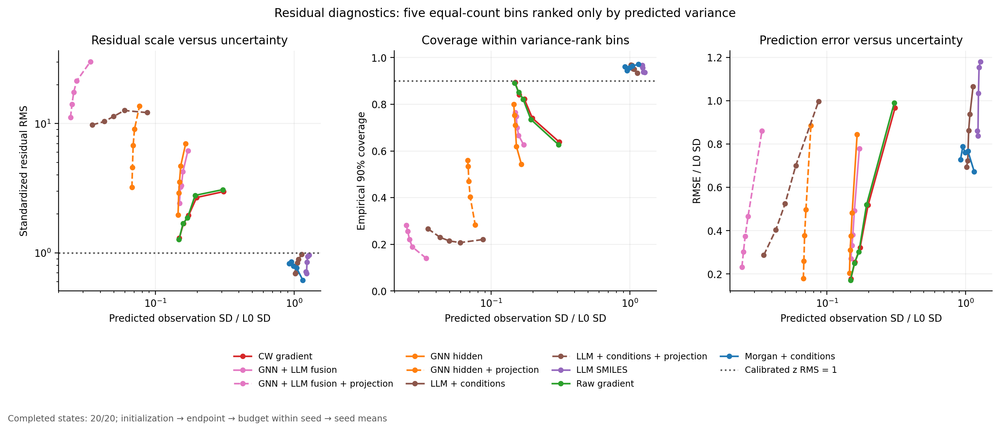
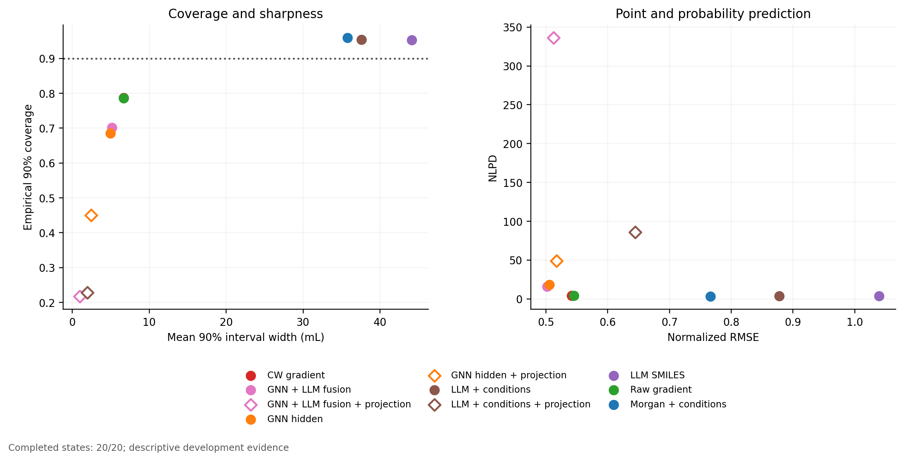
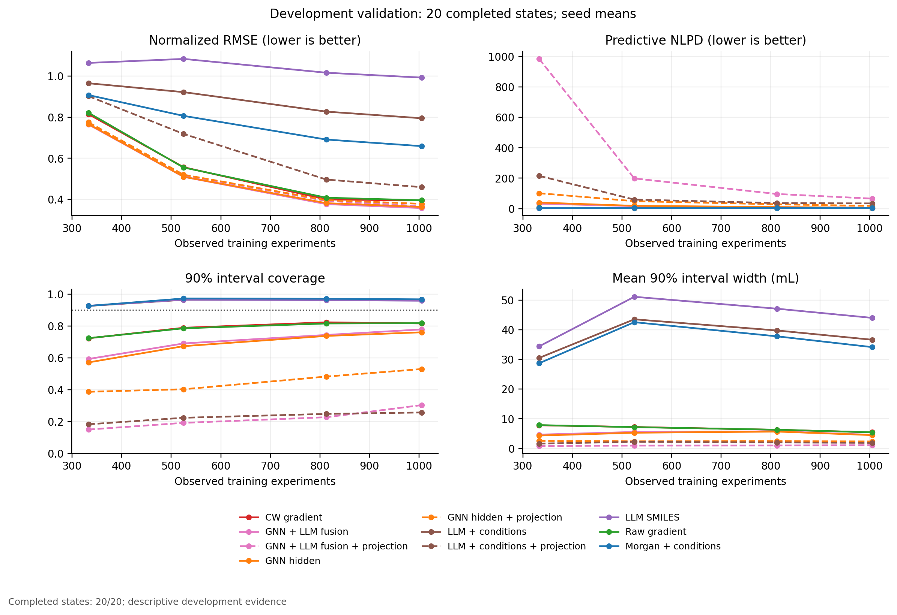

# GP概率预测与不确定性校准

日期：2026-11-04。**当前为完整预定开发矩阵**：已完成 20/20 个seed×预算状态，720 次端点GP拟合。只汇总有complete回执的真实结果，不计未完成目录，不把预检重复计算为独立状态。

本地语言对照是 **Qwen1.5-0.5B-Chat的冻结decoder hidden state**，不是T5或语义embedding专用encoder。T5缺本地权重，未下载；本次只研究Frozen/Projection思路，没有执行GOLLuM主变体PLLMφ的语言模型微调。

评价来自既有416行validation，它参与过QGeoGNN checkpoint selection，因此全部为开发证据。五seed共享数据来源、四预算嵌套，20状态不能称20次统计独立重复。主指标为两个端点RMSE/L0标准差的均值；Projection先平均17/29/43三初始化，再平均端点，总体先在seed内平均已完成预算，再等权平均seed。±为seed样本SD，非置信区间。缺项时不同seed的预算组成可能不同，必须结合下表解释；配对比较只用共同状态。

| 开发seed | 已完成预算 | 计划预算 |
| --- | --- | --- |
| 157 | 333, 525, 813, 1005 | 333, 525, 813, 1005 |
| 887 | 333, 525, 813, 1005 | 333, 525, 813, 1005 |
| 2357 | 333, 525, 813, 1005 | 333, 525, 813, 1005 |
| 6101 | 333, 525, 813, 1005 | 333, 525, 813, 1005 |
| 12203 | 333, 525, 813, 1005 | 333, 525, 813, 1005 |

数值来源：[机器汇总](summary/summary.json)，SHA256 `c6eff9e4004835036fff1b454bdf3b9f7222124fc47e05c03eb95ce0d0613b9a`。方法与权限见[PROTOCOL.md](PROTOCOL.md)、[METHOD.md](METHOD.md)、[AUDIT.md](AUDIT.md)。

## 均值与概率分开判定

| 候选−对照 | 配对seed/状态 | Δ主误差 | 主误差下降seed | ΔNLPD | Δ90%覆盖 |
| --- | --- | --- | --- | --- | --- |
| LLM conditions - structured | 5/20 | 0.1113 | 0/5 | 0.0762 | -0.5 pp |
| LLM conditions - GNN | 5/20 | 0.3723 | 0/5 | -14.6175 | +26.9 pp |
| LLM conditions - SMILES | 5/20 | -0.1621 | 5/5 | -0.1658 | +0.1 pp |
| llm_conditions: projection - frozen | 5/20 | -0.2333 | 5/5 | 82.5195 | -72.6 pp |
| gnn: projection - frozen | 5/20 | 0.0120 | 0/5 | 30.5515 | -23.5 pp |
| fusion: projection - frozen | 5/20 | 0.0099 | 1/5 | 320.3658 | -48.3 pp |
| Fusion frozen - GNN | 5/20 | -0.0033 | 5/5 | -2.4964 | +1.6 pp |
| Fusion projected - GNN projected | 5/20 | -0.0053 | 4/5 | 287.3179 | -23.2 pp |

NLPD越小越好，90%/95%覆盖应与区间宽度共同检查；接近名义覆盖但区间极宽不代表有用。全部NLPD及宽度使用mL响应尺度，观测预测方差为latent variance+训练噪声；没有用latent区间冒充响应预测区间。本次未在validation上调方差或进行事后覆盖校准。

llm_conditions: projection - frozen：已完成共同状态的seed均值主误差下降，Δ=-0.2333，5/5 seed方向为下降；NLPD差=82.5195。 **均值误差改善与概率评分恶化同时出现，不能称为更可靠的GP。**

fusion: projection - frozen：已完成共同状态的seed均值主误差上升，Δ=0.0099，1/5 seed方向为下降；NLPD差=320.3658。 当前没有主指标平均收益；不能用个别预算或初始化替代该结论。

Fusion projected - GNN projected：已完成共同状态的seed均值主误差下降，Δ=-0.0053，4/5 seed方向为下降；NLPD差=287.3179。 **均值误差改善与概率评分恶化同时出现，不能称为更可靠的GP。**

当前预算×端点×表示/核的seed均值覆盖率范围为14.8%–97.3%，72/96条汇总行低于名义90%。这是描述性组均值计数，不是独立校准检验或新设通过门槛。

## 按预算和端点评分

| 预算 | 表示/核 | 目标 | seed数 | RMSE mL | NLPD | 90%覆盖 | 95%覆盖 | 90%宽 mL | 95%宽 mL | 标准化误差RMS |
| --- | --- | --- | --- | --- | --- | --- | --- | --- | --- | --- |
| 333 | CW Gradient / Linear | V1 | 5 | 5.8438 | 4.8129 | 74.9% | 79.8% | 6.1942 | 7.3808 | 2.5151 |
| 333 | CW Gradient / Linear | V2 | 5 | 11.6501 | 7.3652 | 66.2% | 72.3% | 9.0954 | 10.8379 | 3.2551 |
| 333 | CW Gradient / Matérn | V1 | 5 | 5.7533 | 4.5481 | 77.2% | 82.2% | 6.3297 | 7.5423 | 2.4260 |
| 333 | CW Gradient / Matérn | V2 | 5 | 11.6683 | 6.9645 | 67.4% | 73.1% | 9.2700 | 11.0459 | 3.1392 |
| 333 | GNN+Qwen Fusion / Matérn | V1 | 5 | 5.4457 | 21.7427 | 64.5% | 68.7% | 4.1663 | 4.9644 | 5.3841 |
| 333 | GNN+Qwen Fusion / Matérn | V2 | 5 | 10.8278 | 42.7826 | 54.1% | 58.7% | 5.1430 | 6.1283 | 8.0592 |
| 333 | GNN+Qwen Fusion + Projection | V1 | 5 | 5.5370 | 1048.6846 | 15.2% | 18.0% | 0.5966 | 0.7109 | 38.6899 |
| 333 | GNN+Qwen Fusion + Projection | V2 | 5 | 10.8885 | 920.6914 | 14.8% | 17.5% | 1.0874 | 1.2957 | 38.8182 |
| 333 | GNN Hidden / Matérn | V1 | 5 | 5.4668 | 26.4654 | 63.0% | 66.6% | 3.9424 | 4.6977 | 5.8368 |
| 333 | GNN Hidden / Matérn | V2 | 5 | 10.8615 | 52.5120 | 51.2% | 56.1% | 4.7330 | 5.6398 | 8.8422 |
| 333 | GNN Hidden + Projection | V1 | 5 | 5.5769 | 81.7969 | 39.1% | 43.4% | 2.0425 | 2.4338 | 11.4725 |
| 333 | GNN Hidden + Projection | V2 | 5 | 10.9081 | 120.2283 | 38.3% | 42.2% | 3.0563 | 3.6418 | 14.0292 |
| 333 | Qwen Conditions / Matérn | V1 | 5 | 6.9166 | 3.3822 | 92.5% | 94.3% | 20.3619 | 24.2627 | 1.1227 |
| 333 | Qwen Conditions / Matérn | V2 | 5 | 13.6523 | 4.0569 | 92.6% | 94.6% | 40.6358 | 48.4205 | 1.1082 |
| 333 | Qwen Conditions + Projection | V1 | 5 | 6.5438 | 228.2870 | 19.6% | 23.0% | 1.1300 | 1.3465 | 19.8004 |
| 333 | Qwen Conditions + Projection | V2 | 5 | 12.6638 | 202.4817 | 16.9% | 19.9% | 2.1413 | 2.5515 | 19.0164 |
| 333 | Qwen SMILES / Matérn | V1 | 5 | 7.4982 | 3.4770 | 92.5% | 94.1% | 22.5918 | 26.9198 | 1.1118 |
| 333 | Qwen SMILES / Matérn | V2 | 5 | 15.2896 | 4.1838 | 92.8% | 94.2% | 46.1903 | 55.0391 | 1.1035 |
| 333 | Raw Gradient / Linear | V1 | 5 | 5.8407 | 5.0407 | 74.4% | 79.5% | 5.9631 | 7.1054 | 2.6112 |
| 333 | Raw Gradient / Linear | V2 | 5 | 11.7776 | 7.1783 | 68.8% | 73.8% | 9.2994 | 11.0809 | 3.2034 |
| 333 | Raw Gradient / Matérn | V1 | 5 | 5.8005 | 4.8724 | 75.5% | 80.6% | 6.0717 | 7.2349 | 2.5576 |
| 333 | Raw Gradient / Matérn | V2 | 5 | 11.8054 | 6.7762 | 69.2% | 74.9% | 9.6457 | 11.4935 | 3.0811 |
| 333 | Structured / Matérn | V1 | 5 | 6.4465 | 3.3477 | 92.6% | 94.2% | 19.4577 | 23.1853 | 1.1282 |
| 333 | Structured / Matérn | V2 | 5 | 12.8445 | 4.0521 | 92.5% | 94.2% | 37.9458 | 45.2152 | 1.1550 |
| 525 | CW Gradient / Linear | V1 | 5 | 3.9204 | 2.9684 | 85.3% | 88.8% | 7.1364 | 8.5036 | 1.5924 |
| 525 | CW Gradient / Linear | V2 | 5 | 7.8586 | 4.2599 | 78.8% | 84.0% | 10.0560 | 11.9824 | 2.1102 |
| 525 | CW Gradient / Matérn | V1 | 5 | 3.9329 | 3.5647 | 81.5% | 85.9% | 5.7054 | 6.7984 | 2.0413 |
| 525 | CW Gradient / Matérn | V2 | 5 | 7.9263 | 4.5166 | 76.2% | 81.0% | 8.7478 | 10.4237 | 2.3080 |
| 525 | GNN+Qwen Fusion / Matérn | V1 | 5 | 3.6467 | 11.2252 | 73.7% | 77.9% | 5.1097 | 6.0886 | 3.3908 |
| 525 | GNN+Qwen Fusion / Matérn | V2 | 5 | 7.1445 | 21.0404 | 64.4% | 69.8% | 5.9995 | 7.1489 | 5.0854 |
| 525 | GNN+Qwen Fusion + Projection | V1 | 5 | 3.7276 | 161.1607 | 20.5% | 23.9% | 0.7023 | 0.8368 | 17.0838 |
| 525 | GNN+Qwen Fusion + Projection | V2 | 5 | 7.2228 | 235.6778 | 17.8% | 21.2% | 1.1975 | 1.4269 | 20.8555 |
| 525 | GNN Hidden / Matérn | V1 | 5 | 3.6311 | 12.3935 | 73.1% | 76.3% | 4.9877 | 5.9432 | 3.5248 |
| 525 | GNN Hidden / Matérn | V2 | 5 | 7.1945 | 23.9413 | 61.6% | 66.8% | 5.5917 | 6.6629 | 5.4344 |
| 525 | GNN Hidden + Projection | V1 | 5 | 3.7281 | 40.5450 | 40.6% | 46.1% | 1.9100 | 2.2759 | 8.1836 |
| 525 | GNN Hidden + Projection | V2 | 5 | 7.2946 | 57.0008 | 40.0% | 44.7% | 2.8915 | 3.4454 | 9.8006 |
| 525 | Qwen Conditions / Matérn | V1 | 5 | 6.6131 | 3.3826 | 96.4% | 97.3% | 29.5780 | 35.2443 | 0.7311 |
| 525 | Qwen Conditions / Matérn | V2 | 5 | 13.1659 | 4.0580 | 96.4% | 97.5% | 57.4264 | 68.4277 | 0.7480 |
| 525 | Qwen Conditions + Projection | V1 | 5 | 5.1754 | 55.8369 | 23.4% | 27.7% | 1.5876 | 1.8917 | 10.3782 |
| 525 | Qwen Conditions + Projection | V2 | 5 | 10.2079 | 62.6039 | 21.3% | 25.3% | 2.8484 | 3.3941 | 10.9887 |
| 525 | Qwen SMILES / Matérn | V1 | 5 | 7.6558 | 3.5303 | 96.5% | 97.5% | 34.1349 | 40.6743 | 0.7369 |
| 525 | Qwen SMILES / Matérn | V2 | 5 | 15.6562 | 4.2341 | 96.5% | 97.5% | 68.0408 | 81.0756 | 0.7558 |
| 525 | Raw Gradient / Linear | V1 | 5 | 3.8545 | 3.0124 | 84.9% | 88.4% | 6.8128 | 8.1179 | 1.6431 |
| 525 | Raw Gradient / Linear | V2 | 5 | 7.9070 | 4.2348 | 79.2% | 84.3% | 10.1488 | 12.0930 | 2.0953 |
| 525 | Raw Gradient / Matérn | V1 | 5 | 3.8868 | 3.6479 | 80.6% | 85.1% | 5.4500 | 6.4940 | 2.0936 |
| 525 | Raw Gradient / Matérn | V2 | 5 | 7.9433 | 4.4657 | 76.4% | 81.8% | 8.9054 | 10.6114 | 2.2795 |
| 525 | Structured / Matérn | V1 | 5 | 5.7964 | 3.3185 | 97.3% | 97.9% | 29.0504 | 34.6156 | 0.6684 |
| 525 | Structured / Matérn | V2 | 5 | 11.4409 | 3.9829 | 97.3% | 98.0% | 56.0112 | 66.7414 | 0.6816 |
| 813 | CW Gradient / Linear | V1 | 5 | 3.2167 | 2.6146 | 88.8% | 91.9% | 7.4075 | 8.8266 | 1.3186 |
| 813 | CW Gradient / Linear | V2 | 5 | 5.6141 | 3.3629 | 87.1% | 90.0% | 10.0879 | 12.0204 | 1.6278 |
| 813 | CW Gradient / Matérn | V1 | 5 | 3.1107 | 3.6081 | 83.7% | 87.2% | 5.0429 | 6.0090 | 2.0591 |
| 813 | CW Gradient / Matérn | V2 | 5 | 5.3586 | 3.7897 | 80.9% | 84.8% | 7.5136 | 8.9530 | 2.0334 |
| 813 | GNN+Qwen Fusion / Matérn | V1 | 5 | 2.8978 | 8.4875 | 77.1% | 80.0% | 5.1546 | 6.1421 | 2.8625 |
| 813 | GNN+Qwen Fusion / Matérn | V2 | 5 | 5.1499 | 10.3836 | 71.6% | 75.5% | 6.3803 | 7.6026 | 3.5617 |
| 813 | GNN+Qwen Fusion + Projection | V1 | 5 | 3.0466 | 101.9147 | 21.7% | 25.1% | 0.6897 | 0.8218 | 13.7238 |
| 813 | GNN+Qwen Fusion + Projection | V2 | 5 | 5.2914 | 90.0378 | 23.8% | 28.0% | 1.2771 | 1.5217 | 13.1987 |
| 813 | GNN Hidden / Matérn | V1 | 5 | 2.9413 | 9.0222 | 76.4% | 79.3% | 5.1093 | 6.0881 | 2.9465 |
| 813 | GNN Hidden / Matérn | V2 | 5 | 5.1881 | 10.8557 | 71.1% | 75.0% | 6.2506 | 7.4481 | 3.6430 |
| 813 | GNN Hidden + Projection | V1 | 5 | 3.1145 | 28.9541 | 45.3% | 51.3% | 1.8186 | 2.1670 | 6.7689 |
| 813 | GNN Hidden + Projection | V2 | 5 | 5.2553 | 27.3636 | 51.2% | 56.7% | 3.0704 | 3.6586 | 6.6162 |
| 813 | Qwen Conditions / Matérn | V1 | 5 | 5.9604 | 3.2908 | 96.6% | 97.3% | 27.1692 | 32.3741 | 0.7208 |
| 813 | Qwen Conditions / Matérn | V2 | 5 | 11.8250 | 3.9607 | 96.4% | 97.6% | 52.3175 | 62.3402 | 0.7421 |
| 813 | Qwen Conditions + Projection | V1 | 5 | 3.7293 | 34.3535 | 25.6% | 30.1% | 1.4443 | 1.7210 | 8.2352 |
| 813 | Qwen Conditions + Projection | V2 | 5 | 6.9299 | 37.9150 | 24.0% | 28.4% | 2.5927 | 3.0894 | 8.6102 |
| 813 | Qwen SMILES / Matérn | V1 | 5 | 7.1652 | 3.4586 | 96.5% | 97.2% | 31.5053 | 37.5409 | 0.7477 |
| 813 | Qwen SMILES / Matérn | V2 | 5 | 14.7498 | 4.1658 | 96.0% | 97.2% | 62.6430 | 74.6438 | 0.7737 |
| 813 | Raw Gradient / Linear | V1 | 5 | 3.3096 | 2.6569 | 88.6% | 91.2% | 7.2273 | 8.6118 | 1.3647 |
| 813 | Raw Gradient / Linear | V2 | 5 | 5.7415 | 3.3149 | 87.6% | 90.8% | 10.6177 | 12.6518 | 1.5634 |
| 813 | Raw Gradient / Matérn | V1 | 5 | 3.1793 | 3.6978 | 82.1% | 86.2% | 4.8930 | 5.8304 | 2.1143 |
| 813 | Raw Gradient / Matérn | V2 | 5 | 5.4847 | 3.7743 | 81.0% | 85.6% | 7.7181 | 9.1966 | 2.0158 |
| 813 | Structured / Matérn | V1 | 5 | 5.0128 | 3.1990 | 97.0% | 97.7% | 25.9491 | 30.9203 | 0.6575 |
| 813 | Structured / Matérn | V2 | 5 | 9.8227 | 3.8547 | 97.2% | 97.7% | 49.5871 | 59.0867 | 0.6724 |
| 1005 | CW Gradient / Linear | V1 | 5 | 3.1774 | 2.6443 | 89.1% | 92.0% | 6.6863 | 7.9672 | 1.4085 |
| 1005 | CW Gradient / Linear | V2 | 5 | 5.5635 | 3.4331 | 85.8% | 90.0% | 9.3553 | 11.1475 | 1.7044 |
| 1005 | CW Gradient / Matérn | V1 | 5 | 3.0962 | 3.7250 | 82.9% | 86.4% | 4.3962 | 5.2384 | 2.1951 |
| 1005 | CW Gradient / Matérn | V2 | 5 | 5.2978 | 4.0595 | 80.2% | 84.6% | 6.4904 | 7.7338 | 2.2209 |
| 1005 | GNN+Qwen Fusion / Matérn | V1 | 5 | 2.7651 | 3.9289 | 82.1% | 85.8% | 4.2869 | 5.1082 | 2.2252 |
| 1005 | GNN+Qwen Fusion / Matérn | V2 | 5 | 4.8724 | 6.6388 | 73.6% | 78.2% | 4.8652 | 5.7973 | 3.2453 |
| 1005 | GNN+Qwen Fusion + Projection | V1 | 5 | 2.8628 | 75.8782 | 26.8% | 31.4% | 0.6900 | 0.8221 | 12.0971 |
| 1005 | GNN+Qwen Fusion + Projection | V2 | 5 | 4.9475 | 55.1107 | 33.8% | 38.5% | 1.5450 | 1.8409 | 10.3886 |
| 1005 | GNN Hidden / Matérn | V1 | 5 | 2.8353 | 4.1149 | 80.4% | 84.6% | 4.2440 | 5.0571 | 2.2993 |
| 1005 | GNN Hidden / Matérn | V2 | 5 | 4.8821 | 6.8959 | 71.7% | 77.3% | 4.7438 | 5.6526 | 3.3166 |
| 1005 | GNN Hidden + Projection | V1 | 5 | 3.0190 | 17.5921 | 50.2% | 56.5% | 1.8251 | 2.1747 | 5.6157 |
| 1005 | GNN Hidden + Projection | V2 | 5 | 4.9637 | 17.1317 | 55.7% | 62.2% | 2.8936 | 3.4480 | 5.6688 |
| 1005 | Qwen Conditions / Matérn | V1 | 5 | 5.7494 | 3.2326 | 96.2% | 97.2% | 25.0500 | 29.8489 | 0.7517 |
| 1005 | Qwen Conditions / Matérn | V2 | 5 | 11.2796 | 3.8973 | 96.2% | 97.3% | 48.1869 | 57.4182 | 0.7665 |
| 1005 | Qwen Conditions + Projection | V1 | 5 | 3.5262 | 35.4869 | 26.5% | 30.8% | 1.3527 | 1.6118 | 8.3406 |
| 1005 | Qwen Conditions + Projection | V2 | 5 | 6.2431 | 32.4519 | 24.9% | 30.0% | 2.4148 | 2.8774 | 7.9397 |
| 1005 | Qwen SMILES / Matérn | V1 | 5 | 7.0096 | 3.4156 | 96.0% | 96.9% | 29.3574 | 34.9815 | 0.7835 |
| 1005 | Qwen SMILES / Matérn | V2 | 5 | 14.3425 | 4.1226 | 95.7% | 96.8% | 58.6107 | 69.8390 | 0.8028 |
| 1005 | Raw Gradient / Linear | V1 | 5 | 3.1703 | 2.6730 | 88.5% | 91.2% | 6.5041 | 7.7501 | 1.4426 |
| 1005 | Raw Gradient / Linear | V2 | 5 | 5.5260 | 3.3649 | 87.5% | 90.6% | 9.7503 | 11.6182 | 1.6357 |
| 1005 | Raw Gradient / Matérn | V1 | 5 | 3.0939 | 3.8500 | 82.3% | 85.4% | 4.1822 | 4.9834 | 2.2759 |
| 1005 | Raw Gradient / Matérn | V2 | 5 | 5.3304 | 4.0300 | 81.2% | 85.0% | 6.6784 | 7.9578 | 2.1979 |
| 1005 | Structured / Matérn | V1 | 5 | 4.7934 | 3.1225 | 96.6% | 97.4% | 23.4873 | 27.9868 | 0.6913 |
| 1005 | Structured / Matérn | V2 | 5 | 9.3241 | 3.7739 | 96.8% | 97.3% | 44.7750 | 53.3527 | 0.7026 |

## 优化、噪声及数值状态

| 表示/核 | 端点fits | 未收敛 | 超参数边界 | 非零jitter | noise方差中位 mL² | noise/signal中位 | lengthscale中位 | 训练秒中位 |
| --- | --- | --- | --- | --- | --- | --- | --- | --- |
| CW Gradient / Linear | 40 | 0 | 0 | 0 | 4.2986 | 0.0284 | NA | 0.263 |
| CW Gradient / Matérn | 40 | 0 | 0 | 0 | 1.2305 | 0.0019 | 3.9530 | 1.546 |
| GNN+Qwen Fusion / Matérn | 40 | 0 | 0 | 0 | 2.1044 | 0.0008 | 14.2563 | 1.693 |
| GNN+Qwen Fusion + Projection | 120 | 120 | 65 | 0 | 0.0512 | 7.79e-06 | 80.3005 | 4.410 |
| GNN Hidden / Matérn | 40 | 0 | 0 | 0 | 2.1759 | 0.0007 | 12.8620 | 1.474 |
| GNN Hidden + Projection | 120 | 120 | 57 | 0 | 0.2751 | 1.72e-05 | 144.3455 | 4.643 |
| Qwen Conditions / Matérn | 40 | 0 | 0 | 0 | 68.0772 | 0.0633 | 2.6831 | 2.083 |
| Qwen Conditions + Projection | 120 | 120 | 63 | 0 | 0.0516 | 6.93e-06 | 26.6613 | 5.416 |
| Qwen SMILES / Matérn | 40 | 0 | 0 | 0 | 103.8427 | 0.9894 | 1.5009 | 2.355 |
| Raw Gradient / Linear | 40 | 0 | 0 | 0 | 4.2558 | 0.0281 | NA | 0.255 |
| Raw Gradient / Matérn | 40 | 0 | 0 | 0 | 1.3704 | 0.0017 | 3.7698 | 1.352 |
| Structured / Matérn | 40 | 0 | 0 | 0 | 59.4442 | 0.2458 | 1.4462 | 1.972 |

360/720次拟合未达到优化器收敛条件；按协议保留有限输出和失败标记，没有按validation表现重启或延长。40步上限下不能声称边际似然已最优。此处fit数用于计算诊断，不是统计独立重复；线性控制另用原Phase0三起点。

MLL联合学习可以让Projection压缩训练响应相关方向，也可能使训练noise趋小、外样本误差远超预测标准差。较低训练NLL只能说明训练Gaussian模型拟合，不证明外样本区间可信。各预算训练样本数不同，不直接横比未除样本数的训练NLL；完整loss、超参数、variance、jitter见results/fit与summary/fits.csv。同方差noise吸收表示失配、超参数plug-in及未收敛均可能贡献过度自信，本次不能凭相关诊断把原因唯一归给某一项。

与Phase0的90%区间61.5%–74.5%欠覆盖相比，本次改变核、状态来源及评价分布，不能把两报告的差异直接解释为已定位原因。真正核敏感性比较应看同状态Raw/CW的Matérn−Linear；Projection比较还涉及容量和有限步优化。

## 标准化残差与预测不确定性的关系

[真实残差诊断](summary/residual_diagnostics.json)与本报告覆盖完全一致，SHA256 `f4dda49f00ffa824828eec542b0f957493eb524c1ef92882c6ec001fc0b5509f`。逐端点fit按观测预测方差升序、sample ID确定并列顺序后等数分五组；bin1是同一fit内最自信的20%行，bin5为最不自信组。分组不使用真实响应，不重拟合、不调方差、不用本节决定方法保留。

标准化残差 `z=(y−μ)/sqrt(v_observation)`；若Gaussian预测无偏且尺度可靠，z的RMS应接近1，90%/95%组内覆盖也应接近相应名义值。高方差与高误差相关只能支持相对排序，不能证明绝对尺度校准；z偏置也会抬高RMS，故低覆盖不能仅凭相关性唯一归因噪声。σ/L0使不同响应量纲可比较。先计算每组RMS，再依初始化→端点→seed内预算→seed平均；表格不是对全部行直接重算的单一RMS。

| 表示/核 | 实际bin数 | 五bin σ/L0范围 | 五bin zRMS范围 | 五bin 90%覆盖范围 | 五bin 95%覆盖范围 | 最自信bin zRMS | 最自信bin 90%覆盖 | seed数 |
| --- | --- | --- | --- | --- | --- | --- | --- | --- |
| CW Gradient / Linear | 5 | 0.2117–0.3184 | 0.9512–2.9437 | 62.3%–93.5% | 68.6%–95.8% | 0.9512 | 93.5% | 5 |
| CW Gradient / Matérn | 5 | 0.1485–0.3097 | 1.3042–2.9779 | 63.8%–89.4% | 69.2%–92.7% | 1.3042 | 89.4% | 5 |
| GNN+Qwen Fusion / Matérn | 5 | 0.1487–0.1713 | 2.4135–6.1805 | 62.7%–76.5% | 66.6%–80.2% | 2.4135 | 76.5% | 5 |
| GNN+Qwen Fusion + Projection | 5 | 0.0243–0.0339 | 11.1535–30.2066 | 14.0%–28.2% | 16.5%–32.9% | 11.1535 | 28.2% | 5 |
| GNN Hidden / Matérn | 5 | 0.1453–0.1650 | 1.9594–6.9909 | 54.3%–80.1% | 59.2%–83.7% | 1.9594 | 80.1% | 5 |
| GNN Hidden + Projection | 5 | 0.0675–0.0766 | 3.2135–13.6344 | 28.4%–56.0% | 32.7%–62.6% | 3.2135 | 56.0% | 5 |
| Qwen Conditions / Matérn | 5 | 1.0179–1.1337 | 0.6929–0.9715 | 93.3%–96.9% | 94.8%–97.7% | 0.6929 | 96.9% | 5 |
| Qwen Conditions + Projection | 5 | 0.0350–0.0869 | 9.7795–12.6373 | 20.7%–26.6% | 24.3%–31.4% | 9.7795 | 26.6% | 5 |
| Qwen SMILES / Matérn | 5 | 1.2166–1.2790 | 0.6904–0.9622 | 93.6%–96.7% | 94.8%–98.0% | 0.7150 | 96.6% | 5 |
| Raw Gradient / Linear | 5 | 0.2105–0.3166 | 0.9608–2.8939 | 63.2%–94.0% | 68.7%–95.6% | 0.9608 | 94.0% | 5 |
| Raw Gradient / Matérn | 5 | 0.1477–0.3060 | 1.2710–3.0851 | 62.7%–89.2% | 69.0%–92.6% | 1.2710 | 89.2% | 5 |
| Structured / Matérn | 5 | 0.9204–1.1556 | 0.6161–0.8505 | 94.4%–97.2% | 95.6%–97.7% | 0.8269 | 96.0% | 5 |

GNN+Qwen Fusion + Projection：最自信bin仍有zRMS=11.1535、90%覆盖=28.2%，与过度自信相容；不能把低预测σ当成已验证的低错误风险。这属于相同开发快照的分层描述，未建立独立确认或唯一致因。

GNN Hidden + Projection：最自信bin仍有zRMS=3.2135、90%覆盖=56.0%，与过度自信相容；不能把低预测σ当成已验证的低错误风险。这属于相同开发快照的分层描述，未建立独立确认或唯一致因。

Qwen Conditions + Projection：最自信bin仍有zRMS=9.7795、90%覆盖=26.6%，与过度自信相容；不能把低预测σ当成已验证的低错误风险。这属于相同开发快照的分层描述，未建立独立确认或唯一致因。

可复算分层明细：[residual_endpoint_bins.csv](summary/residual_endpoint_bins.csv)、[residual_state_bins.csv](summary/residual_state_bins.csv)、[residual_seed_bins.csv](summary/residual_seed_bins.csv)、[residual_bin_summary.csv](summary/residual_bin_summary.csv)、[residual_endpoint_summary.csv](summary/residual_endpoint_summary.csv)。逐V1/V2结果避免端点平均掩盖差异。

没有独立训练/校准/最终核验分割，不授予部署概率校准资格。正式AL的适用checkpoint、候选分布、噪声机制与状态转移仍需独立补证，不能由当前NLPD或均值误差单项放行。
