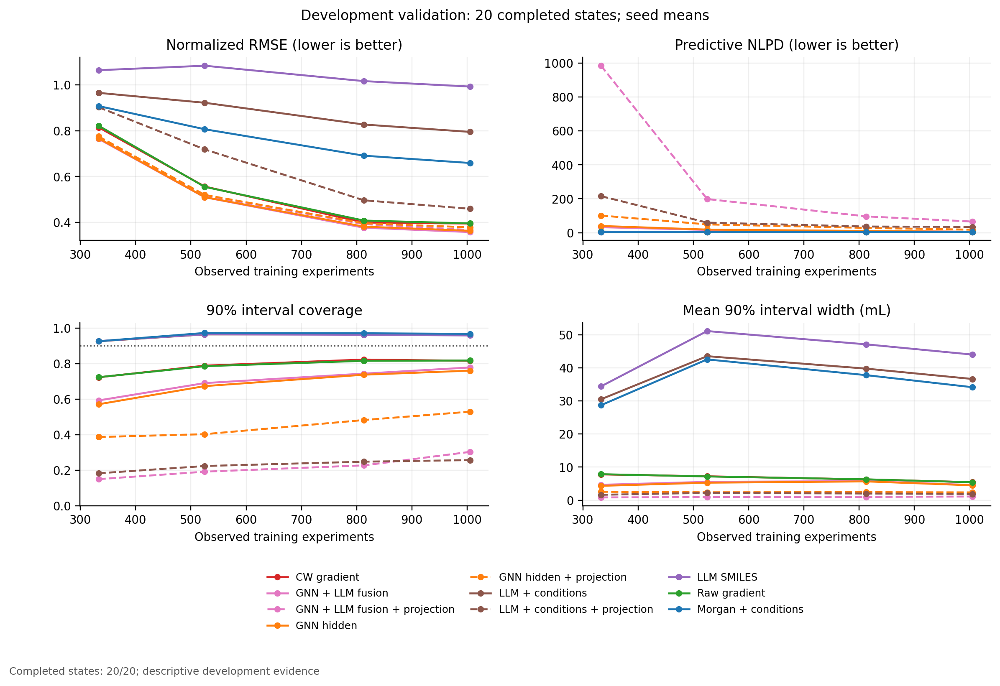

# 实验表示：响应预测、科学距离与文本鲁棒性

日期：2026-11-04。**当前为完整预定开发矩阵**：已完成 20/20 个seed×预算状态，720 次端点GP拟合。只汇总有complete回执的真实结果，不计未完成目录，不把预检重复计算为独立状态。

本地语言对照是 **Qwen1.5-0.5B-Chat的冻结decoder hidden state**，不是T5或语义embedding专用encoder。T5缺本地权重，未下载；本次只研究Frozen/Projection思路，没有执行GOLLuM主变体PLLMφ的语言模型微调。

评价来自既有416行validation，它参与过QGeoGNN checkpoint selection，因此全部为开发证据。五seed共享数据来源、四预算嵌套，20状态不能称20次统计独立重复。主指标为两个端点RMSE/L0标准差的均值；Projection先平均17/29/43三初始化，再平均端点，总体先在seed内平均已完成预算，再等权平均seed。±为seed样本SD，非置信区间。缺项时不同seed的预算组成可能不同，必须结合下表解释；配对比较只用共同状态。

| 开发seed | 已完成预算 | 计划预算 |
| --- | --- | --- |
| 157 | 333, 525, 813, 1005 | 333, 525, 813, 1005 |
| 887 | 333, 525, 813, 1005 | 333, 525, 813, 1005 |
| 2357 | 333, 525, 813, 1005 | 333, 525, 813, 1005 |
| 6101 | 333, 525, 813, 1005 | 333, 525, 813, 1005 |
| 12203 | 333, 525, 813, 1005 | 333, 525, 813, 1005 |

数值来源：[机器汇总](summary/summary.json)，SHA256 `c6eff9e4004835036fff1b454bdf3b9f7222124fc47e05c03eb95ce0d0613b9a`。方法与权限见[PROTOCOL.md](PROTOCOL.md)、[METHOD.md](METHOD.md)、[AUDIT.md](AUDIT.md)。

## 响应预测

| 表示/核 | L333主误差 | L525主误差 | L813主误差 | L1005主误差 |
| --- | --- | --- | --- | --- |
| CW Gradient / Linear | 0.8198 ± 0.1722 (n=5) | 0.5542 ± 0.1480 (n=5) | 0.4163 ± 0.0376 (n=5) | 0.4095 ± 0.0400 (n=5) |
| CW Gradient / Matérn | 0.8150 ± 0.1787 (n=5) | 0.5565 ± 0.1396 (n=5) | 0.3992 ± 0.0402 (n=5) | 0.3946 ± 0.0359 (n=5) |
| GNN+Qwen Fusion / Matérn | 0.7645 ± 0.1743 (n=5) | 0.5095 ± 0.1286 (n=5) | 0.3766 ± 0.0323 (n=5) | 0.3575 ± 0.0405 (n=5) |
| GNN+Qwen Fusion + Projection | 0.7720 ± 0.1666 (n=5) | 0.5170 ± 0.1244 (n=5) | 0.3924 ± 0.0375 (n=5) | 0.3664 ± 0.0453 (n=5) |
| GNN Hidden / Matérn | 0.7669 ± 0.1728 (n=5) | 0.5100 ± 0.1278 (n=5) | 0.3813 ± 0.0319 (n=5) | 0.3630 ± 0.0421 (n=5) |
| GNN Hidden + Projection | 0.7751 ± 0.1660 (n=5) | 0.5199 ± 0.1281 (n=5) | 0.3960 ± 0.0356 (n=5) | 0.3781 ± 0.0441 (n=5) |
| Qwen Conditions / Matérn | 0.9656 ± 0.2056 (n=5) | 0.9223 ± 0.1647 (n=5) | 0.8273 ± 0.1216 (n=5) | 0.7951 ± 0.1297 (n=5) |
| Qwen Conditions + Projection | 0.9029 ± 0.1813 (n=5) | 0.7187 ± 0.1282 (n=5) | 0.4963 ± 0.0626 (n=5) | 0.4593 ± 0.0632 (n=5) |
| Qwen SMILES / Matérn | 1.0646 ± 0.2351 (n=5) | 1.0841 ± 0.2004 (n=5) | 1.0169 ± 0.1802 (n=5) | 0.9931 ± 0.1882 (n=5) |
| Raw Gradient / Linear | 0.8231 ± 0.1679 (n=5) | 0.5521 ± 0.1577 (n=5) | 0.4266 ± 0.0378 (n=5) | 0.4074 ± 0.0417 (n=5) |
| Raw Gradient / Matérn | 0.8219 ± 0.1720 (n=5) | 0.5550 ± 0.1496 (n=5) | 0.4079 ± 0.0410 (n=5) | 0.3954 ± 0.0384 (n=5) |
| Structured / Matérn | 0.9080 ± 0.2212 (n=5) | 0.8067 ± 0.1495 (n=5) | 0.6912 ± 0.1020 (n=5) | 0.6592 ± 0.1047 (n=5) |

按同seed同预算比较，而不是用全体最低RMSE命名胜者。表中Linear是Raw/CW核敏感性控制，它复用Phase0三起点，与Matérn单起点优化预算不同；两者差异不能完全归因核族。

| 候选−对照 | 配对seed/状态 | Δ主误差 | 主误差下降seed | ΔNLPD | Δ90%覆盖 |
| --- | --- | --- | --- | --- | --- |
| LLM conditions - structured | 5/20 | 0.1113 | 0/5 | 0.0762 | -0.5 pp |
| LLM conditions - GNN | 5/20 | 0.3723 | 0/5 | -14.6175 | +26.9 pp |
| LLM conditions - SMILES | 5/20 | -0.1621 | 5/5 | -0.1658 | +0.1 pp |
| GNN - structured | 5/20 | -0.2610 | 5/5 | 14.6937 | -27.4 pp |

LLM conditions - structured：已完成共同状态的seed均值主误差上升，Δ=0.1113，0/5 seed方向为下降；NLPD差=0.0762。 当前没有主指标平均收益；不能用个别预算或初始化替代该结论。

LLM conditions - GNN：已完成共同状态的seed均值主误差上升，Δ=0.3723，0/5 seed方向为下降；NLPD差=-14.6175。 当前没有主指标平均收益；不能用个别预算或初始化替代该结论。 NLPD有所改善，需结合区间宽度判断是否主要来自更保守的方差；不把它等同均值优势。

LLM conditions - SMILES：已完成共同状态的seed均值主误差下降，Δ=-0.1621，5/5 seed方向为下降；NLPD差=-0.1658。 概率结论还需共同检查逐端点覆盖、宽度和初始化/优化稳定性。

Qwen SMILES-only使同分子不同实验条件具有相同向量，无法单独识别条件响应。Conditions改善或恶化必须相对这个对照和Structured/GNN一起解释；它不能仅由文本包含数字推定已学会数值含义。GNN Hidden保留任务监督信息，Raw/CW刻画参数敏感性，三者不是同一种表示。

## 严格单条件观测对

| seed | 变化轴 | 不同观测对 | 涉及分子 |
| --- | --- | --- | --- |
| 157 | 样品上样体积 | 39 | 32 |
| 157 | PE/EA | 137 | 66 |
| 157 | 加载溶剂体积 | 2 | 2 |
| 887 | 样品上样体积 | 39 | 32 |
| 887 | PE/EA | 113 | 76 |
| 887 | 加载溶剂体积 | 0 | 0 |
| 2357 | 样品上样体积 | 39 | 32 |
| 2357 | PE/EA | 123 | 73 |
| 2357 | 加载溶剂体积 | 0 | 0 |
| 6101 | 样品上样体积 | 39 | 36 |
| 6101 | PE/EA | 117 | 75 |
| 6101 | 加载溶剂体积 | 0 | 0 |
| 12203 | 样品上样体积 | 42 | 31 |
| 12203 | PE/EA | 136 | 80 |
| 12203 | 加载溶剂体积 | 1 | 1 |

条件对全部来自validation，当前GP未用其响应拟合，但该validation曾用于QGeoGNN选checkpoint。同一分子、其他实际记录条件完全一致，只有目标轴变化；不同预算复用同一validation，对数不能乘四。加载溶剂体积只有极少数分子支持，零对seed为不可评，不能把缺失当零误差。

| 表示/核 | 变化轴 | 距离/训练RMS | \|真实Δ\| mL | GP差分误差 mL | GNN差分误差 mL | 距离−\|真实Δ\|ρ | seed数 |
| --- | --- | --- | --- | --- | --- | --- | --- |
| CW Gradient / Linear | 加载溶剂体积 | 8.06e-05 | 1.7448 | 1.7442 | 1.7430 | 1.0000 | 2 |
| CW Gradient / Linear | PE/EA | 0.7769 | 7.5091 | 3.8440 | 3.2400 | 0.6640 | 5 |
| CW Gradient / Linear | 样品上样体积 | 0.0001 | 1.4999 | 1.4999 | 1.4909 | 0.0906 | 5 |
| CW Gradient / Matérn | 加载溶剂体积 | 8.06e-05 | 1.7448 | 1.7446 | 1.7430 | 1.0000 | 2 |
| CW Gradient / Matérn | PE/EA | 0.7769 | 7.5091 | 3.5392 | 3.2400 | 0.6640 | 5 |
| CW Gradient / Matérn | 样品上样体积 | 0.0001 | 1.4999 | 1.4999 | 1.4909 | 0.0906 | 5 |
| GNN+Qwen Fusion / Matérn | 加载溶剂体积 | 0.0474 | 1.7448 | 1.7495 | 1.7430 | 1.0000 | 2 |
| GNN+Qwen Fusion / Matérn | PE/EA | 0.6102 | 7.5091 | 3.2405 | 3.2400 | 0.5289 | 5 |
| GNN+Qwen Fusion / Matérn | 样品上样体积 | 0.2118 | 1.4999 | 1.3446 | 1.4909 | 0.1541 | 5 |
| GNN+Qwen Fusion + Projection | 加载溶剂体积 | 0.0233 | 1.7448 | 1.7374 | 1.7430 | 1.0000 | 2 |
| GNN+Qwen Fusion + Projection | PE/EA | 0.5559 | 7.5091 | 3.3377 | 3.2400 | 0.7072 | 5 |
| GNN+Qwen Fusion + Projection | 样品上样体积 | 0.2115 | 1.4999 | 1.5241 | 1.4909 | 0.1945 | 5 |
| GNN Hidden / Matérn | 加载溶剂体积 | 0.0003 | 1.7448 | 1.7430 | 1.7430 | 1.0000 | 2 |
| GNN Hidden / Matérn | PE/EA | 0.7692 | 7.5091 | 3.2431 | 3.2400 | 0.5767 | 5 |
| GNN Hidden / Matérn | 样品上样体积 | 0.0011 | 1.4999 | 1.4917 | 1.4909 | 0.0956 | 5 |
| GNN Hidden + Projection | 加载溶剂体积 | 0.0005 | 1.7448 | 1.7421 | 1.7430 | 1.0000 | 2 |
| GNN Hidden + Projection | PE/EA | 0.6229 | 7.5091 | 3.3913 | 3.2400 | 0.6994 | 5 |
| GNN Hidden + Projection | 样品上样体积 | 0.0015 | 1.4999 | 1.4882 | 1.4909 | 0.0911 | 5 |
| Qwen Conditions / Matérn | 加载溶剂体积 | 0.0965 | 1.7448 | 1.4372 | 1.7430 | 1.0000 | 2 |
| Qwen Conditions / Matérn | PE/EA | 0.2103 | 7.5091 | 7.1121 | 3.2400 | 0.2535 | 5 |
| Qwen Conditions / Matérn | 样品上样体积 | 0.2936 | 1.4999 | 2.3212 | 1.4909 | 0.1512 | 5 |
| Qwen Conditions + Projection | 加载溶剂体积 | 0.0884 | 1.7448 | 1.5371 | 1.7430 | 1.0000 | 2 |
| Qwen Conditions + Projection | PE/EA | 0.6824 | 7.5091 | 4.4941 | 3.2400 | 0.4233 | 5 |
| Qwen Conditions + Projection | 样品上样体积 | 0.3053 | 1.4999 | 2.8261 | 1.4909 | 0.1052 | 5 |
| Qwen SMILES / Matérn | 加载溶剂体积 | 0.0000 | 1.7448 | 1.7448 | 1.7430 | NA | 2 |
| Qwen SMILES / Matérn | PE/EA | 0.0000 | 7.5091 | 7.5091 | 3.2400 | NA | 5 |
| Qwen SMILES / Matérn | 样品上样体积 | 0.0000 | 1.4999 | 1.4999 | 1.4909 | NA | 5 |
| Raw Gradient / Linear | 加载溶剂体积 | 7.87e-05 | 1.7448 | 1.7445 | 1.7430 | 1.0000 | 2 |
| Raw Gradient / Linear | PE/EA | 0.7532 | 7.5091 | 3.8333 | 3.2400 | 0.6732 | 5 |
| Raw Gradient / Linear | 样品上样体积 | 0.0001 | 1.4999 | 1.4998 | 1.4909 | 0.0870 | 5 |
| Raw Gradient / Matérn | 加载溶剂体积 | 7.87e-05 | 1.7448 | 1.7447 | 1.7430 | 1.0000 | 2 |
| Raw Gradient / Matérn | PE/EA | 0.7532 | 7.5091 | 3.5666 | 3.2400 | 0.6732 | 5 |
| Raw Gradient / Matérn | 样品上样体积 | 0.0001 | 1.4999 | 1.4998 | 1.4909 | 0.0870 | 5 |
| Structured / Matérn | 加载溶剂体积 | 0.1592 | 1.7448 | 2.0814 | 1.7430 | 1.0000 | 2 |
| Structured / Matérn | PE/EA | 0.6061 | 7.5091 | 6.6209 | 3.2400 | 0.1609 | 5 |
| Structured / Matérn | 样品上样体积 | 0.3205 | 1.4999 | 1.8478 | 1.4909 | 0.1062 | 5 |

差分误差为`|(y_B−y_A)−(pred_B−pred_A)|`。距离按训练侧centered向量RMS归一；Projection行使用真实学习后空间。小距离若伴随很小真实差分，并不足以判表示失败；小距离同时出现较大真实差分与较大差分误差，才支持未表达该响应方向的诊断。表格同时给出这三项，未事后设一个有利的小距离阈值。不同轴的实际变化幅度/单位不同，距离比不是物理导数，相关也不证明因果；row pairs与seed可能共享分子，ρ不带独立pair显著性。

样品上样体积：CW Gradient距离0.0001、平均|真实Δ|=1.4999 mL、差分误差=1.4999 mL（两均值之比1.00）；GNN Hidden距离0.0011、平均|真实Δ|=1.4999 mL、差分误差=1.4917 mL（两均值之比0.99）；Qwen Conditions距离0.2936、平均|真实Δ|=1.4999 mL、差分误差=2.3212 mL（两均值之比1.55）；Raw Gradient距离0.0001、平均|真实Δ|=1.4999 mL、差分误差=1.4998 mL（两均值之比1.00）。这个比值只把差分误差与该轴响应变化放在一起，不是预注册的通过阈值；更大的embedding距离也可能伴随更差的真实差分预测。

PE/EA：CW Gradient距离0.7769、平均|真实Δ|=7.5091 mL、差分误差=3.5392 mL（两均值之比0.47）；GNN Hidden距离0.7692、平均|真实Δ|=7.5091 mL、差分误差=3.2431 mL（两均值之比0.43）；Qwen Conditions距离0.2103、平均|真实Δ|=7.5091 mL、差分误差=7.1121 mL（两均值之比0.95）；Raw Gradient距离0.7532、平均|真实Δ|=7.5091 mL、差分误差=3.5666 mL（两均值之比0.47）。这个比值只把差分误差与该轴响应变化放在一起，不是预注册的通过阈值；更大的embedding距离也可能伴随更差的真实差分预测。

加载溶剂体积：CW Gradient距离8.06e-05、平均|真实Δ|=1.7448 mL、差分误差=1.7446 mL（两均值之比1.00）；GNN Hidden距离0.0003、平均|真实Δ|=1.7448 mL、差分误差=1.7430 mL（两均值之比1.00）；Qwen Conditions距离0.0965、平均|真实Δ|=1.7448 mL、差分误差=1.4372 mL（两均值之比0.82）；Raw Gradient距离7.87e-05、平均|真实Δ|=1.7448 mL、差分误差=1.7447 mL（两均值之比1.00）。这个比值只把差分误差与该轴响应变化放在一起，不是预注册的通过阈值；更大的embedding距离也可能伴随更差的真实差分预测。

## 等义模板扰动

固定A模板拟合的Qwen Conditions GP直接输入B模板；没有重训或由B评分调参。两模板的原始数字、单位、分子及实验含义相同，变化只是措辞。以下是256个冻结合法U候选的平均描述；不读取候选响应。当前只检查固定Qwen Conditions GP，未完成Projection/Fusion模板稳健性验证。

| seed数 | 模板距离/训练RMS | 最近10邻居重叠 | V1均值变化 mL | V2均值变化 mL | V1方差ρ | V2方差ρ | V1 MaxVar32重叠 | V2 MaxVar32重叠 |
| --- | --- | --- | --- | --- | --- | --- | --- | --- |
| 5 | 5.5074 | 69.8% | 4.1082 | 10.9365 | -0.0580 | -0.0572 | 9.4% | 9.7% |

| 端点 | MaxVar采集分数绝对变化均值 mL² |
| --- | --- |
| V1 | 600.2872 |
| V2 | 3815.5031 |

邻居或方差排序变化说明文本形式进入了数值决策链；即使输入语义等价，也不能默认采集稳定。MaxVar重叠只是一种采集信号检查，未证明IVR/BatchIG或真实AL的模板鲁棒性。

逐行已授权开发差分见summary/contrasts.csv；预算、端点及初始化明细见summary的metrics/state_metrics表。本报告不构成真实新实验或主动学习效果证据。
