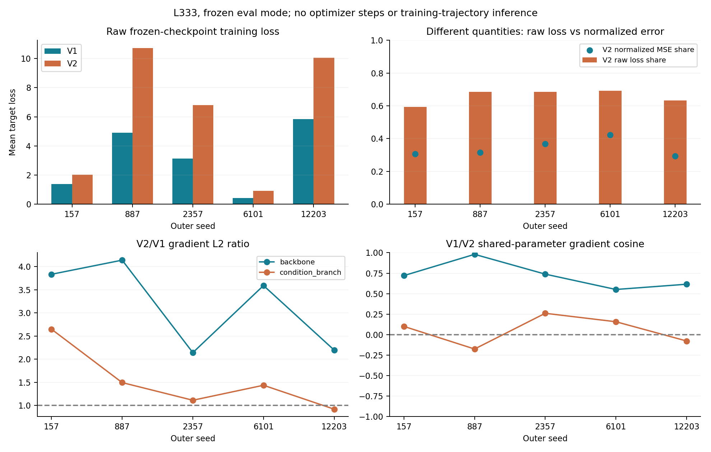
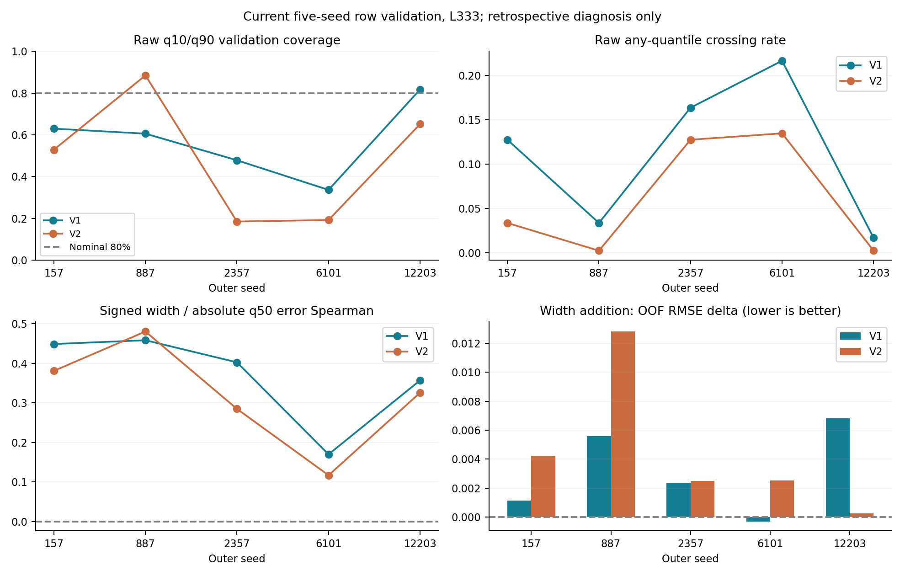

# 4g QGeoGNN-V2 分位数与损失离线诊断

科学状态：`NEW_OFFLINE_MEASURED`。本报告只分析既有训练快照；没有改模型、loss、训练配置或AL方法，没有optimizer step、LLM请求、新选点或标签揭示。

## 证据边界与真正缺口

已阅读并按固定提交 `16eca74769f664bc378a58ccbf380a806723f587` 复核 A0 指定的 training/predictor.py、独立六输出 model、uncertainty/quantiles.py、最终4g资格报告QUANTILE_AUDIT、8g loss-controls、R0/R1 regression ladder以及 point_metrics。文件SHA见 `INPUT_AND_CODE_HASHES.json` 的 `historical_evidence`。

`HISTORICAL_MEASURED`：资格报告已测过 seeds42/525/1101 × row/compound 的交叉、覆盖、宽度-误差相关性和top20富集，已披露test aggregate只在 `historical_reuse.csv` 重用，未重复前向或读取其test标签。row历史V1/V2覆盖均值约0.722/0.691，compound约0.638/0.463；不能直接套到当前AL回合。

8g对照研究是在4g pretrained→8g微调背景比较0.5/1/SD归一化，3seed×2split，不能作为纯4g AL的权重因果证据。R0→R1还同时改变shuffle、weight decay与checkpoint选择目标，也不能隔离loss权重。当前loss仍是每目标q10 pinball + q50 MSE + q90 pinball + 两个soft crossing，V1/V2等权。q50并非严格pinball中位数；其统计解释是MSE目标下的中心预测，不能宣称已校准条件中位数。

本次填补缺口：当前五个AL outer seeds 157/887/2357/6101/12203、L333、row、每seed333个已授权L0训练行和416个validation行。只读checkpoint/partition/纯结构graphcache均匹配已有冻结SHA。canonical CSV按sample_id与角色先过滤，再转换目标字符串；U0/test目标转换数均为0。输出只含aggregate，不保存单行真实标签/预测到Git。

这些模型只用了L333标签，covariate scaler来自冻结outer-train X、target sigma来自L0；资格报告则是不同3seed、全source训练预算且披露的是test。训练状态、划分、角色和尺度估计人口均不同，不作直接优劣归因。L525/L1005/L1485、当前compound AL和same-seed K3ensemble控制为 `NOT_MEASURED`。完整逐项状态见 `MEASUREMENT_STATUS.csv`。

## A1：raw loss、归一化误差与梯度贡献

`NEW_OFFLINE_MEASURED`：对固定checkpoint保持eval模式，在全部L0行分块前向/反向，按行数加权累积每目标每组件梯度，测共享backbone与condition分支；所有模型参数/缓冲哈希前后相同。loss组件及分组L2见 `loss_components.csv`；raw loss份额、train-only sigma、validation RMSE/NRMSE及normalized squared贡献见 `loss_scale_contributions.csv`。CSV的mean_loss在两个参数组重复用于对齐，汇总只取一组，不对这两份scalar叠加。两目标未经尺度标准化训练，而validation combined NRMSE为 `sqrt(0.5*((RMSE1/sigma1)^2+(RMSE2/sigma2)^2))`，二者不是同一统计量。

| seed | V1_raw_total_loss | V2_raw_total_loss | V2_raw_loss_share | V2_normalized_train_squared_error_share | validation_combined_nrmse |
| --- | --- | --- | --- | --- | --- |
| 157 | 1.3847 | 2.0221 | 0.5936 | 0.3076 | 0.8539 |
| 887 | 4.9064 | 10.7207 | 0.6860 | 0.3148 | 0.5846 |
| 2357 | 3.1299 | 6.8006 | 0.6848 | 0.3683 | 0.6420 |
| 6101 | 0.4119 | 0.9252 | 0.6919 | 0.4233 | 1.0209 |
| 12203 | 5.8315 | 10.0580 | 0.6330 | 0.2929 | 0.6557 |

| seed | parameter_group | V2_to_V1_gradient_norm | cosine | gradient_conflict |
| --- | --- | --- | --- | --- |
| 157 | backbone | 3.8364 | 0.7206 | False |
| 157 | condition_branch | 2.6500 | 0.1008 | False |
| 887 | backbone | 4.1420 | 0.9799 | False |
| 887 | condition_branch | 1.4960 | -0.1751 | True |
| 2357 | backbone | 2.1431 | 0.7383 | False |
| 2357 | condition_branch | 1.1142 | 0.2607 | False |
| 6101 | backbone | 3.5930 | 0.5512 | False |
| 6101 | condition_branch | 1.4382 | 0.1576 | False |
| 12203 | backbone | 2.1982 | 0.6153 | False |
| 12203 | condition_branch | 0.9213 | -0.0771 | True |

这五个冻结eval状态中，backbone的V2/V1梯度范数比都大于1（2.143–4.142），平均约3.183；backbone余弦均为正。condition分支更异质：2/5个seed余弦为负，且并非每seed都由V2拥有更大梯度范数。原始V2标签/RMSE较大不能单独推出这些结论，结论来自实际导数测量。

`NOT_MEASURED`：实际Adam更新竞争和整个训练轨迹谁“主导优化”。本次没有优化器momentum/逐epoch状态回放，也未执行参数更新；eval梯度与train-mode BatchNorm导数可能不同。CSV的gradient-conflict与对合并梯度的内积只是方向诊断，不是Adam更新或因果权重实验证明。改变V2权重是否有益仍为 `HYPOTHESIS`，本次不改权重。



## A2：原始分位数可靠性

以下全部在排序或后处理之前从原始六输出计算；严格 `>` 与精确数值相等 `==` 分开记录，负宽度保持有符号。q10/q90 pinball、q50误差、mean/median signed与clipped width、三个精确相等率均在 `quantile_metrics.csv`。

| seed | target | q10_gt_q50_rate | q50_gt_q90_rate | negative_width_rate | central80_coverage | signed_width_mean | signed_width_median |
| --- | --- | --- | --- | --- | --- | --- | --- |
| 157 | V1 | 0.0048 | 0.1226 | 0.0000 | 0.6298 | 5.6482 | 4.7833 |
| 157 | V2 | 0.0337 | 0.0000 | 0.0000 | 0.5288 | 7.5576 | 6.8528 |
| 887 | V1 | 0.0048 | 0.0288 | 0.0000 | 0.6058 | 5.1184 | 4.1389 |
| 887 | V2 | 0.0000 | 0.0024 | 0.0000 | 0.8846 | 23.7174 | 19.7305 |
| 2357 | V1 | 0.0769 | 0.0913 | 0.0192 | 0.4784 | 3.5677 | 2.5301 |
| 2357 | V2 | 0.0505 | 0.0793 | 0.0072 | 0.1851 | 1.7990 | 1.4238 |
| 6101 | V1 | 0.1106 | 0.1202 | 0.0385 | 0.3365 | 1.6436 | 1.2298 |
| 6101 | V2 | 0.0697 | 0.0649 | 0.0048 | 0.1923 | 1.6134 | 1.4116 |
| 12203 | V1 | 0.0168 | 0.0000 | 0.0000 | 0.8173 | 9.6399 | 8.5902 |
| 12203 | V2 | 0.0024 | 0.0000 | 0.0000 | 0.6514 | 14.5823 | 12.7457 |

当前validation的80%名义区间覆盖波动很大：V1为0.337–0.817，V2为0.185–0.885，不能笼统称为已校准80%区间。按L0响应四分位阈值与事后validation误差四分位分组的覆盖见 `coverage_groups.csv`；后者是描述性难度分层，不能用于策略选择或盲确认。

`sorting_*` 字段单独比较推理排序前后q50变动率、平均绝对变动和MAE/RMSE。排序会替换交叉行的中心输出，它只是后处理，不是模型内部硬约束；任何排序结果都未覆盖原始交叉率、误差或历史冻结报告。

## A3：宽度的增量困难样本信息

分别保存并按L0 sigma标准化 `w1=V1_q90-V1_q10`、`w2=V2_q90-V2_q10`，保留截零版本和crossing标志。`signal_diagnostics.csv` 含 signed/clipped width 对标准化绝对q50误差的Spearman、Top20% error enrichment、AUSE，以及与latent到L0距离、完整网络归一化q50梯度范数、9D条件覆盖距离和q50值的相关性/Top20重叠。Top20大小固定ceil(20%×n)，平局按原输入顺序。AUSE明确使用0..0.9十个固定剔除比例的归一化retained-MAE差面积。

增量检验使用固定 `SHA256(canonical_smiles) mod 5` 分组折，化学组不跨折；每折标准化只在辅助模型训练折拟合，ridge固定为1，不调参。对每个seed/target在validation内部做事后OOF困难度预测。baseline包含两目标q50/sigma、latent distance、两目标完整网络q50梯度norm及9D条件信号/距离，再加入signed/clipped widths和crossing flags。**这里的“留出”只针对辅助ridge；validation之前已用于选择原GNN checkpoint，不是独立盲确认数据。**

| seed | target | baseline_oof_rmse | with_width_oof_rmse | rmse_delta_with_minus_base |
| --- | --- | --- | --- | --- |
| 157 | V1 | 0.6578 | 0.6589 | 0.0011 |
| 157 | V2 | 0.5480 | 0.5522 | 0.0042 |
| 887 | V1 | 0.4397 | 0.4453 | 0.0056 |
| 887 | V2 | 0.4623 | 0.4751 | 0.0128 |
| 2357 | V1 | 0.4010 | 0.4033 | 0.0024 |
| 2357 | V2 | 0.5834 | 0.5859 | 0.0025 |
| 6101 | V1 | 0.8545 | 0.8542 | -0.0003 |
| 6101 | V2 | 0.7628 | 0.7653 | 0.0025 |
| 12203 | V1 | 0.5837 | 0.5905 | 0.0068 |
| 12203 | V2 | 0.4626 | 0.4629 | 0.0003 |

| target | mean | lower95 | upper95 |
| --- | --- | --- | --- |
| V1 | 0.0031 | 0.0008 | 0.0054 |
| V2 | 0.0045 | 0.0015 | 0.0087 |

在这组固定辅助模型和可获得控制信号下，加入宽度未改善困难度预测，平均OOF RMSE反而增大：V1 +0.00312、V2 +0.00447。这只是当前L333/row/固定ridge规格下没有观察到增量收益；不能证明宽度在所有非线性模型、预算或策略下都无信息。

`NOT_MEASURED`：匹配的same-seed、same-budget K=3 ensemble disagreement控制。没有将不同outerseed模型混合成伪ensemble，因此不能声称已经控制所有已知AL信号。bootstrap按5个seed聚合而非把所有行当独立样本；区间仅描述同一复用数据集和固定预算下的seed变异，不是新数据总体或学习效率的置信区间。

单独记录 `V2_q90-V1_q10` 的离线相关性。它等于 `(V2_q50-V1_q50)+(V2_q90-V2_q50)+(V1_q50-V1_q10)`，同时含洗脱过程中心跨度和两端边际；不是纯epistemic uncertainty，也不是 `(V2-V1)` 的一个有效分位数，不能据此解释80% coverage。



## 可复现性与结论边界

代码、输入manifest、checkpoint/partition/graphcache来源及SHA、每seed参数/缓冲state前后哈希在 `INPUT_AND_CODE_HASHES.json`。原始授权标签、checkpoint和图仅放在独立只读私有scratch快照，不进入本报告Git目录。本次真实测量实际使用独立Git快照 `4ee480378b0293f1985e3ee4a09df2c78f77901e`。另外逐文件证明14个科学依赖文件与main祖先 `16eca74769f664bc378a58ccbf380a806723f587` 原字节完全一致，证书见 `main_ancestor_recovery`。因此 main-only 复现可从16eca恢复相同科学代码，不依赖B分支或其可编辑API。浅克隆若缺少固定历史对象，须先显式取回16eca；本程序不会自动fetch/pull或改工作树。只读恢复输入的独立演练已通过，未为此重跑诊断。运行示例：

```sh
python prepare_inputs.py --repository /path/to/main/repository --destination /private/tmp/fresh_quantile_snapshot
KMP_DUPLICATE_LIB_OK=TRUE OMP_NUM_THREADS=1 OPENBLAS_NUM_THREADS=1 MKL_NUM_THREADS=1 PYTHONDONTWRITEBYTECODE=1 \
python run_audit.py --snapshot-manifest /private/tmp/fresh_quantile_snapshot/data/MANIFEST.json \
  --legacy-source /private/tmp/fresh_quantile_snapshot/code --output /path/to/diagnosis
python render_report.py --repository /path/to/original/repository --output /path/to/diagnosis
```

新核心诊断的9项合成安全/数值测试通过。**没有执行QGeoGNN训练、付费LLM、U/test目标读取、真实选点接受或标签揭示。**

`HYPOTHESIS`：宽度能否改善AL AULC或达到给定误差所需标签数，仍须等当前CW-Free结束并获新授权后开展预注册、匹配seed/budget的正式对照。当前offline富集、OOF或梯度事实均不构成学习效率或loss权重因果结论。
