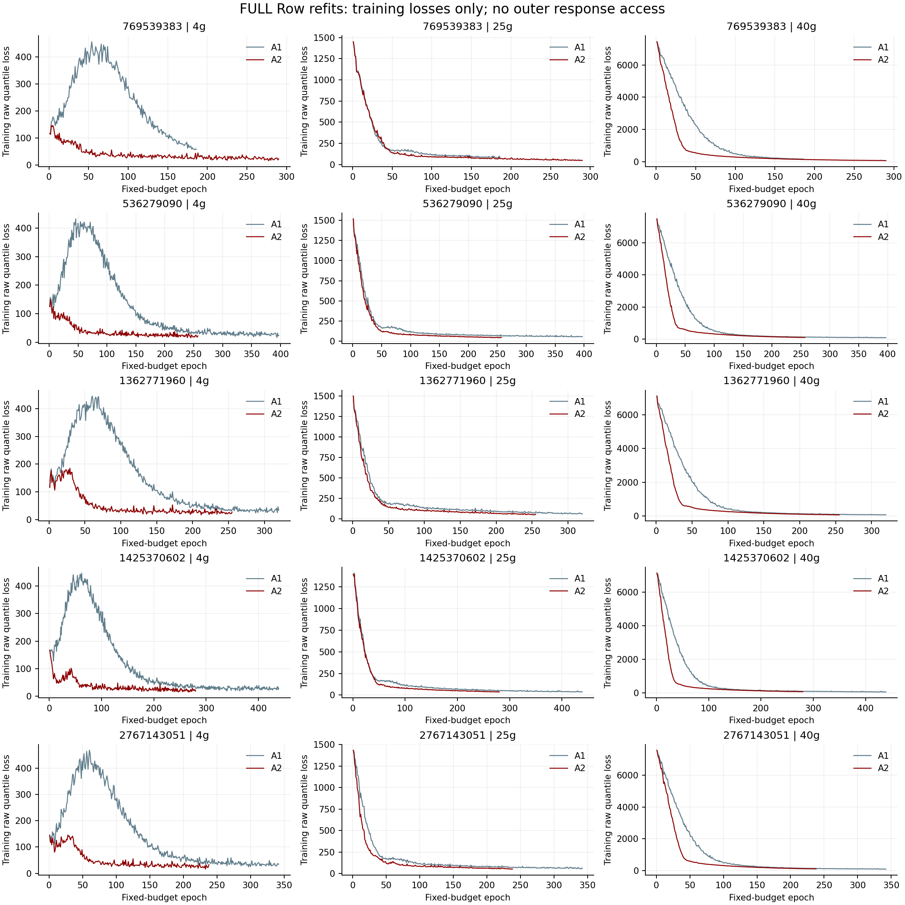

# Phase 3A：FULL-data 重训与盲预测冻结

日期：2026-10-14（Asia/Shanghai）。**10/10 次最终重训完成，40/40 个盲预测文件已冻结。未解析任何外层 validation/test 真实响应，未调用 outer score，未进入 Phase 3B。**

## 执行前核验与固定预算

只读复核全部50次Row-CV拟合、100个目标柱结果、每seed/arm五个joint best_epoch、原最早argmin、checkpoint、BN buffers、冻结参数、真实步数和确定性折身份。原Phase1的43个归档根文件、110个runtime文件，历史研究1069文件，以及Phase2的56个报告产物哈希均保持不变。详见 PHASE3A_INPUT_AUDIT.json；Phase1/2原报告仍保留，不回写。

8项Phase3A测试通过（TEST_RESULTS_PHASE3A.txt）：A1/A2三步合成数据更新与原fixed_epochs refit逐位一致，特征白名单、train-only标签请求、完全无标签重放、FULL身份授权、非法joint预算及预测schema/有限性守卫均通过。首次测试中修正了pandas测试夹具的浮点类型声明；发生在真实训练前，不改变任何训练设置。

每个arm使用自己五折joint best_epoch的round-half-up中位数，从同一个4g源checkpoint重新构建。实际optimizer.step逐次累加；以下全为1 step/epoch。两个arm的共同初始张量与共同epoch样本身份调度完全一致，A1/A2允许不同预算。这测量完整Row-CV选择加FULL refit流程，不是equal-step FiLM模块的净效应。

| seed | A1 epochs | A1 steps | A2 epochs | A2 steps | source_train | 25g train | 40g train |
| --- | --- | --- | --- | --- | --- | --- | --- |
| 769539383 | 186 | 186 | 290 | 290 | 3330 | 320 | 364 |
| 536279090 | 397 | 397 | 257 | 257 | 3330 | 326 | 348 |
| 1362771960 | 320 | 320 | 255 | 255 | 3330 | 315 | 361 |
| 1425370602 | 439 | 439 | 280 | 280 | 3330 | 327 | 354 |
| 2767143051 | 342 | 342 | 238 | 238 | 3330 | 320 | 359 |

全部五折epoch、最终预算、实际步数、每柱标签身份hash、模型文件SHA256及包含BN buffers的状态张量SHA256见 FINAL_REFIT_MANIFEST.csv、各run/fit.json。总计 **3004 optimizer steps**，FINAL_TRAINING_HISTORY.csv含3004个实际epoch。

## 数据与模型边界

FULL严格等于原Row split中全部合格目标gradient_train，包含原pool，外层validation/test均排除；没有将完整原始CSV作为监督人口。4g仅解析固定3330条source_train标签。目标仍为408/456条过滤人口，逐seed实际train数量见上表。label_access.json保存实际请求身份与数量，training_identities.csv逐arm保存全部标签身份；源validation标签也未解析。

输入仅解析原七列白名单，排除t1/t2、verified times和其他冗余终点。标签reader先读取sample_id，然后通过skiprows仅解析获准训练行的V1_ml/V2_ml。外层输入图的y全为零，独立truth数组全为NaN；checkpoint重放loader完全不读取标签。文件SHA256需要读取原CSV字节，这不等于解析外层响应；本报告的“未访问终点”指未解析、使用或评分任何外层真实终点。

直接复用冻结原模型、Adam、pretrained/new学习率、weight decay、raw_quantile损失、mixed late BN、frozen-prefix cache、balanced-task batcher、FiLM16维与block3/4作用位置。固定refit不接收validation，不运行early stopping；patience80仍属于冻结内层选择，不能用它提前停止最终预算。未新增PCGrad、calibration head、搜索或equal-step候选。

## 完整状态、盲预测与冻结验证

最终checkpoint位于 `runtime/final_row_aligned/seed_<seed>/<A1|A2>/final.pt`；每个checkpoint完整保存model_state_dict及BN running_mean/running_var/num_batches_tracked。各run分别保存25g/40g的validation/test六输出盲预测CSV，没有真实响应列。源checkpoint SHA256为 `fce9edebc294fd179c7c7dc27ab2badea049c77fdad03a6cf0c317c63df544b0`，原split SHA256为 `33e079a2b7250a82b040605bddb372646ab424684268b5b0c63df6366194a0a3`。

全部40个文件的列顺序、身份顺序、记录数、有限性和原输出截断均通过检查，共 **1852 条预测记录**（两个arm、多seed重复身份，非独立实验数）。十个checkpoint重新加载后在**零标签输入**上重放40个上下文，最大绝对差 **2.84e-14 mL**；最终状态tensor digest、文件digest、固定预算和BN步数完全一致。见 FINAL_CHECKPOINT_REPLAY.csv。

所有最终权重、预测、训练身份、label receipt及汇总文件在 PREDICTION_FREEZE_MANIFEST.json 中hash锁定；清单通过immutable write写入，冻结文件设置只读。再次读取与hash验证通过；完成后的入口只验证冻结，不重复训练或改写预测。任何后续不一致须停止，不能根据评分修补已有文件。

## 数值与收敛限制

没有非有限loss/gradient/预测、checkpoint不一致、冻结参数或BN故障。训练损失完整曲线见下图，首轮/末轮和末20轮均值/SD见 FINAL_TRAINING_DIAGNOSTICS.csv。固定预算全部小于500，没有提高上限；固定预算完成不等于已证明充分收敛。保留pilot A2内层一折best_epoch=500的右截断边界，不据此延长最终预算。

训练loss并非所有任务都单调下降：A1五个seed的4g source训练loss均先升后降，峰值约432–468，位于46–62 epoch，最终约24–58；详细峰值/epoch已加入训练诊断表。源任务与目标任务处于同一等权原始loss及混合BN优化中，这里只描述观察，不据此改变权重、BN或训练预算，也不利用外层响应诊断其原因。

原输出实现仅有ReLU和eval clamp[0,1e8]，并不保证每行分位数单调或V2≥V1；本阶段没有新增排序、投影或校准。盲输出诊断中，V1/V2分位数交叉计 **3 个端点-记录组合**，V2低于V1计 **0 个分位点-记录组合**；重复seed/arm记录分别计数，明细见 BLIND_PREDICTION_SHAPE_AUDIT.csv。这些是已有输出结构的可见属性，不涉及读取真实响应，也不参与模型或epoch选择。

三条交叉均发生于seed1425370602的25g test V1：A1一条，A2两条，都是q50大于q90。逐条身份和原始预测见 BLIND_QUANTILE_CROSSINGS.csv。保留这些负诊断，不对冻结预测排序或修补。

## 后续评价与基线异常

EVALUATION_PLAN.md在拟合前锁定，主要test评价按柱分别报告五seed均值、paired-seed gain与gain of means、seed wins、V1/V2 RMSE/MAE、Center/Width、train-80% tail与最大误差。validation单列次要描述，不与test合并。全部方法必须使用同一FULL gradient_train尺度与同一test身份。FiLM/A1、多任务/简单校准、均值/尾部代价是三个不同问题。

历史基线审查只读元数据、冻结哈希与sample_id，未读响应或评分表。Scale与P0/P1共30个柱×seed×method上下文通过FULL Row身份/冻结检查；后两者使用Group-CV，是不同选择工作流参考，不能归因于单一结构。Affine没有找到兼容FULL冻结证据，paper-style等旧outer-validation选择工作流不进入主要同协议对照。

HIER的目标角色和两柱训练union身份相同，但其冻结provenance存在以下差异，因此**排除HIER直接对照，不修复或重建历史产物**：

- `src/qgeognn_al/transfer/hierarchical_cw_corrected.py`：冻结期望 `f4ff5c45f14808271256b52dfd04f395873f26ba6a46ed30ed0f7db230f28768`，当前 `9e99aa29aa358fb11d30e619ab979705f916b962fe921635626d81e27ac60dbb`。

审查结论和具体预测hash保存于 PHASE3A_BASELINE_COMPATIBILITY.json，后续须再次核验。此异常不涉及A1/A2被冻结训练依据；A1/A2主比较的Phase3B前置条件已满足。

## 科学解释与停止

历史Row外层及Phase1/2结果已曝光，本研究为开发性方法诊断，未来外层结果不能称独立外部确认。五seed共享历史数据，不当作五次独立物理重复，不做不合理的独立样本显著性检验。Phase2的25g V1 tail平均恶化约1.98%、40g V2 MAE微增及最大误差负结果均继续保留；本阶段盲预测不能判断这些问题是否改善。

**Phase3A完成并停止。** 已满足执行预定A1/A2 Phase3B的技术前置条件，但未执行任何新外层评分，仍等待用户下一步确认；不能据此选择唯一最终arm或宣称旧40g外层退化已修复。
