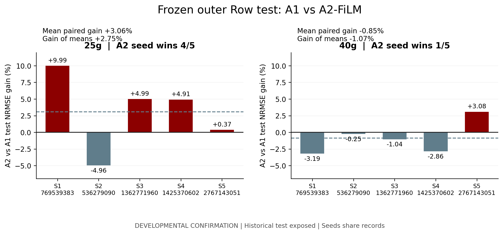
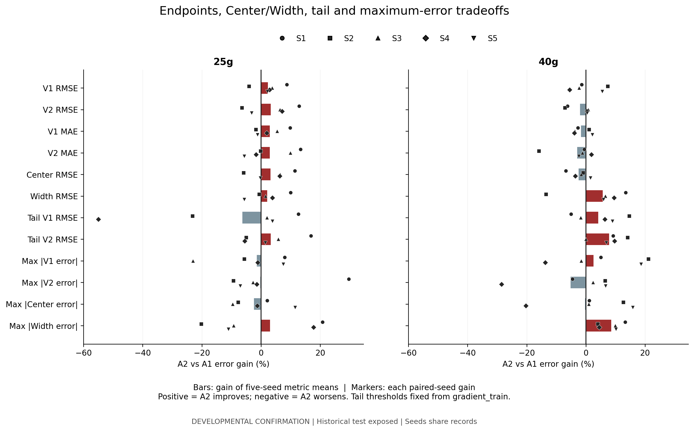
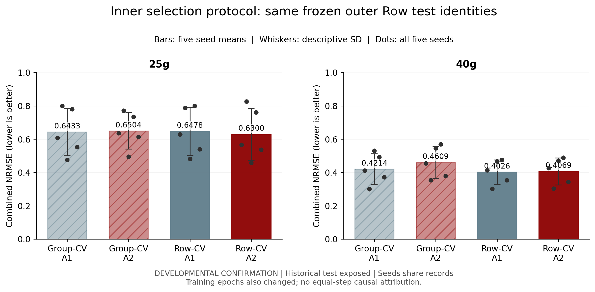

# Phase 3B：最终 Row 外层评分与研究收尾

日期：2026-10-14（Asia/Shanghai）。**本次完成一次预定 test 评分，未训练、修改checkpoint、修补预测或启动新候选。最终判定为 C：内部改善未稳定转化为跨柱外层收益。** 25g有局部收益，40g仍出现内部到外层的收益落差；这不是两柱均退化的结论。

## 冻结、评价计划与一次评分边界

在读取任何test响应之前，十个refit、四十个预测上下文/1852条记录、SHA256、六输出列顺序、完整状态/BN、原Row角色身份、训练标签身份、最终epoch和实际steps全部核验通过，冻结文件仍只读。Phase3A的137个冻结文件、Phase2的56个报告文件、原Phase1归档及历史1069文件不变。具体证据见 PHASE3B_PREFLIGHT_AUDIT.json、PHASE3B_SCORE_MANIFEST.json 和最终完整性清单。

EVALUATION_PLAN.md为唯一评分口径，与本轮指令没有实质冲突。仅评分 **test**，validation盲预测同样经过身份/有限性检查，但未解析validation真实终点，也未与test混合。先按每seed/柱gradient_train重算V1/V2 SD(ddof=0)和80% tail阈值并与Phase3A保存值核对，再只读取十个获准test上下文，共860条跨seed记录（重复记录并非独立重复）。标准point_metrics/metric_rows来自原项目，没有重新定义NRMSE、使用test尺度或重新选tail阈值。

冻结计划要求的最大误差和Tail均报告；新增R²使用同一项目标准实现。4项合成测试通过，验证标准指标、tail包含阈值边界/空tail=NA、两种改善率不同及评分前冻结边界。评分入口遇到已有完成receipt只校验结果，不重复读取标签或评分。所有新结果通过清单锁定，原冻结预测保持不变。

## 主要结果：新 Row-CV → FULL refit → Row test

SD为五seed描述性标准差(ddof=1)，不表示五次独立物理重复或置信区间。paired gain = mean_seed(1−A2/A1)，gain of means = 1−mean_seed(A2)/mean_seed(A1)，正值为A2改善。

| column | arm | mean_NRMSE | seed_SD | paired_gain_% | gain_of_means_% | A2_seed_wins |
| --- | --- | --- | --- | --- | --- | --- |
| 25g | A1 | 0.6478 | 0.1434 | 3.0612 | 2.7545 | 4 |
| 25g | A2 | 0.6300 | 0.1564 | 3.0612 | 2.7545 | 4 |
| 40g | A1 | 0.4026 | 0.0738 | -0.8513 | -1.0673 | 1 |
| 40g | A2 | 0.4069 | 0.0806 | -0.8513 | -1.0673 | 1 |

| column | outer_seed | A1_NRMSE | A2_NRMSE | paired_gain_% | A2_seed_win |
| --- | --- | --- | --- | --- | --- |
| 25g | 536279090 | 0.7876 | 0.8267 | -4.9585 | False |
| 40g | 536279090 | 0.3028 | 0.3036 | -0.2548 | False |
| 25g | 769539383 | 0.6295 | 0.5666 | 9.9897 | True |
| 40g | 769539383 | 0.4141 | 0.4273 | -3.1884 | False |
| 25g | 1362771960 | 0.4826 | 0.4585 | 4.9929 | True |
| 40g | 1362771960 | 0.4666 | 0.4714 | -1.0372 | False |
| 25g | 1425370602 | 0.8002 | 0.7609 | 4.9107 | True |
| 40g | 1425370602 | 0.4753 | 0.4888 | -2.8602 | False |
| 25g | 2767143051 | 0.5391 | 0.5371 | 0.3710 | True |
| 40g | 2767143051 | 0.3542 | 0.3433 | 3.0839 | True |

25g平均配对收益 **+3.061%**，gain of means **+2.755%**，4/5 seed wins；536279090退化约4.96%，2767143051仅改善约0.37%。40g平均配对收益 **−0.851%**，gain of means **−1.067%**，仅1/5 seed wins；2767143051改善约3.08%，其余四seed均退化。不能把25g的正结果或40g的小幅均值变化概括为两柱稳定受益。

## 端点、Center/Width 与性能代价

以下为五seed指标均值，误差单位mL；R²无单位。完整均值/SD在 OUTER_ROW_SUMMARY.csv，逐seed如下。

| column | arm | V1_rmse_mean | V2_rmse_mean | V1_mae_mean | V2_mae_mean | V1_r2_mean | V2_r2_mean | Center_rmse_mean | Width_rmse_mean |
| --- | --- | --- | --- | --- | --- | --- | --- | --- | --- |
| 25g | A1 | 7.1996 | 10.2879 | 3.7870 | 5.8041 | 0.3762 | 0.5900 | 8.3055 | 6.2803 |
| 25g | A2 | 7.0336 | 9.9547 | 3.6759 | 5.6345 | 0.3904 | 0.6130 | 8.0401 | 6.1477 |
| 40g | A1 | 11.4998 | 13.9308 | 6.6758 | 8.7020 | 0.7847 | 0.8444 | 11.8534 | 9.5814 |
| 40g | A2 | 11.5153 | 14.2131 | 6.7864 | 8.9605 | 0.7820 | 0.8377 | 12.1444 | 9.0352 |

| column | outer_seed | arm | V1_rmse | V2_rmse | V1_mae | V2_mae | V1_r2 | V2_r2 | Center_rmse | Width_rmse |
| --- | --- | --- | --- | --- | --- | --- | --- | --- | --- | --- |
| 25g | 769539383 | A1 | 7.3463 | 9.0241 | 4.2751 | 6.0314 | 0.4986 | 0.6818 | 7.5742 | 6.4291 |
| 25g | 769539383 | A2 | 6.7082 | 7.8598 | 3.8535 | 5.2288 | 0.5819 | 0.7586 | 6.7093 | 5.7876 |
| 40g | 769539383 | A1 | 12.9267 | 13.3431 | 7.0239 | 8.8680 | 0.6928 | 0.8319 | 12.0992 | 10.2331 |
| 40g | 769539383 | A2 | 13.1150 | 14.1750 | 7.2162 | 8.9166 | 0.6838 | 0.8103 | 12.9163 | 8.8623 |
| 25g | 536279090 | A1 | 9.1463 | 12.0679 | 4.1577 | 6.0297 | -0.1550 | 0.4524 | 10.3479 | 5.5007 |
| 25g | 536279090 | A2 | 9.5200 | 12.8476 | 4.2316 | 6.0393 | -0.2513 | 0.3793 | 10.9626 | 5.5380 |
| 40g | 536279090 | A1 | 8.0921 | 11.4137 | 5.5979 | 7.0044 | 0.8887 | 0.8855 | 9.2943 | 6.7800 |
| 40g | 536279090 | A2 | 7.4977 | 12.2235 | 5.5396 | 8.1168 | 0.9045 | 0.8686 | 9.3808 | 7.6980 |
| 25g | 1362771960 | A1 | 5.1158 | 8.4908 | 3.3645 | 4.8602 | 0.7040 | 0.7185 | 6.4506 | 5.4855 |
| 25g | 1362771960 | A2 | 4.9221 | 7.9479 | 3.1826 | 4.3770 | 0.7260 | 0.7534 | 6.0336 | 5.4015 |
| 40g | 1362771960 | A1 | 13.3547 | 15.2301 | 7.2871 | 9.2103 | 0.7633 | 0.8523 | 13.3744 | 10.2522 |
| 40g | 1362771960 | A2 | 13.6604 | 15.1110 | 7.5585 | 9.3229 | 0.7523 | 0.8546 | 13.5835 | 9.5839 |
| 25g | 1425370602 | A1 | 8.2839 | 13.9399 | 3.6049 | 6.5370 | 0.1433 | 0.3307 | 10.7274 | 8.0979 |
| 25g | 1425370602 | A2 | 8.0456 | 12.9486 | 3.5372 | 6.6479 | 0.1919 | 0.4225 | 10.0519 | 7.7866 |
| 40g | 1425370602 | A1 | 13.1251 | 16.5691 | 7.1845 | 9.8387 | 0.7528 | 0.8233 | 13.9403 | 10.7834 |
| 40g | 1425370602 | A2 | 13.8523 | 16.5148 | 7.4683 | 9.6549 | 0.7247 | 0.8245 | 14.4405 | 9.7539 |
| 25g | 2767143051 | A1 | 6.1058 | 7.9167 | 3.5328 | 5.5624 | 0.6901 | 0.7666 | 6.4273 | 5.8882 |
| 25g | 2767143051 | A2 | 5.9720 | 8.1696 | 3.5747 | 5.8794 | 0.7035 | 0.7514 | 6.4434 | 6.2246 |
| 40g | 2767143051 | A1 | 10.0005 | 13.0981 | 6.2857 | 8.5884 | 0.8260 | 0.8290 | 10.5588 | 9.8584 |
| 40g | 2767143051 | A2 | 9.4513 | 13.0413 | 6.1495 | 8.7915 | 0.8446 | 0.8305 | 10.4010 | 9.2778 |

25g：V1/V2 RMSE的gain of means约+2.31%/+3.24%，MAE约+2.93%/+2.92%；Center +3.19%，Width +2.11%。40g：Width RMSE改善约5.70%，但Center恶化约2.46%；V2 RMSE恶化约2.03%，V1/V2 MAE分别恶化约1.66%/2.97%。因此40g的Width改善并未转化为更好的Combined NRMSE，不能只报告Width。

Tail使用各seed/柱全部gradient_train端点80%分位，固定阈值、同一真实test掩码，不根据test分布重选。每seed先计算tail SSE/count再开根号，跨seed只平均五个tail RMSE；不将共享记录堆叠成独立物理样本。详细阈值、count、SSE及全部seed如下。

| column | endpoint | A1_mean_seed_tail_rmse | A2_mean_seed_tail_rmse | gain_of_tail_means_% | A2_deteriorating_seeds |
| --- | --- | --- | --- | --- | --- |
| 25g | V1 | 8.3137 | 8.8354 | -6.2750 | 2 |
| 25g | V2 | 14.1751 | 13.7054 | 3.3136 | 2 |
| 40g | V1 | 19.4333 | 18.6204 | 4.1827 | 2 |
| 40g | V2 | 22.7717 | 20.9787 | 7.8740 | 0 |

| outer_seed | column | endpoint | threshold_ml | tail_count | A1_tail_rmse | A2_tail_rmse | paired_tail_gain_% | A2_tail_deteriorated |
| --- | --- | --- | --- | --- | --- | --- | --- | --- |
| 536279090 | 25g | V1 | 34.6375 | 10 | 7.5925 | 9.3523 | -23.1778 | True |
| 536279090 | 25g | V2 | 57.6000 | 11 | 15.3463 | 16.1152 | -5.0105 | True |
| 536279090 | 40g | V1 | 74.2000 | 15 | 15.4045 | 13.1476 | 14.6506 | False |
| 536279090 | 40g | V2 | 108.1050 | 15 | 22.7303 | 19.5299 | 14.0797 | False |
| 769539383 | 25g | V1 | 32.4925 | 23 | 9.4286 | 8.2388 | 12.6194 | False |
| 769539383 | 25g | V2 | 57.1550 | 16 | 15.5725 | 12.9494 | 16.8443 | False |
| 769539383 | 40g | V1 | 70.0800 | 18 | 16.8413 | 17.6942 | -5.0641 | True |
| 769539383 | 40g | V2 | 101.3100 | 20 | 16.5187 | 15.0055 | 9.1604 | False |
| 1362771960 | 25g | V1 | 34.6175 | 14 | 9.8099 | 9.6104 | 2.0336 | False |
| 1362771960 | 25g | V2 | 57.2050 | 17 | 16.5023 | 15.5431 | 5.8123 | False |
| 1362771960 | 40g | V1 | 68.0750 | 22 | 24.6708 | 25.1015 | -1.7459 | True |
| 1362771960 | 40g | V2 | 99.7000 | 24 | 24.7666 | 24.7597 | 0.0277 | False |
| 1425370602 | 25g | V1 | 34.6325 | 9 | 4.7675 | 7.3906 | -55.0224 | True |
| 1425370602 | 25g | V2 | 57.0800 | 15 | 11.5109 | 12.1448 | -5.5072 | True |
| 1425370602 | 40g | V1 | 71.9550 | 16 | 19.8535 | 18.5867 | 6.3807 | False |
| 1425370602 | 40g | V2 | 106.5500 | 17 | 29.2272 | 26.3947 | 9.6913 | False |
| 2767143051 | 25g | V1 | 34.0375 | 20 | 9.9702 | 9.5850 | 3.8633 | False |
| 2767143051 | 25g | V2 | 56.8100 | 19 | 11.9437 | 11.7746 | 1.4161 | False |
| 2767143051 | 40g | V1 | 74.7050 | 12 | 20.3963 | 18.5722 | 8.9435 | False |
| 2767143051 | 40g | V2 | 108.4550 | 12 | 20.6159 | 19.2036 | 6.8505 | False |

25g V1 tail平均RMSE由8.314增至8.835mL，**恶化6.275%**；536279090和1425370602分别恶化23.18%和55.02%。后者虽然整体NRMSE改善4.91%，V1 tail明显恶化。25g V2 tail均值改善3.31%，但同样两seed退化。40g V1/V2 tail均值改善4.18%/7.87%；V1仍有两个seed退化，V2五seed均改善（1362771960仅约0.03%）。共6/20个柱×seed×endpoint tail对照退化。

### 最大绝对误差

先在每seed内部取最大误差，再报告五seed最大误差的均值和最坏seed的最大值，不把这些数值当RMSE或平均样本误差。对应sample_id保存在 OUTER_ROW_RESULTS.csv。

| column | arm | V1_mean_max_abs | V2_mean_max_abs | Center_mean_max_abs | Width_mean_max_abs | V1_worst_seed_max_abs | V2_worst_seed_max_abs | Center_worst_seed_max_abs | Width_worst_seed_max_abs |
| --- | --- | --- | --- | --- | --- | --- | --- | --- | --- |
| 25g | A1 | 41.6509 | 50.7664 | 44.6191 | 25.5806 | 59.5987 | 80.0253 | 69.8120 | 41.6224 |
| 25g | A2 | 42.2363 | 50.9035 | 45.6755 | 24.7940 | 62.9748 | 87.5249 | 75.2498 | 34.2504 |
| 40g | A1 | 67.9163 | 57.5717 | 62.7440 | 37.6571 | 88.9456 | 71.5852 | 80.2654 | 48.4653 |
| 40g | A2 | 66.2045 | 60.5392 | 62.9217 | 34.4291 | 101.1491 | 91.9964 | 96.5727 | 46.2956 |

| column | outer_seed | arm | V1_max_abs_error | V2_max_abs_error | Center_max_abs_error | Width_max_abs_error |
| --- | --- | --- | --- | --- | --- | --- |
| 25g | 769539383 | A1 | 38.0235 | 35.9873 | 30.7959 | 23.4445 |
| 25g | 769539383 | A2 | 34.9985 | 25.3224 | 30.1605 | 18.5656 |
| 40g | 769539383 | A1 | 80.5103 | 56.4721 | 68.4912 | 47.7126 |
| 40g | 769539383 | A2 | 76.4526 | 59.0286 | 67.7406 | 41.4003 |
| 25g | 536279090 | A1 | 59.5987 | 80.0253 | 69.8120 | 20.4266 |
| 25g | 536279090 | A2 | 62.9748 | 87.5249 | 75.2498 | 24.5501 |
| 40g | 536279090 | A1 | 38.4986 | 52.9380 | 45.7183 | 26.3690 |
| 40g | 536279090 | A2 | 30.3837 | 49.5182 | 39.9510 | 25.3224 |
| 25g | 1362771960 | A1 | 19.7796 | 38.6016 | 29.1906 | 27.6269 |
| 25g | 1362771960 | A2 | 24.3362 | 39.6451 | 31.9907 | 30.1892 |
| 40g | 1362771960 | A1 | 78.7933 | 55.2180 | 67.0056 | 30.7920 |
| 40g | 1362771960 | A2 | 80.0419 | 53.9150 | 66.3737 | 27.7410 |
| 25g | 1425370602 | A1 | 56.3547 | 74.9262 | 65.6405 | 41.6224 |
| 25g | 1425370602 | A2 | 56.9763 | 76.0161 | 66.4962 | 34.2504 |
| 40g | 1425370602 | A1 | 88.9456 | 71.5852 | 80.2654 | 48.4653 |
| 40g | 1425370602 | A2 | 101.1491 | 91.9964 | 96.5727 | 46.2956 |
| 25g | 2767143051 | A1 | 34.4979 | 24.2917 | 27.6567 | 14.7826 |
| 25g | 2767143051 | A2 | 31.8959 | 26.0091 | 24.4804 | 16.4147 |
| 40g | 2767143051 | A1 | 52.8336 | 51.6453 | 52.2394 | 34.9468 |
| 40g | 2767143051 | A2 | 42.9951 | 48.2379 | 43.9705 | 31.3865 |

25g的五seed最大绝对误差均值中，A2的V1/V2/Center分别增大约1.41%/0.27%/2.37%，Width改善约3.08%；40g的V2最大误差均值增大约5.15%，Width改善约8.57%。在NRMSE改善的五个柱×seed上下文、共20个输出组合中，**9个输出最大误差反而增加**。具体负结果：

| outer_seed | column | endpoint | nrmse_gain_% | max_error_gain_% |
| --- | --- | --- | --- | --- |
| 1362771960 | 25g | V1 | 4.9929 | -23.0367 |
| 1362771960 | 25g | V2 | 4.9929 | -2.7034 |
| 1362771960 | 25g | Center | 4.9929 | -9.5923 |
| 1362771960 | 25g | Width | 4.9929 | -9.2746 |
| 1425370602 | 25g | V1 | 4.9107 | -1.1030 |
| 1425370602 | 25g | V2 | 4.9107 | -1.4546 |
| 1425370602 | 25g | Center | 4.9107 | -1.3036 |
| 2767143051 | 25g | V2 | 0.3710 | -7.0699 |
| 2767143051 | 25g | Width | 0.3710 | -11.0406 |

三个V1分位数交叉保持原样，均位于1425370602的25g test：A1一条、A2两条（q50>q90）。全部预测有限且满足原[0,1e8]输出截断；无V2_q50<V1_q50，不新增单调排序或物理投影。此诊断不影响样本保留或评分。

## 历史 Group-CV 模型选择的描述性对照

历史 ROW_OUTER_RESULTS.csv的score/freeze链、原split/source/过滤人口/预测目标、全部test身份以及模型与指标实现均通过匹配核验。使用同一test真值、FULL训练尺度重算历史A1/A2指标，全部与原冻结表一致（容差1e−10）；历史产物未改写，证据见 PHASE3B_HISTORICAL_MATCH_AUDIT.json。HIER仍因原冻结源码hash不匹配排除，未因本次结果重新引入。

| column | inner_cv | arm | mean_test_nrmse | seed_sd_test_nrmse | mean_paired_seed_gain_% | gain_of_means_% | A2_seed_wins |
| --- | --- | --- | --- | --- | --- | --- | --- |
| 25g | Group_CV | A1 | 0.6433 | 0.1418 | -2.0918 | -1.1001 | 2 |
| 25g | Group_CV | A2 | 0.6504 | 0.1087 | -2.0918 | -1.1001 | 2 |
| 25g | Row_CV | A1 | 0.6478 | 0.1434 | 3.0612 | 2.7545 | 4 |
| 25g | Row_CV | A2 | 0.6300 | 0.1564 | 3.0612 | 2.7545 | 4 |
| 40g | Group_CV | A1 | 0.4214 | 0.0924 | -9.8339 | -9.3729 | 0 |
| 40g | Group_CV | A2 | 0.4609 | 0.0961 | -9.8339 | -9.3729 | 0 |
| 40g | Row_CV | A1 | 0.4026 | 0.0738 | -0.8513 | -1.0673 | 1 |
| 40g | Row_CV | A2 | 0.4069 | 0.0806 | -0.8513 | -1.0673 | 1 |

旧40g A2为 **0/5 wins、平均配对−9.834%**，新协议为 **1/5、−0.851%**：五seed全部退化的现象改变为四seed退化，明显缩小差距，尚未反转为可重复收益。旧25g A2为2/5、−2.092%，新25g为4/5、+3.061%；旧负结果保留。

从Group-CV到Row-CV，25g A1的test NRMSE均值恶化约0.70%（仅2/5 seed变好），A2改善约3.14%（3/5变好）；40g A1改善约4.47%（3/5变好），A2改善约11.72%（5/5变好）。A1/A2变化方向并非所有柱一致；A2改善幅度更大，不代表新A2已优于新A1。

两协议最终训练预算如下。各上下文为1 step/epoch。

| outer_seed | arm | Group_CV_epochs | Row_CV_epochs | Group_CV_steps | Row_CV_steps |
| --- | --- | --- | --- | --- | --- |
| 769539383 | A1 | 234 | 186 | 234 | 186 |
| 769539383 | A2 | 84 | 290 | 84 | 290 |
| 536279090 | A1 | 422 | 397 | 422 | 397 |
| 536279090 | A2 | 112 | 257 | 112 | 257 |
| 1362771960 | A1 | 170 | 320 | 170 | 320 |
| 1362771960 | A2 | 69 | 255 | 69 | 255 |
| 1425370602 | A1 | 316 | 439 | 316 | 439 |
| 1425370602 | A2 | 87 | 280 | 87 | 280 |
| 2767143051 | A1 | 262 | 342 | 262 | 342 |
| 2767143051 | A2 | 94 | 238 | 94 | 238 |

A2五seed从Group-CV的69–112 epoch变为Row-CV的238–290 epoch；A1变化方向混合。这些外层差异可能与更晚的选择和更长的训练有关，同时还涉及内层验证任务变化。本实验无equal-step对照，不能将改善单独归因于FiLM模块，也不能证明增加epoch是唯一机制。不同内层CV的绝对NRMSE不在同一验证集上，不用于协议优劣比较。

## 简单校准与其他匹配工作流参照

在读取test响应前，已锁定并复核Scale、P0/P1共30个参照上下文，无根据成绩增删。相同FULL目标训练人口、source checkpoint、Row test身份及冻结预测均通过核验；本轮重新计算使用本研究同一训练尺度/tail阈值。Scale只提供q50端点，不能对占位六列作分位数有效性结论。P0/P1采用Group-CV选epoch，是完整参数迁移工作流参考，不是与A1/A2相同内层split或单一架构净效应。

| column | reference | arm | reference_mean_nrmse | reference_seed_sd | candidate_mean_nrmse | mean_paired_seed_gain_% | gain_of_means_% | candidate_seed_wins |
| --- | --- | --- | --- | --- | --- | --- | --- | --- |
| 25g | P0 | A1 | 0.6683 | 0.1205 | 0.6478 | 3.5246 | 3.0684 | 3 |
| 25g | P0 | A2 | 0.6683 | 0.1205 | 0.6300 | 6.6212 | 5.7384 | 3 |
| 25g | P1 | A1 | 0.6757 | 0.1344 | 0.6478 | 4.3501 | 4.1242 | 4 |
| 25g | P1 | A2 | 0.6757 | 0.1344 | 0.6300 | 7.3912 | 6.7651 | 5 |
| 25g | scale_only | A1 | 0.7507 | 0.1717 | 0.6478 | 13.5259 | 13.7048 | 5 |
| 25g | scale_only | A2 | 0.7507 | 0.1717 | 0.6300 | 16.3533 | 16.0818 | 5 |
| 40g | P0 | A1 | 0.4778 | 0.0801 | 0.4026 | 15.8873 | 15.7354 | 5 |
| 40g | P0 | A2 | 0.4778 | 0.0801 | 0.4069 | 15.1903 | 14.8361 | 5 |
| 40g | P1 | A1 | 0.4751 | 0.0838 | 0.4026 | 15.2586 | 15.2542 | 5 |
| 40g | P1 | A2 | 0.4751 | 0.0838 | 0.4069 | 14.5856 | 14.3497 | 5 |
| 40g | scale_only | A1 | 0.5745 | 0.0560 | 0.4026 | 30.3696 | 29.9200 | 5 |
| 40g | scale_only | A2 | 0.5745 | 0.0560 | 0.4069 | 29.6944 | 29.1721 | 5 |

两种多任务模型相对Scale在两柱均5/5 seed wins；A1 gain of means约25g +13.70%、40g +29.92%，A2约+16.08%、+29.17%。它们也在均值上优于P0/P1，但25g相对P0仅3/5 wins。多任务优于当前这个匹配Scale，不等于FiLM优于A1，也不等于优于所有校准方法。源source_train辅助监督在多任务流程中继续使用，与单柱校准不同，差异不能解释成纯结构因果效应。

Affine没有兼容FULL冻结证据；paper-style等旧outer-validation选择权限不同，未进入主要同协议对照；HIER的源码冻结不匹配保持排除。没有重训任何历史方法。

## 最终研究判断与第19页证据

**四类中选择 C。** 原因是40g内部Row-CV平均配对+3.605%、4/5 wins，最终test却−0.851%、1/5 wins；Row-CV对齐仍不足以解决该柱内部到外层收益落差。25g的内部+3.701%转为test+3.061%、4/5 wins，具有局部预测价值，但V1 tail和最大误差存在代价，不能掩盖40g的失败。内部最优checkpoint的验证结果包含选择乐观性，且验证/test身份不同，不能把内部3%–4%当作外层有效性的替代证据。

第19页最值得展示两项证据：

1. **收益不跨柱稳定转化**：25g +3.06%/4 wins，40g −0.85%/1 win；40g由旧−9.83%/0 wins缩小差距但仍未胜过A1。图1/图2提供主结果和历史边界。
2. **均值改善存在鲁棒性代价**：25g NRMSE均值改善2.75%，V1 tail均值却恶化6.28%，一个seed tail恶化55.02%，且最大误差负结果保留。图3展示全部seed，不仅展示有利均值。

建议把 **A1作为跨25g/40g共同工作基线优先保留**；A2保留为开发性研究候选，不作为已被当前数据证明的统一升级。若强调25g平均误差，A2有局部价值，但必须同时披露尾部代价。就当前匹配的预测表现，未支持退回Scale；其计算/部署更简单的工程价值不是本次精度比较能否定的。以上是科学/使用建议，不修改任何已冻结arm或据test再选checkpoint，也不启动新研究。

## 证据边界与停止

历史Row test与Phase1/2结果在新协议设计前已曝光。因此所有新旧对照只能称 **DEVELOPMENTAL CONFIRMATION**，不是独立外部确认或无偏泛化能力证明。五seed共享大量历史记录、独立物理重复标识未知；不做独立样本显著性检验、不给出未经支持的p值。仍需未曝光独立数据才能进行新的独立确认，本轮不会自动获得或评分该数据。

**Phase3B已完成并停止。** 评分来源/标签请求/冻结链、原始test结果、全部负诊断和三张PNG/SVG图均保存；没有继续训练、搜索、后处理或新候选测试。
