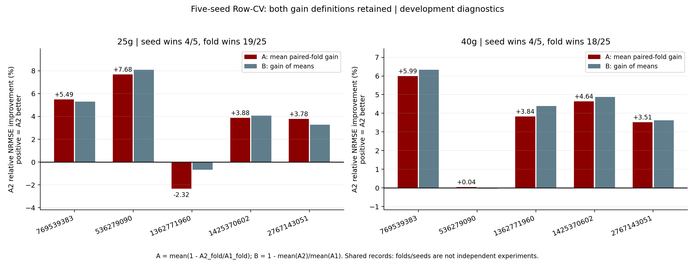
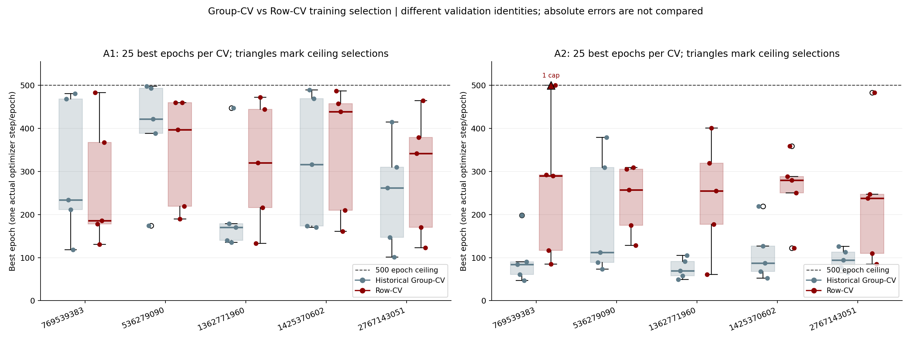
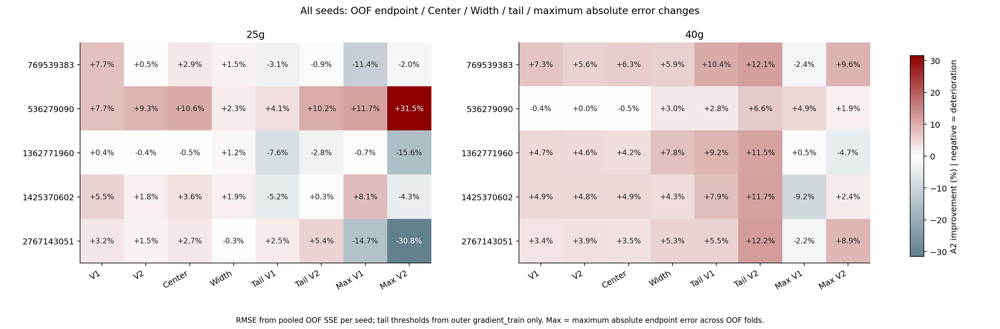

# A1/A2 Row-aligned Phase 2：完整五 seed 内部验证

日期：2026-10-13（Asia/Shanghai）。**已完成50次拟合：复用Phase1的10次，新增四个seed的40次。** 本研究为开发性方法诊断；Phase1及历史Row外层结果已被观察，不是独立外部确认。没有读取外层validation/test端点，没有FULL refit、新外层评分、优化器干预或超参数搜索。原Phase1报告和来源记录见 [phase1_archive/REPORT.md](phase1_archive/REPORT.md)。

## 五 seed 主要结论

25g: mean paired-fold gain +3.701%，gain of means +3.983%，seed wins 4/5，fold wins 19/25；40g: mean paired-fold gain +3.605%，gain of means +3.795%，seed wins 4/5，fold wins 18/25。

两个柱的平均收益在多数 seed 重复出现，支持 Row-CV 下的内部稳定性信号；稳定性仍须结合每柱端点、tail 和最大误差负结果理解。

候选与稳定性的判断为描述性研究建议，依据已披露的两柱均值、seed/fold wins及误差剖面；不是新增预注册通过gate，也不用于调整训练规则或选择已曝光外层测试上的最佳模型。

每折同一个验证集合用于扫描并选择epoch，再报告该最优checkpoint的验证指标，因此数值包含模型选择的乐观性；这些是内部选择诊断，不是独立泛化误差估计。

A = mean(1−A2_fold/A1_fold)，B = 1−mean(A2)/mean(A1)。下表SD为25折描述性标准差(ddof=1)，另列五个seed均值的描述性SD。fold和seed共享大量数据，不是独立实验；没有独立样本显著性检验或“统计显著”的宣称。

| column | arm | mean_nrmse | fold_sd_nrmse | seed_mean_sd_nrmse | mean_paired_fold_gain_percent | gain_of_means_percent | seed_wins | fold_wins |
| --- | --- | --- | --- | --- | --- | --- | --- | --- |
| 25g | A1 | 0.5424 | 0.0901 | 0.0239 | 3.7014 | 3.9828 | 4 | 19 |
| 25g | A2 | 0.5208 | 0.0919 | 0.0317 | 3.7014 | 3.9828 | 4 | 19 |
| 40g | A1 | 0.4907 | 0.0756 | 0.0223 | 3.6047 | 3.7945 | 4 | 18 |
| 40g | A2 | 0.4720 | 0.0710 | 0.0292 | 3.6047 | 3.7945 | 4 | 18 |

每个seed的真实结果如下，两个gain定义分别列出；seed win按A2五折均值低于A1判定。

| column | outer_seed | A1_mean_nrmse | A2_mean_nrmse | mean_paired_fold_gain_percent | gain_of_means_percent | fold_wins | seed_win |
| --- | --- | --- | --- | --- | --- | --- | --- |
| 25g | 536279090 | 0.5384 | 0.4949 | 7.6793 | 8.0781 | 4 | True |
| 40g | 536279090 | 0.5055 | 0.5057 | 0.0438 | -0.0316 | 3 | False |
| 25g | 769539383 | 0.5696 | 0.5395 | 5.4859 | 5.2970 | 3 | True |
| 40g | 769539383 | 0.4838 | 0.4532 | 5.9900 | 6.3251 | 4 | True |
| 25g | 1362771960 | 0.5611 | 0.5649 | -2.3182 | -0.6806 | 4 | False |
| 40g | 1362771960 | 0.5028 | 0.4807 | 3.8373 | 4.3941 | 3 | True |
| 25g | 1425370602 | 0.5092 | 0.4885 | 3.8824 | 4.0623 | 5 | True |
| 40g | 1425370602 | 0.4544 | 0.4322 | 4.6379 | 4.8809 | 4 | True |
| 25g | 2767143051 | 0.5337 | 0.5162 | 3.7775 | 3.2755 | 3 | True |
| 40g | 2767143051 | 0.5068 | 0.4885 | 3.5147 | 3.6265 | 4 | True |

## V1/V2、Center/Width 与 tail

下表是25折指标算术均值，RMSE/MAE单位mL；离散程度和每seed数值见 INNER_SUMMARY.csv、SEED_RESULTS.csv。各seed的OOF pooled RMSE先按SSE/记录数汇总，再跨seed平均；不把重复seed中的记录计为额外独立样本。

| column | arm | mean_V1_rmse | mean_V2_rmse | mean_V1_mae | mean_V2_mae | mean_Center_rmse | mean_Width_rmse |
| --- | --- | --- | --- | --- | --- | --- | --- |
| 25g | A1 | 6.0592 | 8.4946 | 3.5607 | 5.4808 | 6.5593 | 6.6827 |
| 25g | A2 | 5.7638 | 8.2783 | 3.5202 | 5.3692 | 6.2953 | 6.5869 |
| 40g | A1 | 13.7748 | 17.3526 | 8.3051 | 10.7715 | 14.8030 | 10.2073 |
| 40g | A2 | 13.2398 | 16.7128 | 8.0481 | 10.8180 | 14.2787 | 9.7297 |

五seed pooled RMSE均值的相对收益（正值为A2改善）：

| column | V1_pooled_RMSE_gain_percent | V2_pooled_RMSE_gain_percent | Center_pooled_RMSE_gain_percent | Width_pooled_RMSE_gain_percent |
| --- | --- | --- | --- | --- |
| 25g | 4.8186 | 2.5106 | 3.8115 | 1.3108 |
| 40g | 3.9113 | 3.7401 | 3.6334 | 5.2510 |

25g的pooled改善主要来自V1/Center，Width收益较小；40g的Width收益高于Center。需要保留一个输出代价：40g V2的25折平均MAE由10.7715增至10.8180 mL（恶化约0.43%），虽然其RMSE改善。平均RMSE降低不能替代所有输出误差均改善的判断。
每seed尾部均使用该seed outer gradient_train端点80%分位。先合并五折tail SSE/count后开根号，再比较方法；尾部不选择checkpoint。

| column | endpoint | A1_mean_seed_tail_rmse | A2_mean_seed_tail_rmse | gain_of_seed_tail_means_percent | A2_deteriorating_seeds |
| --- | --- | --- | --- | --- | --- |
| 25g | V1 | 7.9831 | 8.1412 | -1.9794 | 3 |
| 25g | V2 | 13.0715 | 12.7486 | 2.4698 | 2 |
| 40g | V1 | 26.6461 | 24.7532 | 7.1038 | 0 |
| 40g | V2 | 32.2335 | 28.7540 | 10.7947 | 0 |

全部seed尾部结果，包含Phase1已观察到的25g V1 tail约3.05%退化，不删除、不改阈值。

| column | outer_seed | endpoint | A1_tail_rmse | A2_tail_rmse | tail_gain_percent | tail_count |
| --- | --- | --- | --- | --- | --- | --- |
| 25g | 536279090 | V1 | 8.6473 | 8.2903 | 4.1290 | 66 |
| 25g | 536279090 | V2 | 13.4123 | 12.0425 | 10.2130 | 66 |
| 40g | 536279090 | V1 | 27.7351 | 26.9500 | 2.8308 | 70 |
| 40g | 536279090 | V2 | 32.3915 | 30.2492 | 6.6138 | 70 |
| 25g | 769539383 | V1 | 7.3832 | 7.6087 | -3.0537 | 64 |
| 25g | 769539383 | V2 | 12.9019 | 13.0193 | -0.9105 | 64 |
| 40g | 769539383 | V1 | 27.2758 | 24.4509 | 10.3570 | 73 |
| 40g | 769539383 | V2 | 33.0293 | 29.0445 | 12.0646 | 73 |
| 25g | 1362771960 | V1 | 9.0737 | 9.7630 | -7.5961 | 63 |
| 25g | 1362771960 | V2 | 13.6085 | 13.9854 | -2.7693 | 63 |
| 40g | 1362771960 | V1 | 25.5890 | 23.2374 | 9.1898 | 73 |
| 40g | 1362771960 | V2 | 34.7176 | 30.7324 | 11.4789 | 73 |
| 25g | 1425370602 | V1 | 7.8279 | 8.2319 | -5.1604 | 66 |
| 25g | 1425370602 | V2 | 12.4776 | 12.4343 | 0.3470 | 66 |
| 40g | 1425370602 | V1 | 25.3595 | 23.3471 | 7.9354 | 71 |
| 40g | 1425370602 | V2 | 27.8562 | 24.6058 | 11.6684 | 71 |
| 25g | 2767143051 | V1 | 6.9835 | 6.8120 | 2.4562 | 64 |
| 25g | 2767143051 | V2 | 12.9570 | 12.2616 | 5.3671 | 64 |
| 40g | 2767143051 | V1 | 27.2711 | 25.7807 | 5.4653 | 72 |
| 40g | 2767143051 | V2 | 33.1729 | 29.1381 | 12.1630 | 72 |

共有 5/20 个“seed×柱×endpoint”tail比较出现A2退化。历史2%保护线仅是描述性参照，本研究没有事后引入正式通过gate。最大绝对误差保存在SEED_RESULTS.csv；平均NRMSE改善而最大误差增大的组合见MAX_ERROR_TRADEOFFS.csv，计 15/40 个“seed×柱×V1/V2/Center/Width”组合。新增最大误差诊断不参与选择模型或epoch。

以下列出这些均值改善但最大误差退化的具体组合，负gain表示最大绝对误差增大：

| column | outer_seed | endpoint | max_error_gain_percent |
| --- | --- | --- | --- |
| 25g | 536279090 | Width | -2.4032 |
| 25g | 769539383 | V1 | -11.4483 |
| 25g | 769539383 | V2 | -2.0235 |
| 25g | 769539383 | Center | -19.4869 |
| 40g | 769539383 | V1 | -2.3801 |
| 40g | 1362771960 | V2 | -4.6572 |
| 40g | 1362771960 | Center | -1.4638 |
| 25g | 1425370602 | V2 | -4.2898 |
| 40g | 1425370602 | V1 | -9.1666 |
| 25g | 2767143051 | V1 | -14.7251 |
| 25g | 2767143051 | V2 | -30.7875 |
| 25g | 2767143051 | Center | -24.5660 |
| 25g | 2767143051 | Width | -3.2695 |
| 40g | 2767143051 | V1 | -2.2468 |
| 40g | 2767143051 | Center | -2.3172 |

## 训练选择机制与收敛边界

| outer_seed | A1_group_median | A1_row_median | A2_group_median | A2_row_median | A2_median_increase | group_A2_minus_A1 | row_A2_minus_A1 | A2_row_cap_folds |
| --- | --- | --- | --- | --- | --- | --- | --- | --- |
| 769539383 | 234 | 186 | 84 | 290 | 206 | -150 | 104 | 1 |
| 536279090 | 422 | 397 | 112 | 257 | 145 | -310 | -140 | 0 |
| 1362771960 | 170 | 320 | 69 | 255 | 186 | -101 | -65 | 0 |
| 1425370602 | 316 | 439 | 87 | 280 | 193 | -229 | -159 | 0 |
| 2767143051 | 262 | 342 | 94 | 238 | 144 | -168 | -104 | 0 |

A2的中位数在 5/5 个seed高于历史Group-CV；Row-CV中A2中位数大于A1的seed数为 1/5。完整五折best epoch和中位数如下。Group-CV及Row-CV的验证身份不同，fold编号不能跨协议当作身份配对，不比较其绝对NRMSE来判断协议优劣。

| cv | outer_seed | arm | five_best_epochs | median_epoch | best_at_cap | training_hit_cap |
| --- | --- | --- | --- | --- | --- | --- |
| Group-CV | 536279090 | A1 | 498, 174, 493, 422, 388 | 422 | 0 | 3 |
| Group-CV | 536279090 | A2 | 89, 112, 73, 309, 379 | 112 | 0 | 0 |
| Group-CV | 769539383 | A1 | 468, 234, 211, 118, 481 | 234 | 0 | 2 |
| Group-CV | 769539383 | A2 | 84, 61, 198, 47, 90 | 84 | 0 | 0 |
| Group-CV | 1362771960 | A1 | 140, 179, 135, 447, 170 | 170 | 0 | 1 |
| Group-CV | 1362771960 | A2 | 49, 69, 58, 91, 105 | 69 | 0 | 0 |
| Group-CV | 1425370602 | A1 | 173, 489, 316, 469, 170 | 316 | 0 | 2 |
| Group-CV | 1425370602 | A2 | 219, 68, 127, 87, 52 | 87 | 0 | 0 |
| Group-CV | 2767143051 | A1 | 262, 147, 415, 101, 310 | 262 | 0 | 0 |
| Group-CV | 2767143051 | A2 | 126, 78, 94, 113, 65 | 94 | 0 | 0 |
| Row-CV | 536279090 | A1 | 460, 397, 190, 460, 219 | 397 | 0 | 2 |
| Row-CV | 536279090 | A2 | 305, 257, 175, 309, 128 | 257 | 0 | 0 |
| Row-CV | 769539383 | A1 | 483, 178, 131, 186, 367 | 186 | 0 | 1 |
| Row-CV | 769539383 | A2 | 292, 117, 85, 290, 500 | 290 | 1 | 1 |
| Row-CV | 1362771960 | A1 | 133, 320, 472, 216, 444 | 320 | 0 | 2 |
| Row-CV | 1362771960 | A2 | 61, 319, 401, 177, 255 | 255 | 0 | 0 |
| Row-CV | 1425370602 | A1 | 487, 457, 439, 161, 210 | 439 | 0 | 3 |
| Row-CV | 1425370602 | A2 | 288, 359, 280, 122, 250 | 280 | 0 | 0 |
| Row-CV | 2767143051 | A1 | 342, 379, 170, 464, 123 | 342 | 0 | 1 |
| Row-CV | 2767143051 | A2 | 238, 247, 110, 483, 85 | 238 | 0 | 1 |

Row-CV共 1/50 次拟合的best epoch选在500上限，其中A1 0/25、A2 1/25。此为收敛边界/右截断，不能声称这些折已充分收敛；没有自行延长上限。实际optimizer steps完整记录在FIT_AUDIT.csv与TRAINING_HISTORY.csv，所有context为 1 step/epoch。4g每epoch只抽相同配对数量，并非遍历3330条源数据。

另有 11/50 次训练实际运行到500（A1 9/25、A2 2/25）。即使best点位于500之前，部分晚期最优的曲线也受最大训练预算约束；“训练到上限”与“最佳点在上限”分别记录，不能混为同一计数。

以下只比较各CV内部的A2/A1相对收益与训练选择；原Group-CV冻结结果没有重新生成。

| cv | column | mean_paired_fold_gain_percent | gain_of_means_percent | seed_wins | fold_wins |
| --- | --- | --- | --- | --- | --- |
| Group-CV | 25g | 5.0998 | 4.7255 | 4 | 19 |
| Group-CV | 40g | 6.5112 | 7.3362 | 5 | 21 |
| Row-CV | 25g | 3.7014 | 3.9828 | 4 | 19 |
| Row-CV | 40g | 3.6047 | 3.7945 | 4 | 18 |

新Row-CV的五seed总体配对相对收益并未高于历史Group-CV；观察到的是验证任务和训练选择时长改变，而非已经证明某协议更优或已经修复旧外层失败。A2虽在五seed均比Group-CV选得更晚，在新Row-CV中仍有4/5 seed的中位数小于A1。
## 图表与完整曲线

- [seed 769539383 全部五折学习曲线](learning_curves/row_cv_seed_769539383.png)
- [seed 536279090 全部五折学习曲线](learning_curves/row_cv_seed_536279090.png)
- [seed 1362771960 全部五折学习曲线](learning_curves/row_cv_seed_1362771960.png)
- [seed 1425370602 全部五折学习曲线](learning_curves/row_cv_seed_1425370602.png)
- [seed 2767143051 全部五折学习曲线](learning_curves/row_cv_seed_2767143051.png)

TRAINING_HISTORY.csv保留每折每个实际epoch。train raw loss使用混合任务训练BN和配对抽样，validation loss使用eval BN固定验证集，不能视为完全同分布的损失估计；非有限预测、梯度和目标验证loss检查全部通过。晚期验证波动/回升与达到500上限均如实保留，不通过额外调参解释或消除。

## 实现、数据边界与下一步

Phase1原runtime 110 个文件和 43 个归档根文件逐字节不变；历史研究 1069 个文件SHA256全部不变。每seed十次拟合均通过五折身份覆盖、A1/A2初始化/训练/验证身份/尺度/batch draw配对、最早joint argmin、真实step计数、冻结参数和BN状态检查。100个目标上下文、6788条保存预测的零标签重放最大绝对差为 2.84e-14 mL。

Phase2仅解析源3330条source_train标签；源validation只用零标签输入检查有限性，不报告其误差或loss。此诊断权限收紧由用户明确要求，原优化代码仅跳过源验证标签诊断；三步合成测试中A1/A2权重、目标历史和best epoch逐位一致。Phase1已有源验证指标保留为历史数据，并明确其只属于Phase1。目标outer validation/test不构建训练/验证图，其真实端点未解析；feature读取全部使用显式白名单，排除t1/t2与verified times。INPUT_OVERLAP_AUDIT.csv/INPUT_DUPLICATE_COUNTS.csv披露不同ID相同可见输入和跨折重合；相同输入不是sample_id泄漏。物理独立批次/重复测量元数据仍未知，结论仅支持记录级Row插值。

A2 可保留为后续开发性配对 refit 的候选，同时保留 A1 对照；当前不能将 A2 认定为唯一最终模型。建议在用户另行确认后，按已冻结每 seed/方法 epoch 中位数做 A1/A2 FULL-data refit，先保存并冻结全部盲预测，再另行进行一次 DEVELOPMENTAL CONFIRMATION 评分。tail/最大误差及 500 cap 问题须保留，不能通过改 epoch 上限、网络或 selector 消除负结果。

不论是否后续refit，已反复曝光的Row外层测试不能提供独立确认；可靠泛化证据仍需未曝光独立数据。**Phase2在此停止，等待下一步确认。**

本阶段没有外层新评分，因此不能推断原40g Row外层退化已经修复；更长的内层epoch或较低的内部误差本身不构成这一结论。
