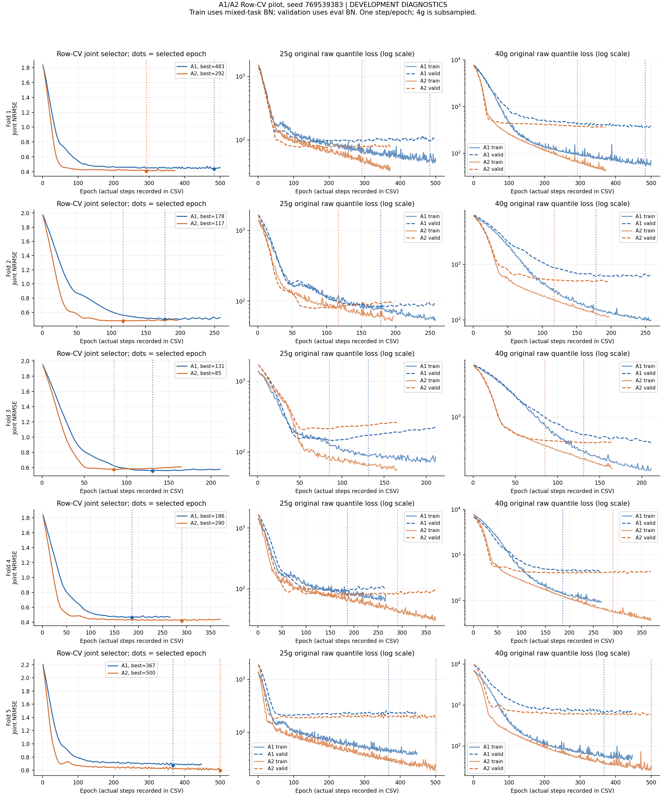
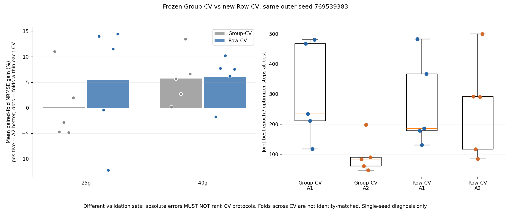

# Phase 1：A1/A2 Row-aligned 试点报告

日期：2026-10-13（Asia/Shanghai）。实际完成 seed 769539383 × 5 folds × 2 arms = **10 次模型拟合**。仅目标 gradient_train 标签用于内层训练/验证；另外四个 seed、FULL-data refit 和外层评分均未执行。完整设计见 [PROTOCOL.md](PROTOCOL.md)，实现检查见 [IMPLEMENTATION_AUDIT.md](IMPLEMENTATION_AUDIT.md)。

## 真实结果与解释

25g：mean paired-fold gain=+5.486%，A2 wins=3/5；历史 Group-CV 同 seed gain=+0.140%。 40g：mean paired-fold gain=+5.990%，A2 wins=4/5；历史 Group-CV 同 seed gain=+5.742%。 Joint mean paired-fold gain=+5.655%，joint fold wins=4/5。

以下误差为五折算术均值，RMSE/MAE 单位 mL；配对 gain 与均值比值为不同统计量，不互换。seed win 分母为 **1 个已执行 seed**，不是 5 个。未经独立重复信息支持，不对重叠 CV 折做显著性检验。

| column | arm | mean_combined_normalized_rmse | mean_V1_rmse | mean_V2_rmse | mean_V1_mae | mean_V2_mae | mean_Center_rmse | mean_Width_rmse |
| --- | --- | --- | --- | --- | --- | --- | --- | --- |
| 25g | A1 | 0.569643 | 6.135416 | 9.267033 | 3.484348 | 5.845965 | 6.961207 | 7.230526 |
| 25g | A2 | 0.539469 | 5.587032 | 9.154063 | 3.389597 | 5.655474 | 6.689051 | 7.071795 |
| 40g | A1 | 0.483778 | 13.734528 | 17.620566 | 8.472440 | 10.904557 | 14.915827 | 10.416885 |
| 40g | A2 | 0.453178 | 12.772520 | 16.675869 | 7.838824 | 10.721519 | 14.017123 | 9.848443 |

配对每折及两柱分别见 [PAIRED_COMPARISONS.csv](PAIRED_COMPARISONS.csv)。OOF pooled 端点与 Center/Width RMSE 按验证条数加权 SSE 汇总，不是折 RMSE 的简单平均；下表是这些 pooled RMSE 的 A2 相对 A1 收益（实际 RMSE 保存在 INNER_SUMMARY.csv）：

| column | V1_rmse_gain_percent | V2_rmse_gain_percent | Center_rmse_gain_percent | Width_rmse_gain_percent |
| --- | --- | --- | --- | --- |
| 25g | 7.694595 | 0.476630 | 2.898898 | 1.481202 |
| 40g | 7.254092 | 5.597051 | 6.265595 | 5.881023 |

## Epoch 选择与 Group-CV 历史诊断

| cv | arm | five_best_epochs | median | maximum_epoch_hits |
| --- | --- | --- | --- | --- |
| Group-CV | A1 | 468, 234, 211, 118, 481 | 234 | 0 |
| Group-CV | A2 | 84, 61, 198, 47, 90 | 84 | 0 |
| Row-CV | A1 | 483, 178, 131, 186, 367 | 186 | 0 |
| Row-CV | A2 | 292, 117, 85, 290, 500 | 290 | 1 |

Row-CV 后 A1 median 186（历史 234），A2 median 290（历史 84）。它们只是待将来确认后 FULL refit 的固定 epoch，保存于 EPOCH_SELECTION.csv；没有用 inner checkpoint 代替 FULL refit。每折 best epoch 是同一个 joint selector 的结果，不能分别为 25g/40g 挑最优。

A2 的中位数不再远小于 A1，反而更大（290 vs 186）。这与“Group-CV 下 A2 较早选择”受划分影响的假设一致，但不同验证集合、折间变动和一个 outer seed 不足以证明系统性偏好，更不能由内部改善推断原 Row 40g 外层退化已经修复。

当前所有拟合实际 **1 optimizer step/epoch**。best checkpoint 对应 best_epoch×steps_per_epoch；实际 total steps 包含等待 patience 的训练，见 INNER_RESULTS.csv 和 TRAINING_HISTORY.csv。4g 每轮只有配对抽样，并未遍历源 3330 条。

**Group-CV 与 Row-CV 使用不同验证集合；表中绝对误差不得用于判定哪种 CV 更优，跨协议 fold 号不是配对身份。** 原 Group-CV 仅是历史参照；本报告没有运行新的 Group-CV。即使相对收益/epoch 变化，也不能由一个 seed 证明 Group-CV 对 A2 有系统性偏好。

## 高保留体积和收敛

tail 使用原 outer gradient_train 各端点 80%分位；五折 OOF SSE/count 汇总，阈值只诊断、不选择。空 tail 折没有记为零误差。

| column | endpoint | A1 | A2 | A2_gain_percent |
| --- | --- | --- | --- | --- |
| 25g | V1 | 7.383202 | 7.608666 | -3.053735 |
| 25g | V2 | 12.901873 | 13.019341 | -0.910470 |
| 40g | V1 | 27.275817 | 24.450854 | 10.357024 |
| 40g | V2 | 33.029324 | 29.044463 | 12.064617 |

center low/mid/high 区间 pooled OOF 收益如下；阈值与数量见 RETENTION_REGIMES.csv、POOLED_RETENTION_REGIMES.csv。

| column | regime | n | V1_gain_percent | V2_gain_percent |
| --- | --- | --- | --- | --- |
| 25g | high | 107 | 13.488945 | 3.608103 |
| 25g | low | 107 | -10.185411 | -15.530749 |
| 25g | mid | 106 | 10.264814 | 7.728181 |
| 40g | high | 122 | 7.587343 | 9.225505 |
| 40g | low | 121 | -1.765405 | -34.856487 |
| 40g | mid | 121 | 9.806747 | 3.031088 |

每轮 train/validation raw loss 与两柱 NRMSE/Center/Width 全部保存在 TRAINING_HISTORY.csv；LOSS_DIAGNOSTICS.csv 给出首末值。train loss 来自训练模式混合 BN 和配对抽样，validation loss 来自 eval BN 固定验证集，二者不能当作完全相同测量。best epoch 远小于 500 只能描述为验证最优出现较早，不能未经证据称为实现过早停止；末期无改善按原 patience=80 停止。A1 有 1/5、A2 有 1/5 次训练达到 500 cap，因而部分曲线仍受上限约束，不能称已充分收敛；本轮不延长训练。

学习曲线显示部分折训练损失持续下降、验证损失回升（尤其 fold 3 的 25g），与有限数据下的过拟合模式相符，没有非有限损失或状态异常证据。A2 fold 5 的最佳点恰在 500 上限，其最优训练时长仍受截断。25g 改善主要来自 V1，V2 pooled 改善仅 0.48%；40g Center/Width 均有收益，endpoint tails 有明显改善。center low 区间两柱 V2 却退化，表明整体平均改善不能代表所有保留体积区间均受益。

## 实现审计与继续建议

14 项协议测试通过；合成标签的一步训练与原入口 checkpoint/原有 history 字段逐位一致（A1、A2 分别验证）。十次真实拟合全部通过身份、配对抽样、共同初始状态、有限预测/梯度、冻结参数、BN 状态/计数、joint argmin 和真实 optimizer steps 检查。1069 个历史文件前后 SHA256 全部不变。没有发现新的训练实现问题。

另外以只读取 feature 白名单、零占位标签的独立入口重放十个 best checkpoint 的 20 个目标上下文，共 1368 条 OOF 记录，最大绝对预测差=2.84e-14 mL；没有解析任何新增真实标签。

独立物理实验/重复测量的批次身份缺乏明确元数据；Row 估计仅支持记录级插值。不同 ID 的相同图输入与跨柱骨干输入重合不等于 sample_id 泄漏，详细数量见 INPUT_DUPLICATE_COUNTS.csv、INPUT_OVERLAP_AUDIT.csv、CROSS_COLUMN_INPUT_AUDIT.csv。跨柱模型还接收不同 task ID，因此骨干输入重合不等于完整模型输入相同。目标 OOF 与同柱 inner train 的相同完整输入/分子重合数量如下（每个目标 ID 验证一次；4g 诊断验证每折重复，不能按独立 OOF 汇总）：

| column | heldout_rows | full_model_input_overlap_rows | canonical_overlap_rows |
| --- | --- | --- | --- |
| 25g | 320 | 2 | 304 |
| 40g | 364 | 6 | 362 |

建议确认后继续另外四个 seed，以检验两个柱上的单 seed 改善能否稳定重复。本试点 25g V1 tail RMSE 增大约 3.05%，超过历史研究 2% 的描述性保护线；这不是本单 seed 的正式 gate，但说明不能声称全误差剖面已改善，也不支持立即 FULL refit 或外层重评。继续的价值在于检验重复性和模型选择机制，须保留负结果，不能更改训练上限、selector 或模型追求通过。 单 seed 仅验证协议和机制，**不能据此判定 FiLM 成功或失败**。后续若确认 Phase 2，则保持当前协议完成剩余 40 次拟合，再讨论是否值得 Phase 3。最终外层测试已多次曝光，仅能标记 DEVELOPMENTAL CONFIRMATION；可靠泛化确认仍需未曝光数据。

本轮在 Phase 1 停止，不运行 PCGrad、其他优化器、额外候选、FULL refit 或 outer score。
